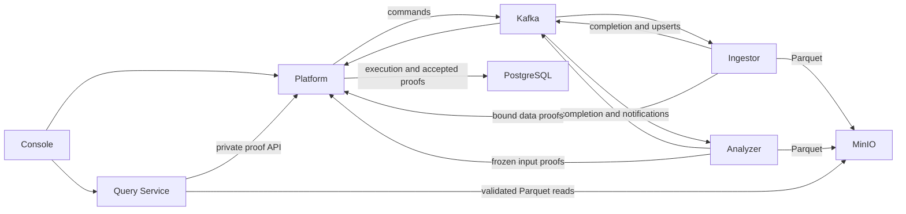

# Omni

Omni is a financial intelligence and Vietnamese stock-market analytics platform.
This Nx monorepo combines a Java/Spring Boot control plane, Python ingestion and
analytics workers, a private Query Service and a React Console. PostgreSQL owns
operational state and accepted output proofs; MinIO stores Parquet data and
Kafka carries commands, completion and projection events.

<a id="documentation"></a>

## Start here

- [Console guide](apps/omni-console/README.md): UI setup, goal discovery, backfill
  creation, Postman examples and request inspection.
- [Documentation index](docs/README.md): architecture, flows, data and operations.
- [Where to change](docs/development/001-where-to-change.md): code ownership.
- [Roadmap](docs/plans/roadmap/README.md) and
  [increment registry](docs/plans/roadmap/implementation-increments.md): approved
  scope, status and dependencies.
- [Release notes](ReleaseNotes.md): dated source and verification checkpoints.

<a id="services"></a>

## Services and libraries

| Nx project      | Guide                                              | Responsibility                                                                  | Local development port |
| --------------- | -------------------------------------------------- | ------------------------------------------------------------------------------- | ---------------------- |
| `platform`      | [apps/core](apps/core/README.md)                   | APIs, scheduler, graph admission, execution/outbox, PostgreSQL proofs and READY | 8080                   |
| `ingestor`      | [apps/ingestor](apps/ingestor/README.md)           | Provider ingestion, Symbols/EOD Parquet and metadata projection events          | 8001                   |
| `analyzer`      | [apps/analyzer](apps/analyzer/README.md)           | Indicators, signals, evaluation and Sector Wave calculations                    | 8000                   |
| `query-service` | [apps/query-service](apps/query-service/README.md) | Private read-only DuckDB queries, datasets and dashboards                       | 8002                   |
| `omni-console`  | [apps/omni-console](apps/omni-console/README.md)   | Operator UI, bounded goal requests and analytics views                          | 5173                   |
| `py-common`     | [libs/py-common](libs/py-common/README.md)         | Shared Python settings, Kafka, runtime, proof readers and storage helpers       | Library                |
| `contracts`     | [libs/contracts](libs/contracts/README.md)         | Canonical protobuf schemas, fixtures and generated adapters                     | Library                |

Ports above are assigned by the root `omni:dev` target; configuration may override
them. The directory `apps/core` is Nx project `platform`.

<a id="architecture-at-a-glance"></a>

## Architecture



Workers use Platform's private proof API rather than writing its database.
Kafka business messages identify logical datasets; configured storage builders
resolve physical paths. See [architecture](docs/architecture/001-system-overview.md),
[Kafka contracts](docs/data/001-kafka-contracts.md) and
[data-lake ownership](docs/data/002-data-lake.md).

<a id="quick-start"></a>

## Local development

Prerequisites: Node.js/npm, Java 21, Docker Compose, uv and the Python version in
[.python-version](.python-version). Configure provider access and private service
credentials through local environment files, using the checked-in examples.

For a new checkout:

```bash
git clone --recurse-submodules <repository-url>
cd omni
npm ci
```

Create `.env` from [`.env.example`](.env.example) for a fresh checkout; preserve
existing local values. Follow the service guides for service-specific environment
files and readiness API configuration before starting the services.

Synchronize Python projects through Nx:

```bash
npx nx run py-common:sync
npx nx run ingestor:sync
npx nx run analyzer:sync
npx nx run query-service:sync
```

Start infrastructure, then the five host development applications:

```bash
docker compose -f docker-compose.infra.yaml up -d
npx nx run omni:dev
```

`omni:dev` starts Platform, Analyzer, Ingestor, Query Service and Console. Platform
uses its development profile and continuous compilation; Python services use the
HMR targets. Console uses Vite. Open `http://localhost:5173`. Current views are Market Dashboard, Jobs, Work
Operations, Dataset Explorer and SQL Console. Manual EOD Data Health scanning
remains planned under P13-I3; there is no current scan tab/API in this checkout.

For an individual service, use its declared target from the workspace root:

```bash
npx nx run platform:serve --configuration=dev
npx nx run analyzer:serve -- --port 8000
npx nx run ingestor:serve -- --port 8001
npx nx run query-service:serve -- --port 8002
npx nx run omni-console:serve -- --port 5173
```

Choose either host processes or the corresponding Docker services for the same
ports. The current Docker application composition contains Platform, Analyzer
and Ingestor; it does not include Query Service or Console:

```bash
npx nx run omni:docker-dev
```

`omni:init` synchronizes submodules and starts the default Compose stack; it is
not an infrastructure-only prerequisite for `omni:dev`. Query Service's durable
SQLite queue requires a persistent volume when deployed; see its service guide.

## Goals and backfills

Open **Work Operations > New backfill** in Console. Platform exposes:

- `GET /api/v1/jobs/backfills/goals`: eligible active canonical targets.
- `GET /api/v1/jobs/backfills/sectors?sectorLevel=2`: available sector codes/names
  from active symbol membership; read-only, level 2 by default.
- `POST /api/v1/jobs/backfills`: bounded goal request creation.
- `GET /api/v1/jobs/atomic-work/requests`: request discovery and polling.
- `GET /api/v1/jobs/atomic-work/requests/{requestId}`: member and attempt detail.

Supported goals are `SYNC_SYMBOLS`, `SYNC_INDICATORS` and `SYNC_SIGNALS`.
Symbols accepts one configured exchange (HOSE/HNX/UPCOM) for today's Vietnam
snapshot; Indicators/Signals use bounded sector/date scope and optional symbol
narrowing. Console defaults sector level to **2 (Recommended)** and uses a
sector-code dropdown with multi-select checkboxes. Changing level clears the
selection. Discovery does not guarantee admission flags or worker readiness.
Select `targetDefinitionId` when a goal has multiple eligible definitions.
Requests use the existing trusted `X-Omni-User` boundary and an `Idempotency-Key`.

The only new-request data policy is `PREFER_EXISTING` (default) or `REFRESH`.
It governs EOD stored-row reuse versus provider fetch. Symbols always fetches
its current snapshot. New HTTP requests reject retired `rerun`/`force` fields;
previously emitted worker commands retain read compatibility.

Compatible in-flight work shares automatically across requests. A stronger EOD
policy may upgrade pending work only before claim/publication and frozen inputs
or storage bases. Otherwise new compatible attempts preserve existing lineage.
Terminal attempts are not reused. Replaying the same key returns the accepted
request; a new key creates a separate request that may still share live work.
Acceptance is not execution completion or output READY.

The graph admits at most 20,000 unique work nodes per request and 5,000 work items
per individual producer expansion, with additional edge/depth/candidate bounds.
These are graph-size bounds, not worker concurrency settings; over-bound requests
are rejected rather than automatically split.

Use the [Console/Postman walkthrough](apps/omni-console/README.md#create-a-goal-request-in-console---november-19)
and [goal API](docs/reference/009-indicators-backfill.md). Generic operator trigger
routes remain retired under [TD-017](docs/technical-debt/017-manual-request-rejection-audit.md).

## Data authority and current I10 scope

Active runtime readers use PostgreSQL-only readiness. Missing proof, API access,
exact-date coverage or validated bytes must wait/fail without legacy JSON fallback.
The retired `_metadata/metadata.json` document is not current discovery or READY
authority. Frozen work/attempt/version lineage, registration/completion validation
and READY-last remain required; whole-file existence does not prove work coverage.
See [the current cutover contract](docs/reference/020-i10-postgres-only-cutover.md)
and [ADR-008](docs/adr/008-postgres-output-readiness.md).

Symbol sync collects all provider pages, upserts full row attributes into Parquet,
reads back the persisted result, then sends consumer batches. Missing provider
symbols do not automatically deactivate Platform rows. Intraday currently has no
supported PostgreSQL registration contract; do not infer availability from old
JSON metadata. See the Ingestor/Analyzer guides for the exact boundaries.

P14-I10 is **completed** for the approved PostgreSQL-only session scope, with
parent PASS 28/28 and explicit owner review. See
[the completion evidence and limits](docs/reference/019-i10-review-20261111.md#november-24-owner-verified-completion).
This is not CI or deployment evidence. Continuous fleet rollout/recovery qualification
and 12-hour reconciliation activation are deferred for session-based use under
[TD-020](docs/technical-debt/020-session-runtime-operations.md). Affected-scope
proof/byte validation, physical pinning/write safety and bounded recovery remain.
The watchdog observation deferral is separate under
[TD-018](docs/technical-debt/018-execution-watchdog-observation.md).

<a id="common-development-commands"></a>

## Development and verification

Run operations from the workspace root through declared Nx targets. Inspect an
unfamiliar project's `project.json` or `nx show project <project>` first.

```bash
npx nx run platform:test
npx nx run ingestor:test
npx nx run analyzer:test
npx nx run query-service:test
npx nx run py-common:test
npx nx run omni-console:test
npx nx run omni-console:typecheck
npx nx run omni-console:lint
npx nx run omni:format --changed
```

These are command examples, not a claim that this README refresh ran them.
Contract checks require the compiler/toolchain described in the contracts guide;
generated adapters are not edited by hand. Python dependency changes use the
owning project's Nx targets. Follow [AGENTS.md](AGENTS.md) for approval, dirty
worktree preservation, verification evidence and commit/deployment boundaries.

## Local infrastructure

Local infrastructure defaults: PostgreSQL 5432, Kafka 9092, MinIO API 9000 / UI
9001, pgAdmin 5050. Deployment placeholders live in
[.env.deploy.example](.env.deploy.example); operational and dataset ownership
contracts remain in [docs](docs/README.md).
