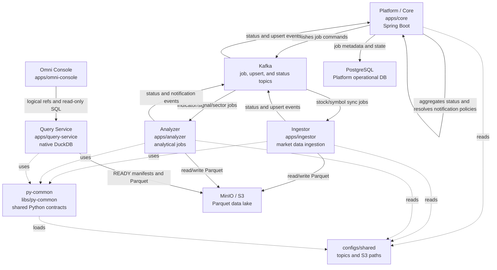
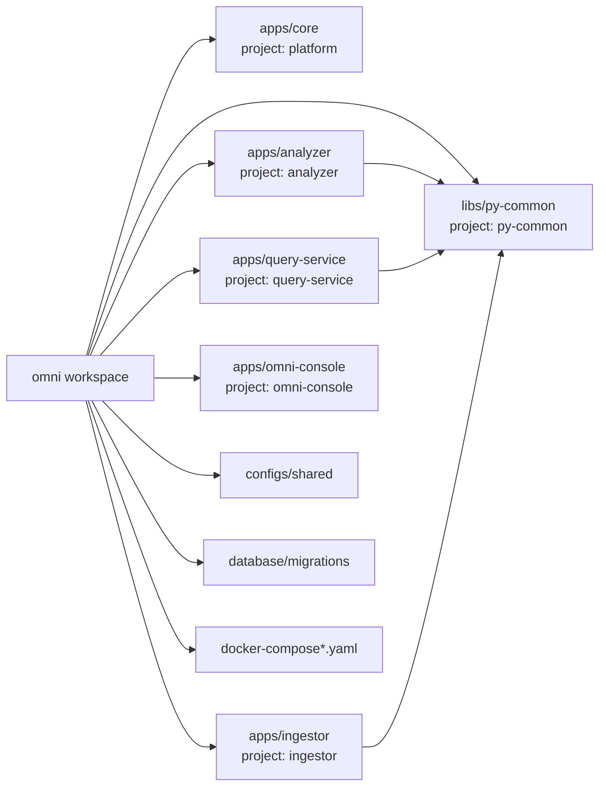

# System Overview

## Cross-service contract ownership

Versioned Kafka and service-to-service Proto3 schemas are owned by the [`contracts`](../../libs/contracts) Nx project. The schemas generate deterministic Java and Python boundary types from one source, while application domain models remain independent. Persisted dataset manifests continue to use JSON and physical object-store paths remain outside business Kafka routing contracts.

The initial contracts project is infrastructure only; production producers and consumers remain on their existing JSON format until rollout-safe compatibility adapters are implemented.

Omni is an Nx monorepo for Vietnamese stock-market data ingestion, analytical precomputation, job orchestration, and operational state tracking.

The system separates orchestration from data processing:

- Platform owns API, scheduler, database-backed job state, static job topology and dispatch planning, dependency evaluation at scheduler-outbox dispatch, and Kafka orchestration.
- Ingestor owns external market-data fetching and raw/normalized Parquet updates.
- Analyzer owns analytical calculations such as indicators, signals, and sector wave datasets.
- Query Service owns bounded read-only native DuckDB execution over READY datasets.
- Omni Console is a thin private UI for metadata, Viewer, SQL, and Dashboard workflows.
- py-common owns shared Python infrastructure for configuration, Kafka, runtime, and storage abstractions.

## High-level Architecture

## Planned JobRun scheduling — canonical 2026-10-15

[Plan 030](../plans/030-static-graph-dispatch-planner.md#canonical-revised-delivery-sequence--2026-10-15) defines I2 static DAG contract/handoff, I3 durable target-driven JobRun and immutable scoped run-step preparation, I4 JobRun-aware outbox admission, I5 measured diagnostics and I6 operations handoff. PostgreSQL is the runtime state authority; no authoritative RAM binding cache is planned. Independent run scopes retain completion barriers, and existing registry/guard separately enforces dataset readiness and exact input versions. No outbox processing-success status, arbitrary execution DAG or planner manifest evaluator is introduced. I2 remains verification_pending; I3–I6 remain pending. Existing inactive backlog-only source is historical scaffolding, not the revised runtime implementation.

## Runtime Responsibilities

| Component       | Path                                                                 | Responsibility                                                                                                                                                                                                                                                                                                                                                  | Boundary                                                                                                                                                                                                                                                            |
| --------------- | -------------------------------------------------------------------- | --------------------------------------------------------------------------------------------------------------------------------------------------------------------------------------------------------------------------------------------------------------------------------------------------------------------------------------------------------------- | ------------------------------------------------------------------------------------------------------------------------------------------------------------------------------------------------------------------------------------------------------------------- |
| Platform / Core | [`apps/core`](../../apps/core)                                       | Owns orchestration, execution/outbox intent, dependency decisions, history, notifications and private API. P14-I1 topology is verified; I2 finalizes its static handoff. I3 plans durable JobRun preparation; I4 owns guarded planner activation; I5/I6 own diagnostics/read-model handoff. Existing inactive backlog scaffolding is not JobRun implementation. | Does not equate execution completion or outbox publication with dataset READY, duplicate manifest policy, or put physical paths in Kafka. Static topology remains configuration; persisted JobRun membership is a frozen instance, not a second topology authority. |
| Ingestor        | [`apps/ingestor`](../../apps/ingestor)                               | Consumes stock/symbol sync jobs, talks to data providers, normalizes records, writes Parquet, publishes status/upsert events.                                                                                                                                                                                                                                   | Does not own scheduler state or Platform database schema.                                                                                                                                                                                                           |
| Analyzer        | [`apps/analyzer`](../../apps/analyzer)                               | Consumes analytical jobs, computes indicators/signals/sector wave datasets, writes analytical Parquet, publishes status/notification events, and preserves failure meta.                                                                                                                                                                                        | Does not own stock-price ingestion or Platform transactional database state.                                                                                                                                                                                        |
| Query Service   | [`apps/query-service`](../../apps/query-service)                     | Resolves READY manifests, normalizes legacy date columns to canonical DuckDB types, and executes bounded read-only native DuckDB queries for Console consumers. Phase 13 plans bounded manual EOD Data Health scan execution here.                                                                                                                              | Does not expose credentials/physical paths, mutate Parquet/READY, or persist Data Health results durably; the planned scan cache is bounded process-local Query Service memory, lost on restart.                                                                    |
| Omni Console    | [`apps/omni-console`](../../apps/omni-console)                       | Private operator UI. Phase 13 plans the fixed order Job Operations, Data Health, then a small Market Review, with Dataset Explorer and Raw SQL as secondary tools.                                                                                                                                                                                              | Does not read object storage directly, execute DuckDB in the browser, infer processing from ambiguous `RUNNING` rows, repair data, or publish directly to Kafka.                                                                                                    |
| py-common       | [`libs/py-common`](../../libs/py-common)                             | Provides shared Python config, messaging/runtime helpers, storage ports, canonical Parquet date/timestamp normalization, manifests, and safe versioned rewrite helpers.                                                                                                                                                                                         | Does not contain service-specific business logic.                                                                                                                                                                                                                   |
| PostgreSQL      | [`database/migrations`](../../database/migrations)                   | Stores Platform-owned operational state such as job definitions, job executions, symbols, and sectors.                                                                                                                                                                                                                                                          | Not the analytical data lake.                                                                                                                                                                                                                                       |
| Kafka           | [`configs/shared/topics.yaml`](../../configs/shared/topics.yaml)     | Carries async job commands, worker status, symbol/sector upserts, signal notifications, and analytical job requests.                                                                                                                                                                                                                                            | Topic and payload contract changes must update producers, consumers, tests, and docs together.                                                                                                                                                                      |
| MinIO / Parquet | [`configs/shared/s3-paths.yaml`](../../configs/shared/s3-paths.yaml) | Stores raw and analytical datasets as Parquet files in the `stock-data` bucket; Phase 13 Data Health reads exact logical EOD versions without mutation.                                                                                                                                                                                                         | Object paths are derived from shared path builders, not from Kafka message fields; scans do not repair data or change READY.                                                                                                                                        |

## Project Map

## Control Plane vs Data Plane

| Plane          | Owns                                                                                                                                                                             | Main components                                                                  |
| -------------- | -------------------------------------------------------------------------------------------------------------------------------------------------------------------------------- | -------------------------------------------------------------------------------- |
| Control plane  | Scheduling, static job topology, bounded dispatch planning, job metadata, manifest-backed dependency eligibility, execution/outbox state, orchestration decisions, API boundary. | Platform, PostgreSQL, Kafka status topics.                                       |
| Data plane     | Fetching external market data, transforming dataframes, reading/writing and bounded querying of Parquet datasets.                                                                | Ingestor, Analyzer, Query Service, MinIO/S3, py-common storage abstractions.     |
| Contract plane | Topic names, payload fields, storage paths, shared runtime settings.                                                                                                             | `configs/shared`, py-common payload/settings models, Platform messaging records. |

## Main Flows

| Flow                 | Document                                                         | Summary                                                                                                                                             |
| -------------------- | ---------------------------------------------------------------- | --------------------------------------------------------------------------------------------------------------------------------------------------- |
| Job execution        | [../flows/job-execution.md](../flows/001-job-execution.md)       | `JobScheduler` resolves producers by `JobType`, producers publish Kafka jobs, workers report status, and Platform policy registries notify.         |
| Stock sync           | [../flows/stock-sync.md](../flows/002-stock-sync.md)             | Platform requests stock/symbol sync, Ingestor fetches provider data, updates Parquet, then reports status/upserts.                                  |
| Indicator and signal | [../flows/indicator-signal.md](../flows/003-indicator-signal.md) | Analyzer reads EOD/indicator datasets, computes indicators/signals/evaluations, writes Parquet, and publishes status or signal notification events. |
| Sector wave          | [../flows/sector-wave.md](../flows/004-sector-wave.md)           | Analyzer precomputes symbol features, sector aggregates, rankings, backtest outputs, and Sector Transition research datasets.                       |

## Static topology declaration

Platform owns one process-local topology API. I3.a pre-cutover source resolves source-controlled definition identities and typed predecessor sets in `StaticDefinitionDependencies`, exposed by `StaticJobTopologyProvider`. JSON `dependsOnJobs` remains compatibility/parity data pending verification and consumer removal; the provider does not read it. `RequiredPathResolver` accepts the same typed declaration without runtime admission or readiness authority. No database graph, JobRun schema, worker transport or dispatch policy is added by this checkpoint. Unused topology adapters have been removed and JSON baseline parsing is test-only. Focused startup and full Platform regression evidence, plus the remaining coverage/build gate, are recorded in Plan 030. See [Plan 030](../plans/030-static-graph-dispatch-planner.md#i3a-pre-cutover-source--2026-10-17).

I3.b source adds a separate persisted **run instance**, not a topology authority:
`job_runs` and immutable scoped steps/predecessors preserve the resolved path
across restarts or later static-declaration changes. The new storage boundary is
used by a default-disabled I3.c preparation route. V13 freezes execution/message
membership after bounded dependency-first preparation. Existing scheduler,
Kafka payloads and FIFO remain active; I4 completion admission is required before
enabling the new route. I3.c did not change cron/manual audit. I3.d now defers operator triggering under TD-017: read-only job APIs remain, old trigger/poll routes return HTTP 410, and V14 removes its legacy audit table. JobRun/dispatch authority is preserved. See
[I3.c preparation](../plans/030-static-graph-dispatch-planner.md#i3c-bounded-preparation--2026-10-18).

## Source-of-truth Config

| Contract                 | Source                                                                     |
| ------------------------ | -------------------------------------------------------------------------- |
| Kafka topic names        | [`configs/shared/topics.yaml`](../../configs/shared/topics.yaml)           |
| S3/Parquet path patterns | [`configs/shared/s3-paths.yaml`](../../configs/shared/s3-paths.yaml)       |
| Platform Nx targets      | [`apps/core/project.json`](../../apps/core/project.json)                   |
| Analyzer Nx targets      | [`apps/analyzer/project.json`](../../apps/analyzer/project.json)           |
| Ingestor Nx targets      | [`apps/ingestor/project.json`](../../apps/ingestor/project.json)           |
| Query Service Nx targets | [`apps/query-service/project.json`](../../apps/query-service/project.json) |
| Omni Console Nx targets  | [`apps/omni-console/project.json`](../../apps/omni-console/project.json)   |
| py-common Nx targets     | [`libs/py-common/project.json`](../../libs/py-common/project.json)         |
