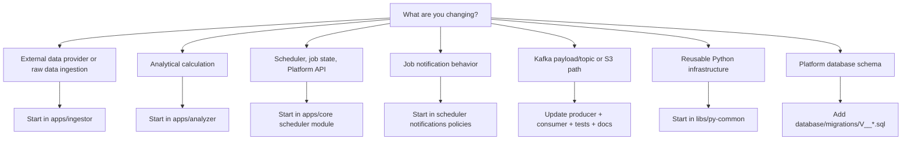

# Where to Change

Use this guide after reading [System overview](../architecture/001-system-overview.md). It maps common product or architecture changes to the first place to inspect.

## Quick Navigation

| Change                               | Start here                                                                                                                                                                 | Also check                                                                                                                                                                                                                                                                                                          |
| ------------------------------------ | -------------------------------------------------------------------------------------------------------------------------------------------------------------------------- | ------------------------------------------------------------------------------------------------------------------------------------------------------------------------------------------------------------------------------------------------------------------------------------------------------------------- |
| Data provider integration            | [`apps/ingestor/app/stocks`](../../apps/ingestor/app/stocks)                                                                                                               | [`apps/ingestor/app/handlers`](../../apps/ingestor/app/handlers), [Data lake](../data/002-data-lake.md)                                                                                                                                                                                                             |
| Stock price ingestion                | [`apps/ingestor/app/handlers/stock_prices.py`](../../apps/ingestor/app/handlers/stock_prices.py)                                                                           | [`topic-sync-stock-prices`](../data/001-kafka-contracts.md#topic-sync-stock-prices), [`eod`](../data/002-data-lake.md#eod)                                                                                                                                                                                          |
| Symbol ingestion                     | [`apps/ingestor/app/handlers/symbols.py`](../../apps/ingestor/app/handlers/symbols.py)                                                                                     | [`topic-sync-symbols`](../data/001-kafka-contracts.md#topic-sync-symbols), [`topic-upsert-symbols`](../data/001-kafka-contracts.md#topic-upsert-symbols)                                                                                                                                                            |
| Indicator calculation                | [`apps/analyzer/app/indicators`](../../apps/analyzer/app/indicators), [`apps/analyzer/app/calculations/indicators.py`](../../apps/analyzer/app/calculations/indicators.py) | [Indicator/signal flow](../flows/003-indicator-signal.md), [`indicators`](../data/002-data-lake.md#indicators)                                                                                                                                                                                                      |
| Signal rule                          | [`apps/analyzer/app/signals`](../../apps/analyzer/app/signals)                                                                                                             | [Indicator/signal flow](../flows/003-indicator-signal.md), [`signals`](../data/002-data-lake.md#signals)                                                                                                                                                                                                            |
| Sector Wave model                    | [`apps/analyzer/app/sector_wave`](../../apps/analyzer/app/sector_wave)                                                                                                     | [Sector wave flow](../flows/004-sector-wave.md), [`features/symbol`](../data/002-data-lake.md#symbol-features), [`features/sector`](../data/002-data-lake.md#sector-features)                                                                                                                                       |
| Sector Transition research           | [`apps/analyzer/app/sector_transition`](../../apps/analyzer/app/sector_transition)                                                                                         | [Sector wave deferred research](../flows/004-sector-wave.md#deferred-research-sector-transition-and-recommendation), [`topic-sector-transition-analyze`](../data/001-kafka-contracts.md#topic-sector-transition-analyze), [`sector-transition-predictions`](../data/002-data-lake.md#sector-transition-predictions) |
| Scheduler or job orchestration       | [`apps/core/src/main/java/com/omni/platform/modules/scheduler`](../../apps/core/src/main/java/com/omni/platform/modules/scheduler)                                         | [Job execution flow](../flows/001-job-execution.md), [`JobProducerRegistry`](../../apps/core/src/main/java/com/omni/platform/modules/scheduler/producers/JobProducerRegistry.java), [Database](../data/003-database.md)                                                                                             |
| Dependency dispatch policy           | [`apps/core/src/main/java/com/omni/platform/modules/scheduler/dependencies`](../../apps/core/src/main/java/com/omni/platform/modules/scheduler/dependencies)               | Scheduler outbox candidate/claim code, manifest guard, exact run/work identity, metadata barrier, [job flow](../flows/001-job-execution.md)                                                                                                                                                                         |
| Static topology or dispatch planning | [`apps/core/src/main/java/com/omni/platform/modules/scheduler`](../../apps/core/src/main/java/com/omni/platform/modules/scheduler)                                         | [Plan 030](../plans/030-static-graph-dispatch-planner.md), job-definition seeds, scheduler-outbox snapshot/candidate repositories, existing dependency registry/guard, claim/fencing tests. Keep topology/planning separate from input readiness.                                                                   |
| Kafka topic or payload contract      | Producer + consumer + [`libs/py-common/py_common/messaging`](../../libs/py-common/py_common/messaging) + [`configs/shared/topics.yaml`](../../configs/shared/topics.yaml)  | [Kafka contracts](../data/001-kafka-contracts.md), status metadata preservation, tests on both sides                                                                                                                                                                                                                |
| Notification policy                  | [`apps/core/src/main/java/com/omni/platform/modules/scheduler/notifications`](../../apps/core/src/main/java/com/omni/platform/modules/scheduler/notifications)             | [Job execution flow](../flows/001-job-execution.md), notification templates, job service tests, policy registry tests                                                                                                                                                                                               |
| Notification delivery/outbox         | [`apps/core/src/main/java/com/omni/platform/modules/notifications`](../../apps/core/src/main/java/com/omni/platform/modules/notifications)                                 | [`database/migrations`](../../database/migrations), [Notification Outbox plan](../plans/022-notification-outbox.md), [Database](../data/003-database.md), transport/claim/retry/configuration tests                                                                                                                 |
| S3 path or dataset layout            | [`configs/shared/s3-paths.yaml`](../../configs/shared/s3-paths.yaml) + path builders in [`libs/py-common/py_common/config`](../../libs/py-common/py_common/config)         | [Data lake](../data/002-data-lake.md), all producers and consumers of the dataset                                                                                                                                                                                                                                   |
| Shared Python abstraction            | [`libs/py-common`](../../libs/py-common)                                                                                                                                   | Analyzer and Ingestor imports/tests                                                                                                                                                                                                                                                                                 |
| Database schema                      | [`database/migrations`](../../database/migrations) + owning Platform module                                                                                                | [Database](../data/003-database.md), Platform tests                                                                                                                                                                                                                                                                 |
| Local runtime command                | Relevant [`project.json`](../../apps/analyzer/project.json)                                                                                                                | Use Nx targets only                                                                                                                                                                                                                                                                                                 |

## Decision Tree



## Adding a Job Type

1. Add or reuse a `JobDefinition.JobType` value in Platform.
2. Add a `JobProducer` that returns the value from `getJobType()`.
3. Do not edit `JobScheduler` dispatch for the new type; `JobProducerRegistry` resolves the registered producer.
4. Add the seed identity/producer configuration in `JobDefinitionConfig` and its typed definition-level predecessor declaration in `StaticDefinitionDependencies`. `StaticJobTopologyProvider` exposes that declaration through the existing process-local topology API. Multiple definitions can map to one `JobType` node; preserve strategy-specific predecessor sets. Retain matching seed `dependsOnJobs` JSON for the catalog compatibility reader and parity tests until its documented removal gate passes; parity/startup already have local executed evidence in Plan 030. JSON is not the active topology authority.
5. Add producer and registry tests, worker consumer tests for the Kafka payload, and topology tests for new or changed edges/mappings.
6. Update [Job execution flow](../flows/001-job-execution.md) and [Kafka contracts](../data/001-kafka-contracts.md) when payload semantics change.
7. Keep dataset readiness decisions in Platform's dependency registry and scheduler-outbox dispatch; `dependsOnJobs` topology does not replace `dependsOnDatasets`, manifests, or exact-version checks.
8. Do not add a producer-local graph, persisted graph table, or infer readiness from topology position.

## Safe-write mechanics

JobRun persistence starts in scheduler `runs/FrozenJobRunPath`, `runs/JobRunSnapshot`
and `repositories/JobRunRepository`; V12 owns its frozen scoped instance schema.
I3.c preparation lives in `runs/JobRunPreparationService` and `JobRunWorkContext`,
the producer overloads and `SchedulerOutboxService.enqueueRunStep`. V13 owns closed
execution/message membership. The route defaults off; preserve legacy entry points,
nullable links, bounded expansion and the I2 resolver/capability boundary. Writing
a snapshot or enqueuing before a target does not authorize completion admission;
I4 must prove that before activation.

When changing prepared SYNC_SYMBOLS membership, review `SymbolUpsertConsumer`
together with `JobService.isRunPreparedExecution` and V13 parent guards. Result
symbols must not append execution children to a closed EXCHANGE work set.

Reusable writer mechanics may share immutable intent identity, fenced lease/claim,
atomic conditional transitions, bounded retry, idempotent completion, and the rule
that input is not acknowledged before output is durable. These mechanics do not
include dependency eligibility. Future Python writer adoption remains separate
roadmap work; do not create a generic dispatcher or move manifest dependency policy
into a writer while reusing safe-write primitives. The inactive P14-I2 source is
backlog-only scaffolding. The owner-approved [Plan 030](../plans/030-static-graph-dispatch-planner.md)
revision requires execution-centered summaries and parent membership grouped by
business group/date/run, with closed-membership completion barriers before advancing.
Do not infer completion from an empty outbox or correlate runs by trigger timestamps.
The planner returns node/cohort/parent scope and quota without SQL or manifest reads;
BANKS and REAL_ESTATE remain independent, and symbol-level grouping is deferred.
Incomplete evidence fails closed; the cursor remains caller-owned, not persisted state.
`DependencyGuard` remains the required-input readiness
authority and atomic outbox claims remain the execution fence. Do not call the planner
from runtime dispatch. Completed P14-I4 uses the separate JobRun snapshot/planner/coordinator, scoped candidate queries and guarded fallback.
P14-I2 owns the static contract; P14-I3 persists JobRun and immutable scoped step membership.
Use jobRunId for cross-step correlation; runtime state is PostgreSQL-first, not an authoritative RAM cache.

## Adding a Notification Policy

Use the default policy for generic job success/failure notifications. Add a custom `JobNotificationPolicy` only when a job type needs domain-specific wording, metadata rendering, or event type selection. Keep notification decisions in the policy layer, not in `JobService`, `JobScheduler`, or producers.

For delivery behavior, start in the notifications module instead. Keep
`scheduler_outbox_messages` and `notification_outbox_messages` separate; share only
claim/lease/fencing mechanics. Persist typed requests and logical channels, resolve
credentials and concrete destinations only at dispatch, and update the migration,
configuration examples, focused tests, [job flow](../flows/001-job-execution.md), and
[database reference](../data/003-database.md) together.

## Kafka Contract Rule

Do not update a Kafka producer or consumer in isolation. When changing a topic, event schema, field semantics, serialization, validation, or error-handling contract:

1. Find the producer.
2. Find the consumer.
3. Update shared payload/config abstractions if used.
4. Update tests for both sides.
5. Update [Kafka contracts](../data/001-kafka-contracts.md).
6. Check impact radius before merging.

## Storage Contract Rule

Do not add bucket names or object names to Kafka job messages for routing. Workers derive object paths from shared path builders backed by [`configs/shared/s3-paths.yaml`](../../configs/shared/s3-paths.yaml).

When changing storage layout:

1. Update [`configs/shared/s3-paths.yaml`](../../configs/shared/s3-paths.yaml).
2. Update path builders and tests.
3. Update all producers and consumers of that dataset.
4. Update [Data lake](../data/002-data-lake.md).

## Verification

### Formatting scope

Repository tooling regressions run through `nx run omni:tools-test`,
`nx run omni:ci-policy-test` and `nx run omni:format-test`. CI runs all three
before stack selection; local `omni:verify` includes them in its required manifest.

On Windows, the formatter and Gradle launchers request hidden child consoles;
`tools/check_result.py` uses `CREATE_NO_WINDOW` while preserving captured logs and
exit codes. These options address console flashes from repository launchers, not
external terminal hosts or test CPU/RAM consumption. Interactive console input is
not supported through the check-result runner.

```bash
# Changed files: staged + unstaged + untracked, relative to the current Git index
nx run omni:format

# All tracked files and untracked files not excluded by Git
nx run omni:format --all
```

Both modes apply `.prettierignore`, skip deleted/non-regular files and leave the Git
index untouched. Prettier formats supported files; Python files in each project's
existing lint roots receive Ruff fixes and formatting through that project's
`lint-fix --configuration=changed`. Unchanged files are not added to the default
scope; a clean worktree is a no-op. Commit-range/branch comparisons are not implied.
File contents are formatted as a whole, including unstaged content in partially
staged files. Review and stage the resulting edits explicitly before committing.

The root target uses [format-workspace.cjs](../../tools/format-workspace.cjs).
`omni:format-test` covers Git selection, Python ownership and Java routing, including
unknown Prettier parser retention, ignore rules, safe batching and error propagation. Direct Python
`lint-fix` and `python-lint-fix` retain their existing full-project scope.
Both full-project and changed-file Python fixes run `ruff check --fix-only`, then
`ruff format`, then a strict `ruff check --no-fix --no-fix-only`. Leftover lint
diagnostics cannot prevent the formatter from running merely because they are not
auto-fixable. The final check still fails on remaining E501 or other violations.
Ruff makes a best-effort attempt to wrap code at 88 columns; long prose comments
and string literals may still require manual wrapping. No E501 suppression or
line-length increase is configured. This pipeline change has not yet been executed.
Platform Java files under `apps/core/src/main/java` and `src/test/java` are routed
through `nx run platform:format`. This uses the isolated Gradle `javaFormatter`
configuration with pinned `google-java-format:1.29.0`, the existing JDK 21 toolchain
and AOSP 4-space indentation. It does not reorder/remove imports, rewrite string
literals or reformat Javadoc. Runtime/test classpaths and root Prettier are unchanged.
Files remain in the selected Git inventory, respect `.prettierignore`, and are
passed in bounded JSON batches rather than interpolated shell arguments. Gradle
validates real paths against Platform Java source roots before writing. Generated
Java outside these roots is excluded. Formatter syntax/download/toolchain failures
fail the Nx command instead of silently reporting success. The first run may need
Maven Central access to populate the isolated formatter dependency cache.

`nx run platform:format` directly formats changed Platform Java files. Root
`omni:format --all` includes all eligible Platform Java sources; direct invocation
of the Gradle task without an explicit file inventory fails closed. No Java compile
or test task is a dependency of formatting. Protobuf is not handled by this target;
use its existing contract-specific targets. Other unknown Prettier types are skipped.
The `--all` mode uses Git inventory rather than recursively scanning ignored
dependency, cache or external directories.

This developer-tooling change affects root formatting and Platform's build-tool-only
Java formatter target. Analyzer, Ingestor, Query Service and py-common retain their
existing Ruff routing; Console and contracts retain their source behavior. Platform
Java formatting changes layout in selected files, not application behavior or APIs.
Kafka, lake, database, shared runtime configuration,
dataset ownership, persistence and operations have no behavioral impact. CI runs
the selection regression tests. No roadmap increment status or runtime contract
changes; canonical architecture, flow, data, deployment and agent policy need no
updates for this command-scope change. The new Java route and regression tests are
source-present; their current execution status is recorded in ReleaseNotes. The
earlier Prettier-only PASS did not cover Java. This feature does not add Java
format-check enforcement to CI or change the root Prettier lint target.

### Service checks

For workflow selection, immutable contract baselines, locked Python environments
and required-check semantics, see [CI Quality Gate](004-ci-quality-gate.md).

Use Nx targets from the workspace root. Inspect a project before running unfamiliar operations:

```bash
nx show project analyzer
nx show project ingestor
nx show project platform
nx show project py-common
```

Common checks:

```bash
nx run analyzer:test
nx run analyzer:lint
nx run ingestor:test
nx run ingestor:lint
nx run py-common:test
nx run py-common:lint
nx run platform:build
```

## JobRun-aware admission — I4

JobRun snapshot/planner/store/coordinator live under `scheduler/planning`.
`SchedulerOutboxDispatcher` evaluates DependencyRegistry, claims through the
coordinator, renews the live fence before each send, then fences retry/ack.
`SchedulerOutboxService` owns ordered poison-safe batch loading and approved
versions after claim; repository SQL owns status/availability/lease/token checks.
Keep the locked reread on the same connection and Kafka outside admission locks.
Preparation stays disabled; use [I4 completion](../plans/030-static-graph-dispatch-planner.md#i4c-integrated-admission-and-completion--2026-10-24) and
the [rollout runbook](../deployment/004-job-run-admission-rollout.md) before changes.

## Legacy outbox normalization — P14-I7

V15 under database/migrations validates and normalizes historical parent-FK aliases
transactionally, then guards future FK/payload execution identity. Applied migrations
and JobRun membership guards must not be rewritten or disabled. SchedulerOutboxService
uses the canonical work FK and rejects mismatching identities; JobRunDispatchStore
locks that work row without waiting before approved-input metadata updates.
SchedulerOutboxIdentityMigrationPostgresTest exercises V14 upgrade/fresh install,
preservation, failure rollback, strict writers, linked/closed membership, lock
timeout and actual post-upgrade claim/retry/ack/status services. Legacy diagnostic
poison fixtures explicitly target V14; normal admission/preparation runs V15.
Retained deployment follows the [cutover/recovery runbook](../deployment/004-job-run-admission-rollout.md#v15-legacy-outbox-identity-cutover-p14-i7).

## Scheduler diagnostics and read-model handoff — I5

Versioned SELECT-only SQL, parameter/bound/safety instructions and the observation
dictionary live in [database/diagnostics/p14/v1](../../database/diagnostics/p14/v1/README.md).
JobRunDiagnosticsPostgresTest executes the actual SQL; SchedulerDiagnosticsFixture
is disposable test data, not a runtime service or a retained-data cleanup tool.
JobRunDispatchBenchmarkPostgresTest and JdbcMeasurementProbe record actual
JDBC/pool behavior only in tests; PlatformStartupPostgresTest exposes an optional
test initializer and preserves its existing default isolation. Reproduction and
source-bound results live beside the SQL. Production admission/status ownership
remains unchanged.

I5's [operator contract and fixtures](../../database/diagnostics/p14/v1/read-model.md)
extend run_steps.sql additively. JobRunReadModelPostgresTest exercises the contract
against actual PostgreSQL for frozen paths, per-run counts, wait/unknown reasons,
capture clocks and unavailable evidence. Plan 029 owns any future API/UI consumer;
do not introduce runtime DTOs or infer worker processing from these observations.

## Deferred operator job triggers — I3.d

JobOperationsController keeps catalog/detail/execution reads and HTTP 410
tombstones for retired manual trigger/audit routes. Execution lookup belongs to
JobOperationsCatalogService. No ManualJobTrigger entity/repository/service or
manual allow-list remains. V14 removes only its old audit table after old readers
stop. Console JobsPanel/DatasetExplorer retain read-only behavior. See TD-017 and
Plan 030 before reintroducing operator triggering; internal MANUAL preparation is
not a public feature. Automatic scheduling and data-plane contracts are unchanged.
