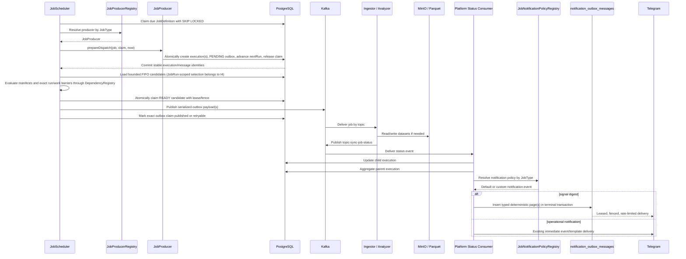
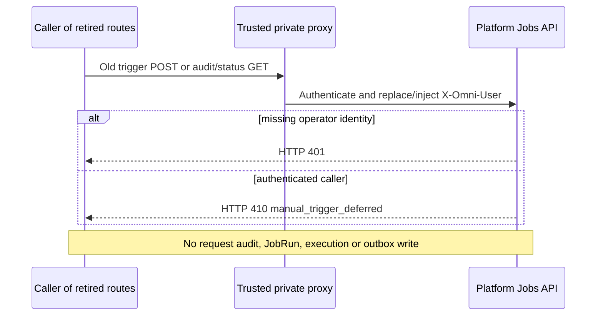
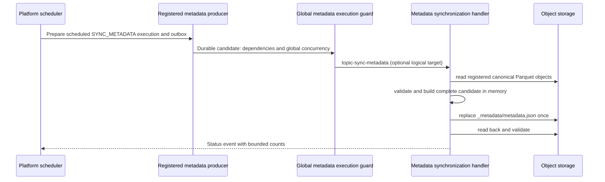
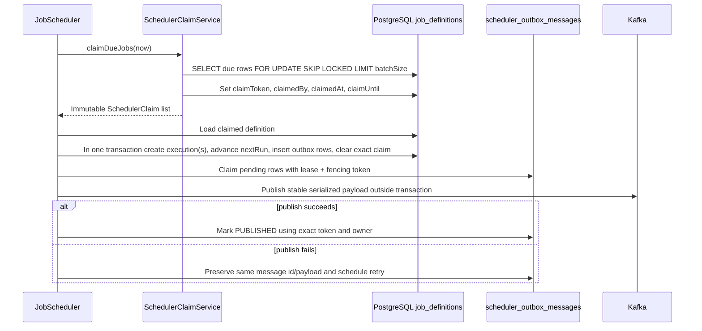
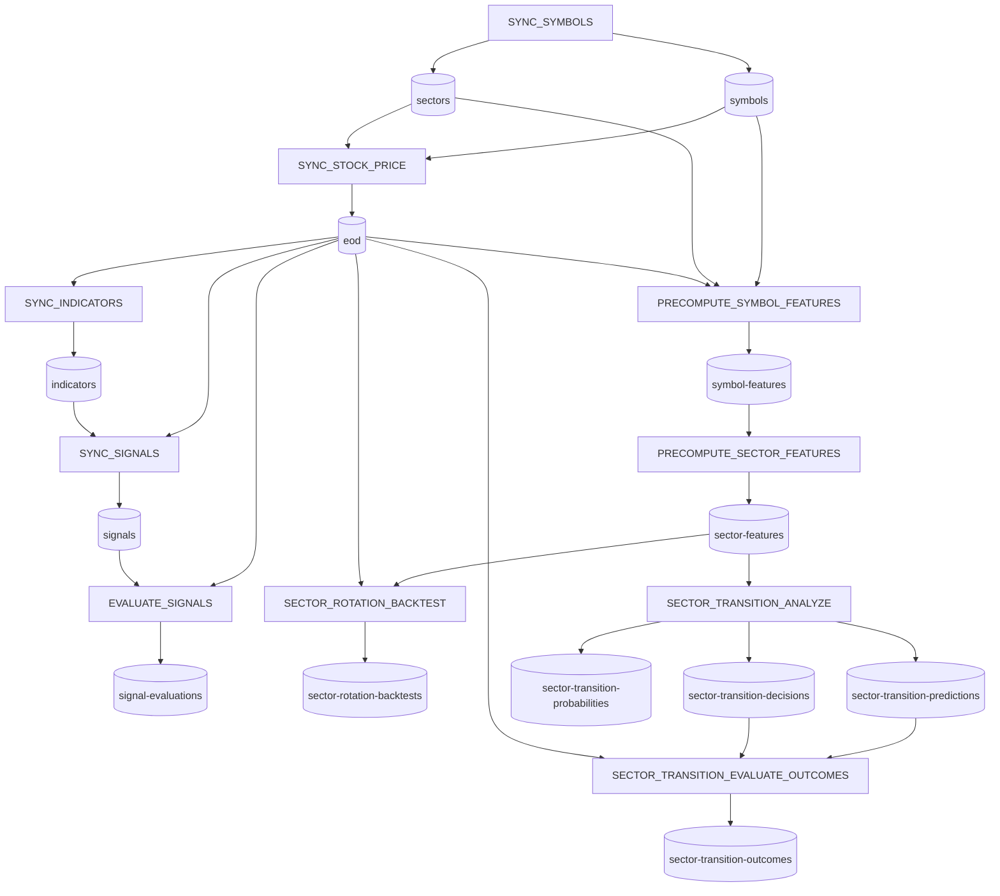
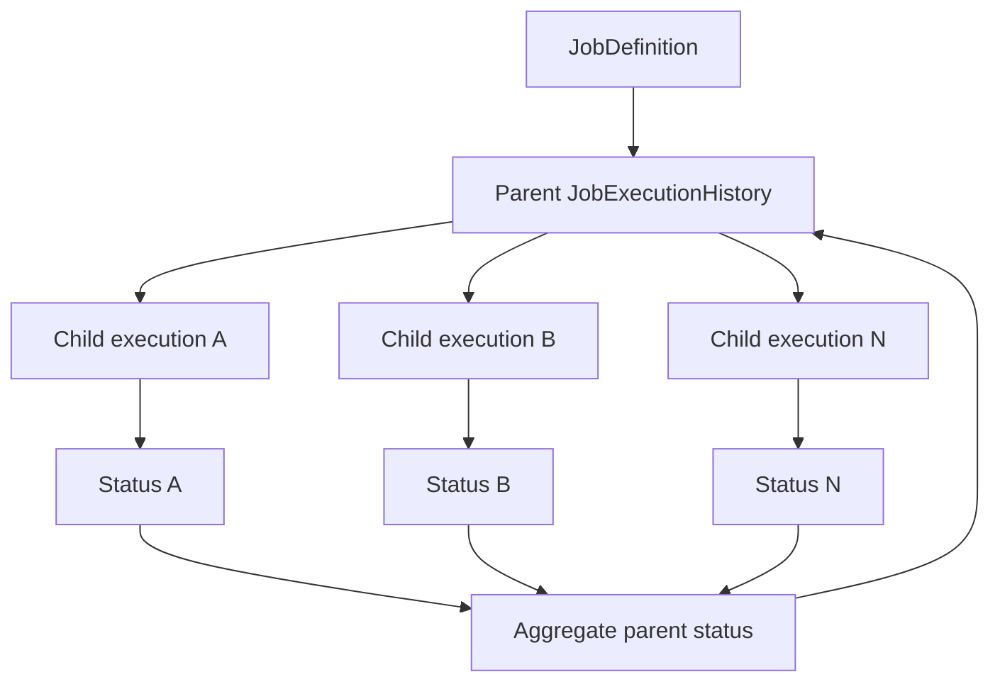

# Job Execution Flow

Platform owns job orchestration. Workers execute data-plane tasks and report status back through Kafka.

When JobRun preparation is enabled, scheduled entry selection uses terminal
definitions (no successors) in the canonical static DAG, including standalone
metadata. SQL filters eligible identities before claim batch limits; ancestor
definitions retain their configuration and are prepared inside each target run.
Disabled preparation retains legacy scheduling. See the
[entry and recovery policy](../deployment/004-job-run-admission-rollout.md#worker-recovery-and-terminal-entries--2026-10-26)
for current entries, local evidence and remaining overlap/rollout gates.
Python workers recover failed sessions with backoff without advancing failed
command offsets; health reports 503 during recovery. Warning-only metadata/symbol
results can complete SUCCESS while dataset READY remains independently enforced.

Operator-triggered jobs are deferred by owner decision in I3.d ([TD-017](../technical-debt/017-manual-request-rejection-audit.md)).
The private Console retains read-only job catalog/history and dataset browsing.
Old POST `/api/v1/jobs/definitions/{id}/triggers` and GET `/api/v1/jobs/triggers/{id}`
return authenticated HTTP 410 with code `manual_trigger_deferred`; they create no
request, execution or outbox intent. Execution status remains available through
the catalog service. V14 drops the old manual audit table after old instances are
stopped; no audit history is migrated. JobRun validation/membership is unchanged.
Dependency evaluation remains Platform-local and occurs only when the scheduler
outbox considers the durable work for dispatch.
Catalog and status responses expose logical identities only. Operational errors
are normalized, bounded, and redact secrets plus object-storage or host paths
before leaving Platform.

The repository now contains versioned `JobCommand` and `JobStatusEvent` Proto3 schemas in [`libs/contracts/proto`](../../libs/contracts/proto). They are a generated contract foundation only: the production flow described below remains on the existing JSON wire format until compatible consumers and adapters are delivered in later Phase 2 increments.

## Planned Phase 13 stage semantics

[Plan 029](../plans/029-operator-trust-console.md) owns the pending truthful-stage model.
Current source creates fan-out child rows as `RUNNING` and sets `startedAt` during
dispatch preparation, so those fields do **not** prove active worker processing. Until
P13-I1 is implemented and verified, operator views must treat this ambiguity explicitly.

P13-I1 plans authoritative evidence for prepared, dependency-waiting, dispatch-waiting,
worker-waiting, processing, terminal-status-published, Platform-applied, completed, and
unknown stages. Historical rows without evidence remain unknown rather than being
inferred from creation or update timestamps. P13-I2 then owns daily jobs/minute,
jobs/hour, jobs/day, duration percentiles, outstanding counts, scheduler-outbox lag,
and a guarded publish-drain estimate for only the currently eligible backlog snapshot.
This planned observability does not change dependency policy, commit offsets, replay
messages, rewrite statuses, or implement Phase 12 concurrency.

I5's [diagnostic pack and measured observations](../../database/diagnostics/p14/v1/README.md)
are read-only/synthetic evidence, not worker timing, READY or admission authority.
I6 supplies the [bounded read contract](../../database/diagnostics/p14/v1/read-model.md) with explicit unknown/freshness semantics; I7 supplies V15 legacy normalization with separate retained rollout gates.

## Static Graph and Planned Dispatch Planning

I4 integrates bounded JobRun snapshot/planning and `JobRunDispatchCoordinator`
with the dispatcher. Linked planned/fallback rows require closed transitive
predecessor SUCCESS under admission locks; NULL-run legacy rows use strict identity
revalidation. DependencyRegistry still decides READY/WAITING/BLOCKED for every
visited candidate. Stale/incomplete snapshots use bounded paginated guarded FIFO;
database failure dispatches nothing. Per-send live-fence renewal precedes Kafka,
and retry/ack keep exact owner/token identity. PUBLISHED is not worker SUCCESS or
dataset READY. See [I4 completion](../plans/030-static-graph-dispatch-planner.md#i4c-integrated-admission-and-completion--2026-10-24).
P14-I7 V15 validates historical parent-FK/payload-child aliases and normalizes
their FK to the actual work execution transactionally before strict readers start.
Invalid identities or projected unique collisions abort without data changes.
The identity trigger prevents incompatible writers from recreating aliases.
NULL-JobRun admission locks the actual work row FOR UPDATE SKIP LOCKED before
approved-input updates; busy work is skipped without attempts, preserving
JobService.applyStatus child-before-parent lock ordering. Retained cutover requires
the [inventory, backup, quiescence and recovery procedure](../deployment/004-job-run-admission-rollout.md#v15-legacy-outbox-identity-cutover-p14-i7). Snapshot run order is
restored to the rotated discovery page before planning. See
[I4 review repair](../plans/030-static-graph-dispatch-planner.md#i4-review-regressions--2026-10-25).

The I4.a/I4.b inactive APIs described in earlier checkpoint evidence are now wired.

I3.b adds request/path persistence and nullable execution links. I3.c adds bounded
GLOBAL/VN preparation and V13 closed execution/message membership, with dependencies
enqueued before the target. The preparation flag is **false** by default; current
scheduled entry points and guard remain active. FIFO enqueue order does not
prove predecessor completion. I3.d defers manual triggering and owns cron/entry
target review; I4 owns safe predecessor-completion admission before activation. See
[I3.c scope/evidence](../plans/030-static-graph-dispatch-planner.md#i3c-bounded-preparation--2026-10-18).

Prepared SYNC_SYMBOLS freezes EXCHANGE executions before dispatch. Symbol-upsert
messages update symbol data without appending SYMBOL executions to that membership;
worker status events continue to determine completion. Legacy parents retain their
existing per-symbol tracking. Database guards also validate parent membership when
a writer omits the child's JobRun link.

The I3.c parent/run lock cycle was reproduced against old V13 in a real-service
PostgreSQL test. Repair source bypasses run locks for progress-only execution and
outbox UPDATEs while retaining parent aggregation locking and membership guards. The
[lock-safety repair plan](../plans/030-static-graph-dispatch-planner.md#i3c-lock-safety-repair-plan--2026-10-19)
records the separate five-check local PASS on 2026-10-20: 28 focused PostgreSQL
tests and 351 full Platform tests, with attributable Java coverage and SQL case
mapping. Both competing service transactions now commit in the regression test.
The route remains disabled pending owner entry-target/shared-upstream rollout review; I4 admission is locally proved.

Visible JobRun replay locks its target definition before its run, matching fresh
preparation's definition-before-run order. Lease validation/release stays in the
same transaction after closure validation. The separate Java replay repair passed
29 focused PostgreSQL cases and 352 full Platform tests on 2026-10-20, including
scheduled/manual overlap with a definition-held caller; old Java reproduced a
deadlock. See [replay repair](../plans/030-static-graph-dispatch-planner.md#i3c-replay-definitionrun-lock-repair--2026-10-20).

The canonical [Plan 030 delivery sequence](../plans/030-static-graph-dispatch-planner.md#canonical-revised-delivery-sequence--2026-10-15) is I2 static target-to-ancestor contract, I3 durable JobRun preparation, I4 guarded JobRun-aware admission, I5 measured diagnostics and operations read-model handoff. Earlier parent-only discovery and RAM binding proposals are superseded. Runtime correlation comes from persisted JobRun and immutable scoped run-step membership, not timestamp heuristics or a process-local authoritative cache.

[Plan 030](../plans/030-static-graph-dispatch-planner.md) owns the active P14 sequence. P14-I1 is completed: the original implementation constructed one immutable process-local topology from seed `dependsOnJobs` declarations, maps every `(source, jobType, cronExpr)` definition identity to a stable logical `JobType` node, validates the graph at startup, and exposes deterministic bounded traversal and Mermaid diagnostics. Multiple definitions sharing one `JobType` intentionally map to the same logical node. No persisted graph or runtime dispatch behavior is introduced.

I3.a pre-cutover source now makes `StaticDefinitionDependencies` the provider declaration and adds a typed resolver constructor. Unused topology compatibility adapters have been removed; JSON baseline/custom-fixture reading now belongs only to test source. Seed JSON remains until the catalog/config consumer-removal gates in Plan 030 pass. The focused startup test passed again after adapter cleanup; the I3.a full regression subsequently passed 293 tests, while its separate coverage/build gate remains open. Historical I1/I2 evidence does not verify the new source.

Completed P14-I3 persists a target-driven JobRun and its required scoped ancestor-to-target steps, and prepares dependency-first execution/outbox intent while preserving the existing FIFO/guard/claim/publish pipeline. Enqueue order does not prove completion; the new route stays disabled unless safe admission is proven. Completed P14-I4 queries persisted step membership, execution progress including published-but-unfinished work, and separate outbox eligibility. It waits for required predecessor SUCCESS and closed membership before advancing, preserves independent run/group/date scopes and joins, and revalidates barriers at admission. Typed scope supports future symbol rollout without cloning static nodes. Existing guard retains dataset readiness/version authority; no outbox processing-success status or arbitrary execution DAG is introduced.

The current definition-scoped outbox projection and first-dispatchable planner remain inactive scaffolding. P14-I2 static handoff and P14-I3 gated JobRun preparation are completed after the 2026-10-24 acceptance reconciliation, using the fresh source-bound 357-test/coverage/build gate rather than historical backlog-only evidence. P14-I4 is now completed with integrated snapshot/quota/scoped-query and final TD-014 safety proof; I5 is locally completed and I6 is completed and I7 is locally completed; I5 owns consolidated performance evidence and I6 the Plan 029 graph read-model handoff. The planner is integrated, but new JobRun preparation remains disabled; no retained rollout or production query-load pass is claimed. Snapshot-count comparison is observability only, not dispatch admission or completion evidence.

The static topology does not change the dependency authority shown below: every future selected candidate still passes through `DependencyRegistry` and `DependencyGuard`, which alone evaluate required input readiness and exact versions. Typed definition-level predecessor declarations describe logical orchestration topology; retained seed `dependsOnJobs` is catalog compatibility/parity metadata pending consumer removal. I3.a parity and startup have local executed evidence in Plan 030; whole-increment status remains owned by the registry. `dependsOnDatasets` and manifests describe data readiness. Graph position is never READY evidence. The existing atomic claim, lease/fencing token, WAITING/BLOCKED handling and publish retry identity remain required. I4 owns JobRun-aware admission and safe fallback; persisted topology, provider-policy expansion and advanced fairness are deferred.

## Flow



## Compact Flow

```text
JobScheduler
 → JobProducerRegistry
 → JobProducer
 → SchedulerOutboxMessage
 → SchedulerOutboxDispatcher
 → Kafka
 → Worker / Analyzer
 → JobStatusMessage
 → JobService
 → JobNotificationPolicyRegistry
 → SignalNotificationTemplate
 → notification_outbox_messages
 → NotificationOutboxDispatcher
 → Telegram
```

## Responsibilities

## Deferred Manual Operator Trigger



Operator triggering and request audit are deferred under TD-017. Console has no
trigger forms, polling or metadata-sync action. The old manual allow-list setting
and runtime service/entity/repository are removed. Catalog and execution reads
remain behind the trusted operator identity; the proxy must strip browser-supplied
`X-Omni-User` and inject the authenticated identity. Internal MANUAL preparation
ports remain for compatibility, with no operator caller. Future reactivation
requires an approved authorization/audit contract. There is no force, bypass or
direct browser-to-Kafka route.

### `SYNC_METADATA` operation

Platform publishes an optional logical target to `topic-sync-metadata`; Analyzer
validates it against the shared dataset registry and is the sole writer of
`_metadata/metadata.json`. An absent target requests a full rebuild, a dataset-only
target replaces one complete section, and a dataset plus complete partition performs
one exact upsert or removal. Unknown keys, partial identities, and all physical
storage fields are rejected.



Scheduled execution defaults to full synchronization. The transport retains its
optional logical `dataset` and complete `partition` target contract; this does not
expose an operator trigger. Manual metadata requests are deferred under TD-017.
The worker never recomputes, deletes, or rewrites Parquet; data producers do not
write metadata. Query Service remains read-only.

| Step                 | Owner                | Responsibility                                                                                |
| -------------------- | -------------------- | --------------------------------------------------------------------------------------------- |
| Schedule selection   | Platform             | Atomically claim enabled jobs due for execution.                                              |
| Producer resolution  | Platform             | Resolve `JobType` to a registered `JobProducer`; fail fast if none exists.                    |
| Job definition       | Platform/PostgreSQL  | Store job type, schedule, and job-specific config.                                            |
| Parent execution     | Platform/PostgreSQL  | Track an execution batch across child tasks.                                                  |
| Child execution      | Platform/PostgreSQL  | Track one executable work unit sent to a worker.                                              |
| Kafka command        | Platform             | Persist then asynchronously publish a worker-specific job payload.                            |
| Worker processing    | Ingestor or Analyzer | Execute data-plane work.                                                                      |
| Status event         | Worker               | Publish `topic-sync-job-status` with execution identity, metrics, and meta.                   |
| Aggregation          | Platform             | Update child status and roll up parent status when applicable.                                |
| Notification policy  | Platform             | Resolve custom policy by job type, or use the default generic policy.                         |
| Signal delivery      | Platform             | Commit typed immediate/digest requests, then deliver with the notification outbox dispatcher. |
| Operational delivery | Platform             | Retain the existing immediate event/template path until separately migrated.                  |

## Scheduler Claim and Transactional Outbox

The production scheduler uses PostgreSQL leases and a transactional outbox. Claim acquisition and outbox acquisition are separate short transactions; Kafka I/O never holds a database transaction open.



Claim candidates use the Phase 0 due semantics: active jobs where `nextRun <= now` or `nextRun IS NULL`. A live lease prevents reclaim; an expired claim receives a new UUID fencing token. Execution and outbox rows commit once, so a Kafka retry reuses the same execution id, outbox message id, key, and serialized payload instead of creating a second logical execution. Delivery remains at-least-once because a process may stop after Kafka accepts a message but before the database acknowledgement commits; consumers must therefore remain idempotent by execution identity.

## Dependency Tree Metadata

Seeded job definitions retain catalog compatibility/traceability metadata in [`JobDefinitionConfig.java`](../../apps/core/src/main/java/com/omni/platform/modules/scheduler/constants/JobDefinitionConfig.java). Active topology uses typed definition-level predecessors behind the existing provider/API; parity, resolver and startup tests have local executed evidence in Plan 030. JSON removal still requires migrating its remaining catalog reader. Plan 028 is REVIEW REQUIRED / ON HOLD and must reuse this topology and the accepted JobRun boundary; no replacement persisted dependency graph is approved.

Scheduled work first commits stable execution and PENDING outbox identities; retained internal MANUAL preparation follows the same boundary but is not an exposed operator feature. Dataset dependencies declared as `ENFORCED` are then checked at the scheduler-outbox dispatch boundary. READY manifests and exact `dataVersion` lineage remain authoritative; execution state is scoped to the exact run/work item and the metadata workflow uses a complete-run barrier where supported. WAITING remains PENDING without consuming delivery attempts, while terminal incompatibility produces `BLOCKED`, not a worker `FAILED` result. `DOCUMENTATION_ONLY` dependencies remain advisory. Static topology and dataset readiness are related but non-interchangeable contracts.



## Core Contracts

| Contract               | Canonical doc/source                                                                                                                                                                                                                                         |
| ---------------------- | ------------------------------------------------------------------------------------------------------------------------------------------------------------------------------------------------------------------------------------------------------------ |
| Status topic           | [`topic-sync-job-status`](../data/001-kafka-contracts.md#topic-sync-job-status)                                                                                                                                                                              |
| Job definitions        | [`database/migrations/V1__create_job_definitions_table.sql`](../../database/migrations/V1__create_job_definitions_table.sql), [`database/migrations/V5__add_scheduler_claim_lease.sql`](../../database/migrations/V5__add_scheduler_claim_lease.sql)         |
| Job execution history  | [`database/migrations/V2__create_job_execution_histories_table.sql`](../../database/migrations/V2__create_job_execution_histories_table.sql)                                                                                                                 |
| Scheduler outbox       | [`database/migrations/V6__create_scheduler_outbox.sql`](../../database/migrations/V6__create_scheduler_outbox.sql), [`database/migrations/V11__dependency_aware_scheduler_outbox.sql`](../../database/migrations/V11__dependency_aware_scheduler_outbox.sql) |
| Manual audit removal   | [`database/migrations/V8__create_manual_job_triggers.sql`](../../database/migrations/V8__create_manual_job_triggers.sql)                                                                                                                                     |
| Java messaging records | [`apps/core/src/main/java/com/omni/platform/modules/scheduler/messaging`](../../apps/core/src/main/java/com/omni/platform/modules/scheduler/messaging)                                                                                                       |
| Java producers         | [`apps/core/src/main/java/com/omni/platform/modules/scheduler/producers`](../../apps/core/src/main/java/com/omni/platform/modules/scheduler/producers)                                                                                                       |
| Producer registry      | [`apps/core/src/main/java/com/omni/platform/modules/scheduler/producers/JobProducerRegistry.java`](../../apps/core/src/main/java/com/omni/platform/modules/scheduler/producers/JobProducerRegistry.java)                                                     |
| Notification policies  | [`apps/core/src/main/java/com/omni/platform/modules/scheduler/notifications`](../../apps/core/src/main/java/com/omni/platform/modules/scheduler/notifications)                                                                                               |
| Java status consumer   | [`apps/core/src/main/java/com/omni/platform/modules/scheduler/consumers/JobStatusConsumer.java`](../../apps/core/src/main/java/com/omni/platform/modules/scheduler/consumers/JobStatusConsumer.java)                                                         |

## Parent/Child Execution Model



## Extending a Job Type

1. Add or reuse a `JobDefinition.JobType` value.
2. Implement a `JobProducer` and return that value from `getJobType()`.
3. Keep producer logic execution-focused: prepare execution, build Kafka messages, enqueue them transactionally, and run `postPublish()` if needed.
4. Do not add scheduler dispatch branches. Spring registers the producer in `JobProducerRegistry` automatically; duplicate producers for the same job type fail application startup.
5. Add or update producer and scheduler tests for the new registration.

## Notification Policies

`JobService` owns status updates and parent aggregation only. After a standalone or parent execution reaches a terminal status, it builds a `JobNotificationContext` and delegates event selection to `JobNotificationPolicyRegistry`.

Use `DefaultJobNotificationPolicy` for generic operational success/failure messages. Add a custom `JobNotificationPolicy` when a job type needs domain-specific rendering, such as Signal Digest summaries or actionable Sector Transition failures. Custom policies should return a notification event and keep template/Telegram delivery outside scheduler producers.

P1-I4 replaces generic status identity with required `workType` and `workKey` in
one coordinated cutover. There is no legacy status fallback or dual-write period.
Operators manually clear historical execution rows before the new services start,
and old `symbolKey`-based repository/status/aggregation branches are deleted. A
symbol-domain command may still carry `symbolKey`; that field is not generic
execution identity.

Platform creates each child from a shared `WorkIdentity` value object, persists
that identity in `meta_json`, and emits it on the job payload. Workers return it
unchanged. Status application validates it against the persisted child before
updating state; symbol offsets query `workType=SYMBOL` plus `workKey` only.

Parent aggregation in `JobService` is the single terminal notification owner.
Workers publish status, not operational notification decisions. The Signal
Digest policy translates a canonical symbol `workKey` back into the domain
`SignalDigestItem.symbolKey` only when building the notification request. Each
complete deterministic digest page is inserted into `notification_outbox_messages`
in the same guarded terminal transaction. Immediate Analyzer signal notifications
also commit a typed request before the Kafka listener returns. The notification
outbox dispatcher resolves the configured chat destination at delivery time,
uses leased fenced claims, and records `SENT`, retryable `PENDING`, or terminal
`DEAD`; credentials and concrete chat identifiers are never persisted.

The V9 migration requires a drained scheduler outbox and empty execution history,
then installs canonical work-identity indexes. It never deletes or rewrites
operational records. The database invariants are documented in
[Database](../data/003-database.md).

The coordinated operational sequence, maintenance-window checks, snapshot-based
rollback procedure, and production completion gates are defined in the
[P1-I4 hard-cutover runbook](../deployment/001-p1-i4-hard-cutover.md). Disposable
PostgreSQL verification runs V9 twice against empty history and checks rejection
of remaining history and pending outbox work. That local evidence does not replace the
maintenance-window preflight or exact-head CI, so the canonical roadmap keeps
P1-I4 `verification_pending`; no production database was modified.

## Failure Semantics

- Worker failures should publish a status event when possible.
- Status events must include `executionId`, optional `parentExecutionId`, required `workType`/`workKey`, final status, duration, metrics, error details, and relevant `metaJson` context.
- Workers should preserve domain metadata on failures instead of replacing metadata with only `recordsProcessed = 0`.
- Platform should update the child execution by execution identity, not by symbol alone.
- Parent aggregation should wait for all child executions to reach terminal states; dependency `BLOCKED` is terminal but distinct from worker `FAILED`.
- Error details must not include credentials, object-store secrets, or provider tokens.

## Related Flows

- [Stock sync](002-stock-sync.md)
- [Indicator and signal](003-indicator-signal.md)
- [Sector wave](004-sector-wave.md)
