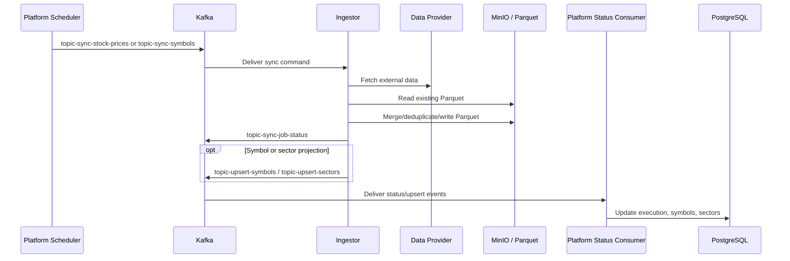
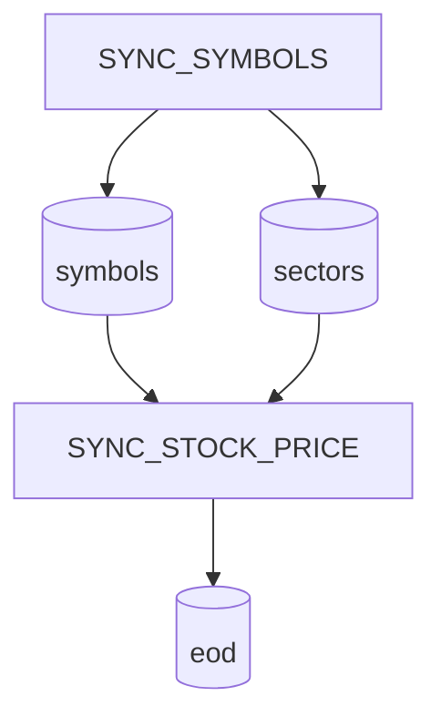

# Stock Sync Flow

Atomic stock bootstrap repair (2026-10-29): missing/empty output retains fetched
history through the requested day (provider limit 10,000); existing output updates
only that day. Missing requested-day data fails before write. Disposable integration
no longer seeds EOD history before running ingestion. I8 remains verification pending.

Current P14 status (2026-10-30): **I8 verification_pending; I9 in_progress**.
I9.a adds read-only graph/atomic planning; it does not acquire or dispatch work.
Common preparation now persists atomic dated work and sends the additive
`jobType`/`businessDate`/`parameters`/`atomicWorkId` envelope. V16 protects accepted
snapshots; matching Java/Python rollout is required even on the legacy scheduler.
Consumers preserve other dates and retain lookback; catalog/metadata are current
snapshots only. Writer and shared ancestors remain deferred. EOD-to-indicator
execution binding is implemented; broader version/concurrency guarantees remain
deferred.
The original I8 delivery ran no checks; later verification and repair evidence
is recorded in Plan 030. This supersedes earlier design-only I8/I9 statements.
See [contract, impact matrix and local handoff](../plans/030-static-graph-dispatch-planner.md#i8-source-delivery-and-local-verification-handoff--2026-10-29).

Stock sync moves external market data into Omni's Parquet data lake and projects symbol/sector metadata back into Platform state.

## Flow



## Compact Flow

```text
Platform
 → Kafka
 → Ingestor
 → Data Provider
 → Parquet
 → Status
 → Platform
```

## Topics

| Topic                                                                               | Direction           | Purpose                                         |
| ----------------------------------------------------------------------------------- | ------------------- | ----------------------------------------------- |
| [`topic-sync-stock-prices`](../data/001-kafka-contracts.md#topic-sync-stock-prices) | Platform → Ingestor | Request EOD price sync for one symbol/task.     |
| [`topic-sync-symbols`](../data/001-kafka-contracts.md#topic-sync-symbols)           | Platform → Ingestor | Request symbol metadata sync.                   |
| [`topic-sync-job-status`](../data/001-kafka-contracts.md#topic-sync-job-status)     | Ingestor → Platform | Report job execution outcome.                   |
| [`topic-upsert-symbols`](../data/001-kafka-contracts.md#topic-upsert-symbols)       | Ingestor → Platform | Project symbol metadata into Platform database. |
| [`topic-upsert-sectors`](../data/001-kafka-contracts.md#topic-upsert-sectors)       | Ingestor → Platform | Project sector metadata into Platform database. |

## Datasets

| Dataset                                       | Producer | Consumer                           | Path                            |
| --------------------------------------------- | -------- | ---------------------------------- | ------------------------------- |
| [`symbols`](../data/002-data-lake.md#symbols) | Ingestor | Analyzer, Platform projection path | `symbols/{exchange}.parquet`    |
| [`eod`](../data/002-data-lake.md#eod)         | Ingestor | Analyzer                           | `eod/{exchange}/{code}.parquet` |

## Responsibilities

| Component     | Does                                                                                                                  | Does not do                                                                                 |
| ------------- | --------------------------------------------------------------------------------------------------------------------- | ------------------------------------------------------------------------------------------- |
| Platform      | Schedules stock/symbol sync jobs, creates execution records, publishes Kafka commands, consumes status/upsert events. | Does not fetch external provider data or route workers by S3 object path in Kafka messages. |
| Ingestor      | Fetches provider data, normalizes records, derives paths, merges Parquet, publishes status/upsert events.             | Does not own Platform database schema or scheduler state.                                   |
| Data provider | Supplies external market data.                                                                                        | Does not define Omni contracts.                                                             |
| MinIO/S3      | Stores Parquet datasets.                                                                                              | Does not own schema evolution decisions.                                                    |

## Seeded Dependency Tree

Platform seeds stock-sync dependency metadata in [`JobDefinitionConfig.java`](../../apps/core/src/main/java/com/omni/platform/modules/scheduler/constants/JobDefinitionConfig.java). This metadata is for visibility only and does not yet block or sequence scheduler dispatch.



## Object Path Rule

Kafka job messages should carry business identity such as `symbolKey`, `source`, job identifiers, and metadata. They should not carry bucket or object path routing fields. Ingestor derives storage paths from shared path builders backed by [`configs/shared/s3-paths.yaml`](../../configs/shared/s3-paths.yaml).

## Source Links

| Area                            | Path                                                                                                                                                   |
| ------------------------------- | ------------------------------------------------------------------------------------------------------------------------------------------------------ |
| Ingestor stock handlers         | [`apps/ingestor/app/handlers`](../../apps/ingestor/app/handlers)                                                                                       |
| Ingestor stock clients          | [`apps/ingestor/app/stocks`](../../apps/ingestor/app/stocks)                                                                                           |
| Platform stock/symbol producers | [`apps/core/src/main/java/com/omni/platform/modules/scheduler/producers`](../../apps/core/src/main/java/com/omni/platform/modules/scheduler/producers) |
| Platform upsert consumers       | [`apps/core/src/main/java/com/omni/platform/modules/scheduler/consumers`](../../apps/core/src/main/java/com/omni/platform/modules/scheduler/consumers) |
| Shared path config              | [`configs/shared/s3-paths.yaml`](../../configs/shared/s3-paths.yaml)                                                                                   |
| Shared topic config             | [`configs/shared/topics.yaml`](../../configs/shared/topics.yaml)                                                                                       |
