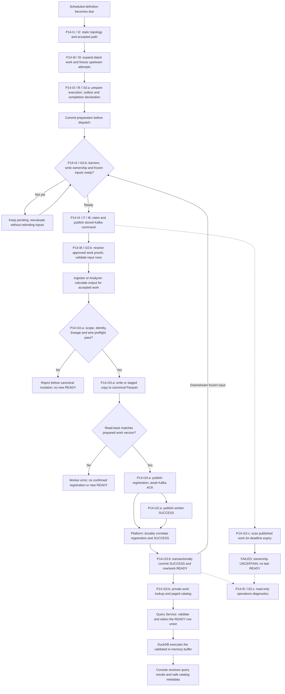

# P14 End-to-End Job, Work READY and Query Flow

Backfill policy: [rerun creates attempts; force refreshes provider EOD](../reference/013-backfill-attempt-and-data-policy.md).
Default shares compatible live in-flight work; otherwise covered EOD is preferred.
New Indicators executions compute from the approved EOD. Selected local worker
E2E checks pass; full I10 coverage/cutover remains open.

Closed-owner follow-up: [safe orphan settlement and separate attempt/output
diagnostics](../reference/012-i10-closed-owner-reconciliation.md). Sharing requires
a live requester; only proven never-dispatched orphans auto-settle. Registration,
READY and terminal request history remain independent. Focused PostgreSQL
regressions pass; this is not retained-environment recovery evidence.

Weekend snapshot correction (2026-11-07): a historical backfill accepted on a
weekend still syncs the current Symbols catalog. Platform and shared Python now
both permit that snapshot, while EOD/Indicators retain weekday-only business
dates and exact coverage checks. See [source and regressions](../reference/009-indicators-backfill.md#current-symbols-snapshots-on-weekends---2026-11-07).

Lifecycle follow-up (2026-11-06): prepared atomic children remain PENDING until a
worker RUNNING receipt. A graph request stays PREPARED while any member is
unfinished, preserving admission for healthy branches after a sibling failure;
only settled membership determines final SUCCESS/FAILED. Receipt ACK does not
commit command offsets or grant READY. See [current flow and diagnostics](../reference/009-indicators-backfill.md#request-settlement-and-worker-receipt---2026-11-06).

The [Indicators-only backfill path](../reference/009-indicators-backfill.md) adds
an authenticated sector/date request before this same EOD -> registration/SUCCESS
-> work READY -> Indicators flow. Enrollment/promotion is scoped to backfill
membership with realtime flags off; legacy writers must remain paused and drained.

Source baseline: 2026-11-04, including the I10 model-version, preflight and catalog
bounds corrections. This document describes the implemented opt-in path. It does
not establish that enrollment, PostgreSQL readers, watchdog or reconciliation are
enabled in a retained environment.

The [increment registry](../plans/roadmap/implementation-increments.md) owns ticket
status. P14-I1-I5 and I7-I9 are completed there; I6 is superseded into I5;
P14-I10 remains `in_progress`. I10.a/b/c are internal checkpoints of P14-I10,
not separate tickets. [Plan 030](../plans/030-static-graph-dispatch-planner.md)
owns implementation scope; the [current I10 handoff](../reference/007-p14-i10-work-identity.md)
owns compatibility, local regression evidence and unresolved cutover gates.

## End-to-end overview

Solid arrows describe the supported source path when its matching flags and
readers are enabled. The watchdog is a failure branch. P12 writer batching is a
deferred review item and is not inserted into this execution path.



## Ticket and ownership map

| Ticket          | Responsibility in this flow                                                                           | Boundary / current status                                                  |
| --------------- | ----------------------------------------------------------------------------------------------------- | -------------------------------------------------------------------------- |
| P14-I1          | Static topology and validation.                                                                       | Completed; topology is not evidence of dataset availability.               |
| P14-I2          | Accepted path/dispatcher contract.                                                                    | Completed; accepted identity and scope precede durable preparation.        |
| P14-I3          | Static definition edges and unified JobRun preparation.                                               | Completed; persist execution/outbox membership before dispatch.            |
| P14-I4          | Guarded outbox admission, claims and publication.                                                     | Completed; enqueue order and publication are not upstream completion.      |
| P14-I5          | Diagnostics and operator read-model handoff.                                                          | Completed; read-only views do not repair execution or grant READY.         |
| P14-I6          | Historical read-model work.                                                                           | Superseded into P14-I5; no separate active runtime stage.                  |
| P14-I7          | Legacy outbox cleanup and compatibility retirement.                                                   | Completed; publication delivers accepted stored membership.                |
| P14-I8          | Unified atomic work expansion and dated worker semantics.                                             | Completed; no second expansion during publication or replay.               |
| P14-I9          | Graph expansion, eligible shared attempts and definition consolidation.                               | Completed; freeze exact upstream attempts and preserve scheduled coverage. |
| P14-I10 (I10.a) | Enrollment before dispatch, scoped worker publication, registration inbox and completion correlation. | Source present; whole-I10 acceptance remains open.                         |
| P14-I10 (I10.b) | Work/row READY, frozen input admission, readers, backfill and reconciliation.                         | Source present; coordinated PostgreSQL cutover remains separately gated.   |
| P14-I10 (I10.c) | Published-deadline watchdog and completion diagnostics.                                               | Source present; default flags remain off.                                  |
| P12-I4          | Future independent dataset writer and compatible batching.                                            | Pending and owner-gated; use the writer TODOs below when reactivated.      |

## Preparation and frozen input admission

1. The scheduler selects eligible due definitions using current coverage rules.
   Each active, non-retired non-signal preset remains independently eligible;
   a narrower descendant does not suppress a broader upstream schedule. Public
   operator-triggered jobs remain deferred under [TD-017](../technical-debt/017-manual-request-rejection-audit.md).
2. `WorkExpansion` and `GraphWorkExpansion` resolve accepted dated work and the
   static ancestor path. `GraphWorkRequestService` acquires eligible shared
   in-flight attempts with matching identity and upstream bindings. Finished or
   failed attempts are not silently repurposed as a new execution.
3. Preparation persists JobRuns, child executions, frozen attempt dependencies
   and pending outbox messages. For supported enrolled work, `OutputDeclarations`
   freezes logical required outputs and replay IDs, and `OutputCompletionGate`
   enrolls the child before the preparation transaction becomes dispatchable.
4. Admission checks predecessor completion, claim/budget constraints and shared
   output ownership. Enrolled inputs bind to the graph's exact upstream attempt,
   work identity, business date and scoped `dataVersion`. Unsupported enforced
   range/freshness policies fail closed rather than use a file-wide substitute.
5. The first `approvedInputs` binding is persisted with execution/outbox context.
   Publication sends stored commands; retries do not expand membership again or
   replace frozen inputs with whichever partition version is newest.

Supported enrollment currently covers `SYNC_STOCK_PRICE`, `SYNC_INDICATORS`,
`SYNC_SIGNALS` and `EVALUATE_SIGNALS`. Other protocols retain their explicit
legacy boundary. Each current completion declaration contains one logical output.

## Worker publication and Platform completion

```mermaid
sequenceDiagram
    participant P as Platform / outbox
    participant KC as Kafka commands
    participant W as Ingestor / Analyzer
    participant R as Private readiness API
    participant S as Canonical Parquet
    participant KR as Kafka registrations
    participant KS as Kafka statuses
    participant DB as Platform PostgreSQL

    P->>DB: I3 / I9 / I10.a: commit work, dependencies, enrollment and pending outbox
    P->>DB: I4 / I10.b: resolve frozen upstream READY
    P->>DB: Freeze approvedInputs and claim stored command
    P->>KC: Publish accepted atomic command
    KC->>W: Deliver execution and immutable work context
    opt Enrolled work has approved inputs
        W->>R: GET work proof for each approved atomicWorkId
        R-->>W: Exact attempt, business date, output version and workScope
        W->>S: Read canonical input bytes
        W->>W: Validate approved scoped rows; apply accepted business-date cutoff
    end
    W->>W: Calculate output and prepare bounded registration
    alt Output exists and preflight passes
        W->>S: Direct write or staged replacement
        W->>S: Read back the canonical object
        S-->>W: Actual persisted bytes
        W->>W: Match selected rows, schema and scoped version; confirm evidence
        W->>KR: Publish immutable registration
        KR-->>W: Broker ACK
        W->>KS: Publish terminal SUCCESS
        KS-->>W: Broker ACK
        par Registration consumer
            KR->>P: Validate and persist registration inbox
        and Status consumer
            KS->>P: Persist first valid SUCCESS evidence
        end
        Note over P,DB: Either consumer may arrive first; both use the execution lock
        P->>DB: Correlate both; commit SUCCESS and promote eligible row/work READY
    else Approved OUTPUT_UNCHANGED evaluation
        W->>KR: Valid-empty registration without outputs or invented coverage
        KR-->>W: Broker ACK
        W->>KS: SUCCESS with no new output pointer
        Note over P,DB: Same durable correlation rules apply to valid-empty completion
    else Invalid scope, identity, input bounds or oversized payload
        W->>KS: Error status; no canonical replacement and no new READY
    end
```

The worker's send order does not establish cross-topic consumer arrival order.
`OutputRegistrationStore` validates the whole bounded event, its immutable replay
identity and persisted attempt/work aliases. Enrolled output scope and direct
inputs must match the server declaration and execution approvals. Shadow-only
evidence cannot authorize completion or READY.

`JobService` and `OutputCompletionGate` durably correlate SUCCESS and registration.
Once all enrolled evidence is accepted, `OutputReadinessStore` promotes row
ownership, the work pointer, discovery projection and revision in the success
transaction. Generation guards prevent older replay from replacing newer row
ownership. Timed-out attempts cannot gain late READY.

Preflight rejects predictable scope/identity/size failures before either canonical
write path mutates data. Read-back, storage or Kafka ACK failures after a canonical
mutation remain a separate recovery risk: retaining an old database pointer does
not guarantee that its mutable bytes still match. A worker error never creates
new READY. Storage fencing and durable recovery remain explicit cutover gates.

## Identity, row scope and version semantics

| Field / concept                      | Meaning                                                                                                                   |
| ------------------------------------ | ------------------------------------------------------------------------------------------------------------------------- |
| `atomicWorkId`                       | Existing canonical hash of job type, work type/key, business date and accepted parameters.                                |
| `atomicAttemptId` / `executionId`    | Distinguish one attempt/execution from another attempt of the same work.                                                  |
| `workScope.rowKeys`                  | Exact registered row coordinates inside a logical output partition.                                                       |
| `model_version`                      | Signal algorithm/model identity within a row key; independent of execution and schema version.                            |
| Work `dataVersion`                   | `WORK_ROWS_V1` fingerprint of scoped rows, schema, work scope and direct approved input versions.                         |
| Catalog `dataVersion`                | Inventory fingerprint when several work proofs share a partition; not any one producing work's output version.            |
| `registrationId` / `eventId`         | Immutable evidence IDs reused for idempotent replay.                                                                      |
| Dataset/partition and canonical path | Physical ownership/discovery coordinates shared by multiple works; physical paths remain outside Kafka business messages. |

EOD and indicators use `date` inside their partition. Signals use
`symbol_key + signal_date + model_version` when the model version is non-null.
An omitted version matches only a legacy null/missing-version row; it never
selects every model at that symbol/date. Legacy, V1 and V2 rows may coexist.
Outcome evaluation registers only modified origin rows, preserving signal date T
instead of inventing evaluation-date D coverage.

Appending an unrelated date/model row does not invalidate a scoped proof.
Superseding an owned coordinate replaces its prior proof; missing, duplicated or
changed owned rows fail reader validation. Frozen upstream approvals describe
provenance and do not assert perpetual recursive freshness of all ancestors.
Workers may retain historical lookback rows through the work date; a day proof
does not certify that complete historical range.

## READY to Query Service and Console

1. Platform exposes authenticated private
   `GET /api/v1/jobs/output-readiness/work?atomicWorkId=...` for exact work input
   lookup and `GET /api/v1/jobs/output-readiness` for a bounded revision-aware
   catalog. Workers and Query Service use API credentials server-side; Console
   does not receive those credentials or unrestricted physical object keys.
2. `PostgresMetadataReader.read_for` checks the frozen work/attempt/date/version
   tuple. The paged catalog groups current proofs per logical partition.
   Aggregated timestamp bounds span all contributing proofs regardless of order;
   datasets without bounds, including signals, keep null bounds.
3. Query's `DatasetResolver` validates canonical Parquet against those proofs,
   then filters the union of registered READY coordinates, including model version.
   It passes that validated frame to `DuckDBExecutor` rather than rereading a
   mutable object path during SQL execution.
4. Console receives the existing safe catalog/query DTOs. The returned rows and
   catalog statistics describe registered availability, not every row in a
   physical history file and not an assertion of analytical freshness.

## Failure, compatibility and operations

- Missing input date/work proof or unresolved earlier writer ownership keeps
  dispatch waiting. Never infer no-trade from missing EOD, or silently rebind a
  dependent to a different upstream attempt.
- Registration/SUCCESS may arrive in either order. Duplicates are idempotent only
  for the same immutable evidence; conflicts are rejected without partial inbox
  acceptance. Accepted registration alone is not READY.
- The opt-in watchdog scans every two minutes by default, against thirty minutes
  from durable `published_at`. Unpublished waiting work is excluded. It rechecks
  under the execution lock, marks expired work FAILED and write ownership
  UNCERTAIN, and cannot prove that a worker has stopped writing.
- Default runtime remains manifest-authoritative with I10 flags off. Shadow
  comparison remains manifest-authoritative; enrolled input readers require the
  PostgreSQL work reader. There is no manifest fallback after PostgreSQL authority
  is selected.
- Deploy matching Java/Python signal-scope adapters together. Old two-coordinate
  proofs cannot certify versioned signal rows under corrected readers; drain old
  commands and obtain legitimate new evidence as needed. Do not patch immutable
  registrations or approved bindings to invent compatibility.
- Historical baselines retain NULL producer provenance. They cannot replace an
  enrolled upstream work identity. The existing V19 JSONB row-key storage needs
  no new migration for the optional model coordinate.
- The twelve-hour `SYNC_METADATA` reconciliation schedule requires its separate
  PostgreSQL cutover flag. Dataset producers write/validate Parquet;
  `SYNC_METADATA` remains the sole writer of `_metadata/metadata.json`.
- P14-I5 and I10.c provide read-only request/attempt/publication/completion
  diagnostics. Correlation is not tracing implementation or automatic recovery.

## Deferred writer review and evidence

Use the [P12-I4 TODO checklist](../reference/007-p14-i10-work-identity.md#review-corrections-and-writer-todos--2026-11-04)
and [Plan 027](../plans/027-concurrent-workers-and-writer-batching.md) before a
future writer takes over this publication boundary. Required review includes:

- Preserve model-aware coordinates and every work/attempt/version through merges,
  deduplication, registration, PostgreSQL row ownership and Query filtering.
- Stage and preflight all batch members/outputs before the first canonical
  mutation. Current limits remain 4096 row keys per output, 128 direct inputs per
  output and 256 KiB per registration event; do not truncate evidence.
- Prove durable replay and offset safety across copy, read-back, registration ACK
  and status ACK failures. Do not report an unregistered completed write as
  `OUTPUT_UNCHANGED` merely because retry sees unchanged bytes.
- Prove shared-path write exclusion, especially for stale workers after timeout;
  database generations and in-process locks alone do not fence MinIO writes.
- Verify batched READY unions and catalog bounds/counts through actual Query reads.

The [November 4 regression record](../reference/007-p14-i10-work-identity.md#review-corrections-and-writer-todos--2026-11-04)
records five passing local suites and blocked protobuf generation. It does not
establish the complete worker/Kafka/Platform/Query E2E acceptance, live provider
behavior, retained migration, production deployment or coordinated reader cutover.
No new ticket status, P12 activation or I10 completion follows from this diagram.

## Source entrypoints

- Preparation/admission: [GraphWorkRequestService](../../apps/core/src/main/java/com/omni/platform/modules/scheduler/work/GraphWorkRequestService.java),
  [PlatformDependencyRegistry](../../apps/core/src/main/java/com/omni/platform/modules/scheduler/dependencies/PlatformDependencyRegistry.java),
  [SchedulerOutboxService](../../apps/core/src/main/java/com/omni/platform/modules/scheduler/services/SchedulerOutboxService.java).
- Worker scope and publication: [work_rows.py](../../libs/py-common/py_common/storage/work_rows.py),
  [output_publication.py](../../libs/py-common/py_common/messaging/output_publication.py),
  [parquet.py](../../libs/py-common/py_common/storage/parquet.py).
- Completion/READY/timeout: [metadata module](../../apps/core/src/main/java/com/omni/platform/modules/scheduler/metadata),
  [JobService](../../apps/core/src/main/java/com/omni/platform/modules/scheduler/services/JobService.java),
  [V19 registration](../../database/migrations/V19__output_registration.sql) through
  [V23 work readiness](../../database/migrations/V23__output_work_readiness.sql).
- Readers/query: [output_readiness.py](../../libs/py-common/py_common/storage/output_readiness.py),
  [DatasetResolver](../../apps/query-service/app/storage.py),
  [DuckDBExecutor](../../apps/query-service/app/executor.py).
- Canonical boundaries: [job execution](001-job-execution.md),
  [Kafka contracts](../data/001-kafka-contracts.md), [data lake](../data/002-data-lake.md),
  [ADR-008](../adr/008-postgres-output-readiness.md),
  [paired deployment](../deployment/004-job-run-admission-rollout.md).
