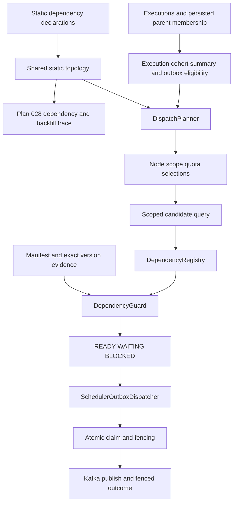

# Plan 030 — Static Graph & DispatchPlanner

Status: Owner-approved active epic in Milestone 1. Canonical story status, dependencies, readiness, and execution order belong to the [increment registry](roadmap/implementation-increments.md). This planning document does not claim that the runtime implementation exists.

Owner decisions recorded: 2026-10-08; scope clarified on 2026-10-13.

## Historical execution-cohort revision — 2026-10-13 (superseded by 2026-10-15 canonical sequence)

This section supersedes the earlier backlog-only selection design, not the historical verification evidence below. The static DAG remains a map of job types; executions populate each node with independent business-group/run/business-date scopes. BANKS and REAL_ESTATE can progress independently inside the same logical node. No outbox processing-success status, execution dependency DAG, new manifest evaluator, or workflow engine is introduced.

Completion ordering is based on persisted execution parent–child evidence for the matching cohort. Dataset readiness and exact input versions remain exclusively evaluated by the existing DependencyRegistry/DependencyGuard before each candidate claim. Execution SUCCESS is not dataset READY. JobScheduler prepares due execution/outbox intent; SchedulerOutboxDispatcher is the existing guard/claim/publish boundary.

Current source is not yet compliant: DispatchScope groups by definition UUID; the outbox-only summary loses published-but-running work; the planner can descend past an upstream node with no dispatchable work even when its executions are unfinished. P14-I2 remains verification_pending with reimplementation required; P14-I3 remains pending. Earlier PASS/owner attestation is historical, not evidence for this revision. P14-I1 remains completed: reuse its verified static graph and validate the new runtime population mapping in P14-I2 rather than reopening historical topology verification.

## Goal

Provide one validated static job topology for shared Platform use and add bounded top-down scheduler-outbox planning without duplicating job input-readiness logic or weakening existing claim/fencing behavior.

The epic is split into three independently reviewable and deliverable stories:

1. **P14-I1 — Static topology and validation**;
2. **P14-I2 — Snapshot-based dispatch planning**;
3. **P14-I3 — Dispatcher integration with preserved claim/fencing**.

The static graph answers which logical job nodes are upstream or downstream. `DispatchPlanner` answers which node/scope/quota should be considered next from a bounded backlog snapshot. `DependencyGuard`, through `DependencyRegistry`, remains the authority for whether a selected job's exact required input is READY, WAITING, or terminally BLOCKED.

## Outcome

After the epic is implemented and verified:

- Platform exposes one immutable, validated static topology with stable logical node identity and explicit mapping to existing job definitions;
- topology consumers, including scheduler planning and proposed backfill tracing, reuse the same boundary rather than maintaining competing graphs;
- scheduler planning consumes a bounded execution-centered summary, augmented with outbox eligibility counts, and traverses independent cohort paths top down;
- planning returns typed node/scope/quota selections and never reads manifests, declares data READY, creates upstream work, or returns raw SQL;
- the dispatcher queries selected candidates, evaluates every candidate through the existing `DependencyRegistry`, and claims/publishes only READY work;
- existing atomic claims, lease fencing, retry identity, WAITING behavior, terminal BLOCKED behavior, item-level readiness, and unrelated-ready-work guarantees remain intact;
- persisted graph ownership, expanded provider policy, adaptive resource scheduling, and advanced fairness remain deferred.

## Historical Source Baseline and Gaps (pre-2026-10-15)

The following baseline/gap inventory records the initial 2026-10-08 design. Current source and revised gaps are described by the 2026-10-13 owner revision and P14-I2 section; do not interpret initial missing-topology claims as current implementation absence.

Source inspection and code-review-graph analysis establish the following planning baseline. Source presence is not implementation or verification evidence for P14.

| Area                       | Reusable source capability                                                                                                                                                                                                                                                                                                                              | Gap owned by this epic                                                                                                                                        |
| -------------------------- | ------------------------------------------------------------------------------------------------------------------------------------------------------------------------------------------------------------------------------------------------------------------------------------------------------------------------------------------------------- | ------------------------------------------------------------------------------------------------------------------------------------------------------------- |
| Dependency declarations    | [`JobDefinitionConfig`](../../apps/core/src/main/java/com/omni/platform/modules/scheduler/constants/JobDefinitionConfig.java) already seeds `dependsOnJobs`, `dependsOnDatasets`, and produced datasets.                                                                                                                                                | No shared typed topology boundary, stable logical node mapping, validation report, deterministic traversal, or topology export exists.                        |
| Job readiness              | [`PlatformDependencyRegistry`](../../apps/core/src/main/java/com/omni/platform/modules/scheduler/dependencies/PlatformDependencyRegistry.java) adapts [`JobDependencyGuard`](../../apps/core/src/main/java/com/omni/platform/modules/scheduler/dependencies/JobDependencyGuard.java) into READY/WAITING/BLOCKED decisions with approved input versions. | Planner integration must preserve this boundary and must not reproduce manifest, exact-version, or dependency-mode evaluation.                                |
| Candidate loading          | [`SchedulerOutboxService.findCandidates()`](../../apps/core/src/main/java/com/omni/platform/modules/scheduler/services/SchedulerOutboxService.java) loads bounded candidate IDs and materializes execution/work identity.                                                                                                                               | There is no node/scope backlog projection or selected-scope candidate query. Current loading parses payloads before planning.                                 |
| Candidate order            | [`SchedulerOutboxRepositoryImpl.findPendingCandidateIds()`](../../apps/core/src/main/java/com/omni/platform/modules/scheduler/repositories/SchedulerOutboxRepositoryImpl.java) selects eligible unclaimed PENDING rows FIFO by availability/creation/ID.                                                                                                | No pending/dispatchable/in-flight snapshot grouped by topology node and scope, no top-down selection, and no quota result.                                    |
| Dispatch safety            | [`SchedulerOutboxDispatcher.dispatchBatch()`](../../apps/core/src/main/java/com/omni/platform/modules/scheduler/SchedulerOutboxDispatcher.java) over-fetches, invokes the registry, claims READY rows atomically, and preserves publish retry fencing.                                                                                                  | The planner is not integrated before candidate fetch. Integration must retain all guard and claim semantics and provide a safe fallback to current selection. |
| Stable definition identity | [`JobDefinition`](../../apps/core/src/main/java/com/omni/platform/modules/scheduler/entities/JobDefinition.java) has a UUID plus source/type/cron uniqueness, while several definitions can share one `JobType`.                                                                                                                                        | P14-I1 must freeze a stable static logical node identity and deterministic definition mapping without introducing the deferred persisted graph migration.     |

The graph impact radius is Platform-centered: dispatcher, outbox service/repository, dependency registry/guard, job-definition seeding, producers, job service, blocked-job compatibility, PostgreSQL scheduler tests, configuration, and operations are directly or transitively relevant. Analyzer, Ingestor, Query Service, Console, shared transport contracts, dataset writers, manifests, and storage paths have no runtime change in this epic unless a later story explicitly changes a contract; their no-impact boundaries must still be reconciled during verification.

## Historical Legacy Readiness and Disposition Review (pre-2026-10-15)

Reviewed on 2026-10-08 against Plans 001, 005, 006, and 023; TD-005, TD-007, and TD-012; current Platform scheduler/dependency source; database migrations; and code-review-graph relationships. This is a planning classification, not executed verification and not a status promotion.

Classification meanings:

- **MUST COMPLETE** — a canonical dependency or safety contract that must close before the named P14 story can activate;
- **PENDING EVIDENCE** — source exists, but required impact/coverage/runtime evidence is incomplete;
- **MISSING IN P14 SCOPE** — behavior does not exist and is intentionally delivered by a P14 story rather than treated as prior debt;
- **TECHNICAL DEBT / MOVE ON** — useful or corrective follow-up that is not required for the bounded P14 path when the stated guardrail is preserved.

| Legacy plan or source concern                                                             | Current evidence                                                                                                                                                                                                | Classification                                                                     | P14 gate                                                            | Disposition                                                                                                                                                 |
| ----------------------------------------------------------------------------------------- | --------------------------------------------------------------------------------------------------------------------------------------------------------------------------------------------------------------- | ---------------------------------------------------------------------------------- | ------------------------------------------------------------------- | ----------------------------------------------------------------------------------------------------------------------------------------------------------- |
| P4-I2 dependency policy/enforcement foundation                                            | Canonically `completed`; static dependency declarations and manifest guard exist.                                                                                                                               | MUST COMPLETE — already satisfied                                                  | P14-I1                                                              | No further Phase 4 implementation prerequisite. Preserve P4-I2 semantics.                                                                                   |
| P4-I3 dependency-aware outbox dispatch                                                    | Source and focused tests are present, but the old increment is superseded because P14-I3 will materially change the dispatcher path. Its unclosed evidence is retained in TD-014.                               | TECHNICAL DEBT / SAFETY TRANSFER                                                   | No separate gate                                                    | Reuse the source as baseline; prove all transferred safety invariants against final P14-I3 behavior rather than completing the old path first.              |
| Stable logical node identity and unambiguous definition mapping                           | `JobDefinition` has UUID plus source/type/cron uniqueness; multiple definitions can share one `JobType`; no static node-key abstraction exists.                                                                 | MISSING IN P14 SCOPE                                                               | P14-I1 acceptance                                                   | Implement in P14-I1. Stop if mapping requires persisted identity or a product decision.                                                                     |
| One shared topology declaration, validation, traversal, and export                        | `dependsOnJobs` is seeded as untyped config/traceability metadata; no typed topology owner or validation exists.                                                                                                | MISSING IN P14 SCOPE                                                               | P14-I1 acceptance                                                   | Implement in P14-I1, preserving dataset readiness as a separate guard concern.                                                                              |
| Backlog snapshot and node/scope/quota planner                                             | Current repository performs bounded FIFO candidate selection and payload materialization; no grouped snapshot or planner exists.                                                                                | MISSING IN P14 SCOPE                                                               | P14-I2 after P14-I1                                                 | Implement in P14-I2 without activating runtime dispatch.                                                                                                    |
| Scoped candidate query and planner fallback                                               | Current dispatcher over-fetches FIFO candidates, evaluates the registry, and atomically claims READY rows.                                                                                                      | MISSING IN P14 SCOPE                                                               | P14-I3                                                              | Implement after P14-I2 and prove the transferred TD-014 safety contract on the final path. Preserve FIFO fallback.                                          |
| Legacy `blocked_jobs` table and `BlockedJobTracker`                                       | V7 table/entity/service exist, but current `JobScheduler` no longer calls the tracker and graph analysis found no caller of the tracker class; scheduler-outbox WAITING/BLOCKED now owns active dispatch state. | TECHNICAL DEBT / MOVE ON                                                           | None for P14-I1/P14-I2; no runtime dependency for P14-I3            | Do not integrate it into topology/planning. Track non-destructive decommission/schema-retention review separately; never delete audit state as part of P14. |
| Missing `PARTITION_MATCH`, `SUPPORTED_SCHEMA_VERSION`, and `MAX_FRESHNESS_LAG` evaluators | Enum/config parameter support exists, but no evaluator is registered; unsupported configured conditions fail closed as dependency errors. Current explicit P4-I2 enforced path uses EXISTS/READY.               | TECHNICAL DEBT / MOVE ON unless a selected active job requires one                 | None for current P14 scope                                          | Keep out of P14. Promote a bounded guard-contract story only before enabling a declaration that uses one of these conditions.                               |
| Async dependency evaluation lifecycle/admission                                           | Virtual-thread parallel evaluation source exists; executor shutdown, downstream admission bounds, and representative load evidence remain open in TD-007.                                                       | TECHNICAL DEBT / MOVE ON for P14-I1/P14-I2; operational activation risk for P14-I3 | Reassess before P14-I3 load/activation evidence                     | Keep TD-007 separate. Planner must not increase guard concurrency or claim a capacity improvement.                                                          |
| Empty-output versus execution-success semantics                                           | TD-005 confirms execution SUCCESS does not prove dataset completeness; guard readiness remains manifest/version based.                                                                                          | TECHNICAL DEBT / MOVE ON                                                           | None if planner never interprets SUCCESS/backlog emptiness as READY | Preserve the explicit rule that topology position, empty backlog, and execution SUCCESS are not data-readiness evidence.                                    |
| P1-I3 canonical sector writer evidence                                                    | `verification_pending`, but it does not provide scheduler topology identity, candidate selection, or claim safety and is not a P14 dependency.                                                                  | TECHNICAL DEBT / MOVE ON relative to P14                                           | None                                                                | Retain its independent evidence queue; do not couple P14 delivery to sector-writer completion.                                                              |
| Persisted topology and Plan 028 graph migration                                           | Proposed and unscheduled; P14-I1 intentionally owns static topology only.                                                                                                                                       | TECHNICAL DEBT / MOVE ON                                                           | None                                                                | Keep deferred. If promoted later, require parity and one-authority cutover behind the P14 topology boundary.                                                |
| Provider-aware policy, adaptive quotas, and advanced fairness                             | No approved requirement or measured need for P14 baseline.                                                                                                                                                      | TECHNICAL DEBT / MOVE ON                                                           | None                                                                | Keep deferred under TD-012/Plan 030 deferred scope. Baseline deterministic bounded allocation remains sufficient.                                           |

### Move-on decision

- **P14-I1 is completed** after its approved local Platform test/coverage/build gate, attributable coverage reconciliation, and owner attestation. P4-I2 is completed and no unresolved old-plan item is a canonical dependency.
- **P14-I2 is verification_pending** with execution-centered cohort reimplementation required by the 2026-10-13 owner decision; earlier checks and attestation apply only to historical source. Freeze authoritative group/date/run correlation and membership closure before implementing the revised projection and planner. The planner remains inactive.
- **P14-I3 is pending** until corrected P14-I2 passes renewed verification. It owns the final integrated dependency-aware dispatcher proof. TD-014 safety invariants are mandatory acceptance, while a separate P4-I3 completion is not required. Re-evaluate TD-007 only if measured integration/load evidence makes it relevant.
- Moving residual work to technical debt means retaining explicit activation triggers and safety boundaries; it does not mean marking the work complete, deleting legacy state, or weakening P14/P4 acceptance criteria.

## Historical Architecture and Responsibility Boundaries (pre-2026-10-15)

| Component                            | Owns                                                                                                                      | Must not own                                                                                       |
| ------------------------------------ | ------------------------------------------------------------------------------------------------------------------------- | -------------------------------------------------------------------------------------------------- |
| Static topology                      | Stable node identity, directed edges, definition mapping, roots, deterministic traversal, validation, diagnostics/export. | Runtime backlog, manifest readiness, claim state, provider quotas, persisted dependency authority. |
| DispatchPlanner                      | Selection of node/scope/quota from one bounded snapshot using top-down traversal and baseline bounded allocation.         | Dependency readiness, upstream enqueue, payload parsing, SQL construction, claims, publication.    |
| DependencyRegistry / DependencyGuard | Required input scope, dependency mode, manifest readiness, exact `dataVersion`, READY/WAITING/BLOCKED decision.           | Cross-node priority, dispatch quota, backlog fairness.                                             |
| SchedulerOutboxDispatcher            | Orchestration of plan, scoped candidate fetch, guard decision, atomic claim, publish, and fenced outcome.                 | Duplicate topology or manifest policy.                                                             |
| Repository/service                   | Parameterized snapshot and candidate projections plus existing atomic state transitions.                                  | Scheduling policy or raw-SQL output from the planner.                                              |

An empty upstream outbox backlog is neither execution-completion nor readiness evidence. A selected candidate can still be WAITING or BLOCKED. Snapshot values are advisory; the atomic claim must revalidate status, availability, lease, and fence identity. Parent relationships identify fan-out membership within a job step, not dependency edges across job steps. Match upstream and downstream parents through explicit cohort identity and the static topology, never by assuming their parent IDs are equal.

## Canonical revised delivery sequence — 2026-10-15

**This section supersedes the earlier 2026-10-13 and prior P14-I2/P14-I3 target scopes and acceptance language elsewhere in this file. Historical verification remains historical evidence, not the current implementation target.** The new architecture is **target-driven JobRun → static-DAG preparation → existing durable outbox → JobRun-aware publish admission**. The goal is not to implement a general workflow engine.

| Story | Status | Independently deployable output | Runtime boundary |
| --- | --- | --- | --- |
| **P14-I1** — Static topology | `completed` | Existing validated immutable static DAG | No dispatcher activation |
| **P14-I2** — Static DAG dispatcher contract and handoff | `verification_pending` | Definitive topology-to-dispatch contracts, traversal/ancestor closure, mapping, validation, tests and handoff for I3 | **No JobRun schema, outbox changes, runtime activation or dashboard SQL requirement** |
| **P14-I3** — Unified JobRun + target DAG preparation | `pending` | Durable `job_runs` and DAG path/membership; prepare dependencies then target, enqueue messages in stable dependency-first order | Existing FIFO outbox + existing DependencyRegistry guard/claims/publish behavior retained |
| **P14-I4** — JobRun-aware outbox planner and admission | `pending` | Bounded execution-centered JobRun snapshot; cohort barriers, quota/fairness, scoped candidate reads and atomic admission revalidation | Planner activated with safe FIFO fallback, preserve fencing/retry and full TD-014 proof |
| **P14-I5** — SQL diagnostics and performance evidence | `pending` | Versioned SQL diagnostics, `EXPLAIN (ANALYZE, BUFFERS)`, measured snapshot/claim/dispatch latency and metrics read-projection dictionary | No dashboard UI or new statistics store |
| **P14-I6** — Operations/read-model handoff | `pending` | Stable bounded JobRun/topology read contract and documentation/fixtures for Plan 029 graph-specific view | API/read model only if actually required and approved; Plan 029 still owns dashboard UI |

Dependencies are **I1 → I2 → I3 → I4 → I5 → I6** for new graph-specific capabilities. Basic Plan 029 operations/stage work remains separately scheduled. No current status is promoted by this documentation decision.

### P14-I2 — Finalize static DAG for dispatch use

Outcome: finish *existing* P14-I2 (currently `verification_pending`) by narrowing it to a validated, reusable **static topology contract** for consumers including I3 and backfill. Reconcile existing P14-I1 graph source and WIP inactive planner scaffolding. Provide deterministic ancestor closure of a target, topological ordering, multiple roots/joins, stable definition mapping, and diagnostics. Define a versioned internal handoff interface such as `resolveRequiredPath(targetDefinition, scope)` returning **definition/node path only**, not runtime execution or message claims.

- No new execution-centered cohort completion logic, `job_runs` persistence, Kafka publication, SQL performance baseline or dashboard metrics under I2. Existing unfinished snapshot/planner classes may remain unused, be adapted atomically, or be marked explicitly as **DEPRECATION CANDIDATE** with caller inventory; never break builds or the current dispatcher.
- **Acceptance:** graph traversal/ordering tests, definition mapping with duplicate/missing/cycle detection, independent root paths, startup/build/regression verification, and an I3 integration contract; scheduler/outbox behavior unchanged. P14-I1 historical PASS remains valid, I2's earlier backlog-only PASS does not close this revised story.

### P14-I3 — Unified JobRun and DAG preparation without outbox behavior change

One **`job_runs`** row is the durable logical request; `job_runs.id` is the authoritative UUID `jobRunId`. Modes: `SCHEDULED`, `MANUAL`, reserved `BACKFILL`. Record target job definition, businessGroup/businessDate (and future scope), request metadata/idempotency, path topology version/fingerprint if needed, lifecycle and failure reason. **Persist complete resolved ancestor + target path/membership** in an explicit stable bounded representation (e.g. run-step rows), linking `job_execution_histories` root/child executions to their run. Persist enough to reconstruct completed/unfinished predecessors after restart even if static declarations change. Do not infer from `triggeredAt` or legacy `runKey`. Use an approved additive schema/migration, but **no persisted second topology authority or arbitrary execution DAG**: run steps are an immutable instance of the static graph at run creation.

- **Definition reduction means reduce independently scheduled roots, not delete dependency definitions required by producers.** Keep executable definitions/configuration for all path steps. Mark only user/scheduler-selected **target roots** as independently triggerable; their ancestors may become dependency-only with no independent cron. Audit existing cron definitions before disabling any, prevent duplicate target/ancestor work, and preserve explicit standalone/manual scheduling where still required.
- Scheduled/manual requests both enter the JobRun creation boundary. Manual uses `job_runs` for request identity/audit/idempotency. **Drop `manual_job_triggers` and its V8-era runtime entity/repository usage after manual controllers/services have atomically cut over and integration tests pass; no historical-data migration is required or claimed by owner decision.** An already-applied Flyway V8 is never deleted/rewritten; add a forward migration that safely drops the obsolete table only when deployed app no longer reads it. Existing endpoint semantics/permissions remain compatible or receive explicit reviewed deprecation, not accidental 500s. Archive/drop audit data is an explicit intentional consequence.
- Materialize all approved required dependency + target executions and outbox messages **in DAG topological order** (dependencies before dependents), preserving per-parent one-time fan-out membership closure and zero-child behavior. The **full planned path** must remain visible in `JobRun` even if outbox preparation is chunked/retired; do not claim closure merely from a partial batch. Use transactional idempotency keys such as (run, step, work identity, business date) and bounded transactions; no N+1 fan-out expansion or unbounded single transaction. Retry/restart must never duplicate a logical step. Existing dataset readiness and exact-version rules apply before work can be considered successful.
- **I3 leaves `SchedulerOutboxDispatcher.findCandidates()`, FIFO selection, `DependencyRegistry`, WAITING/BLOCKED, atomic claim/fencing, retries and Kafka publish intact.** Dependency-first enqueue/FIFO is a *preference*, **not an execution completion guarantee**: an upstream may be PUBLISHED but not finished when downstream candidates are examined. If the existing guard cannot prove required execution completion for a new run path, **do not activate the new target-driven route in I3**; keep it behind a disabled-by-default feature flag or enforce a bounded guard-compatible safe admission rule. No silent correctness regression allowed before I4.
- Independent rollback/verification: no schema removal before cutover; old scheduled/manual runtime works during staging, then new target-run creation may be separately enabled after compatibility checks. PostgreSQL tests for referential integrity, commit/rollback, retry/crash, duplicate runs, multiple definitions and multiple dates; manual API and legacy outbox regression PASS.

### P14-I4 — JobRun snapshot, DispatchPlanner and outbox integration

Outbox planning now reads the persisted **JobRun path and run-step membership as authoritative planned work**, plus execution statuses (including published-but-unfinished) and separate outbox eligibility/lease aggregates. **No need to re-discover inter-step correlation from timestamp heuristics**. The static DAG validates path structure, but the immutable persisted JobRun instance fixes expected membership, join branches, and target. Snapshot queries are bounded and short-lived; topology is in-memory, runtime state is PostgreSQL-first. Long-lived cache/recovery is deferred to [TD-017](../technical-debt/017-scheduler-cache-and-recovery-epic.md).

- For each businessGroup/businessDate/jobRunId cohort, keep earliest unfinished dependency step eligible for remaining sends. Only advance past predecessor completion with **persisted closed membership and all required executions SUCCESS**; FAILED/BLOCKED/unknown/incomplete cannot open a barrier. At joins require every required predecessor. Do not conflate outbox PUBLISHED with worker completion; legacy execution RUNNING is preparation-time and is not evidence of worker start.
- DispatchPlanner returns typed step/run scope, quotas/order and diagnostic reason. Outbox queries only selected scopes; evaluate the existing `DependencyRegistry` for every candidate, then **revalidate cohort barrier at admission/claim**, preserve lease/fencing/retries/approved inputs and publish-ack semantics. Ensure fairness across independent roots/cohorts, no starvation on WAITING/BLOCKED/lost claims; add bounded observable fallback that **cannot bypass cohort barrier while enabled**. Explicit rollback to historical FIFO semantics requires a conscious operator decision.
- Verification: A→B→C 100 items, dispatch budget 75 ⇒ 75 A, then 25 A while earlier items RUNNING, wait for SUCCESS and closed membership, then B; cross-date/group/run isolation; joins, empty/failed/incomplete parents, concurrent enqueues, retries, stale snapshot, restart, old rows and full TD-014 transferred dispatcher safety.
- I4 must be deployable independently after I3 without a metrics/dashboard prerequisite.

### P14-I5 — Measurable diagnostics and benchmarks

Deliver runnable **read-only SQL diagnostics** for active JobRun cohorts, path completeness, parent/child status, waiting/failing joins, published-but-unfinished steps, eligible/leased/retry-delayed outbox, unknown identity and overcount detection. Each query documents parameters, bounds, expected cardinality, sample-safe use and interpretation. Benchmark snapshot and claim SQL using controlled `EXPLAIN (ANALYZE, BUFFERS)`, rows scanned/returned, index scans/buffer reads, transaction duration, Hikari active/idle/pending/wait, round trips, per-tick snapshot/planner latency p50/p95/p99 and planned→selected→claimed→published→executed breakdown. **No made-up PASS thresholds**; baseline and regression comparison with dataset size, environment and sampling window. `pg_stat_statements` is optional, not presumed installed. Define a low-cardinality metrics/read-projection dictionary for Plan 029 (not a UI).

I3/I4 require **targeted safety/query correctness diagnostics** before activation; moving the consolidated SQL *deliverable* to I5 does **not** defer necessary I3/I4 security, concurrency, fail-closed, lock/cost or regression checks.

### P14-I6 — Operator read-model handoff

Expose or specify bounded JobRun/path/step progress, queue backlog, completion/wait/blocked reason, throughput, snapshot freshness and uncertain/UNKNOWN flags for Plan 029. Distinguish execution preparation/status from actual worker processing (P13-I1 timing evidence). No high-cardinality metric labels, full graph engine, dataset manifest reimplementation or dashboard UI duplication. Keep all required API addition/migration and backward-compatible fields scoped and independently testable; otherwise documentation/SQL contracts alone suffice and no new endpoint should be introduced.

### Cross-cutting migration and deprecation

At **every story boundary**, build/test must PASS and the pre-existing enabled scheduled/manual/FIFO behavior must remain correct. Schema change is expand → cut over all readers/writers → safe forward-only drop, never mutate old applied Flyway migrations. Deprecate still-used Java interfaces via `@Deprecated` **when a safe compatibility adapter is retained**; document replacement, callers and removal gate. For SQL/tables, endpoints, or hard removals without an annotation, document deliberate breaking-contract removal and the exact migration/rollback plan. Preserve existing `triggeredAt`, `executionId`, `parentLogId` and `runKey` semantics until their usages are reviewed; `jobRunId` replaces only *cross-step* correlation. No source is deprecated merely because cleanup might be useful.

## Relationship to Other Plans

- **Plan 023 / TD-014:** existing DependencyRegistry, guarded claim and publish are unchanged by I2/I3; their final post-planner safety verification transfers to **P14-I4**.
- **Plan 028:** reuse static DAG ancestor-path resolution from I2 and unified JobRun target-run preparation from I3; full date-range backfill, previews, date/version producer and writer adaptations remain independently proposed. Do not create a second DAG or orchestration authority.
- **Plan 029:** basic Job Operations, Data Health and shell remain independent. JobRun/graph-specific read views consume I5 evidence and I6 bounded handoff; worker stage truthfulness remains P13-I1.
- **TD-017:** performance-triggered future long-lived cache and startup cache reconstruction only; PostgreSQL remains authoritative.

## Deferred Scope

The following remain deferred and are not acceptance criteria for P14:

- persisted job graph, graph administration API/UI, or migration away from static ownership;
- provider-specific rate policy, provider rotation, or an expanded provider-policy framework;
- weighted/aging/priority-class fairness, adaptive quotas, resource-aware placement, or automatic concurrency changes;
- runtime-generated DAG edges, conditional branches, ANY/quorum dependencies, remaining-dependency counters, or a workflow engine;
- backfill expansion, new historical producer transport contracts, or repair actions; reading and validating business-date/run/group identity from existing executions is required by this revision;
- TODO future: symbolKey-level cohort grouping and dedicated scheduler DLQ/replay policy. Neither snapshot equality nor quarantine opens a failed cohort barrier;
- generic static dependency snapshot extraction from job-definition-specific resolution, tracked in [TD-012](../technical-debt/012-static-dag-dispatch-planner.md#deferred-generic-static-dependency-snapshot); current delivery reuses the existing definition-derived graph rather than introducing another abstraction;
- Kafka, protobuf, manifest, dataset-path, dataset-writer, or worker-runtime changes.

## Dataset Outputs

No analytical dataset output.

## Metadata Outputs

No dataset metadata output.

The epic does not read or write dataset manifests as topology state. `DependencyGuard` continues to read existing readiness and exact-version evidence, and existing producers retain READY-last publication semantics.

## Algorithm Feature Outputs

No direct algorithm feature output.

## Algorithms Unlocked

No trading or research algorithm is introduced. The shared topology makes deterministic dependency/backfill tracing possible, and bounded planning makes scheduler selection explainable and independently testable.

## Contract Impact and Field/DTO Inventory — canonical 2026-10-15

| Owner | Contract change | Required compatibility |
| --- | --- | --- |
| I2 | Static target→ancestors topological path, definition/node identity mapping, diagnostics | Additive internal API; no runtime activation |
| I3 | **New `job_runs` and durable run-step membership**; `jobRunId` link to root/child execution; scheduled/manual/backfill mode; target/scope/request context | New forward Flyway migration; manual API cutover before dropping manual table; old rows/FIFO/guard remain safe; no modification of applied V8 |
| I3 | Optional root-only autonomous cron scheduling | Dependency definitions/producer configs retained; no silent loss of independent required schedules; explicit opt-in |
| I4 | Execution/outbox read projection, typed JobRun cohort/step/quota selection, scoped queries and enabled/fallback config | Read-only bounded snapshot, claim-time revalidation, guarded/fenced publishing and rollback |
| I5 | Versioned diagnostic SQL, benchmark evidence, metric read dictionary | No metric storage/schema/public API required solely for measurement |
| I6 | Bounded JobRun operations projection or approved API | No duplicate Plan 029 UI, explicit UNKNOWN and authorization |
| Deferred | Cache lifecycle and startup cache recovery (TD-017); full historical backfill (Plan 028) | Separate owner approval |

Kafka/protobuf, dataset manifests, storage object paths and Python worker transport stay unchanged **unless an I3 dependency-preparation implementation proves an additive producer/consumer contract is unavoidable**; if so stop, document blast radius and obtain a separately approved compatibility slice. Never conflate JobRun/step completion with outbox PUBLISHED or dataset READY. `triggeredAt` remains audit timestamp; legacy `runKey` remains compatible until cutover; `jobRunId` is run correlation, not child identity.

## Cross-Service Blast Radius

| Surface                    | Impact or no-impact reason                                                                                                                                                                                                                                                                                                                                                                                               |
| -------------------------- | ------------------------------------------------------------------------------------------------------------------------------------------------------------------------------------------------------------------------------------------------------------------------------------------------------------------------------------------------------------------------------------------------------------------------ |
| Platform                   | Primary owner: topology population mapping, execution/parent/cohort projection, producer metadata inventory, JobService aggregation safety, planner, scoped queries, dispatcher, configuration and tests. Graph impact analysis on JobService, snapshot service and dispatcher found 16 additional impacted files; bounded results were truncated and included 84 unresolved call sites, not proof of no further impact. |
| Analyzer                   | No runtime change: planner selection is Platform-local and worker payloads remain unchanged. Reconcile only if a later story changes transport, which this epic forbids.                                                                                                                                                                                                                                                 |
| Ingestor                   | No runtime change for the same reason; provider behavior and ingestion concurrency remain deferred.                                                                                                                                                                                                                                                                                                                      |
| Query Service              | No runtime change. It does not own scheduler topology or dispatch planning.                                                                                                                                                                                                                                                                                                                                              |
| Omni Console               | No P14 runtime scope. A later Plan 029 graph visualization may consume an explicitly approved Platform read projection after P14-I2.                                                                                                                                                                                                                                                                                     |
| Shared contracts/libraries | No protobuf, Kafka, or shared Python change. Hand-written Java abstractions remain in Platform because current ownership is scheduler-local.                                                                                                                                                                                                                                                                             |
| Persistence                | Execution histories, parent aggregation, metadata identity and outbox eligibility are jointly impacted. Review bounded joins/indexes, late-child closure and retry correlation; no graph/count persistence or outbox status is approved. Missing identity/closure evidence requires an explicit contract/migration decision before implementation.                                                                       |
| Configuration              | Additive Platform-local bounded settings in P14-I3; no provider credentials, regions, topics, or storage paths.                                                                                                                                                                                                                                                                                                          |
| Tests                      | Platform unit and PostgreSQL integration tests are directly impacted; producer/worker contract tests are no-impact while payloads remain unchanged.                                                                                                                                                                                                                                                                      |
| Operations                 | Add bounded planner diagnostics, fallback visibility, and query-cost evidence; no deployment topology, capacity, or provider-policy change.                                                                                                                                                                                                                                                                              |

## Repository Guidance Updates

Implementation must review and update, where applicable:

- [`AGENTS.md`](../../AGENTS.md), [`CLAUDE.md`](../../CLAUDE.md), and [`.roo/rules`](../../.roo/rules) only if architecture/workflow guidance changes;
- [`docs/README.md`](../README.md), [`docs/INDEX.md`](../INDEX.md), and the canonical roadmap;
- [`docs/architecture/001-system-overview.md`](../architecture/001-system-overview.md);
- [`docs/flows/001-job-execution.md`](../flows/001-job-execution.md);
- [`docs/data/003-database.md`](../data/003-database.md) if snapshot indexes or query ownership change;
- [`docs/development/001-where-to-change.md`](../development/001-where-to-change.md);
- Plans 023, 028, and 029 plus TD-012.

This planning update clarifies roadmap hierarchy and approved architecture but changes no runtime coding rule. Existing repository guidance already requires Platform-local dependency policy, graph impact analysis, claim/fencing preservation, and explicit cross-service reconciliation; therefore no immediate `AGENTS.md`, `CLAUDE.md`, or `.roo/rules` edit is required.

### Documentation disposition for the 2026-10-13 revision

Architecture, execution flow, developer ownership guidance, field/DTO inventory, registry, roadmap selection, TD-012 and release notes have revision records. Documentation indexes retain their existing Plan 030 links; no new document is introduced. Plans 023/028/029 and TD-014 retain their original ownership and dependency relationships; no independent schedule, backfill rollout or UI contract is changed. Data-lake/Kafka contracts and deployment/service runtime instructions have no implementation change from this documentation-only revision. Database documentation must be revisited when identity/closure or projection/index design is frozen. No agent-rule change is proposed: existing guard ownership and verification gates remain applicable. These dispositions do not claim that every linked document or path has passed a complete static audit; remaining audit scope must close before documentation synchronization is marked complete.

## Verification — historical evidence and new story-level gates

P14-I1 source implementation is present in the Platform scheduler topology package:

- `TopologyNodeKey` provides validated stable logical keys derived from `JobType`;
- `JobDefinitionIdentity` maps the existing `(source, jobType, cronExpr)` database identity without a migration;
- `StaticTopologyDeclaration` preserves raw nodes, edges, and mappings for validation;
- `StaticJobTopology` provides immutable roots, direct/transitive traversal in both directions, deterministic topological order, bounds, mapping lookup, validation, and Mermaid diagnostics;
- `StaticJobTopologyProvider` is the single active declaration boundary and derives job-to-job edges from existing seed `dependsOnJobs` metadata without reading manifest readiness;
- `StaticJobTopologyTest` covers the canonical seed graph, multiple definitions sharing one type, traversal/export, invalid keys, unknown/duplicate/self edges, cycles, unmapped/ambiguous definitions, bounds, unknown lookups, traversal depth, and malformed dependency metadata.
- `JobDefinitionSeederTest` covers seed-owned title/fallback/config synchronization while preserving source identity and runtime-owned scheduling fields.

P14-I1 blast-radius reconciliation:

- Platform: changed by additive topology classes/tests plus startup seed synchronization of title, fallback sources, and config for the existing `(source, jobType, cronExpr)` identity; scheduler dispatch, producers, claims, dependency guard, public controllers, runtime-owned scheduling fields, and stale-row policy are unchanged.
- Analyzer and Ingestor: no runtime impact because Kafka payloads, worker handlers, and job execution contracts are unchanged.
- Query Service and Console: no impact because no API or graph presentation endpoint is introduced.
- Shared contracts/libraries: no impact because Proto3, py-common, topic configuration, and generated code are unchanged.
- Persistence and configuration: no impact because the graph is process-local, derives from existing seeds, and adds no migration, table, index, property, or environment variable.
- Dataset/storage contracts: no impact because manifests, readiness, lineage, logical paths, producers, and consumers are unchanged.
- P14-I2 persistence/query impact: additive read-only PostgreSQL aggregation reuses existing outbox/execution/job-definition columns and indexes; no migration, status, write path, claim path, or payload materialization change is introduced.
- Operations: startup constructs topology, snapshot service, and pure planner beans; no scheduler or dispatcher calls them, so runtime dispatch behavior remains unchanged.

Code-review-graph impact analysis was performed before implementation and reconciled against Platform, Analyzer, Ingestor, Query Service, Console, shared contracts/libraries, persistence, configuration, tests, and operations. The owner approved and reviewed the complete local verification gate on 2026-10-11:

- `nx run platform:test` — PASS;
- `nx run platform:coverage` — PASS, with attributable JaCoCo evidence for every changed critical class;
- `nx run platform:build` — PASS;
- compact gate: `PASS P14-I1 required=3 pass=3 fail=0 unknown=0 missing=0 sources=exit_code`;
- owner attestation: `OWNER_VERIFIED P14-I1 verified_by=tanlocit9`, bound to summary SHA-256 `77c59cef1535dfda4cf3c84d581e6ca3a715ede604b2228e32b20ef6309a2ad4`.

The checks emitted shutdown-hook Hikari warnings after tests but completed successfully. No CI, deployment, provider, production, migration, load, or live-runtime verification is claimed or required by the bounded P14-I1 process-local topology scope.

P14-I1 impact/source/test coverage matrix:

| Feature / criterion                                                  | Source                      | Executed tests                                                                | Attributable coverage       |
| -------------------------------------------------------------------- | --------------------------- | ----------------------------------------------------------------------------- | --------------------------- |
| Stable logical node key                                              | `TopologyNodeKey`           | `StaticJobTopologyTest`                                                       | 100.0% line / 100.0% branch |
| Stable definition identity                                           | `JobDefinitionIdentity`     | `StaticJobTopologyTest`                                                       | 93.3% line / 83.3% branch   |
| Immutable raw declaration                                            | `StaticTopologyDeclaration` | `StaticJobTopologyTest`                                                       | 100.0% line / no branches   |
| Validation, roots, traversal, order, bounds, mapping, Mermaid export | `StaticJobTopology`         | `StaticJobTopologyTest`                                                       | 99.2% line / 94.8% branch   |
| Seed-derived nodes/edges and malformed metadata diagnostics          | `StaticJobTopologyProvider` | `StaticJobTopologyTest`                                                       | 100.0% line / 100.0% branch |
| Startup seed synchronization with runtime-field preservation         | `JobDefinitionSeeder`       | `JobDefinitionSeederTest`                                                     | 93.5% line / 100.0% branch  |
| Canonical seed/dependency declaration                                | `JobDefinitionConfig`       | `JobDefinitionConfigTest`, `JobDefinitionSeederTest`, `StaticJobTopologyTest` | 99.4% line / 91.3% branch   |

Historical evidence: the earlier P14-I2 source passed its owner-approved local verification gate on 2026-10-12. This evidence does not cover the subsequent per-path/freshness correction:

- `nx run platform:test` — PASS after focused repair of Spring constructor selection and repository-proxy exception expectation;
- `nx run platform:coverage` — PASS, with every P14-I2 critical component above the 80% line/branch threshold;
- `nx run platform:build` — PASS;
- compact gate: `PASS P14-I2 required=3 pass=3 fail=0 unknown=0 missing=0 sources=exit_code`;
- owner attestation: `OWNER_VERIFIED P14-I2 verified_by=tanlocit9`, bound to summary SHA-256 `afacc8b02a7216de87631fbab178207dbe860bb869c3e560858a0478a2902255`.

The suite emitted known shutdown-hook Hikari warnings, and compilation reported the native-JPA unchecked warning tracked by TD-015; neither failed the gate. No CI, commit, merge, deployment, production, load, or dispatcher-runtime activation is claimed.

Historical source correction — 2026-10-12, superseded as the target design by the 2026-10-13 cohort revision: planner traversed nodes without dispatchable work, stopped occupied paths and deduplicated scopes. Explicit evaluation time and positive maximum snapshot age were added; tests were not run. This source does not enforce execution-cohort completion barriers. Earlier coverage below remains historical, not verification of the revised target.

Historical reconciliation for the 2026-10-12 source correction: only planner/result APIs and focused tests changed, without runtime activation or transport/schema changes. This does not describe the 2026-10-13 revised implementation blast radius; use the Cross-Service Blast Radius and revised P14-I2 requirements above. The referenced execution-log.md is absent; existing canonical evidence records are used. SQL output limits do not prove bounded scan cost; query-load evidence remains unclaimed.

Historical P14-I2 impact/source/test coverage matrix:

| Feature / criterion                                         | Source                                              | Executed tests                                        | Attributable coverage       |
| ----------------------------------------------------------- | --------------------------------------------------- | ----------------------------------------------------- | --------------------------- |
| Explicit persisted-definition scope                         | `DispatchScope`                                     | `DispatchPlannerTest`, `PlanningContractsTest`        | 100.0% line / 100.0% branch |
| Mutually exclusive backlog count contract                   | `BacklogCounts`                                     | `PlanningContractsTest`, `BacklogSnapshotServiceTest` | 100.0% line / 85.7% branch  |
| Timestamped bounded complete/incomplete snapshot            | `BacklogSnapshot`                                   | `BacklogSnapshotServiceTest`, `PlanningContractsTest` | 95.0% line / 83.3% branch   |
| Typed bounded planner result                                | `DispatchPlan`                                      | `DispatchPlannerTest`, `PlanningContractsTest`        | 100.0% line / 100.0% branch |
| Topology mapping, truncation, stale/duplicate scope failure | `BacklogSnapshotService`                            | `BacklogSnapshotServiceTest`                          | 100.0% line / 87.5% branch  |
| Roots, joins, backoff isolation, quotas and cursor fairness | `DispatchPlanner`                                   | `DispatchPlannerTest`                                 | 98.1% line / 87.5% branch   |
| Raw persisted aggregate identity/count contract             | `SchedulerBacklogGroup`                             | `PlanningContractsTest`, PostgreSQL repository test   | 100.0% line / 87.5% branch  |
| Read-only PostgreSQL backlog classification/projection      | `SchedulerOutboxRepositoryImpl.findBacklogGroups()` | `JobDefinitionClaimRepositoryPostgresTest`            | 100.0% line / 100.0% branch |

Implementation verification must use the confirmed Platform targets and receive approval before execution. Required evidence includes:

- code-review-graph impact analysis before shared API/configuration/persistence changes and change detection after edits;
- explicit reconciliation of Platform, Analyzer, Ingestor, Query Service, Console, shared contracts/libraries, persistence, configuration, tests, and operations;
- an impact-to-test matrix for every changed/directly impacted production path and acceptance criterion;
- independently attributable coverage of at least 80% line and 80% branch for topology validation/traversal, snapshot classification, planner selection, scoped candidate query, and integration/fallback components;
- P14-I1 tests for deterministic identity/mapping, multiple definitions per type, roots, joins, ancestors/descendants, duplicate/self/unknown/dangling edges, cycles, graph bounds, and stable export;
- P14-I2 tests for pending/dispatchable/retry-delayed/in-flight classification, multiple roots, joins, empty upstream nodes, shared descendants, incomplete/stale snapshots, deterministic quotas, underfilled budgets, WAITING/backoff isolation, and baseline no-starvation;
- P14-I3 dispatcher and PostgreSQL tests for selected-scope querying, guard invocation for every candidate, READY/WAITING/BLOCKED, concurrent claim loss, lease expiry, token/instance fencing, attempt accounting, retry identity, publication acknowledgement, terminal non-reclaimability, underfill/refill, fallback, and legacy rows;
- bounded query-plan/load evidence before asserting a performance benefit;
- static documentation-consistency audit after documentation synchronization;
- approved targeted Platform test/coverage/build checks and applicable exact-head CI/runtime evidence before any story is marked completed.

Aggregate project coverage, source presence, graph reachability, broad suite success, or Git/CI identifiers cannot substitute for story-attributable behavior evidence.

## Acceptance Criteria — canonical 2026-10-15

### P14-I1 — completed (historical evidence retained)

- [x] Static topology, mapping, deterministic traversal and cycle/duplicate/dangling validation have already passed the recorded P14-I1 gates; do not rewrite the attestation for subsequent changes.

### P14-I2 — static topology handoff

- [ ] Reuse the P14-I1 validated graph to resolve target ancestors, stable job definition mapping and dependency-first topological order; multiple roots/joins, cycles, missing/duplicate definitions, deterministic output and bounded traversal covered by tests.
- [ ] Produce an approved internal graph-to-dispatch handoff **without** adding JobRun schema/runtime outbox integration/metrics UI; version the contract and validate I3 compatibility.
- [ ] Inactive earlier snapshot/planner scaffolding is reconciled or documented as candidate for deprecation/removal with caller inventory; legacy scheduler/dispatcher builds and tests pass unchanged.

### P14-I3 — unified JobRun, DAG path and durable preparation

- [ ] `job_runs.id` is `jobRunId`, with durable target/mode/group/date/path and immutable run-step membership. Every step can be mapped to required predecessors, execution/outbox evidence and run identity after restart. No timestamp-based cross-step correlation.
- [ ] All executable ancestor job definitions remain available as dependency-only definitions; only independently scheduled **root targets** are reduced after reviewing cron and manual use. DAG path resolves and enqueues dependencies before target without producing unsupported extra descendants.
- [ ] Manual trigger controller/API/idempotency/permissions and audit move to JobRun; obsolete `manual_job_triggers` table is dropped via **new forward-only migration after code cutover** (no data migration); prior Flyway migration files are untouched. No broken startup state during rollout.
- [ ] Existing outbox FIFO/guard/claim/retry/fencing/publish behavior remains compatible; **enqueue order is not completion safety**. Any newly introduced target-run route is gated off unless existing guard or a proven safe admission check prevents downstream execution before upstream SUCCESS/closed membership.
- [ ] Transaction, partial preparation, crash/replay, concurrent run, duplicate creation, zero-child, missing/failed work, and safe rollback tests pass with legacy/manual/scheduled behavior unaffected.

### P14-I4 — JobRun-aware planning and guarded outbox integration

- [ ] Bounded PostgreSQL read snapshot includes closed run-step and child membership, terminal and published-but-unfinished evidence, separate outbox lease/eligibility/retry states, freshness, completeness and UNKNOWN reasons.
- [ ] Planner selects earliest incomplete predecessor path, advances only on required predecessor SUCCESS + closed membership, respects joins and isolates businessGroup/businessDate/jobRunId; no implicit graph traversal beyond target.
- [ ] The 100-item budget-75 trace verifies 75→25 upstream dispatch while children run, barrier WAIT, eventual downstream advance and unused quota going to other scopes.
- [ ] Before every admission/claim, revalidate the selected JobRun cohort barrier, use DependencyRegistry READY/WAITING/BLOCKED and preserve atomic fenced publish/retry/ack. Bounded no-starvation fallback and legacy row compatibility tested, transferred [TD-014](../technical-debt/014-dependency-aware-dispatch-verification-residue.md) evidence completed.
- [ ] Targeted SQL query cost, concurrency, bounds and restart evidence are sufficient to activate I4 safely; the full performance/metrics pack is owned by I5.

### P14-I5 — measured evidence

- [ ] Versioned diagnostic SQL and safe bounded `EXPLAIN (ANALYZE, BUFFERS)` steps cover run steps, membership/completion, backlog, blocked/unknown causes, index usage and overcount prevention.
- [ ] Dataset/window/environment-aware p50/p95/p99 planner/snapshot/claim durations, rows and buffers, DB calls, Hikari pool pressure, execution/publish throughput, comparisons and uncertain states are measured rather than guessed.
- [ ] Definitions and limitations for Plan 029 metrics are recorded; no premature UI or new stats persistence.

### P14-I6 — operations read-model handoff

- [ ] Graph-specific JobRun/path status, completeness, backlog, uncertain states and measured progress can be consumed through a bounded read contract/fixtures or approved API if necessary; no duplicate dashboard implementation.
- [ ] Plan 029 owns actual operator UI; worker RUNNING is reported only with actual worker timing evidence, never inferred from preparation-time child RUNNING.

### Every story

- [ ] Explicit blast radius/caller inventory, compatible source/schema/transport evolution, independent build/test/coverage and rollback, documented deprecation/removal gates, no half-implemented breaking dependencies on a future story.
- [ ] No persisted second graph authority, generic workflow engine, cache/recovery implementation, arbitrary provider scheduler or unrelated Plan 028 backfill rollout is introduced.

## Risks and Stop Conditions — current

Stop and request owner input if:

- one stable static node cannot map unambiguously to current definitions without a persisted identity migration;
- topology and dataset dependency declarations materially disagree and selecting an authority changes product semantics;
- the approved group/date/run barrier expands into a whole-node or cross-cohort barrier, or authoritative cohort membership/correlation cannot be established from existing execution evidence;
- provider/resource quotas or advanced fairness become necessary for acceptable behavior;
- a snapshot query requires unbounded scans or a material schema/index migration without measured evidence;
- integration cannot preserve current claim/fencing, attempt, retry, BLOCKED, or legacy compatibility semantics;
- Plan 028 persisted topology is promoted, requiring an explicit one-authority cutover decision.

## Rollback — canonical 2026-10-15

- **I2:** inactive graph handoff may be rolled back without runtime/schema changes.
- **I3:** disable target-driven JobRun preparation; preserve legacy scheduling and FIFO outbox until safe migration/cutover. **The dropped manual table cannot be restored without backup**, and no manual history migration is planned: document this irreversible data-loss consequence before executing its forward migration, and preserve manual API availability through the cutover.
- **I4:** disable JobRun-aware outbox selection and retain explicitly reviewed historic FIFO behavior, DependencyGuard, claim fencing and persisted records; never silently bypass an enabled cohort barrier.
- **I5/I6:** diagnostics and bounded read-model consumers can be withdrawn without affecting claims or execution history.
- Never roll back by deleting JobRun/outbox/execution data, modifying applied migrations, replaying unpublished work without idempotency, or inventing successful upstream completion.
