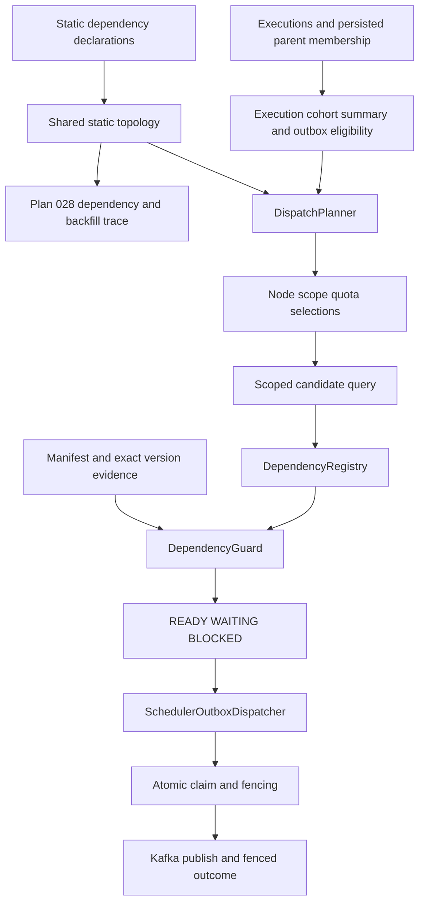

# Plan 030 — Static Graph & DispatchPlanner

Status: Owner-approved active epic in Milestone 1. Canonical story status, dependencies, readiness, and execution order belong to the [increment registry](roadmap/implementation-increments.md). This planning document does not claim that the runtime implementation exists.

Owner decisions recorded: 2026-10-08; scope clarified on 2026-10-13.

## Owner-approved execution-cohort revision — 2026-10-13

This section supersedes the earlier backlog-only selection design, not the historical verification evidence below. The static DAG remains a map of job types; executions populate each node with independent business-group/run/business-date scopes. BANKS and REAL_ESTATE can progress independently inside the same logical node. No outbox processing-success status, execution dependency DAG, new manifest evaluator, or workflow engine is introduced.

Completion ordering is based on persisted execution parent–child evidence for the matching cohort. Dataset readiness and exact input versions remain exclusively evaluated by the existing DependencyRegistry/DependencyGuard before each candidate claim. Execution SUCCESS is not dataset READY. JobScheduler prepares due execution/outbox intent; SchedulerOutboxDispatcher is the existing guard/claim/publish boundary.

Current source is not yet compliant: DispatchScope groups by definition UUID; the outbox-only summary loses published-but-running work; the planner can descend past an upstream node with no dispatchable work even when its executions are unfinished. P14-I2 remains verification_pending with reimplementation required; P14-I3 remains pending. Earlier PASS/owner attestation is historical, not evidence for this revision. P14-I1 remains completed: reuse its verified static graph and validate the new runtime population mapping in P14-I2 rather than reopening historical topology verification.

## Goal

Provide one validated static job topology for shared Platform use and add bounded top-down scheduler-outbox planning without duplicating job input-readiness logic or weakening existing claim/fencing behavior.

The epic is split into three independently reviewable and deliverable stories:

1. **P14-I1 — Static topology and validation**;
2. **P14-I2 — Snapshot-based dispatch planning**;
3. **P14-I3 — Dispatcher integration with preserved claim/fencing**.

The static graph answers which logical job nodes are upstream or downstream. `DispatchPlanner` answers which node/scope/quota should be considered next from a bounded backlog snapshot. `DependencyGuard`, through `DependencyRegistry`, remains the authority for whether a selected job's exact required input is READY, WAITING, or terminally BLOCKED.

## Outcome

After the epic is implemented and verified:

- Platform exposes one immutable, validated static topology with stable logical node identity and explicit mapping to existing job definitions;
- topology consumers, including scheduler planning and proposed backfill tracing, reuse the same boundary rather than maintaining competing graphs;
- scheduler planning consumes a bounded execution-centered summary, augmented with outbox eligibility counts, and traverses independent cohort paths top down;
- planning returns typed node/scope/quota selections and never reads manifests, declares data READY, creates upstream work, or returns raw SQL;
- the dispatcher queries selected candidates, evaluates every candidate through the existing `DependencyRegistry`, and claims/publishes only READY work;
- existing atomic claims, lease fencing, retry identity, WAITING behavior, terminal BLOCKED behavior, item-level readiness, and unrelated-ready-work guarantees remain intact;
- persisted graph ownership, expanded provider policy, adaptive resource scheduling, and advanced fairness remain deferred.

## Verified Source Baseline and Gaps

The following baseline/gap inventory records the initial 2026-10-08 design. Current source and revised gaps are described by the 2026-10-13 owner revision and P14-I2 section; do not interpret initial missing-topology claims as current implementation absence.

Source inspection and code-review-graph analysis establish the following planning baseline. Source presence is not implementation or verification evidence for P14.

| Area                       | Reusable source capability                                                                                                                                                                                                                                                                                                                              | Gap owned by this epic                                                                                                                                        |
| -------------------------- | ------------------------------------------------------------------------------------------------------------------------------------------------------------------------------------------------------------------------------------------------------------------------------------------------------------------------------------------------------- | ------------------------------------------------------------------------------------------------------------------------------------------------------------- |
| Dependency declarations    | [`JobDefinitionConfig`](../../apps/core/src/main/java/com/omni/platform/modules/scheduler/constants/JobDefinitionConfig.java) already seeds `dependsOnJobs`, `dependsOnDatasets`, and produced datasets.                                                                                                                                                | No shared typed topology boundary, stable logical node mapping, validation report, deterministic traversal, or topology export exists.                        |
| Job readiness              | [`PlatformDependencyRegistry`](../../apps/core/src/main/java/com/omni/platform/modules/scheduler/dependencies/PlatformDependencyRegistry.java) adapts [`JobDependencyGuard`](../../apps/core/src/main/java/com/omni/platform/modules/scheduler/dependencies/JobDependencyGuard.java) into READY/WAITING/BLOCKED decisions with approved input versions. | Planner integration must preserve this boundary and must not reproduce manifest, exact-version, or dependency-mode evaluation.                                |
| Candidate loading          | [`SchedulerOutboxService.findCandidates()`](../../apps/core/src/main/java/com/omni/platform/modules/scheduler/services/SchedulerOutboxService.java) loads bounded candidate IDs and materializes execution/work identity.                                                                                                                               | There is no node/scope backlog projection or selected-scope candidate query. Current loading parses payloads before planning.                                 |
| Candidate order            | [`SchedulerOutboxRepositoryImpl.findPendingCandidateIds()`](../../apps/core/src/main/java/com/omni/platform/modules/scheduler/repositories/SchedulerOutboxRepositoryImpl.java) selects eligible unclaimed PENDING rows FIFO by availability/creation/ID.                                                                                                | No pending/dispatchable/in-flight snapshot grouped by topology node and scope, no top-down selection, and no quota result.                                    |
| Dispatch safety            | [`SchedulerOutboxDispatcher.dispatchBatch()`](../../apps/core/src/main/java/com/omni/platform/modules/scheduler/SchedulerOutboxDispatcher.java) over-fetches, invokes the registry, claims READY rows atomically, and preserves publish retry fencing.                                                                                                  | The planner is not integrated before candidate fetch. Integration must retain all guard and claim semantics and provide a safe fallback to current selection. |
| Stable definition identity | [`JobDefinition`](../../apps/core/src/main/java/com/omni/platform/modules/scheduler/entities/JobDefinition.java) has a UUID plus source/type/cron uniqueness, while several definitions can share one `JobType`.                                                                                                                                        | P14-I1 must freeze a stable static logical node identity and deterministic definition mapping without introducing the deferred persisted graph migration.     |

The graph impact radius is Platform-centered: dispatcher, outbox service/repository, dependency registry/guard, job-definition seeding, producers, job service, blocked-job compatibility, PostgreSQL scheduler tests, configuration, and operations are directly or transitively relevant. Analyzer, Ingestor, Query Service, Console, shared transport contracts, dataset writers, manifests, and storage paths have no runtime change in this epic unless a later story explicitly changes a contract; their no-impact boundaries must still be reconciled during verification.

## Legacy Readiness and Disposition Review

Reviewed on 2026-10-08 against Plans 001, 005, 006, and 023; TD-005, TD-007, and TD-012; current Platform scheduler/dependency source; database migrations; and code-review-graph relationships. This is a planning classification, not executed verification and not a status promotion.

Classification meanings:

- **MUST COMPLETE** — a canonical dependency or safety contract that must close before the named P14 story can activate;
- **PENDING EVIDENCE** — source exists, but required impact/coverage/runtime evidence is incomplete;
- **MISSING IN P14 SCOPE** — behavior does not exist and is intentionally delivered by a P14 story rather than treated as prior debt;
- **TECHNICAL DEBT / MOVE ON** — useful or corrective follow-up that is not required for the bounded P14 path when the stated guardrail is preserved.

| Legacy plan or source concern                                                             | Current evidence                                                                                                                                                                                                | Classification                                                                     | P14 gate                                                            | Disposition                                                                                                                                                 |
| ----------------------------------------------------------------------------------------- | --------------------------------------------------------------------------------------------------------------------------------------------------------------------------------------------------------------- | ---------------------------------------------------------------------------------- | ------------------------------------------------------------------- | ----------------------------------------------------------------------------------------------------------------------------------------------------------- |
| P4-I2 dependency policy/enforcement foundation                                            | Canonically `completed`; static dependency declarations and manifest guard exist.                                                                                                                               | MUST COMPLETE — already satisfied                                                  | P14-I1                                                              | No further Phase 4 implementation prerequisite. Preserve P4-I2 semantics.                                                                                   |
| P4-I3 dependency-aware outbox dispatch                                                    | Source and focused tests are present, but the old increment is superseded because P14-I3 will materially change the dispatcher path. Its unclosed evidence is retained in TD-014.                               | TECHNICAL DEBT / SAFETY TRANSFER                                                   | No separate gate                                                    | Reuse the source as baseline; prove all transferred safety invariants against final P14-I3 behavior rather than completing the old path first.              |
| Stable logical node identity and unambiguous definition mapping                           | `JobDefinition` has UUID plus source/type/cron uniqueness; multiple definitions can share one `JobType`; no static node-key abstraction exists.                                                                 | MISSING IN P14 SCOPE                                                               | P14-I1 acceptance                                                   | Implement in P14-I1. Stop if mapping requires persisted identity or a product decision.                                                                     |
| One shared topology declaration, validation, traversal, and export                        | `dependsOnJobs` is seeded as untyped config/traceability metadata; no typed topology owner or validation exists.                                                                                                | MISSING IN P14 SCOPE                                                               | P14-I1 acceptance                                                   | Implement in P14-I1, preserving dataset readiness as a separate guard concern.                                                                              |
| Backlog snapshot and node/scope/quota planner                                             | Current repository performs bounded FIFO candidate selection and payload materialization; no grouped snapshot or planner exists.                                                                                | MISSING IN P14 SCOPE                                                               | P14-I2 after P14-I1                                                 | Implement in P14-I2 without activating runtime dispatch.                                                                                                    |
| Scoped candidate query and planner fallback                                               | Current dispatcher over-fetches FIFO candidates, evaluates the registry, and atomically claims READY rows.                                                                                                      | MISSING IN P14 SCOPE                                                               | P14-I3                                                              | Implement after P14-I2 and prove the transferred TD-014 safety contract on the final path. Preserve FIFO fallback.                                          |
| Legacy `blocked_jobs` table and `BlockedJobTracker`                                       | V7 table/entity/service exist, but current `JobScheduler` no longer calls the tracker and graph analysis found no caller of the tracker class; scheduler-outbox WAITING/BLOCKED now owns active dispatch state. | TECHNICAL DEBT / MOVE ON                                                           | None for P14-I1/P14-I2; no runtime dependency for P14-I3            | Do not integrate it into topology/planning. Track non-destructive decommission/schema-retention review separately; never delete audit state as part of P14. |
| Missing `PARTITION_MATCH`, `SUPPORTED_SCHEMA_VERSION`, and `MAX_FRESHNESS_LAG` evaluators | Enum/config parameter support exists, but no evaluator is registered; unsupported configured conditions fail closed as dependency errors. Current explicit P4-I2 enforced path uses EXISTS/READY.               | TECHNICAL DEBT / MOVE ON unless a selected active job requires one                 | None for current P14 scope                                          | Keep out of P14. Promote a bounded guard-contract story only before enabling a declaration that uses one of these conditions.                               |
| Async dependency evaluation lifecycle/admission                                           | Virtual-thread parallel evaluation source exists; executor shutdown, downstream admission bounds, and representative load evidence remain open in TD-007.                                                       | TECHNICAL DEBT / MOVE ON for P14-I1/P14-I2; operational activation risk for P14-I3 | Reassess before P14-I3 load/activation evidence                     | Keep TD-007 separate. Planner must not increase guard concurrency or claim a capacity improvement.                                                          |
| Empty-output versus execution-success semantics                                           | TD-005 confirms execution SUCCESS does not prove dataset completeness; guard readiness remains manifest/version based.                                                                                          | TECHNICAL DEBT / MOVE ON                                                           | None if planner never interprets SUCCESS/backlog emptiness as READY | Preserve the explicit rule that topology position, empty backlog, and execution SUCCESS are not data-readiness evidence.                                    |
| P1-I3 canonical sector writer evidence                                                    | `verification_pending`, but it does not provide scheduler topology identity, candidate selection, or claim safety and is not a P14 dependency.                                                                  | TECHNICAL DEBT / MOVE ON relative to P14                                           | None                                                                | Retain its independent evidence queue; do not couple P14 delivery to sector-writer completion.                                                              |
| Persisted topology and Plan 028 graph migration                                           | Proposed and unscheduled; P14-I1 intentionally owns static topology only.                                                                                                                                       | TECHNICAL DEBT / MOVE ON                                                           | None                                                                | Keep deferred. If promoted later, require parity and one-authority cutover behind the P14 topology boundary.                                                |
| Provider-aware policy, adaptive quotas, and advanced fairness                             | No approved requirement or measured need for P14 baseline.                                                                                                                                                      | TECHNICAL DEBT / MOVE ON                                                           | None                                                                | Keep deferred under TD-012/Plan 030 deferred scope. Baseline deterministic bounded allocation remains sufficient.                                           |

### Move-on decision

- **P14-I1 is completed** after its approved local Platform test/coverage/build gate, attributable coverage reconciliation, and owner attestation. P4-I2 is completed and no unresolved old-plan item is a canonical dependency.
- **P14-I2 is verification_pending** with execution-centered cohort reimplementation required by the 2026-10-13 owner decision; earlier checks and attestation apply only to historical source. Freeze authoritative group/date/run correlation and membership closure before implementing the revised projection and planner. The planner remains inactive.
- **P14-I3 is pending** until corrected P14-I2 passes renewed verification. It owns the final integrated dependency-aware dispatcher proof. TD-014 safety invariants are mandatory acceptance, while a separate P4-I3 completion is not required. Re-evaluate TD-007 only if measured integration/load evidence makes it relevant.
- Moving residual work to technical debt means retaining explicit activation triggers and safety boundaries; it does not mean marking the work complete, deleting legacy state, or weakening P14/P4 acceptance criteria.

## Architecture and Responsibility Boundaries

| Component                            | Owns                                                                                                                      | Must not own                                                                                       |
| ------------------------------------ | ------------------------------------------------------------------------------------------------------------------------- | -------------------------------------------------------------------------------------------------- |
| Static topology                      | Stable node identity, directed edges, definition mapping, roots, deterministic traversal, validation, diagnostics/export. | Runtime backlog, manifest readiness, claim state, provider quotas, persisted dependency authority. |
| DispatchPlanner                      | Selection of node/scope/quota from one bounded snapshot using top-down traversal and baseline bounded allocation.         | Dependency readiness, upstream enqueue, payload parsing, SQL construction, claims, publication.    |
| DependencyRegistry / DependencyGuard | Required input scope, dependency mode, manifest readiness, exact `dataVersion`, READY/WAITING/BLOCKED decision.           | Cross-node priority, dispatch quota, backlog fairness.                                             |
| SchedulerOutboxDispatcher            | Orchestration of plan, scoped candidate fetch, guard decision, atomic claim, publish, and fenced outcome.                 | Duplicate topology or manifest policy.                                                             |
| Repository/service                   | Parameterized snapshot and candidate projections plus existing atomic state transitions.                                  | Scheduling policy or raw-SQL output from the planner.                                              |

An empty upstream outbox backlog is neither execution-completion nor readiness evidence. A selected candidate can still be WAITING or BLOCKED. Snapshot values are advisory; the atomic claim must revalidate status, availability, lease, and fence identity. Parent relationships identify fan-out membership within a job step, not dependency edges across job steps. Match upstream and downstream parents through explicit cohort identity and the static topology, never by assuming their parent IDs are equal.

## Story Sequence

### P14-I1 — Static topology and validation

**Dependencies:** P4-I2.  
**Blocks:** P14-I2 and the topology-dependent trace slice of Plan 028.

Outcome:

- define an immutable Platform-local topology API with stable logical node keys, directed edges, roots, direct upstream/downstream lookup, bounded ancestor/descendant traversal, and deterministic topological order;
- map existing seeded job definitions to nodes explicitly, including the case where several definitions share one `JobType`;
- derive the initial graph from one static declaration boundary and remove competing static edge declarations where safe;
- validate unknown nodes, missing/ambiguous definition mappings, duplicate edges, self-edges, cycles, unreachable mappings, and configured graph bounds at startup/test time;
- expose deterministic diagnostic and Mermaid-friendly output without introducing a public API or persistence migration;
- document the mapping between job-to-job topology and dataset dependency declarations while keeping their meanings distinct.

Bounded tasks:

1. inventory current job definitions and freeze node-key/mapping rules;
2. add immutable topology model and one declaration provider;
3. add validation and deterministic traversal;
4. add definition mapping and diagnostics/export;
5. reconcile Plan 028 reuse and canonical docs.

Rollback removes the topology consumer wiring and restores the previous static declaration reads. No execution, outbox, or dataset state is migrated.

### P14-I2 — Execution-centered cohort summary and dispatch planning

**Dependencies:** P14-I1.
**Blocks:** P14-I3 and the graph-backed Job Operations presentation slice of Plan 029.

Outcome:

- keep one static topology initialized from approved job dependency declarations; do not create nodes or edges from execution IDs, run keys, sector names, or dates;
- populate that map using persisted execution-to-definition-to-node mappings and parent–child membership, grouped by business group, business date, and jobRunId identity;
- read execution histories first, including published-but-PENDING/RUNNING work and terminal executions; join bounded outbox aggregates only for message dispatchability, retry delay, and lease information;
- distinguish execution progress from message delivery. Outbox lease in-flight is not worker RUNNING; no remaining PENDING messages is not successful completion;
- keep the earliest incomplete upstream node active for each cohort path: dispatch its remaining eligible messages while earlier batches are running, then wait if all are sent but required executions remain unfinished;
- descend only after required upstream parents/work items in the same cohort have completed successfully with authoritative membership/closure evidence; a failed, missing, ambiguous, or incomplete upstream cohort never opens the barrier;
- return only bounded typed node/cohort/parent scope, quota, and diagnostic reason/order. No manifest evaluation, SQL, claims, or publication belongs in the planner;
- reconcile joins across all required upstream branches in the same cohort and deduplicate selections; allocate quota fairly across independent roots AND business-group cohorts.

Identity and completion rules:

1. Discover bounded PENDING executions, group them by persisted parent ID, load the parent execution and its job definition, resolve that definition's dependency declarations, and map the group back onto the existing definition-derived static graph. Parent ID belongs to execution history, not to job definition. Standalone execution uses its own definition through an explicit no-parent path. Use persisted relationships, not untrusted message parent IDs.
   Discovery is not the completion summary: additionally load the relevant upstream parents and complete child membership across PENDING, RUNNING and terminal states for the matching cohort. A pending-only result must not lose published-but-running upstream work or successful predecessor evidence. Resolve groups and dependencies through bounded batched queries rather than per-child N+1 reads. Persisted definition declarations must agree with the initialized seed-derived topology; mismatches fail closed with diagnostics, never create a competing graph silently.
2. Freeze the semantic cohort key: businessGroup + businessDate + jobRunId. BANKS and REAL_ESTATE must not block one another. Multiple definitions/parents of a required step need explicit membership; do not choose the newest successful parent heuristically.
3. The existing candidate runKey may fall back to triggeredAt; this is not proof of a shared jobRunId across job steps. Establish where group/date/run facts are authoritatively stored or derived and validate actual producer metadata. Missing facts are UNKNOWN; do not infer business date from cron/wall-clock timezone or merge parents by temporal proximity.
4. Prove fan-out membership is complete before trusting parent SUCCESS. Inspect producer transaction boundaries, dynamic child creation, empty-parent semantics, retries, duplicate/out-of-order status events and late children. If existing evidence cannot prove closure, stop for approval of a bounded identity/closure contract or persistence change; do not invent completeness from observed child counts.
5. Parent IDs are membership references, not new dependency edges. Across job steps, the static DAG and matching cohort determine required predecessors. No persisted execution DAG is authorized.
6. Execution completion is a planning barrier only. Existing candidate guard remains responsible for dataset READY and exact dataVersion lineage; no new metadata polling/barrier evaluator is added to planner.

Example acceptance trace: A -> B -> C has 100 work items per step for one cohort and budget 75. First tick selects 75 A; second tick selects the remaining 25 A even while the first batch is running. Later ticks cannot select B until all required A executions succeed with closed membership; while waiting, unused quota goes to another cohort/path. Then select up to 75 B, still subject to candidate guard and atomic claim. Another run/date or REAL_ESTATE cohort does not extend the BANKS barrier.

Each dispatch tick captures a fresh bounded summary. Preserve capture time, completeness, and explicit caller-time freshness validation already present; a default maximum age equal to configured dispatch fixed delay is proposed for P14-I3 integration, not a runtime configuration already implemented. This age check does not prove execution completion or replace claim revalidation. Comparing consecutive summary counts is optional observability only, never a skip-dispatch, completion, or DLQ rule.

Existing inactive source is reusable scaffolding, not the revised implementation: definition-only DispatchScope, outbox-only BacklogSnapshotService/query, and first-dispatchable traversal must be adapted. Keep earlier tests/evidence as history; require fresh execution/cohort tests and attributable coverage. No P14-I1 status or historic evidence is rewritten.

### Job run identity and backward-compatible evolution — owner decision 2026-10-15

Use **`jobRunId`** as the canonical name for the durable, explicitly correlated *logical workflow run* across job steps. Do **not** conflate it with a job-definition UUID, one parent/child `executionId`, `parentExecutionId`, the existing `runKey` (whose fallback may be trigger time), or `triggeredAt`. The cohort scope is **businessGroup + businessDate + jobRunId**; the static DAG remains defined by job types rather than per-run edges. Children of a single parent inherit the same `jobRunId`, with parent-child membership still proven by persisted parent references and the committed one-time fan-out transaction.

For future **manual reruns** and **backfills**, distinct requested logical runs must have distinct `jobRunId` values even when businessDate and group match. A backfill request may contain multiple business dates: specify explicit request-to-jobRunId mapping per dated cohort and retain `backfillRequestId` as the request identity rather than treating it as interchangeable with `jobRunId`. For regular scheduled work, identify the source and propagation of a stable run ID across independently committed job steps; sharing a scheduler tick, wall-clock timestamp, or transaction is **not** sufficient. Freeze the UUID/string type, persistence location/index strategy, nullability, creation/propagation ownership, retry/idempotency guarantees and read/write contracts only after producer/consumer inventory. This naming decision does **not** authorize immediate new database schema, public API or Kafka field; any such requirement is a separately approved, independently deployable contract slice.

**Compatibility / deprecated-before-delete gate (mandatory at every P14-I2 checkpoint):**

1. Preserve the existing FIFO `SchedulerOutboxDispatcher` → `SchedulerOutboxService.findCandidates()` → `DependencyRegistry` path until P14-I3. New `jobRunId` resolution/planner DTOs are additive and inactive by default; do not silently remove/change legacy `runKey` fallback in a currently used dispatcher contract during P14-I2. Legacy rows lacking `jobRunId` remain readable through the historical path; the *new planner* may place them last for consideration but must fail closed when upstream run correlation is required.
2. If a Java class, method, field, or internal SPI is targeted for future removal, prefer a transitional compatibility adapter and **`@Deprecated(since = "...", forRemoval = false)`** on a still-used declaration where applicable; document its replacement, callers, migration window, acceptance tests and planned removal owner. A producer/persisted schema/transport contract or SQL surface cannot be made safely compatible by Java annotation alone: require additive expand/migrate/contract steps and explicit evidence. Do not annotate unaffected code merely because future cleanup is possible.
3. If a deletion is safe now because all callers/tests are migrated and the surface is truly internal and unused, removal may occur in the same atomic checkpoint with impact analysis and passing validation. If not, mark it as **DEPRECATION CANDIDATE** in this plan with exact source path, dependent consumers, migration prerequisite and future owning story; no breaking half-migration.
4. Every checkpoint (identity/closure, read projection, pure planner, SQL/metrics, verification handoff) must compile and pass targeted legacy + new tests *at its own commit*, require no pending P14-I3 wiring to boot, and leave runtime scheduler, existing persisted data, claims, guard and publication behavior unchanged. A proposed identity/schema change that cannot meet this gate becomes a separate owner-approved story before P14-I2 proceeds.

**Deprecation candidates pending code impact verification (not yet annotated/removed):** `SchedulerOutboxService.toCandidate()` timestamp-based `runKey` fallback *only if* a later P14-I3 migration can preserve all legacy consumer semantics; definition-only `DispatchScope` and old backlog DTO/query contracts only after all tests/callers migrate atomically or a typed adapter remains. Existing `triggeredAt` is audit evidence and **not** a deprecation candidate. The earlier planner scaffolding remains inactive, not inherently obsolete. Re-evaluate and update this list after each checkpoint; do not treat speculative removal as approved.

### Authoritative persistence, bounded recovery and identity safety — 2026-10-15

Current decision supersedes the former 2026-10-14 runtime-binding proposal: **PostgreSQL is authoritative**, and P14-I2 reads bounded execution/parent/definition/outbox evidence on every planning tick. Keep only immutable static topology and tick-local derived snapshots in memory; do not implement long-lived cache, after-commit in-memory binding publication, or startup cache reconstruction.

Correctness requirements **remain in P14-I2**, regardless of caching:
- Check explicit group/date/jobRunId identity using persisted producer metadata; no trigger-time or newest-success fallback. Missing identity sorts last for consideration but cannot bypass a required upstream correlation/barrier. An unknown or ambiguous predecessor is an explicit fail-closed diagnostic, not an empty/completed predecessor.
- Validate the owner-stated **one-time child dispatch transaction** invariant in source and tests: one committed parent child-creation transaction fixes membership. Commit is not child SUCCESS. Audit zero children, duplicate/retried dispatch, late children and rollback; stop for a bounded persistence/identity contract decision if closure cannot be proven.
- Capture complete parent-child progress across PENDING/RUNNING/terminal execution states, including PUBLISHED outbox messages with unfinished execution; outbox alone is not completion. Parent ID is fan-out membership only, never an inferred cross-step edge.
- Prove retained persisted evidence is sufficient for normal restart and reconstruction **by requerying PostgreSQL**, including completion evidence needed by downstream active cohorts. Define safe retention/cleanup boundaries and verify missing/ambiguous source rows fail closed.
- Use short-lived bounded read-only transactions and query-plan/pool measurements. Planner snapshot is advisory; P14-I3 performs admission-time barrier revalidation and preserves guard/claim fencing. No unmeasured performance improvement is claimed.

Any later **long-lived cache, cached-binding publication or startup-cache recovery** is a separately owner-gated deferred epic, [TD-017 — Scheduler Snapshot Cache & Recovery](../technical-debt/017-scheduler-cache-and-recovery-epic.md). It is not a prerequisite for P14-I2/P14-I3.

### P14-I2 measurable evidence and future dashboard handoff — 2026-10-15

P14-I2 must deliver a **reproducible PostgreSQL diagnostic SQL pack** and a recorded performance/correctness baseline, not merely runnable application code. Keep SQL scripts read-only and parameterized where possible; use a documented representative dataset and explicitly distinguish measured values from targets. Query instrumentation and contract descriptions must be reusable by Plan 029 (graph-backed Job Operations) without implementing a UI, public metrics API, or new persistent statistics table in P14-I2.

Required deliverables:

1. **SQL diagnostics** (versioned under a clearly named docs or tooling path): count active cohorts by business group/date/run and node; summarize parent/child totals by execution status; show closed vs unresolved membership; separate pending/eligible/retry-delayed/leased/published outbox evidence; detect missing/ambiguous correlation and definition mappings; identify failed or stalled upstream barriers; and identify duplicate join fan-out/overcounting. Each query documents parameters, interpretation, expected cardinality and safety on production-sized datasets.
2. **Query-performance evidence:** supply parameterized representative snapshot queries and `EXPLAIN (ANALYZE, BUFFERS)` recipes for a controlled environment (or production only under explicitly approved conditions). Record rows scanned/returned, plan nodes, buffer hits/reads, execution time and relevant index usage for multiple backlog/cohort sizes. A result `LIMIT` does not prove bounded scan cost. Review indexes using evidence; no automatic migration is authorized.
3. **Tick-level benchmarks:** measure snapshot capture duration (p50/p95/p99), planner computation duration (p50/p95/p99), database round trips and queries per tick, processed cohort count, result cardinality, incomplete/UNKNOWN scope count, plus Hikari active/idle/pending connections and acquisition wait where available. Record test environment, data volume, sampling window, configurable dispatch delay, and baseline versus revised behavior. Do not invent fixed latency/throughput success thresholds before measurements; derive acceptance thresholds from evidence and obtain owner approval.
4. **Correctness and throughput counters:** specify derivation of pending, eligible, retry-delayed, leased, published-but-unfinished, RUNNING, SUCCESS, FAILED/BLOCKED, completion-barrier WAIT, selectable vs selected quota, and unused quota. Define unit, grouping dimension, time window, source query, cardinality limit and uncertainty for each. Published is not completed, outbox lease is not worker RUNNING, and UNKNOWN is not zero.
5. **Dashboard handoff:** document a stable **logical metric/read-projection contract** for future Plan 029 screens (no premature API/schema commitment), including backlog by node/cohort, cohort completion %, blocked/unknown reasons, planner selection vs eventual claimed/published throughput, snapshot age/completeness, database query latency and connection-pool pressure. Identify which measures only become observable after P14-I3 is integrated; mark them `NOT_AVAILABLE_YET` rather than claiming runtime implementation.
6. **Repeatable verification procedure:** provide exact SQL invocation steps, environment/preconditions, seed/test-data recipe, sampling approach, safe timeout, regression-comparison instructions, expected outputs and caveats. Verify indexes and lock behavior with PostgreSQL views such as `pg_stat_activity`, `pg_locks`, and `pg_stat_statements` only when the extension is installed/authorized; never assume it exists. Do not run unbounded `EXPLAIN ANALYZE` over production tables by default.

The P14-I2 exit gate includes the diagnostic SQL pack, executed correctness checks, a reproducible benchmark report with measured baselines, and the Plan 029 metric mapping. Missing measurements remain `UNKNOWN`, not PASS. There is no requirement to implement dashboards, long-lived in-memory binding state, metrics storage, or a public API in this story.

### P14-I2 data-source simplification — owner decision 2026-10-15

Use PostgreSQL persisted execution/outbox evidence as the authoritative source for each fresh, bounded, read-only planning snapshot. The in-memory static topology and tick-local immutable DTOs remain; do not introduce a long-lived authoritative parent-binding cache, post-commit memory publication or startup binding reconstruction in P14-I2 unless measurements or proven missing persistence justify a new owner decision. Future cache and startup-cache recovery are deferred to [TD-017](../technical-debt/017-scheduler-cache-and-recovery-epic.md) and are not activation prerequisites.

Do not use `triggeredAt` as a fallback for missing cross-step `jobRunId`. Incomplete identity is scheduled last among eligible cohorts for consideration, but cannot bypass required predecessor correlation or the completion barrier; ambiguous dependent paths fail closed with explicit diagnostics. For fan-out, verify the stated invariant that each parent creates its fixed child set exactly once within the committed transaction; that commit establishes membership closure, not child completion. Audit retry, empty-set and late-child paths before treating this invariant as proven.

### P14-I3 — Dispatcher integration with claim/fencing preservation

**Dependencies:** P14-I2.
**Blocks:** no whole Plan 028 dependency; only consumers explicitly requiring planner-driven dispatch.

Outcome:

- capture a fresh execution-centered summary each tick, populate the static map by cohort, invoke the planner before payload materialization, and query candidates only for selected node/cohort/parent scopes and quotas;
- revalidate the matching cohort completion barrier before downstream admission; concurrent enqueue/retry changes must not silently invalidate a selection. Use explicit closure and bounded re-read/refill rather than mutable cached summaries;
- evaluate every returned candidate through the existing `DependencyRegistry` and retain READY/WAITING/BLOCKED semantics;
- preserve atomic `claimEligible`, lease/token/instance fencing, approved-input persistence, publish acknowledgement, retry identity, and terminal BLOCKED non-reclaimability;
- preserve no-starvation behavior when selected candidates wait, block, disappear, or lose a concurrent claim;
- add a configuration-controlled candidate-order fallback. While cohort ordering is enabled, FIFO fallback must retain matching cohort admission barriers and the existing guard; it cannot silently bypass unfinished upstream executions. Fully disabling revised ordering restores historical behavior only through an explicit observable rollback decision;
- expose bounded operational diagnostics for snapshot completeness, selections, selected-vs-claimed counts, and fallback use without high-cardinality labels.

Bounded tasks:

1. add scoped candidate repository/service boundary;
2. integrate plan → query → registry → claim while retaining the existing publish loop;
3. define underfill/refill behavior for WAITING/BLOCKED/lost claims;
4. add fallback/rollback configuration and bounded diagnostics;
5. verify PostgreSQL concurrency, fencing, compatibility, and no-starvation behavior.

Rollback disables planner selection and restores the current candidate-selection path. It must not delete pending outbox rows, execution history, claims, approved inputs, or publication evidence.

## Relationship to Other Plans

### Plan 023 and DependencyGuard

[Plan 023](023-dependency-aware-outbox-dispatch.md) preserves the dependency-aware dispatcher source/design baseline, while [TD-014](../technical-debt/014-dependency-aware-dispatch-verification-residue.md) records its unclosed evidence. P4-I3 is superseded. P14-I3 owns the final READY/WAITING/BLOCKED, claim/fencing, retry, compatibility, concurrency, migration, fallback, and runtime proof after planner integration.

### Plan 028

[Plan 028](028-reusable-date-range-backfill.md) may use P14-I1's shared topology to trace ancestors/descendants and generate deterministic backfill work. It does not need to wait for P14-I2 or P14-I3 because `DispatchPlanner` selects already-enqueued scheduler-outbox work and does not expand backfills. Plan 028's proposed persisted graph, stable persisted job keys, dated identity, producer changes, and backfill execution remain separate unscheduled scope. If persisted topology is later promoted, it must replace the static provider through one topology boundary with parity/cutover evidence; two runtime authorities are forbidden.

### Plan 029

[Plan 029](029-operator-trust-console.md) basic Job Operations, Data Health, and shell delivery do not depend on P14. A graph-specific presentation that groups or traces scheduler backlog by topology node depends on P14-I2's accepted snapshot/selection semantics. Plan 029 must not infer graph state from UI data or wait for P14-I3 merely to deliver existing operational views.

## Deferred Scope

The following remain deferred and are not acceptance criteria for P14:

- persisted job graph, graph administration API/UI, or migration away from static ownership;
- provider-specific rate policy, provider rotation, or an expanded provider-policy framework;
- weighted/aging/priority-class fairness, adaptive quotas, resource-aware placement, or automatic concurrency changes;
- runtime-generated DAG edges, conditional branches, ANY/quorum dependencies, remaining-dependency counters, or a workflow engine;
- backfill expansion, new historical producer transport contracts, or repair actions; reading and validating business-date/run/group identity from existing executions is required by this revision;
- TODO future: symbolKey-level cohort grouping and dedicated scheduler DLQ/replay policy. Neither snapshot equality nor quarantine opens a failed cohort barrier;
- generic static dependency snapshot extraction from job-definition-specific resolution, tracked in [TD-012](../technical-debt/012-static-dag-dispatch-planner.md#deferred-generic-static-dependency-snapshot); current delivery reuses the existing definition-derived graph rather than introducing another abstraction;
- Kafka, protobuf, manifest, dataset-path, dataset-writer, or worker-runtime changes.

## Dataset Outputs

No analytical dataset output.

## Metadata Outputs

No dataset metadata output.

The epic does not read or write dataset manifests as topology state. `DependencyGuard` continues to read existing readiness and exact-version evidence, and existing producers retain READY-last publication semantics.

## Algorithm Feature Outputs

No direct algorithm feature output.

## Algorithms Unlocked

No trading or research algorithm is introduced. The shared topology makes deterministic dependency/backfill tracing possible, and bounded planning makes scheduler selection explainable and independently testable.

## Contract Impact

| Contract area                        | Decision                                                                                                                                                                                                                                                              |
| ------------------------------------ | --------------------------------------------------------------------------------------------------------------------------------------------------------------------------------------------------------------------------------------------------------------------- |
| Kafka or service-to-service protobuf | Unchanged. No producer/consumer payload change is planned.                                                                                                                                                                                                            |
| Object-storage JSON manifest         | Unchanged. The planner does not read manifests; the existing guard remains the readiness consumer.                                                                                                                                                                    |
| Storage paths or dataset ownership   | Unchanged. No dataset writer or logical path changes.                                                                                                                                                                                                                 |
| Public Java or Python API            | Internal Java APIs are added for topology, snapshot, planner, and scoped candidate selection. No Python or external HTTP API is required.                                                                                                                             |
| Configuration or environment         | Additive Platform configuration may control graph bounds, snapshot/query limits, planner activation, fallback, and baseline quota limits. Defaults must be bounded and preserve the current path until P14-I3 activation evidence is approved.                        |
| PostgreSQL/persistence               | P14-I1 introduces no migration. P14-I2/P14-I3 add bounded read projections/index review only; persisted graph/count tables and new outbox status values are out of scope. Any index change requires measured query evidence and a separate migration/rollback review. |

## Field/DTO Inventory and Bounded Delivery

Candidate names are design labels until the owning story freezes exact Java types.

| Surface                  | Candidate facts                                                                                                                                 | Change / impact                 | Behavior and compatibility                                                                                   | Delivery story |
| ------------------------ | ----------------------------------------------------------------------------------------------------------------------------------------------- | ------------------------------- | ------------------------------------------------------------------------------------------------------------ | -------------- |
| Static node              | nodeKey, display label, upstream/downstream keys, definition matcher, root marker                                                               | ADD internal, MEDIUM            | Immutable and deterministic; no UUID/`JobType` ambiguity and no persisted authority.                         | P14-I1         |
| Topology validation      | errors/warnings, paths, topological order, mapping cardinality, bounds                                                                          | ADD internal, MEDIUM            | Startup/test diagnostics fail closed for invalid active mappings.                                            | P14-I1         |
| Execution cohort summary | nodeKey, businessGroup, businessDate, jobRunId, parent IDs, membership/closure, execution progress and separate outbox eligibility counts | DERIVED + SEMANTIC, HIGH        | Missing evidence is UNKNOWN; published is not processed; exact scope barriers do not block unrelated groups. | P14-I2         |
| DispatchSelection        | nodeKey, scope, quota, deterministic reason/order                                                                                               | ADD internal + SEMANTIC, MEDIUM | Selects candidate-query scope only; does not imply readiness.                                                | P14-I2         |
| Scoped candidate request | selected node/scope/quota plus current eligibility time                                                                                         | ADD internal, HIGH              | Must remain parameterized, bounded, and compatible with atomic claim revalidation.                           | P14-I3         |
| Planner activation       | enabled/fallback/bounds                                                                                                                         | ADD configuration, HIGH         | Safe default and rapid fallback to existing FIFO path; no record deletion.                                   | P14-I3         |

No new public DTO, transport schema, persisted count, dependency table, or status enum is approved by this epic.

## Cross-Service Blast Radius

| Surface                    | Impact or no-impact reason                                                                                                                                                                                                                                                                                                                                                                                               |
| -------------------------- | ------------------------------------------------------------------------------------------------------------------------------------------------------------------------------------------------------------------------------------------------------------------------------------------------------------------------------------------------------------------------------------------------------------------------ |
| Platform                   | Primary owner: topology population mapping, execution/parent/cohort projection, producer metadata inventory, JobService aggregation safety, planner, scoped queries, dispatcher, configuration and tests. Graph impact analysis on JobService, snapshot service and dispatcher found 16 additional impacted files; bounded results were truncated and included 84 unresolved call sites, not proof of no further impact. |
| Analyzer                   | No runtime change: planner selection is Platform-local and worker payloads remain unchanged. Reconcile only if a later story changes transport, which this epic forbids.                                                                                                                                                                                                                                                 |
| Ingestor                   | No runtime change for the same reason; provider behavior and ingestion concurrency remain deferred.                                                                                                                                                                                                                                                                                                                      |
| Query Service              | No runtime change. It does not own scheduler topology or dispatch planning.                                                                                                                                                                                                                                                                                                                                              |
| Omni Console               | No P14 runtime scope. A later Plan 029 graph visualization may consume an explicitly approved Platform read projection after P14-I2.                                                                                                                                                                                                                                                                                     |
| Shared contracts/libraries | No protobuf, Kafka, or shared Python change. Hand-written Java abstractions remain in Platform because current ownership is scheduler-local.                                                                                                                                                                                                                                                                             |
| Persistence                | Execution histories, parent aggregation, metadata identity and outbox eligibility are jointly impacted. Review bounded joins/indexes, late-child closure and retry correlation; no graph/count persistence or outbox status is approved. Missing identity/closure evidence requires an explicit contract/migration decision before implementation.                                                                       |
| Configuration              | Additive Platform-local bounded settings in P14-I3; no provider credentials, regions, topics, or storage paths.                                                                                                                                                                                                                                                                                                          |
| Tests                      | Platform unit and PostgreSQL integration tests are directly impacted; producer/worker contract tests are no-impact while payloads remain unchanged.                                                                                                                                                                                                                                                                      |
| Operations                 | Add bounded planner diagnostics, fallback visibility, and query-cost evidence; no deployment topology, capacity, or provider-policy change.                                                                                                                                                                                                                                                                              |

## Repository Guidance Updates

Implementation must review and update, where applicable:

- [`AGENTS.md`](../../AGENTS.md), [`CLAUDE.md`](../../CLAUDE.md), and [`.roo/rules`](../../.roo/rules) only if architecture/workflow guidance changes;
- [`docs/README.md`](../README.md), [`docs/INDEX.md`](../INDEX.md), and the canonical roadmap;
- [`docs/architecture/001-system-overview.md`](../architecture/001-system-overview.md);
- [`docs/flows/001-job-execution.md`](../flows/001-job-execution.md);
- [`docs/data/003-database.md`](../data/003-database.md) if snapshot indexes or query ownership change;
- [`docs/development/001-where-to-change.md`](../development/001-where-to-change.md);
- Plans 023, 028, and 029 plus TD-012.

This planning update clarifies roadmap hierarchy and approved architecture but changes no runtime coding rule. Existing repository guidance already requires Platform-local dependency policy, graph impact analysis, claim/fencing preservation, and explicit cross-service reconciliation; therefore no immediate `AGENTS.md`, `CLAUDE.md`, or `.roo/rules` edit is required.

### Documentation disposition for the 2026-10-13 revision

Architecture, execution flow, developer ownership guidance, field/DTO inventory, registry, roadmap selection, TD-012 and release notes have revision records. Documentation indexes retain their existing Plan 030 links; no new document is introduced. Plans 023/028/029 and TD-014 retain their original ownership and dependency relationships; no independent schedule, backfill rollout or UI contract is changed. Data-lake/Kafka contracts and deployment/service runtime instructions have no implementation change from this documentation-only revision. Database documentation must be revisited when identity/closure or projection/index design is frozen. No agent-rule change is proposed: existing guard ownership and verification gates remain applicable. These dispositions do not claim that every linked document or path has passed a complete static audit; remaining audit scope must close before documentation synchronization is marked complete.

## Verification

P14-I1 source implementation is present in the Platform scheduler topology package:

- `TopologyNodeKey` provides validated stable logical keys derived from `JobType`;
- `JobDefinitionIdentity` maps the existing `(source, jobType, cronExpr)` database identity without a migration;
- `StaticTopologyDeclaration` preserves raw nodes, edges, and mappings for validation;
- `StaticJobTopology` provides immutable roots, direct/transitive traversal in both directions, deterministic topological order, bounds, mapping lookup, validation, and Mermaid diagnostics;
- `StaticJobTopologyProvider` is the single active declaration boundary and derives job-to-job edges from existing seed `dependsOnJobs` metadata without reading manifest readiness;
- `StaticJobTopologyTest` covers the canonical seed graph, multiple definitions sharing one type, traversal/export, invalid keys, unknown/duplicate/self edges, cycles, unmapped/ambiguous definitions, bounds, unknown lookups, traversal depth, and malformed dependency metadata.
- `JobDefinitionSeederTest` covers seed-owned title/fallback/config synchronization while preserving source identity and runtime-owned scheduling fields.

P14-I1 blast-radius reconciliation:

- Platform: changed by additive topology classes/tests plus startup seed synchronization of title, fallback sources, and config for the existing `(source, jobType, cronExpr)` identity; scheduler dispatch, producers, claims, dependency guard, public controllers, runtime-owned scheduling fields, and stale-row policy are unchanged.
- Analyzer and Ingestor: no runtime impact because Kafka payloads, worker handlers, and job execution contracts are unchanged.
- Query Service and Console: no impact because no API or graph presentation endpoint is introduced.
- Shared contracts/libraries: no impact because Proto3, py-common, topic configuration, and generated code are unchanged.
- Persistence and configuration: no impact because the graph is process-local, derives from existing seeds, and adds no migration, table, index, property, or environment variable.
- Dataset/storage contracts: no impact because manifests, readiness, lineage, logical paths, producers, and consumers are unchanged.
- P14-I2 persistence/query impact: additive read-only PostgreSQL aggregation reuses existing outbox/execution/job-definition columns and indexes; no migration, status, write path, claim path, or payload materialization change is introduced.
- Operations: startup constructs topology, snapshot service, and pure planner beans; no scheduler or dispatcher calls them, so runtime dispatch behavior remains unchanged.

Code-review-graph impact analysis was performed before implementation and reconciled against Platform, Analyzer, Ingestor, Query Service, Console, shared contracts/libraries, persistence, configuration, tests, and operations. The owner approved and reviewed the complete local verification gate on 2026-10-11:

- `nx run platform:test` — PASS;
- `nx run platform:coverage` — PASS, with attributable JaCoCo evidence for every changed critical class;
- `nx run platform:build` — PASS;
- compact gate: `PASS P14-I1 required=3 pass=3 fail=0 unknown=0 missing=0 sources=exit_code`;
- owner attestation: `OWNER_VERIFIED P14-I1 verified_by=tanlocit9`, bound to summary SHA-256 `77c59cef1535dfda4cf3c84d581e6ca3a715ede604b2228e32b20ef6309a2ad4`.

The checks emitted shutdown-hook Hikari warnings after tests but completed successfully. No CI, deployment, provider, production, migration, load, or live-runtime verification is claimed or required by the bounded P14-I1 process-local topology scope.

P14-I1 impact/source/test coverage matrix:

| Feature / criterion                                                  | Source                      | Executed tests                                                                | Attributable coverage       |
| -------------------------------------------------------------------- | --------------------------- | ----------------------------------------------------------------------------- | --------------------------- |
| Stable logical node key                                              | `TopologyNodeKey`           | `StaticJobTopologyTest`                                                       | 100.0% line / 100.0% branch |
| Stable definition identity                                           | `JobDefinitionIdentity`     | `StaticJobTopologyTest`                                                       | 93.3% line / 83.3% branch   |
| Immutable raw declaration                                            | `StaticTopologyDeclaration` | `StaticJobTopologyTest`                                                       | 100.0% line / no branches   |
| Validation, roots, traversal, order, bounds, mapping, Mermaid export | `StaticJobTopology`         | `StaticJobTopologyTest`                                                       | 99.2% line / 94.8% branch   |
| Seed-derived nodes/edges and malformed metadata diagnostics          | `StaticJobTopologyProvider` | `StaticJobTopologyTest`                                                       | 100.0% line / 100.0% branch |
| Startup seed synchronization with runtime-field preservation         | `JobDefinitionSeeder`       | `JobDefinitionSeederTest`                                                     | 93.5% line / 100.0% branch  |
| Canonical seed/dependency declaration                                | `JobDefinitionConfig`       | `JobDefinitionConfigTest`, `JobDefinitionSeederTest`, `StaticJobTopologyTest` | 99.4% line / 91.3% branch   |

Historical evidence: the earlier P14-I2 source passed its owner-approved local verification gate on 2026-10-12. This evidence does not cover the subsequent per-path/freshness correction:

- `nx run platform:test` — PASS after focused repair of Spring constructor selection and repository-proxy exception expectation;
- `nx run platform:coverage` — PASS, with every P14-I2 critical component above the 80% line/branch threshold;
- `nx run platform:build` — PASS;
- compact gate: `PASS P14-I2 required=3 pass=3 fail=0 unknown=0 missing=0 sources=exit_code`;
- owner attestation: `OWNER_VERIFIED P14-I2 verified_by=tanlocit9`, bound to summary SHA-256 `afacc8b02a7216de87631fbab178207dbe860bb869c3e560858a0478a2902255`.

The suite emitted known shutdown-hook Hikari warnings, and compilation reported the native-JPA unchecked warning tracked by TD-015; neither failed the gate. No CI, commit, merge, deployment, production, load, or dispatcher-runtime activation is claimed.

Historical source correction — 2026-10-12, superseded as the target design by the 2026-10-13 cohort revision: planner traversed nodes without dispatchable work, stopped occupied paths and deduplicated scopes. Explicit evaluation time and positive maximum snapshot age were added; tests were not run. This source does not enforce execution-cohort completion barriers. Earlier coverage below remains historical, not verification of the revised target.

Historical reconciliation for the 2026-10-12 source correction: only planner/result APIs and focused tests changed, without runtime activation or transport/schema changes. This does not describe the 2026-10-13 revised implementation blast radius; use the Cross-Service Blast Radius and revised P14-I2 requirements above. The referenced execution-log.md is absent; existing canonical evidence records are used. SQL output limits do not prove bounded scan cost; query-load evidence remains unclaimed.

Historical P14-I2 impact/source/test coverage matrix:

| Feature / criterion                                         | Source                                              | Executed tests                                        | Attributable coverage       |
| ----------------------------------------------------------- | --------------------------------------------------- | ----------------------------------------------------- | --------------------------- |
| Explicit persisted-definition scope                         | `DispatchScope`                                     | `DispatchPlannerTest`, `PlanningContractsTest`        | 100.0% line / 100.0% branch |
| Mutually exclusive backlog count contract                   | `BacklogCounts`                                     | `PlanningContractsTest`, `BacklogSnapshotServiceTest` | 100.0% line / 85.7% branch  |
| Timestamped bounded complete/incomplete snapshot            | `BacklogSnapshot`                                   | `BacklogSnapshotServiceTest`, `PlanningContractsTest` | 95.0% line / 83.3% branch   |
| Typed bounded planner result                                | `DispatchPlan`                                      | `DispatchPlannerTest`, `PlanningContractsTest`        | 100.0% line / 100.0% branch |
| Topology mapping, truncation, stale/duplicate scope failure | `BacklogSnapshotService`                            | `BacklogSnapshotServiceTest`                          | 100.0% line / 87.5% branch  |
| Roots, joins, backoff isolation, quotas and cursor fairness | `DispatchPlanner`                                   | `DispatchPlannerTest`                                 | 98.1% line / 87.5% branch   |
| Raw persisted aggregate identity/count contract             | `SchedulerBacklogGroup`                             | `PlanningContractsTest`, PostgreSQL repository test   | 100.0% line / 87.5% branch  |
| Read-only PostgreSQL backlog classification/projection      | `SchedulerOutboxRepositoryImpl.findBacklogGroups()` | `JobDefinitionClaimRepositoryPostgresTest`            | 100.0% line / 100.0% branch |

Implementation verification must use the confirmed Platform targets and receive approval before execution. Required evidence includes:

- code-review-graph impact analysis before shared API/configuration/persistence changes and change detection after edits;
- explicit reconciliation of Platform, Analyzer, Ingestor, Query Service, Console, shared contracts/libraries, persistence, configuration, tests, and operations;
- an impact-to-test matrix for every changed/directly impacted production path and acceptance criterion;
- independently attributable coverage of at least 80% line and 80% branch for topology validation/traversal, snapshot classification, planner selection, scoped candidate query, and integration/fallback components;
- P14-I1 tests for deterministic identity/mapping, multiple definitions per type, roots, joins, ancestors/descendants, duplicate/self/unknown/dangling edges, cycles, graph bounds, and stable export;
- P14-I2 tests for pending/dispatchable/retry-delayed/in-flight classification, multiple roots, joins, empty upstream nodes, shared descendants, incomplete/stale snapshots, deterministic quotas, underfilled budgets, WAITING/backoff isolation, and baseline no-starvation;
- P14-I3 dispatcher and PostgreSQL tests for selected-scope querying, guard invocation for every candidate, READY/WAITING/BLOCKED, concurrent claim loss, lease expiry, token/instance fencing, attempt accounting, retry identity, publication acknowledgement, terminal non-reclaimability, underfill/refill, fallback, and legacy rows;
- bounded query-plan/load evidence before asserting a performance benefit;
- static documentation-consistency audit after documentation synchronization;
- approved targeted Platform test/coverage/build checks and applicable exact-head CI/runtime evidence before any story is marked completed.

Aggregate project coverage, source presence, graph reachability, broad suite success, or Git/CI identifiers cannot substitute for story-attributable behavior evidence.

## Acceptance Criteria

### P14-I1

- [x] One immutable static topology boundary owns active job-to-job node relationships.
- [x] Every active topology node has a stable logical key and an explicit, unambiguous mapping to existing definitions, including multiple definitions sharing one `JobType`.
- [x] Direct and transitive traversal is deterministic, bounded, cycle-safe, and available in both directions.
- [x] Unknown/dangling mappings, duplicate/self edges, cycles, ambiguous definitions, and graph-bound violations fail with actionable diagnostics.
- [x] Topology and dataset readiness remain distinct; no manifest evaluation moves into the graph.
- [x] Deterministic diagnostic/export output is available without adding persistence or a public API.

### P14-I2

- [ ] Static graph population maps executions to job nodes and persisted parent membership without adding execution-derived edges.
- [ ] Bounded execution-centered summaries preserve published-but-unfinished work, terminal outcomes, membership completeness, and separate outbox eligibility counts.
- [ ] Explicit businessGroup/businessDate/jobRunId scopes correlate required upstream parents without timestamp heuristics; separate scheduled, manual rerun and backfill cases are covered, with missing or ambiguous evidence failing closed.
- [ ] The 100-item, 75/25/wait/advance trace is exercised; downstream cannot advance before required upstream executions succeed with closed membership.
- [ ] BANKS and REAL_ESTATE, and different runs/dates in one node, remain independent; waiting cohorts yield budget to other cohorts.
- [ ] All required upstream branches at a join must complete for the matching cohort; shared selections are deduplicated.
- [ ] Selections contain only node/cohort/parent scope, quota and diagnostics; existing candidate guard remains the dataset readiness/version authority.
- [ ] Retry, late child, empty parent, missing status, failure/BLOCKED, duplicate/out-of-order events, **database-backed restart**, safe evidence retention and incomplete summaries have explicit tests; no long-lived cache recovery is required.
- [ ] Fresh summaries are captured each tick; comparison with old counts is observability only; symbol-level grouping remains an explicit future TODO.
- [ ] Versioned read-only diagnostic SQL covers cohort/child status, outbox eligibility, ambiguous identity, and blocked barriers; repeatable EXPLAIN/buffer/index and pool-load evidence records measured p50/p95/p99 and documented dataset conditions.
- [ ] A dimensioned metric/read-projection dictionary and reproducible baseline report are handed to Plan 029; metrics requiring P14-I3 runtime integration are identified as not yet available, not falsely marked implemented.
- [ ] Each checkpoint builds/tests independently with legacy dispatcher behavior intact; any planned removal has either source-level `@Deprecated` where applicable or an explicit deprecation/migration record with caller inventory, owner and no-breaking-change gate.

### P14-I3

- [ ] Dispatcher obtains planner selections before candidate payload materialization and uses bounded parameterized scoped queries.
- [ ] Every selected candidate is evaluated through the existing `DependencyRegistry`; planner state never bypasses READY/WAITING/BLOCKED.
- [ ] Atomic claim revalidation, lease/token/instance fencing, approved-input persistence, attempts, retries, and publish acknowledgement preserve P4-I3 semantics.
- [ ] WAITING/BLOCKED/lost-claim candidates cannot starve unrelated selected work or consume a publish slot incorrectly.
- [ ] A bounded, observable fallback preserves cohort admission while enabled; explicit full rollback distinguishes historical semantics and never bypasses guard/claims or deletes execution/outbox history.
- [ ] No Kafka/protobuf, manifest, dataset path/ownership, Python worker, provider policy, or persisted graph contract is introduced.

### Documentation and completion

- [ ] Canonical roadmap, ID mappings, Plans 023/028/029, TD-012, architecture, flow, database/development docs, indexes, and repository guidance are synchronized or carry explicit no-update reasons.
- [ ] Each story has a reconciled blast radius, impact-to-test matrix, attributable coverage, approved checks, and applicable runtime evidence before its status becomes `completed`.
- [ ] Persisted graph, expanded provider policy, advanced fairness, runtime DAGs, and backfill implementation remain deferred unless separately approved and scheduled.

## Risks and Stop Conditions

Stop and request owner input if:

- one stable static node cannot map unambiguously to current definitions without a persisted identity migration;
- topology and dataset dependency declarations materially disagree and selecting an authority changes product semantics;
- the approved group/date/run barrier expands into a whole-node or cross-cohort barrier, or authoritative cohort membership/correlation cannot be established from existing execution evidence;
- provider/resource quotas or advanced fairness become necessary for acceptable behavior;
- a snapshot query requires unbounded scans or a material schema/index migration without measured evidence;
- integration cannot preserve current claim/fencing, attempt, retry, BLOCKED, or legacy compatibility semantics;
- Plan 028 persisted topology is promoted, requiring an explicit one-authority cutover decision.

## Rollback

- P14-I1: remove consumers of the static topology boundary and restore prior static declaration reads; no persisted state is changed.
- P14-I2: leave the pure planner and projections inactive or remove them; runtime dispatch remains unchanged.
- P14-I3: disable planner selection and use the existing bounded FIFO candidate path while retaining the guard, claims, pending rows, execution history, approved inputs, and publication evidence.
- Never roll back by deleting scheduler-outbox rows, rewinding execution history, bypassing dependencies, or weakening fencing.
