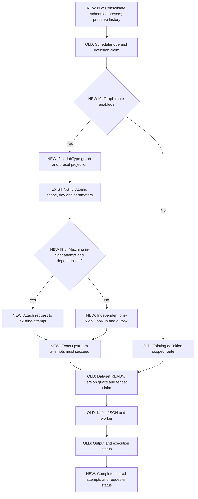
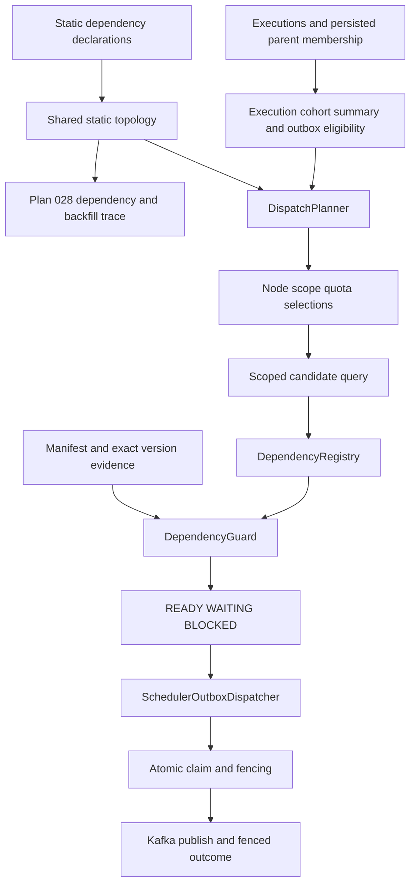

# Plan 030 — Static Graph & DispatchPlanner

## I9 full source delivery and review handoff — 2026-10-30

**I9 verification_pending: I9.a/b/c source delivered, verification not run.** Owner
requested latest branch plus all remaining I9 implementation and a commit, with
implementation decisions recorded for later review. The previous owner-local
verification preference remains in force. This authorizes source development over
I8's still-open closure prerequisite; it does not close I8 or any I9 acceptance/
coverage/deployment gate. Base: `5eb0cbc`. Earlier local I9.a and indicator-binding
PASS evidence below is preserved and does not verify these runtime changes.

### Goal and outcome

Compose the existing JobType graph with I8, make each atomic ancestor an independent
one-step JobRun, acquire matching in-flight attempts once, attach request membership
and dependencies, and consolidate equivalent scheduled presets in the existing
`job_definitions` catalog. No second definition catalog or physical dataset path.
The existing definition-scoped V1 route remains available when the new flag is off.

### Dataset, metadata and algorithm outputs

No new analytical dataset, discovery document, algorithm feature or strategy.
Operational outputs are V17 atomic work slots/attempts, immutable upstream-attempt
bindings, accepted request graph/membership, requester execution status and V18
consolidation inventories/history aliases. SYNC_METADATA remains discovery owner.
I8 worker semantics, logical paths and READY-last/exact-version guards are reused.
Metadata publication remains independently scheduled/triggered: graph completion
does not refresh discovery. Operators must retain discovery refresh after writes;
WAITING on stale/missing READY metadata is deliberate, not a graph success bypass.

### I9.a runtime graph composition

`GraphWorkRequestService` uses the existing `GraphWorkExpansion` and real producer
preview to capture descriptors once; `persistAtomicRunStep` allocates real execution
IDs without a second expansion/catalog-membership read. Strategy, timeframe,
classification level, date/current catalog and scope projections remain owned by
existing static rules/presets. Definitions are locked in UUID order for one accepted
configuration/catalog snapshot; these deliberately coarse locks serialize competing
preparations until commit. A transaction-level SHARE lock on symbols freezes membership/classification through
all projected previews, including inserts. This temporarily blocks catalog writers;
measure retained-catalog latency/contention before activation. Membership is
materialized once per expansion.
The existing graph bounds (20,000 works, 100,000 edges, 1,024 expansions and 200,000
candidate visits), transaction timeout and provider/current-snapshot limits apply;
large retained catalog/latency behavior still needs local performance evidence.
JPA tracking clears after each closed one-work run to avoid graph-wide dirty checks.

Each work gets a one-step V1 JobRun with its original definition identity/scope/day,
parent, one child and one outbox command. Existing V12/V13 closure and path checks
still apply. Cross-work dependency instances live in V17, without rewriting old
frozen paths/fingerprints. A requester has a separate execution and accepted graph;
its returned execution UUID remains usable by the existing status endpoint.
The separate read-only `planGraphExpansion` API remains a preview and does not acquire.

### I9.b acquisition, completion, cancellation and retry decisions

- Work identity remains the unchanged I8 hash. Attempt UUID, execution UUID and
  requester UUID have separate meanings. A slot row locks acquisition; sorted slot
  locking plus atomic DB transactions prevents duplicate overlapping acquisitions.
- Policy is **IN_FLIGHT_ONLY**: reuse PENDING/RUNNING work only when the exact sorted
  upstream attempt UUID list also matches and no upstream has failed. Completed,
  failed or differently bound work creates a new attempt. There is no permanent
  SUCCESS/freshness cache and no automatic in-place retry of an immutable attempt.
- A request freezes target IDs, definition provenance and its attempt membership.
  Exact idempotency replay returns that request's original execution, including
  FAILED/CANCELLED; changed target/parameters under the same key is rejected.
  Internal `retry` requires an owned terminal request and a new manual key; it
  prepares a new graph with `retryOf` correlation. Scheduled refresh uses the next
  due key. Old dependent attempts never switch to a newer ancestor attempt.
- V17 guards prohibit changing/deleting accepted bindings/membership and require
  both graph and attempt closure before commit. Reuse is execution sharing, never
  dataset READY, approved-version safety or writer exclusion by itself.
- `atomic_work_admissible` is applied before candidate limits in planned, legacy,
  disabled-planner and fallback paths and again at claim/publish renewal. It checks
  an active requester and SUCCESS of the exact referenced upstream child attempts.
  Existing JobRun checks, DependencyRegistry, approval binding and fenced outbox
  claims remain separate and mandatory.
- Cancel is owner-scoped and removes only the request's interest. Other owners keep
  the work eligible. No in-flight worker is killed; already-publishing work may
  finish. Unpublished work without an active requester is parked, not deleted;
  a later matching request may reattach. Operator cleanup is a separate retention
  concern. No public manual/cancel/retry command API is enabled here.
- The bounded reconciler propagates upstream FAILED/ERROR/BLOCKED to unpublished
  dependents, closes atomic parents/runs, and aggregates target status into requester
  executions. Request pages use a rotating advisory cursor; cursor loss on restart
  does not change durable membership. Parent/run/failure pages are bounded to 100.
- Expired leases retaining tokens can now save WAITING/retry and BLOCKED decisions;
  live claim tokens remain fenced. This removes the reviewed stale-token persistence
  gap in source; READY-row progress and failure propagation still need execution.

### I9.c definition inventory, consolidation and rollback decisions

`DefinitionConsolidationService.inventory` groups active scheduled presets only
when source, JobType, fallback order and all non-selector configuration match.
Strategy, classification, readiness policy and global output universe differences
stay separate. SYMBOL and sector-feature presets may union `sectorCodes`; an empty
selector means the full universe and absorbs subsets. Global writers require exact
configuration equality. Groups of one are retained unchanged.

The retained definition is deterministic by cron string then UUID; the first next_run
is the earliest former next_run (or immediate if any was null), then its retained
cron governs the combined scope. Former staggered cron cadence is intentionally
consolidated, not claimed equivalent. Inventory records every old source/type/cron,
config/fallback, schedule flag and next_run for review. Active leases reject the
operation. `schedule_enabled=false` and `canonical_definition_id` retire scheduling
on redundant rows while preserving their original configs, IDs, cron, active/manual
capability, history FKs and frozen paths. No old rows are deleted or reparented.
Graph ancestor selection uses retained presets; explicit internal manual targeting
of an old row keeps its original subset preset. Scheduler selects terminal JobTypes
from the active catalog; metadata remains independently eligible. This affects only
the opt-in graph route; legacy terminal-definition selection remains unchanged.

Seeder synchronization preserves applied retained/retired presets. Historical
`findLastOffset` includes the alias group, keeping offsets available from retired
IDs; I8 atomic dates remain the execution authority. `rollback(changeId)` restores
preset config/schedule links only if config/source/type/cron/fallback/lease state
still matches the inventory. It does not rewind next_run or alter past executions.
Conflicting operator edits fail explicitly. V18 is additive and changes no schedules
by itself; `consolidate` is explicit or enabled by the startup flag below. No retained
consolidation or rollback was executed in this task.

### Contract and cross-service impact

| Owner / source | Impact and local evidence to obtain |
| --- | --- |
| Platform graph/producer/preparation | New runtime materialization and returned requester status; existing composer/route tests plus `GraphWorkRequestsPostgresTest` overlap, concurrent acquire, exact replay, failure/refresh/rollback and status cases. |
| Platform outbox/planner/claims | Atomic barrier on every candidate/claim/renew path, terminal JobType scheduling and expired-token repair; planned/fallback/disabled/retry and stale/live lease cases must run. |
| Platform definition/catalog/seeder/offset readers | Canonical selector union, stopped redundant schedules, preserved seed/manual/history/offset behavior; `DefinitionConsolidationTest` and PostgreSQL migration/consolidation/rollback cases. |
| Platform operations/security | Additive authenticated GET `/api/v1/jobs/atomic-work/requests/{id}` and `/consolidations` (last 100); existing status endpoint retained. Request UUID is in request execution metadata. No public mutation API; auth/not-found/diagnostic regression required. |
| Database | Forward V17/V18 only; guards, FKs, deferred closure and alias view. V1–V16 checksums/data/paths unchanged. Latest migration-count assertions move to 18. Upgrade, dirty-data, rollback-conflict and concurrent isolation checks required. |
| Analyzer/Ingestor/py-common/contracts | No source or wire change in I9: unchanged atomic envelope/approval/status fields; actual workers must be exercised with shared attempts. Existing indicator READY/approved metadata plus exact-byte binding repair remains, not broader version safety. |
| Query Service/MinIO | No read schema/path/owner changes; concurrent different identities can still target the same object. Container integration/READY/lineage remains required; no writer exclusion claim. |
| Console | Existing definition/execution DTOs unchanged; requester execution reports aggregate status. New diagnostic endpoints are additive; no new UI. Old rows remain active presets even when scheduling is disabled; inspect consolidation inventory rather than infer scheduling from active alone. |
| Configuration/deployment/writer | Opt-in flags below; writer/result intents, physical output writeKey, intentId and durable writer offset loops stay Plan 027/P12. Accepted work identity/execution context is reusable unchanged. |

The code-review graph connector is unavailable in this environment. Source impact
and post-edit analysis use direct Java/SQL/Kafka/status/storage/deployment ownership
inspection; no graph impact/change-detection PASS is claimed. No test/build/lint/
format, migration, provider, container, coverage or CI command ran in this delivery.
New test source is NOT execution evidence. Existing I9.a/I8 repair reports are
historical source-bound evidence; they do not cover these edits. Require the full
criterion/source/test matrix and >=80% attributable line/branch coverage for every
critical changed/directly impacted component before closing I9.

### Flags, rollout and rollback

Defaults remain preparation=false, planning=true, graph-expansion=false and
consolidation=false. Set `app.scheduler.job-run.graph-expansion-enabled` (env
`APP_SCHEDULER_JOB_RUN_GRAPH_EXPANSION_ENABLED`) only with preparation and planning;
invalid combinations fail startup. Definition consolidation is explicitly separate:
`app.scheduler.job-run.definition-consolidation-enabled` (env
`APP_SCHEDULER_DEFINITION_CONSOLIDATION_ENABLED`) applies after seeding at startup.
Prefer a maintenance window with scheduler claims paused; active leases reject
consolidation. Baseline graph checks do not activate retained environments.

Deploy V17/V18 with the matching Platform build; keep matching I8 workers. To stop
new graph requests while draining existing ones, pause scheduler scanning externally
and keep graph reconciliation, preparation and guarded dispatch configured; graph
requires preparation at startup. Do not set an invalid flag combination. Disable graph only after active graph requests drain/cancel;
otherwise the graph-only reconciler stops. Old V1 runs continue on the existing
path. Keep V17/V18 functions and snapshot-aware build while graph outbox/work remains;
rolling back to binaries that omit the atomic barrier can publish downstream early.
Rollback consolidation through the stored change IDs before returning to old catalog
scheduling. Do not drop migrations, rewrite frozen paths or re-expand old requests.

### Owner-local verification handoff and documentation audit

Recommended **NOT RUN** targets: `nx run platform:test`, `platform:coverage`,
`platform:build`, project Java format target, `platform:test-integration` and
`platform:test-overlap`; re-run impacted `py-common`, Ingestor, Analyzer and Query
Service targets through their declared Nx projects. Cover graph flags/default
compatibility, all job types/strategies/scopes, concurrent overlap, restart,
idempotency conflicts, immutable/missing closures, failures and retry, cancellation
before/after publish, no-owner parking, stale/live leases, fairness with READY work,
upgrade from V16, existing V1 snapshots and seed/consolidation/offset/rollback parity.
The overlap probe must retain all version/lineage assertions. Do not infer PASS from
source, fixture counts, previous gates or commit/push.

Record each required local check with `tools/check_result.py init` and `run` or
`import-log` under P14-I9, then summarize and confirm the compact conclusion is
ready. Agent reads only `python tools/check_result.py conclusion --increment P14-I9`.
No completion/attestation was fabricated. I8 remains verification_pending; I9 is
verification_pending until owner-local full acceptance and documentation closure.

Documentation synchronization covers registry, plan, release notes, architecture,
execution/data/database/Kafka flows, deployment, ownership, index, Platform and
worker guides plus Plan 027/writer debt/field inventory. ADR lease/outbox/READY
policies are retained; AGENTS/CLAUDE/editor rules require no tool/permission change.
Plan 028 backfill and Plan 029 ETA/UI are not activated. Static audit checks IDs,
statuses/dependencies, source paths and links, graph/request/attempt distinctions,
writer boundaries and deployment warnings; executable/graph audit remains unavailable.

### Review flow — old and new

## I9.a acceptance hardening — 2026-10-30

`planGraphExpansion` starts a separate read-only repeatable-read transaction, so a
writable/read-committed caller cannot weaken the planning snapshot. The caller's
transaction is suspended and restored; planning does not see its uncommitted
configuration changes. Call the Spring service proxy, not a self-invoked method.
No scheduler, preparation or dispatch route is switched to this internal API.

Sector-feature projection now carries the dependent's `sectorLevel` along with
`timeframe`. A level-1 analysis must not depend on level-2 feature work from the
upstream preset. Tests keep levels 1/2 as distinct atomic identities and verify
that projection does not mutate that preset's configuration.

Additional regressions cover exchange-to-symbol and strategy selection, global
sector ancestors, timeframe/classification-level projection, immutable definition
provenance, duplicate/oversized/wrong-type expansions, malformed symbol keys,
date mismatches and the distinct-expansion bound. Real PostgreSQL/Spring cases exercise preview parity,
weekday ranges/current catalog dates, unchanged cadence/leases/no durable intent,
failure without partial work, concurrent committed catalog changes, and isolation
from an existing writable caller transaction.

Local planning gate: **PASS `P14-I9a-8219aff`, required=1/pass=1** through
`nx run platform:coverage --skip-nx-cache`, read with
`python tools/check_result.py conclusion --increment P14-I9a-8219aff`.
The final run executed 486 tests with zero failures/errors and two opt-in skips;
`GraphWorkExpansionTest` passed 12/12 and `JobRunPreparationPostgresTest` 36/36.
All 295 tracked Java production/test files matched the hashes captured before that
run. HEAD was `69f1154`; the gate suffix retains this task's starting `8219aff`.
Copied JUnit/JaCoCo reports, source binding and detailed impact/test matrix are in
`.agent/check-results/P14-I9a-8219aff/`. The initial attempt's repository-spy setup
failure was repaired and rerun; no failing check was waived. Existing closed-test-
container/Hikari shutdown warnings persist, with final Gradle/Nx exit code zero.

| Criterion / source | Executed evidence | Line / branch |
| --- | --- | --- |
| Graph composition, scope/strategy/date/projection, provenance, invalid membership and bounds: `GraphWorkExpansion` | 12 composer cases, including classification levels 1/2 and distinct-expansion budget | 92.7% / 84.2% |
| Immutable work/plan: `GraphWorkExpansion.Work` / `.Plan` | Composer identity rejection and immutable collection/provenance cases | 100% / 100% where branches exist |
| Existing static edges/presets: `StaticTopologyDeclaration` / `StaticDefinitionDependencies` | Composer strategies plus existing topology/path suites | 100% / 100% |
| Shared I8 producer boundary: `JobProducer` | `ExpansionRoutesTest`, real producer/date/sector parity and existing producer/preparation suites | 94.3% / 83.1% |
| Detached preview/context: `JobRunWorkContext` | Preview no-write route, PostgreSQL parity and existing preparation suites | 87.3% / 94.4% |
| Date/default/atomic identity: `WorkExpansion` | Composer, route, work-expansion and PostgreSQL suites | 96.9% / 87.2% |
| Snapshot/isolation/no durable side effects: `JobRunPreparationService` | Four `graphPlanning*` PostgreSQL cases; concurrent catalog commit, writable caller, leases/failure and real producer/sector parity | 99.4% / 91.9% |

`planGraphExpansion` and its producer/membership callbacks have 100% line coverage;
they contain no instrumented branch counter. These results supersede the earlier
I9.a 67% branch and unexecuted-transaction limitations below. Source and local
planning acceptance are verified; checkpoint completion still depends on the
unclosed I8 prerequisite. I8 stays `verification_pending`, I9 `in_progress`.
No build/lint/format, cross-service integration rerun, CI, deployment, activation
or owner attestation is claimed by this continuation.

Blast radius: Platform planning transaction/projection/tests only. The real
producer preview and membership query execute within one database snapshot;
persisted JobRun, execution/outbox, definitions, schema, flags and production scheduling are unchanged.
Analyzer, Ingestor, Query Service, Console and shared libraries/contracts have no
source or transport changes in this continuation. No worker/storage/provider or
deployment behavior changes, and no integration result is carried forward as proof
of the changed planning transaction. Writer, durable dedup/completion and definition
retirement remain I9.b/c or Plan 027 scope. I8/I9 status is unchanged.

Documentation scope: this plan, ReleaseNotes, registry continuation note and Platform
guide own the new evidence/transaction semantics. Existing architecture, ADR, flows,
Kafka/lake/database, deployment, ownership/index and agent guidance remain accurate:
there is no new runtime route, wire/schema/storage/configuration or workflow policy.

Static documentation consistency audit: CONSISTENT for the touched plan, release
notes, registry, roadmap index and Platform guide. IDs, statuses/dependencies,
required plan sections, owned links/anchors, contract boundaries and evidence
wording agree; historical results remain historical. Graph change detection against
`69f1154` covers nine files/18 symbols with four heuristic test gaps; the executed
source/test matrix above covers those planner/projection symbols. Graph hints are
not test evidence. No additional concrete defect was found in the scoped self-review.

## Preparation, diagnostics and EOD binding repairs — 2026-10-30

The eight failing Platform cases and two integration findings recorded below are
resolved by the local `P14-I8-I9a-repair-ac1f800` gate, **PASS 6/6**. This repair does not finalize I8
or I9.a, enable preparation, add a writer or alter applied V1–V16 migrations.

- Preparation resolves each step exactly once into accepted descriptors, checks
  the aggregate run budget, then allocates persistent child UUIDs and enqueues
  those descriptors. Materialization does not reread catalog membership or expand
  again. Snapshot/membership lookups are indexed in memory and dirty checking is
  bounded to one closed step. The existing transaction timeout is unchanged.
- Offset, migration-count, canonical-order, manual-request, immutable-guard and
  producer-fixture assertions now exercise the I8 contract. They still assert
  rollback/no partial intent, preserved history/cadence, exact membership and
  rejected identity mutation. The old root-message metadata test now follows its
  actual atomic child.
- A successful metadata parent projects `PARTIAL_SUCCESS`, skipped-object count
  and warning from its children without changing SUCCESS into a blocking status.
- Outbox publication carries the execution's first `approvedInputs` in command
  metadata. Retry/replay preserve that binding; status handling keeps its structured
  form and rejects worker attempts to replace it. The persisted intent payload is
  unchanged; replay uses `boundPayload` to reconstruct the published context.
- Atomic indicator handling requires the matching EOD approval and checks current
  READY metadata plus the fingerprint of the exact bytes decoded before output.
  This closes the exercised approved-version and stale-metadata/read race on this
  path. It does not provide all-consumer binding or writer/concurrency exclusion.

Current local execution: Platform coverage PASS (476 tests, zero failures, two
opt-in integration skips); the whole-run budget regression completes in 2.33 s.
Shared Python coverage PASS (200 tests, four opt-in Kafka skips), Ingestor PASS
(73) and Analyzer PASS (153). Cross-service container integration and the separate
shared-ancestor version/replay probe both PASS. The adverse overlap invalidates
both existing approvals: both attempts and replay return ERROR before output;
all three consistency assertions are true. This is fail-closed execution, not a
claim that overlapping jobs transparently succeed or that writer exclusion exists.
No failing check is waived. Compact conclusion is read through
`tools/check_result.py conclusion --increment P14-I8-I9a-repair-ac1f800`.

Attributable Java line/branch coverage from the saved full-suite report:
`JobProducer` 94.3%/83.1%, `JobRunWorkContext` 87.3%/94.4%,
`JobRunPreparationService` 96.0%/91.9%, `SchedulerOutboxService` 99.1%/90.0%,
`JobService` 95.2%/87.5% and `WorkExpansion` 94.7%/83.9%. The separate I9.a
`GraphWorkExpansion` has 86.2%/67.0%; its branch/transaction/complete acceptance
gate remains open. I8 remains `verification_pending`, I9 `in_progress`.

Evidence directory suffix records the starting base `ac1f800`. HEAD was externally
amended to `8219aff` while work continued; the final production/test files are in
that commit, with source hashes and copied reports saved in the ignored repair
evidence directory. No new commit or push is performed by this repair turn.

Blast radius: Platform preparation/outbox/status and Analyzer indicator input
handling change; py-common adds binding validation and byte-verified reads. Ingestor
and Query Service have no production edits, but their real workers/readers are in
the container story. Console has no API/UI change. JSON command metadata gains
logical approval context; Proto/generated code, storage paths/owners, database
schema and flags are unchanged. Kafka/lake/indicator/job flow, service guides,
rollout notes, this plan and release notes own the repair documentation. Writer
Plan 027/P12 and shared ownership I9.b remain deferred. No build/lint/format,
CI, live provider or retained-environment deployment result is claimed.

Documentation reconciliation: the registry retains I8 `verification_pending` and
I9 `in_progress`; mandatory plan sections and the repair links remain present.
Architecture/ownership/index/database references retain their existing boundaries
and point to the bounded repair. ADRs need no change because durable outbox,
ownership and READY-last decisions are preserved. AGENTS, CLAUDE, editor rules and
shared skills need no change because command permissions and agent workflow are
unchanged. Static consistency review found no conflicting current completion or
activation claim. Graph change detection against `ac1f800` inspected 48 files and
89 symbols; its 38 heuristic test gaps are navigation hints, not executed coverage.
The saved impact/test matrix and reports establish the repair evidence; the open
I9.a branch/transaction acceptance gaps above remain unresolved.

## I9.a read-only graph expansion development — 2026-10-29

**I9: in_progress; I9.a: source present, verification pending.** I8 remains
`verification_pending`. Owner explicitly directed I9.a development after the I8
test amendment; this supersedes the previous start-after-completed-I8 restriction
for source development only. Completion and activation gates remain unchanged.

`JobRunPreparationService.planGraphExpansion` is an internal read-only planning
API under a repeatable-read transaction. It uses active `job_definitions`, the
source-controlled static edge rules and each real producer's `previewAtomicWork`.
Preview calls the same I8 expansion boundary through a detached work context; it
does not create history, claim work, insert outbox intent or publish Kafka.
Existing scheduled/manual preparation, frozen V1 paths and fingerprints retain
their current execution path. This API is not a public manual endpoint.

`GraphWorkExpansion` returns accepted time, atomic target IDs, immutable work
descriptors, deterministic dependency instances and definition provenance. Matching
atomic IDs are coalesced only within one plan; there is no cross-request database
deduplication or execution reuse. I9.b must bind a closed plan to durable attempts,
dependencies and ownership without silently re-expanding it. Replay/publication
still use stored execution/outbox membership, not this planning API.

Scope mapping supports SYMBOL-to-SYMBOL, SYMBOL-to-EXCHANGE and the reverse,
SECTOR-to-SYMBOL through current active membership, and existing GLOBAL units.
Signal edges use effective strategy, including intraday ancestors for
`CONFIRMED_TREND_EQUALS`; cron is not the strategy selector. Evaluation selects
matching signal strategies. Upstream date/parameter projection preserves the
business day and selected timeframe/indicator input, keeps source/strategy defaults
owned by each upstream preset and drops target-only parameters. Catalog ancestors
use the accepted current Vietnam snapshot, explicitly distinguished on the edge;
this is current-membership planning, not historical catalog reconstruction.

Unsupported/missing scope mappings, malformed identities, unknown strategies and
missing required ancestors fail rather than returning partial plans. Bounds are
20,000 selected works, 100,000 edges, 1,024 expansions/catalog definitions, 200,000
candidate rows/visits and depth 32. Candidate expansions are cached by definition
and canonical request. Reversed catalog order and transient execution UUIDs do not
change the logical graph result.

| Area | Impact / no-impact reason | Regression evidence |
| --- | --- | --- |
| Platform | New graph composer, shared static edge rules, detached producer preview/context and read-only planning API | `GraphWorkExpansionTest`, `ExpansionRoutesTest`, existing topology/preparation suites |
| Analyzer, Ingestor | No production changes in I9.a; existing I8 atomic consumers remain authoritative | I8 worker evidence above; no new worker behavior claimed |
| Query Service, Console | No endpoint, read schema, dataset or UI change | No new application integration claim |
| Shared contracts/libraries | Existing I8 envelope/hash reused; no Proto/generated/config catalog added | Existing Java/Python fixture evidence retained |
| Persistence | Read-only catalog/membership snapshot; no new tables, migrations, FKs or attempt ownership | Preview test asserts no service/Kafka writes; transaction integration evidence remains pending |
| Configuration/operations | Same definitions/presets and flags; no scheduler activation, cron consolidation or rollout change | Existing activation/version gates retained |

Verification used only the approved `platform:coverage` target. The initial run
found two test compilation issues, corrected before rerun. The rerun compiled
production/tests and executed 471 tests: eight existing failures and two skips.
All six `GraphWorkExpansionTest` cases and all three `ExpansionRoutesTest` cases
passed (including the new actual-producer no-write preview case). The local gate
`P14-I9a-development-ac1f800` concludes FAIL; individual passing cases do not
promote it to PASS. Fresh attributable JaCoCo thresholds, transaction-level API
integration, complete strategy/scope/date/route acceptance and the existing I8
failures remain unresolved. No formatter/lint/build/CI/deployment or integration
rerun result is claimed. I9.a is not finalized.

Documentation reconciliation: update registry/current-status notes, this plan,
release notes, Platform guide and job flow. Architecture/Kafka/lake/database,
deployment, development ownership, service/index and Plan 027/TD-009 notes retain
their existing contracts, with status wording synchronized. ADR, AGENTS.md,
CLAUDE.md and editor rules need no behavioral rule changes: no public/wire/storage,
writer or deployment authority is added. Graph impact remains bounded navigation;
direct Java/producer/Python/storage reconciliation supplies the no-impact reasons.

## Additional I8 unit coverage and owner-directed I9.a continuation — 2026-10-29

Owner requested additional unit tests, amendment of the current I8 commit and a
force push, then I9.a source development. This explicitly permits I9.a development
while I8 remains `verification_pending`; it does not waive either increment's
completion, migration, integration, coverage or activation gates. I9.b/c and writer
activation remain outside this continuation.

New regressions exercise non-finite numbers, malformed atomic envelopes, snapshot
day validation, status attribution, legacy bypass, invalid stored dates and
no-write failures. Stock tests cover missing/empty/existing history, provider date
bounds, empty/malformed fetches and failed writes. Java tests cover malformed
scope/parameters, detached preset overrides and deeply immutable snapshots.
The shared Python suite passed 190 tests (four opt-in Kafka cases skipped), and
Ingestor passed 73. Attributable line/branch coverage: atomic contract 94.3%/90.4%,
atomic storage helpers 100%/100%, stock handler 100%/100%.

Full I8 prerequisite checks on `209ee9e` failed: Platform had 461 tests, eight
failures and two skips; cross-service integration could not read metadata
`PARTIAL_SUCCESS` diagnostics from the parent after child expansion. The separate
shared-ancestor probe reached its intended approved-EOD-version assertion and
failed for both successful workers and replay. These findings remain open; added
unit coverage is not a passing full I8 gate. The Platform coverage rerun executed
464 tests with the same eight failures and two skips; all eight `WorkExpansionTest`
cases passed. `P14-I8-add-unit-209ee9e` concludes FAIL (two checks passed, Platform
coverage failed). Owner-requested amendment is a test-source delivery, not increment
finalization or a passing gate. No formatter/lint/build target is
authorized for this continuation; no such execution is claimed.

Documentation scope: plan and release notes record this bounded test addition and
owner sequencing decision. Registry status is unchanged at this stage. No source,
Kafka schema, paths, database migrations, configuration, deployment or repository
guidance changes are introduced by the test amendment; existing canonical owners
and rollout gates remain applicable.

## I8 source delivery and local verification handoff — 2026-10-29

Review repair follow-up (2026-10-29): the original no-verification delivery below
is historical. Stock bootstrap now retains provider history through the requested
day on missing/empty output, without integration-only history seeding. Python
numeric canonicalization no longer uses context-rounding `Decimal.normalize()`;
Java/Python share exact decimal vectors in
`libs/contracts/fixtures/atomic-work-numbers-v1.json`. Java inline qualified class
references were replaced with imports in the I8 source/test selection.

Local repair gate `P14-I8-review-fixes-20261029` concludes **PASS 3/3** via
`tools/check_result.py conclusion`: `ingestor:test --skip-nx-cache` (59 tests),
`py-common:test --skip-nx-cache --args="tests/messaging/test_atomic_work.py"`
(9 tests), and `platform:test --skip-nx-cache --args="--tests
com.omni.platform.modules.scheduler.expansion.WorkExpansionTest"` (5 tests).
Java formatting and scoped Python lint-fix/format passed for the I8 file set.
The stock regression exercises existing/missing/empty output, missing-day no-write,
future-row exclusion, correction and status attribution. Numeric regression maps
both canonical implementations to shared long-integer/decimal/exponent/zero vectors;
Python runs them at precision 6, 28 and 50. This proves canonicalization of supplied
numeric values, not lossless arbitrary-precision fractional JSON decoding.

This bounded repair gate does not replace the full I8 gate or establish numeric
coverage thresholds. Integration containers, migrations and live providers were
not run. I8 remains `verification_pending`, I9 pending. No flags were enabled.
Production impact: Ingestor bootstrap and shared Python numeric canonicalization;
Platform canonicalization is unchanged (new regression/import/style only).
Analyzer imports the shared validator; its source edits here are formatting only.
Query Service and Console have no production changes; shared contracts add only a
fixture. Persistence schema, paths, configuration and rollout gates are unchanged.

Documentation repair scope: updated this plan, Ingestor guide, stock flow and root
release notes. Registry/roadmap statuses need no update; architecture, ADR, Kafka
wire schema, data-lake ownership/paths, database, deployment, development ownership,
indexes and repository guidance retain their existing contracts. Graph tools are
unavailable; no graph change-detection result is claimed. Static consistency review
is limited to the repair scope and does not finalize I8.

**Status: verification_pending.** Owner requested implementation, commit and push
without running verification; no build, test, lint, format, migration, runtime or
coverage execution is claimed. I7 evidence is unchanged; I9 remains pending and
blocked on the complete I8 gate. Preparation flags remain disabled. This section
supersedes earlier pending/design-only I8 statements, not historical evidence.

### Implemented contract and boundaries

`JobProducer` now uses `WorkExpansion` for legacy scheduled, internal manual and
JobRun preparation. Definitions remain configuration/presets and execution FKs.
Requests accept `scope: {type,key}`, inclusive `dateFrom`/`dateTo`, and `parameters`.
Missing dates resolve once to the accepted Vietnam calendar day; weekends produce
no work. Selection is current active membership at acceptance, not a historical
listing universe. Exchange scopes resolve to symbol work for symbol job types.
Explicit unknown/empty symbol scopes fail closed; limits are 366 calendar days and
5,000 atomic works per parent, with transactional failure rather than truncation.
No paging, public manual API, cross-run reuse or graph mapping is added in I8.

Every persisted command adds flattened `jobType`, ISO `businessDate`, effective
`parameters` and `atomicWorkId`. The ID is `work:` plus SHA-256 of UTF-8 canonical
JSON `[jobType,workType,workKey,businessDate,parameters]`: sorted object keys,
ordered arrays, normalized finite decimal numbers, no whitespace. Known set-like
parameter arrays are sorted/deduplicated before hashing. Definition/execution UUIDs,
cron, offsets and timestamps are excluded. The shared Java/Python fixture lives in
`libs/contracts/fixtures/atomic-work-v1.json`; no protobuf/generated file changes.
`KafkaPublisher` flattens the additive envelope through the existing publishing
port; ordinary messages retain their existing serializer path.

Atomic units: SYMBOL for stock/indicators/signals/intraday/symbol features;
EXCHANGE for symbol catalog and signal evaluation; SECTOR for sector features;
GLOBAL for metadata, rotation backtest and transition analysis/outcomes. A GLOBAL
operation is the existing processor's smallest supported transaction, not individual
rows/outputs. SYNC_SYMBOLS and SYNC_METADATA support current snapshots only and
reject historical requests, including commands delayed across a Vietnam day.

Parents retain `acceptedExpansion` and closed `expandedWorkIds`; children retain
`workExpansion` (including accepted configuration), `workIdentity` and
`workBusinessDate`. V16 adds immutable snapshot guards and updates the prepared-work
unique index. Existing step `businessDate` stays the V13 anchor; atomic child dates
are separate. V1–V15 and historical rows are not rewritten or re-expanded.
Outbox readiness uses the accepted configuration; publication/retry/fallback/replay
uses stored payload membership and performs no second expansion.

Python accepts legacy commands only when all four new fields are absent; partial
or inconsistent envelopes fail. Atomic workers restrict inputs through the work
day, keep lookback, require a requested EOD day where applicable and replace only
that day's output while preserving other dates. Stock uses the provider's recent-N
API and fails before write if the requested date is unavailable. Missing/empty
stock output bootstraps up to 10,000 provider rows through the requested day;
initialized output replaces only that day's prices. Signals preserve later history/current
projection when older work runs. Metadata remains the sole discovery writer.

These are mutable-object read/merge/write operations: concurrent writes can still
lose updates. Atomic identity does not bind approved data versions, fingerprint
Parquet bytes or solve the known metadata/bytes race. The expired-token WAITING/
BLOCKED persistence finding is also unchanged. Keep activation gates in force.

Future writer can reuse the envelope, canonicalization, validation and execution
attribution and accept computed result plus this identity. It still needs operation,
logical output/row identity and deterministic intentId. Work ID, writer writeKey and
intentId are separate; actual durable-intent publication, buffers, offset boundaries,
concurrency and version binding remain Plan 027/P12 work. JobType alone is not a
safe buffer/exclusion key.

### Cross-service impact and source-to-test handoff

| Area / source                                                                               | Impact and acceptance evidence to run locally                                                                                                                                                                                                 |
| ------------------------------------------------------------------------------------------- | --------------------------------------------------------------------------------------------------------------------------------------------------------------------------------------------------------------------------------------------- |
| Platform `WorkExpansion`, `JobProducer`, five symbol/intraday adapters                      | Shared route/date/scope/default/bounds/canonical identity; `WorkExpansionTest`, `ExpansionRoutesTest`; broaden to every concrete producer and failure/rollback path.                                                                          |
| Preparation/context, `JobService`, outbox candidate snapshots                               | Closed membership, per-day children, JSON status preservation, readiness against accepted config; run existing JobRun/outbox suites plus source regressions.                                                                                  |
| V16 and shared Kafka serialization                                                          | Forward migration from V15, legacy history, immutable descriptors, two days in one anchored step, flattened payload; `AtomicWorkExpansionPostgresTest`, updated migration assertions and `WorkExpansionTest`. No retained migration executed. |
| py-common envelope/storage                                                                  | Shared fixture parity, legacy/partial/tampered contracts, lookback cutoff, missing-day no-write and history preservation; `tests/messaging/test_atomic_work.py`.                                                                              |
| Ingestor stock/catalog/status                                                               | Exact-day writes and unavailable-day errors; `test_atomic_stock_work.py`; catalog current-day/delayed rejection needs executed coverage.                                                                                                      |
| Analyzer indicators/signals/evaluation/sector wave/transition/metadata and status producers | Cutoffs, historical writes and attribution; `test_atomic_work_handler.py` plus existing handler suites. Signals/sector/current-snapshot failure and retry branches still require local attributable evidence.                                 |
| Query Service                                                                               | No production change: paths, discovery and read schema remain. Integration fixture expects one indicator day; cold stock ingestion supplies lookback without test-only history seeding. Run `platform:test-integration`.                      |
| Console                                                                                     | No API or UI fields changed; existing execution/status contract retained. Check diagnostics accept structured metadata; no new UI feature.                                                                                                    |
| Contracts/configuration/operations                                                          | Additive JSON fixture only; no generated files, seed/cron edits, new flag or writer service. Coordinated rollout below is required even with preparation disabled.                                                                            |

Shared-ancestor integration now changes the same day's price instead of appending
an unrelated future day; the exact approved-version safety assertion is retained.
It is an unresolved-blocker probe, not an expected passing I8 claim. Integration
fixtures use the current Vietnam weekday; run these current-snapshot stories on a
weekday. Historical 180/181-row evidence remains historical and is not rerun here.

Graph discovery/impact/change-detection tools are unavailable in this session;
manual Java/Python/Kafka/storage/status/migration inspection supplied this impact
inventory. No graph PASS is asserted. Test source presence is not coverage evidence;
all rows above remain NOT RUN. Require an attributable source/branch matrix and at
least 80% line/branch coverage for impacted critical components before closure;
aggregate suite totals alone do not close I8.

### Deployment, rollback and owner handoff

Stop/drain incompatible old consumers and old Platform writers before accepting
expanded commands. Deploy matching py-common/Ingestor/Analyzer and Platform with
V16; never allow old workers to silently ignore the new day/identity fields.
The legacy scheduler also emits the new envelope, so the preparation flag does
not isolate this change. V16 is a forward startup migration; apply the normal
retained-data review/backup procedure. No environment was migrated in this task.
Rollback must retain snapshot-aware status handling until expanded work drains;
old metadata stringification can violate immutable guards. Do not drop V16 or
rewrite stored membership as a rollback shortcut.

Owner-local recommended targets, **NOT RUN**: `nx run platform:test`,
`nx run platform:coverage`, `nx run py-common:test`, `nx run py-common:coverage`,
`nx run ingestor:test`, `nx run ingestor:coverage`, `nx run analyzer:test`,
`nx run analyzer:coverage`, `nx run platform:test-integration` and the separate
known-blocker probe `nx run platform:test-overlap`. Run project build/lint/format
targets as part of the full accepted local gate. Record each required check using
`tools/check_result.py init` and `run` (or `import-log`), then `summarize` and confirm
when the compact conclusion is ready. Agent reads only
`python tools/check_result.py conclusion --increment P14-I8`; no PASS or owner
attestation has been created here. Fill missing route/concurrency/failure evidence
and reconcile the impact matrix before marking I8 completed or starting I9.

Documentation reconciliation: registry, numbered plan, roadmap/index, release
notes, architecture, execution/data flows, Kafka/lake/database, deployment,
ownership, service guides, field inventory and writer plan/debt updated together.
ADR lease policy, AGENTS/CLAUDE/editor rules, seeds, Plan 028/029 and Console/Query
production guides need no changes: no lease-policy/tooling/graph/API/dataset-path
change. Static document review only; executable checks and graph audit remain
unavailable/not run and increment closure is explicitly deferred.

## Current I8/I9 handoff — 2026-10-29

Canonical scheduling is I7 completed -> I8 verification_pending -> I9 verification_pending in the
[increment registry](roadmap/implementation-increments.md#increment-registry).
I8 first unifies request-to-atomic-work expansion and dated consumer semantics.
I9 then delivers graph composition (a), shared ancestor work (b), and definition
consolidation including history/offset/migration/diagnostics/rollback (c).
Definitions remain the single configuration/preset source; neither full cron
removal nor definition-free runtime nor a second configuration catalog is scope.

The [isolated I7 local completion](#i7-isolated-local-completion--2026-10-28)
records the latest source-bound gate; the old cloud download failure is historical.
This audit reads that recorded evidence, not a fresh test/coverage execution or
owner attestation. Pending does not mean I7 is incomplete; I8 still needs normal
readiness/contract-task handoff review before autonomous selection.

Writer consumes computed result plus unchanged work identity/execution context in
a future validated intent. Work key, logical output writeKey and operation
intentId remain distinct, as specified in the
[handoff](#i9-checkpoints-and-writer-result-handoff--2026-10-28) and
[Plan 027](027-concurrent-workers-and-writer-batching.md#p14-expansion-reuse-boundary--2026-10-28).
The writer does not expand requests or resolve static graph. P12, concurrency,
public manual APIs, version binding and default preparation activation remain
outside this documentation change. The core normalized day/work identity is
prepared by I8/I9; actual durable-intent publication and both writer offset
boundaries are later writer implementation, not a prerequisite to finish I8.

### Documentation reconciliation boundary

Scope: registry/order, Plan 030/027, roadmap/index, field inventory, writer debt,
architecture/flow/data/development ownership and service guides. Current planned
notes are distinct from historical source/test records. I7 counts/gate evidence
and historical failed attempts are preserved rather than rewritten as new PASS.
No production source, schema, generated contract, configuration or flag changes.
Platform/Analyzer/Ingestor and shared contracts are planned I8/I9 impact; Query
Service/Console remain compatibility review unless output/read contracts change.
Future writer and shared output ownership remain deferred to their existing plan.

AGENTS.md, CLAUDE.md and .roo/rules were reviewed: no update needed because this
change adds no new tool, permission, source ownership or verification rule.
ADR-007 remains the current runtime boundary; planned changes link here rather
than silently changing an accepted lease policy. Deployment runbook keeps
retained-data/activation gates; backfill Plan 028 and operator Plan 029 remain
separately scoped. No extra service or dataset readiness authority is introduced.
Static review checks current IDs/status/dependencies, required I8/I9 sections,
writer contracts, relevant links and introduced claims. Graph tools are unavailable:
no graph impact/change-detection PASS, executable test/lint/build/format,
numeric coverage, CI, deployment or increment completion is claimed by this audit.

Status: Owner-approved active epic in Milestone 1. The [increment registry](roadmap/implementation-increments.md) owns status/dependencies/readiness. I1–I5 are completed on local source-bound evidence; I6 is superseded into I5; I7 is locally completed; I8 is verification_pending; I9 is verification_pending with I9.a/b/c source delivered for owner review. Preparation remains disabled; no retained rollout or deployment is claimed.

Owner decisions recorded: 2026-10-08; scope clarified on 2026-10-13.

October 27 [shared-ancestor integration](../deployment/004-job-run-admission-rollout.md#shared-ancestor-integration--2026-10-27)
reproduces an activation blocker on disposable PostgreSQL/Kafka/MinIO: two runs
approved against V1 report SUCCESS using V2 after a shared ancestor replaces EOD;
same-identity replay also uses V2. The dedicated `platform:test-overlap` gate fails
its safety assertion. Prior local story completion does not establish input snapshot
safety, and no increment status is changed. Owner confirms retained V15 applied;
that report does not resolve this worker/input-version mismatch.

Default-flow review (2026-10-25): **not ready to remove preparation/planning flags**.
The [rollout readiness review](../deployment/004-job-run-admission-rollout.md#default-flow-readiness-review--2026-10-25)
records 351 passing Python tests, reused source-bound Platform evidence, a real
disposable-broker reproduction of premature offset commit, the Analyzer/Platform
partial-status mismatch, entry-target decisions and the required whole-chain gate.
It prepares removal scope without enabling preparation or changing increment
statuses; local P14 completion is not operational activation.

Offset follow-up: the
[sequential manual-commit/startup fix](../deployment/004-job-run-admission-rollout.md#offset-safety-follow-up--2026-10-25)
is locally verified separately under `P14-offset-safety`. The original loss probe
is historical evidence of the repaired defect. The October 26
[partial-result policy](../technical-debt/001-p3-i5-metadata-reconciliation.md#temporary-warning-policy--2026-10-26)
now uses owner-approved temporary SUCCESS-with-warning semantics for returned
partial results, retaining counters; exceptions remain ERROR/FAILED. Expected-object
classification remains open under that temporary tolerance. The initial
[October 26 disposable integration](../deployment/004-job-run-admission-rollout.md#disposable-cross-service-integration--2026-10-26)
verified worker/status persistence, READY/exact lineage, Query Service reads and
metadata-failure preservation for one bounded scope. It exposed the failed-worker
HTTP 200 defect and required explicit recovery at that time.
The subsequent [worker/entry follow-up](../deployment/004-job-run-admission-rollout.md#worker-recovery-and-terminal-entries--2026-10-26)
fixes symbol warning completion and truthful health with automatic session recovery.
Owner selected terminal definition entries, including standalone metadata; enabled
claims filter them before batch limits. The bounded indicator integration uses
explicit preparation, while full-catalog terminal selection is tested in PostgreSQL.
Cross-run shared-writer safety, retained rollout and remaining workload integration
still prevent activation. No P12 scope or P14 increment status is promoted.

## Historical execution-cohort revision — 2026-10-13 (superseded by 2026-10-15 canonical sequence)

This section supersedes the earlier backlog-only selection design, not the historical verification evidence below. The static DAG remains a map of job types; executions populate each node with independent business-group/run/business-date scopes. BANKS and REAL_ESTATE can progress independently inside the same logical node. No outbox processing-success status, execution dependency DAG, new manifest evaluator, or workflow engine is introduced.

Completion ordering is based on persisted execution parent–child evidence for the matching cohort. Dataset readiness and exact input versions remain exclusively evaluated by the existing DependencyRegistry/DependencyGuard before each candidate claim. Execution SUCCESS is not dataset READY. JobScheduler prepares due execution/outbox intent; SchedulerOutboxDispatcher is the existing guard/claim/publish boundary.

Current source is not yet compliant: DispatchScope groups by definition UUID; the outbox-only summary loses published-but-running work; the planner can descend past an upstream node with no dispatchable work even when its executions are unfinished. P14-I2 remains verification_pending with reimplementation required; P14-I3 remains pending. Earlier PASS/owner attestation is historical, not evidence for this revision. P14-I1 remains completed: reuse its verified static graph and validate the new runtime population mapping in P14-I2 rather than reopening historical topology verification.

## Goal

### Current architecture — 2026-10-15

Provide one validated static DAG that accepts a **target job definition** and resolves all required upstream jobs. Persist each requested workflow as a single **JobRun** with immutable planned dependency path. Prepare/enqueue dependency messages before downstream/target messages; the existing FIFO outbox/DependencyRegistry pipeline remains unchanged in I3. I4 enables **JobRun-aware** selection based on persisted step completion, not merely enqueue order, while preserving guard and fenced claims. I5 measures throughput/query behavior; I5 supplies the read-model handoff to Plan 029.

**The target/entry job is often a DAG sink, not a root node in graph theory.** “Reduce job definitions” means reduce separately cron-scheduled **entry targets**; ancestor definitions, producers and configurations remain. Existing jobs may remain independently triggerable where operationally required.

Current stories and statuses are defined solely by the [canonical I1–I7 story sequence](#canonical-revised-delivery-sequence--2026-10-15). Requirements elsewhere labeled historical must not override it. No runtime implementation, migration, benchmark or test execution is claimed by this documentation revision.

## Outcome

A reusable static definition-path handoff in I2, followed by durable JobRun preparation
in I3 and guarded runtime admission in I4. I2 and I3 are completed on source-bound
local acceptance/test/coverage/build and documentation evidence below. I4 admission is integrated and locally verified below; preparation remains disabled.
No new owner attestation or deployment is asserted.

## I8/I9 expansion-first scope revision — 2026-10-28

Owner revised the unimplemented I8/I9 draft: common expansion first, then static
graph composition and definition consolidation. This replaces the earlier draft
for cron isolation and definition-free runtime. Existing definitions/configJson
remain the sole preset/configuration source; no second definition catalog.
Full cron removal, definition-free runtime and historical definition-FK removal
are outside these increments. Both remain pending; no runtime/flag change.

### Shared expansion and writer contract for I8/I9

Request tuple: <JobType>:<scope>:<dateFrom>:<dateTo>:<parameters>.
Atomic work tuple: <JobType>:<workKey>:<businessDate>:<parameters>.
Use typed scope/workType and canonical encoding, not ambiguous concatenation.
Freeze exact Java/Python fields, map/default/null/value/collection normalization
and hash fixtures before coding. Existing definition defaults and supported
overrides resolve once, including source/strategy/timeframe and other effective
values. Snapshot them. Definition UUID, cron, actor and diagnostic IDs are
provenance, not atomic dedup keys. No new identityVersion/computationVersion field.

Default both date bounds once to today's Vietnam local date. Expand inclusive
weekdays excluding Saturday/Sunday; retry retains dates and snapshotted membership.
Holiday/lifecycle, historical symbols and provider no-data need explicit support
policy; weekdays are not a trading calendar. Only symbol-capable jobs derive
EXCHANGE input to SYMBOL work. SYNC_SYMBOLS remains EXCHANGE, sector features
SECTOR, universe/metadata jobs their supported atomic unit. Output businessDate
and input lookback differ; enforce historical cutoff and no future-data leakage.

All creation routes normalize -> expand -> persist closed membership -> enqueue
once. Planned/legacy/fallback/retry outbox dispatch only delivers stored work;
never fan out twice or re-expand on replay. Bound/page expansion and partial failure.
I8 preserves existing graph and definition-selection behavior. I9 maps static
dependency scope/parameters through the same I8 expander, projects upstream-relevant
parameters and atomically shares matching work across overlapping requests.
Different target strategies must not duplicate identical stock-price ancestors.

Graph stores relations/mappings, not copied definition configuration. Select/merge
existing definitions by explicit source/strategy/scope/default parity; conflicting
or missing configuration fails, never an arbitrary first match. Keep execution
UUIDs, parent aggregation, fencing and V15 execution-FK/payload guards. Shared
work needs durable requester/dependency ownership and explicit retry/rerun/refresh/
cancel/failure policy, not a second parent_log_id.

### Writer reuse and separation

| Surface            | Reuse and source/plan state                                                                           | Limit                                                                                                                                        |
| ------------------ | ----------------------------------------------------------------------------------------------------- | -------------------------------------------------------------------------------------------------------------------------------------------- |
| Atomic envelope    | Existing executionId/parentExecutionId/workType/workKey; I8 defines businessDate/effective parameters | Carry through intents; request/definition/parent IDs do not determine output locks                                                           |
| Parameters         | I8 normalization, validation, accepted snapshots and fixtures                                         | Never reinterpret delayed work using mutable config                                                                                          |
| Logical outputs    | Current DatasetRef, dataset registry, storage ports and path builders                                 | Derive output writeKey from logical dataset/partition; no physical path business routing                                                     |
| Dedup              | I9 unique acquisition is planned                                                                      | Work identity is not writer intentId; one work can produce several operations/outputs                                                        |
| Kafka/status       | Source-present factory, JobStatusPublisher, supervision and manual commit loop                        | Current consume_job_records commits after acknowledged terminal status, not durable successor intent; needs a separate reviewed handoff loop |
| Safe-write         | Source-present Java SafeWriteIntent validation/mechanics                                              | Reuse semantics/tests; not a Python writer implementation                                                                                    |
| writeMode/writeKey | Planned P12-I2/I4 policy/resolver                                                                     | JobType selects policy, output selects buffer/exclusion, compatible operation selects batching                                               |
| intentId           | Planned execution + operation + logical row/output + schema/model identity                            | Freeze exact envelope/hash; stable on retry, distinct operations stay distinct                                                               |

Example: two HOSE-HPG signal days are different work but mutate the same strategy/
timeframe/HOSE history. EVALUATE_SIGNALS also touches that history despite another
JobType. Share output exclusion, not work identity; a batch may cross parents/dates
only where ordered operation semantics are compatible.

Preserve two offset boundaries: source commits after durable intent acknowledgement
(or authoritative error); writer commits after all outputs plus per-child terminal
status. RAM expansion/buffer admission is not durable handoff or SUCCESS. No P12/
writer activation or concurrency increase. Version binding stays a separate
unresolved writer/storage slice; selected signal batching and ancestor dedup do
not solve EOD/indicator approved-version or metadata/bytes races. Preserve READY-last,
DependencyRegistry and exact-lineage requirements; no safety gate is waived.

### P14-I8 — Unified work expansion

#### Goal

Unify request-to-atomic-work expansion across existing creation/dispatch routes before graph or definition consolidation.

#### Outcome

Definition plus scope/date/parameter overrides yields closed, bounded smallest-supported work. Existing fan-out moves behind one boundary; existing graph/definition ownership stays.

#### Dataset Outputs

No new analytical dataset output. Existing schemas/paths/owners remain; dated
cutoff/lookback changes require existing dataset regression.

#### Metadata Outputs

No dataset metadata output. Accepted work/dependency snapshots are operational
evidence, not READY/discovery authority.

#### Algorithm Feature Outputs

No direct algorithm feature output.

#### Algorithms Unlocked

Consistent scoped/day work orchestration; no new strategy, public manual/backfill
API or universal historical provider/version-binding guarantee.

#### Contract Impact

| Surface                           | Decision                                                                                                                                                                                                                                                                       |
| --------------------------------- | ------------------------------------------------------------------------------------------------------------------------------------------------------------------------------------------------------------------------------------------------------------------------------ |
| Kafka/service-to-service protobuf | HIGH: explicit day/effective-parameter semantics across Java producers, Ingestor/Analyzer, py-common. Retain current JSON unless a schema migration is explicitly chosen; inspect Proto3 foundation, never hand-edit generated output. Freeze fields/defaults/legacy handling. |
| Object-storage JSON manifest      | Unchanged; preserve READY-last/lineage and old READY on failure.                                                                                                                                                                                                               |
| Storage path/dataset ownership    | Unchanged; business day does not imply physical per-day files. Review shared-history writes as work count grows.                                                                                                                                                               |
| Java/Python APIs                  | HIGH: common expander, creation adapters and dated worker behavior; execution/status identity retained.                                                                                                                                                                        |
| Configuration/environment         | Existing definitions/configJson remain source of truth with accepted snapshots. No cron redesign, writer/concurrency increase or flag activation.                                                                                                                              |
| Persistence                       | Inventory current membership fields; forward additions only where missing. Retain definition FKs and applied migrations.                                                                                                                                                       |

#### Repository Guidance Updates

Synchronize architecture, flow, data/Kafka/database, deployment, ownership and service
guides, Plan 027/TD-009. Review AGENTS.md, CLAUDE.md and .roo/rules; general safety/
verification rules stay authoritative. Do not introduce a second definition catalog.

#### Verification

Plan platform:test/build/coverage and test-integration; analyzer:test/coverage,
ingestor:test/coverage and py-common:test/coverage as impacted. Contract lint/
breaking only for actual schema migration. Cover route parity, canonical defaults,
scope collision, weekends/midnight, bounds/partial failure, membership replay,
historical provider capability, cutoff/lookback/future leakage, status and offsets.
Require executed criterion/source/test mapping and >=80% line and branch coverage
per critical changed/directly impacted component. Inspect declared Nx targets and
obtain applicable authorization. Graph impact/change detection and cross-service
reconciliation are required; unavailable graph tools are not PASS.
No runtime checks/coverage are executed by this planning revision.

#### Acceptance Criteria

- [ ] Route matrix covers JobScheduler/JobProducer.prepareDispatch,
      prepareManualDispatch, JobRunPreparationService.prepareScheduled/prepareManual
      and every concrete JobType producer; no public manual endpoint activation.
- [ ] All creation routes use one boundary; planned/NULL-run/fallback/retry/replay
      outbox dispatch never performs a second fan-out.
- [ ] Per-type atomic scope/default/override/date capability is explicit;
      unsupported units/provider history fail. Existing graph/definition selection stays.
- [ ] Same effective input produces same work; closed membership/parameters/dates
      survive restart and mutable configuration changes.
- [ ] Inclusive weekday expansion and Vietnam defaults are verified alongside
      actual consumer date cutoff/lookback, not just labels.
- [ ] Zero/oversized/partial work, transactions, cancellation and output/status
      failures retain coherent membership, identity and commit ordering.
- [ ] Producer/consumer fixtures, impact/coverage, required checks, docs and
      rollout/rollback evidence pass before completion.

#### Field/DTO Inventory and Bounded Delivery

| Surface       | Fields/change                                                                      | Task                               |
| ------------- | ---------------------------------------------------------------------------------- | ---------------------------------- |
| Request       | definition provenance, JobType, scope, dateFrom/dateTo, effective parameters; HIGH | I8.a capability/default/contract   |
| Expanded work | workType/workKey, businessDate, parameter snapshot; HIGH                           | I8.b bounded closed membership     |
| Routes        | common expander plus producer/legacy/JobRun/internal manual adapters; HIGH         | I8.c no-double-expansion migration |
| Consumer      | day cutoff/lookback and output compatibility; HIGH                                 | I8.d dated worker adaptation       |
| Evidence      | executed regression/coverage, docs/rollback                                        | I8.e verification gate             |

I8 depends on completed I7. The isolated 2026-10-28 gate below supersedes the
earlier cloud bootstrap failure; that failure is not a current dependency blocker.
I8 remains pending until normal readiness/module-conflict and contract-task
handoff review is recorded. This documentation change starts no implementation.

### P14-I9 — Graph-driven expansion and definition consolidation

#### Goal

Compose static dependencies with verified I8 expansion, share ancestor work, then consolidate redundant definitions without losing configuration/history.

#### Outcome

Target work maps to ancestor work through static scope/parameter edges and I8 expansion. Matching work shares database identity and durable dependency barriers; existing definitions remain the one config source.

#### Dataset Outputs

No new analytical dataset output. Existing schemas/paths/owners remain; dated
cutoff/lookback changes require existing dataset regression.

#### Metadata Outputs

No dataset metadata output. Accepted work/dependency snapshots are operational
evidence, not READY/discovery authority.

#### Algorithm Feature Outputs

No direct algorithm feature output.

#### Algorithms Unlocked

Consistent scoped/day work orchestration; no new strategy, public manual/backfill
API or universal historical provider/version-binding guarantee.

#### Contract Impact

| Surface                           | Decision                                                                                                                                                                                                |
| --------------------------------- | ------------------------------------------------------------------------------------------------------------------------------------------------------------------------------------------------------- |
| Kafka/service-to-service protobuf | Reuse I8 atomic contract; any additions require explicit producer/consumer tests. Work hash never replaces execution/fencing.                                                                           |
| Object-storage JSON manifest      | Unchanged; version binding remains separately unresolved.                                                                                                                                               |
| Storage path/dataset ownership    | Unchanged; work dedup is not all-writer output exclusion.                                                                                                                                               |
| Java/Python APIs                  | HIGH: resolver/mapping, shared preparation/completion, definition selection and diagnostics; consumers reuse I8.                                                                                        |
| Configuration/environment         | HIGH: consolidate equivalent definitions with source/strategy/default/scope/schedule mapping. Full cron removal is not scope.                                                                           |
| Persistence                       | HIGH: unique work acquisition, requester/dependency membership and immutable attempt policy. Forward migrations preserve historical FKs, paths/fingerprints, offsets, executions/outbox and V15 guards. |

#### Repository Guidance Updates

Synchronize architecture, flow, data/Kafka/database, deployment, ownership and service
guides, Plan 027/TD-009. Review AGENTS.md, CLAUDE.md and .roo/rules; general safety/
verification rules stay authoritative. Do not introduce a second definition catalog.

#### Verification

Plan platform:test/build/coverage, test-integration and test-overlap, plus impacted
I8 worker/shared targets. Cover strategy edges, upstream projection, symbol to wider
scope, overlapping ranges, concurrent dedup, shared-owner cancel/failure/retry,
old paths/fingerprints/history/offsets and definition consolidation rollback.
Keep known overlap safety FAIL as a separate version activation gate; never weaken
it. Regress expired-lease WAITING/BLOCKED and READY-row progress before activation.
Require executed criterion/source/test mapping and >=80% line and branch coverage
per critical changed/directly impacted component. Inspect declared Nx targets and
obtain applicable authorization. Graph impact/change detection and cross-service
reconciliation are required; unavailable graph tools are not PASS.
No runtime checks/coverage are executed by this planning revision.

#### Acceptance Criteria

- [x] Static graph plus existing definitions derives ancestors through explicit
      scope/parameter mapping and I8 expansion without another config catalog.
- [x] Strategy-specific edges use effective strategy instead of cron identity;
      graph adaptation preserves all existing distinctions.
- [x] Projected upstream parameters share equivalent work despite target-only
      differences; real source/strategy/scope/day/parameter differences stay distinct.
- [ ] Atomic DB acquisition/shared ownership handles concurrent overlapping scopes/
      ranges, joins, failures, retry/refresh and multiple-request cancellation.
- [ ] Definition inventory maps old -> retained source/strategy/default/scope/
      schedule behavior; conflicts fail explicitly.
- [ ] Consolidation follows graph/expansion parity: stop new scheduling on retired
      entries; preserve historical FKs, frozen paths/fingerprints and offset lookups
      through explicit mappings. Do not delete historical data.
- [ ] Replay never re-expands or silently substitutes an ancestor attempt.
      Work reuse does not imply dataset freshness/READY.
- [ ] Writer work/output/intent keys stay separate; no writer/concurrency/version
      guarantee is added. Existing safety blockers stay visible.
- [ ] Complete impact/test/coverage, migration/compatibility, diagnostics,
      docs and rollback gates pass before completion.

#### Field/DTO Inventory and Bounded Delivery

| Surface     | Fields/change                                                    | Task                             |
| ----------- | ---------------------------------------------------------------- | -------------------------------- |
| Static edge | dependency type, scope/parameter mapping; HIGH                   | I9.a graph-to-expander parity    |
| Shared work | atomic key, requester/upstream links, retry/refresh policy; HIGH | I9.b unique acquire/barriers     |
| Definitions | old-to-retained config/source/strategy/scope/schedule map; HIGH  | I9.c consolidate after parity    |
| History     | preserved FKs/path fingerprints/offset semantics; HIGH           | I9.c migration/read/rollback     |
| Evidence    | diagnostics/source-test/coverage/docs                            | Each checkpoint; final I9.c gate |

I9 depends on I8; owner-directed I9.a/b/c source is delivered and verification_pending
while both increments retain their completion gates. Full cron removal, definition-free runtime,
writer, public manual/backfill platform and historical deletion are outside scope.

### I9 checkpoints and writer result handoff — 2026-10-28

I9 checkpoints are ordered I9.a -> I9.b -> I9.c. Owner authorized all three source
steps while I8 closure remains open; acceptance still requires its prerequisite.
These suffixes are internal checkpoints, not new scheduled increment IDs or a
reason to mark I9 completed early. Registry I9 is verification_pending after full source delivery; each checkpoint has its own source/test/coverage, compatibility and
documentation gate. Overall I9 closes only after all three gates pass.

#### I9.a — Graph-driven expansion

Compose static edge scope/parameter mappings with the I8 expander. Preserve
strategy-specific ancestors and wider EXCHANGE/SECTOR/GLOBAL capabilities.
Output: deterministic target-to-ancestor atomic work and dependency instances.
Gate: mapping/parameter projection, date/lookback and route parity tests; no
definition reduction yet. No cross-request shared-work claim until I9.b.

#### I9.b — Shared ancestor work

Add atomic database dedup/acquisition, durable requester/dependency membership,
shared completion barriers, retry/refresh and cancellation ownership.
Output: overlapping requests reference the same matching work/execution safely.
Gate: concurrent acquisition, joins, failures, restart/replay, multiple-owner cancel
and immutable referenced attempts. Cancelling one requester cannot terminate work
another still needs. Preserve execution/status and future writer handoff identity.

#### I9.c — Definition consolidation

Consolidate redundant definitions only after I9.a/I9.b parity. Keep the existing
definition/configuration source; do not build another catalog or remove definition
history. Output: reviewed old-to-retained definition/config/scope/schedule mapping,
compatible offset/history/frozen-path readers, diagnostics and rollback.
Gate: behavior parity, preserved V12/V13 history/fingerprints and V15 identity,
migration/offset/rollback tests plus complete I9 acceptance/coverage/docs.

#### Future consumer-to-writer handoff

The intended future flow is atomic work -> consumer computes -> result plus
unchanged work identity -> writer -> durable output -> individual terminal status.
I8/I9 prepare reusable identities/contracts; writer service and two-boundary offset
handoff remain deferred Plan 027 implementation, not runtime changes in I9.b.

The future validated write intent carries:

- Original atomic work identity: JobType, typed workKey, businessDate and canonical
  effective parameters, plus executionId and applicable parentExecutionId.
- Computed result or a bounded durable logical candidate reference, operation and
  logical output/row identity. Large results need a reviewed durable reference
  contract; RAM pointers are invalid. Physical MinIO paths are not business routing.
- Deterministic intentId, schema/model identity and applicable lineage evidence.
  A writer must not infer missing approved versions or invent provenance.

Writer does not rerun static graph or expand requests. It validates the operation,
derives output writeKey and serializes/buffers compatible operations. Work dedup
before compute and operation dedup at write time are separate: the same work can
emit multiple operations/outputs. Duplicate replay preserves intentId and execution
attribution; changed content under one intentId needs an explicit reject/conflict
policy, not silent overwrite. A child reaches terminal success only after all its
required outputs are durable; failures retain attributable execution/work identity.

Source command commit after acknowledged durable intent is a future distinct
boundary. Existing terminal-status consume_job_records cannot be reused unchanged
to acknowledge the handoff. Writer offset commit follows output plus terminal
status, including replay after storage success/status failure. Expansion membership,
RAM queue admission and shared-work acquisition alone cannot acknowledge output.

Contract fixtures planned with I8/I9 must show unchanged identity through consumer
and writer, two dates/symbols sharing one output key, different JobTypes sharing
that key, multiple intents per execution, duplicate/conflicting replay, durable
reference validation, partial output failure and output/status/commit recovery.
I8/I9 cover their producer/identity parts; actual writer execution/offset behavior
is a later P12 gate, not a claimed test PASS here. Version binding stays unresolved.

### I8/I9 cross-service impact reconciliation

| Owner                 | I8 impact                                                                                | I9 impact                                                                                                               |
| --------------------- | ---------------------------------------------------------------------------------------- | ----------------------------------------------------------------------------------------------------------------------- |
| Platform              | All producer/creation routes, expander, accepted snapshots and date/status compatibility | Graph/resolver, definition selection, projection, shared acquisition/barriers, catalog/notifications and offset mapping |
| Analyzer              | Atomic date contract, supported unit, strategy, cutoff/lookback, existing writes/status  | Reuse I8 consumer behavior; regression for mapped inputs                                                                |
| Ingestor              | Historical provider capability, symbol/day work, exchange catalog/status                 | Source/fallback/offset parity through consolidation                                                                     |
| Query Service         | Read/lineage regression; production change only if output contract proves necessary      | Same dataset/API; no new READY authority                                                                                |
| Console               | Existing read compatibility; no manual trigger                                           | Shared request/work progress and old definition provenance where exposed                                                |
| Shared contracts/libs | Java/py-common validation, fixtures, Kafka/status/storage; inspect proto foundation      | Reuse I8 envelope, no generated edits                                                                                   |
| Persistence           | Existing membership inventory before additions; keep definition FKs                      | Unique acquisition/shared links; preserve V12/V13 history/V15 guard                                                     |
| Config                | Definitions/configJson authority and effective snapshots                                 | Reduce equivalents with explicit source/strategy/scope/schedule map                                                     |
| Storage               | Same paths/owners/READY; assess dated and shared-history writes                          | No universal output lock or version binding from dedup                                                                  |
| Tests/operations      | Per-route/type capability matrix, bounds/contracts/date regression/coverage/rollout      | Concurrency/migration/history/parity, diagnostics and rollback; retained actions separately gated                       |
| Future writer         | Reuse envelope/params/output/status; terminal-only loop is not handoff                   | Shared execution vs output/operation identity, P12 deferred                                                             |

Graph tools are unavailable. Static reconciliation is fallback, not graph PASS or
executed coverage. Resolve this limitation under policy before completion.

### I7 re-verification boundary

Historical attempt from another environment, superseded by the isolated local
completion below. Its dependency-download failure is not the result of the new
source-bound nine-check gate (the original eight areas, with formatting recorded
separately for Java and docs).

Review baseline: feat/P14-WIP at cfa0a345545f5e80f57fe48ae5fcfd8982e7080e,
reconstructed from main 0c521ef plus all 82 compared files through GitHub reads.
Git transport cannot reach its configured proxy. No branch/ref, commit, push or
retained environment is changed. Original ignored P14-I7 required-check evidence
is absent here: `conclusion --increment P14-I7` returns INVALID
(`cannot_read_required.json`). The new P14-I7-reverify-20261028 focused Nx check
fails before test execution because Gradle 9.2.1 download returns connection
refused. Full build/coverage are not run after this prerequisite failure.
There is no new test PASS, attributable coverage, owner attestation or fresh
I7 closure. Historical `completed` is not relabelled as freshly verified.
Restore the original eight-check manifest/evidence, rerun its complete gate on
the selected source, reconcile source/test/coverage and documentation, then
record a separate closure result. Do not replace that gate with the new manifest.

The known approved-version overlap failure, metadata/Parquet read race and expired
lease WAITING/BLOCKED persistence findings remain activation concerns. I7 owns
legacy outbox alias normalization/retirement; its closure cannot certify these
other behaviors. No production parent-BLOCKED defect is claimed without evidence.

## I7 isolated local completion — 2026-10-28

I7 is locally completed after isolated verification against c20d9cb. This change contains V15,
strict canonical-work candidate validation, nonwaiting work locks and their
regressions only. The verified commit preserves separate I5/I6 identities and excludes I8/I9
planning and later worker/readiness changes. The later documentation consolidation
and plans retained below are outside that commit and its verification scope.

Fresh local source/test/build/coverage verification passed: 444 tests / 67 suites, zero failures/errors/skips; all 31 critical Java components meet >=80% line/applicable branch coverage. Ten migration cases, candidate/admission/preparation regressions and actual SQL/read-model/benchmark cases pass. The final gate is `P14-I7-reverify-20261028` (nine required checks, including owned-file format and static documentation audit). SQL coverage is behavioral, not a Java percentage. Exact source hashes and the executed criterion/source/test matrix are retained under `.agent/check-results/P14-I7-reverify-20261028/`.
No historical PASS or coverage is reused.
No retained migration, deployment, preparation activation or owner attestation
is claimed. Preparation remains false and existing cron selection is unchanged.

V15 validates every outbox identity and projected unique key in one PostgreSQL
transaction, normalizes only validated NULL-JobRun parent-FK/payload-child aliases,
then guards future execution ID/FK identity. Only execution_id changes; payload,
message/execution IDs, keys/topics, delivery/attempts, availability, leases/tokens/
owners, audit fields, metadata and execution/JobRun hierarchy are preserved.
Applied V1–V14 and all membership guards remain untouched. Invalid/ambiguous rows,
linked aliases and collisions abort before updates; lock failure rolls back safely.

SchedulerOutboxService no longer resolves a payload child through a stored parent
FK: missing/mismatching execution IDs and conflicting explicit definition IDs fail
closed. Current parent-input enqueue still persists the actual child FK; work
metadata fallback and parent history lookup remain supported. claimLegacy takes
the actual FK work row FOR UPDATE SKIP LOCKED before outbox/approved-input writes,
preserving child-before-parent status lock order and zero-attempt busy-work skips.
The obsolete findLegacyWorkExecutionId API and alias acceptance branch are removed.
I5/I6's versioned inventory remains useful before/after V15; tests that
intentionally create old poison/alias data target V14 without disabling guards.

| Changed source / acceptance path                                                                 | Attributable executed evidence                                                                                                                                                                                                                                                                                                                                                |
| ------------------------------------------------------------------------------------------------ | ----------------------------------------------------------------------------------------------------------------------------------------------------------------------------------------------------------------------------------------------------------------------------------------------------------------------------------------------------------------------------- |
| V15 normalize only the FK and preserve intent/history in all delivery/lease states               | SchedulerOutboxIdentityMigrationPostgresTest.upgradePreservesEveryIntentHistoryAndDeliveryFieldAcrossStatesAndLeases compares every outbox field except FK and all execution rows across PENDING/PUBLISHED/BLOCKED, live/no lease and an already-current row; zero remaining aliases and unchanged counts are asserted.                                                       |
| Upgrade, fresh install and restart                                                               | restartMigrateAndValidateAreIdempotentAndFreshInstallHasStrictGuard exercises V14→V15, repeat migrate/validate with no repeated intent, and empty V1→V15 installation.                                                                                                                                                                                                        |
| Malformed/missing/invalid/jsonb poison payloads, missing child and conflicting parent/definition | malformedMissingInvalidAndJsonbPoisonIdentityRollBackAllNormalization and absentChildForeignParentDefinitionAndPayloadParentAreRejectedAtomically assert transactional FK/field/history preservation and no V15 schema-history row after failure. No quarantine/delete/guessing.                                                                                              |
| Projected collision and linked-run rejection                                                     | projectedUniqueCollisionStopsBeforeChangingAnyReference and linkedAliasIsRejectedWithoutChangingCanonicalRunOrExecutionMembership fail before normalization and preserve all references and run links.                                                                                                                                                                        |
| Closed JobRun membership and inherited guards                                                    | closedJobRunMembershipRemainsByteIdenticalAndItsGuardsStayEnabled preserves frozen runs/steps/closures and canonical intent through upgrade, then proves the existing immutability guard still rejects mutation.                                                                                                                                                              |
| Incompatible future writer and delivery state                                                    | postCutoverGuardRejectsOldWriterAliasesAndPoisonButAllowsFencedDeliveryUpdates rejects alias/poison/missing IDs and preserves attempts/FK through normal ack fields.                                                                                                                                                                                                          |
| Writer quiescence and retry                                                                      | activeWriterLockStopsMigrationAndAQuiescedRetrySucceeds proves the five-second lock timeout leaves data unchanged; the same forward migration succeeds after writer rollback. Locks do not replace operational drain.                                                                                                                                                         |
| Actual post-upgrade candidate/claim/metadata/retry/ack/status behavior                           | upgradedAliasUsesActualServicesForApprovalRetryAckAndChildStatusAggregation starts the actual Platform on a V14 schema with an alias, applies V15, claims through JobRunDispatchStore, writes approvedInputs only on the child, retries from attempt 7 to 9, fences renewal/ack and calls real JobService.applyStatus to complete child/parent. No real broker/provider call. |
| Strict candidate and safe skips in SchedulerOutboxService                                        | SchedulerOutboxCandidateTest covers normalized child metadata, parent/foreign/missing/invalid execution rejection, explicit definition mismatch, poison-safe batch order/bounds, lost claim and preserved metadata fallback. Removed alias-success expectations now assert rejection.                                                                                         |
| Nonwaiting actual-work locking in JobRunDispatchStore                                            | JobRunAdmissionPostgresTest.normalizedChildStatusCanFinishWhileApprovedInputAdmissionSkipsItsBusyWorkRow runs concurrent actual applyStatus/admission, proves bounded skip without attempts while the worker holds the child and proves later normal claim/approval; inherited JobRun guard/fence/retry/fallback tests remain executed.                                       |

Cross-service impact is reconciled against canonical architecture/data/flow/service
ownership and graph analysis. Platform candidate parsing/admission, approved-input
metadata, enqueue and status callers are reviewed; JobProducer/JobService already
write canonical child FKs and their contracts stay unchanged. Notification outbox
retains its separate table; Sector Transition producers inherit the canonical
JobProducer/JobService enqueue path and downstream state writers stay unchanged.
Analyzer/Ingestor keep Kafka
execution/status identity, providers and Parquet behavior. Query Service/Console
keep APIs/history/read handoff. Contracts/proto/generated code/py-common, Kafka
topics/fields, manifests, physical paths/dataset ownership, READY-last and exact
lineage do not change. Persistence gains V15/identity guard only; configuration,
preparation=false and all 32 crons remain. Operations gain the explicit
[cutover/recovery procedure](../deployment/004-job-run-admission-rollout.md#v15-legacy-outbox-identity-cutover-p14-i7).
Graph bounds and untracked-test indexing are not cross-language or coverage proof.

Documentation review: architecture, ADR-007, execution flow, database,
deployment, development ownership, roadmap, service guide and diagnostic
instructions describe V15 and strict identity. Kafka/data-lake contracts,
Analyzer/Ingestor/Query Service/Console guides, shared contracts/libraries,
Plan 027/029, field inventory, indexes and AGENTS/CLAUDE/editor guidance need no
change: message/schema/API/storage/workflow ownership and policy are unchanged.
Applied migrations remain unchanged. Benchmark artifacts are refreshed after
execution because the measured store/service source changed.

Remaining operational gates are inventory/reconciliation, verified backup/restore,
draining incompatible writers, explicitly authorized V15 execution, post-cutover
zero-alias/field-count checks and compatible artifact recovery. No physical
history deletion, live-provider throughput, deployment or hosted CI is claimed.

## I7 local completion — 2026-10-25

Owner requested I5/I6 documentation consolidation followed by I7 implementation.
The existing feat/P14-I6 branch and c20d9cb history are preserved. I5 owns the
combined diagnostics/measurement/read-model delivery; I6 is superseded into I5.
I7 is locally completed on source-bound gate **PASS P14-I7 required=8 pass=8**.
The full clean Platform build executes **444 tests / 67 suites**, zero failures,
errors or skips; all 31 critical Java components meet >=80% line/applicable branch.
Ten real migration cases, candidate/admission/preparation/repository regressions,
eight pre-cutover diagnostics and nine current read-model cases pass. The full
build reruns six measured workloads and 24 actual query plans; artifacts are
refreshed because measured service/store source changed. SQL has a behavior matrix
below, not a fabricated numeric Java coverage percentage. Ignored evidence lives
under .agent/check-results/P14-I7; source hashes bind V15, runtime owners and tests.

This dated record describes the earlier source. The fresh isolated completion
and current acceptance matrix are recorded above; no old PASS is reused.

## I5/I6 consolidation — 2026-10-25

Owner requested a documentation-only consolidation: I5 owns the complete diagnostic,
measured-performance and bounded operator read-model deliverable. Former I6 is
superseded into I5; retain its ID only for traceability, without renumbering I7.
No source, old commit, test name or historical check-result manifest is rewritten.
I5 remains completed on the combined original I5 and former I6 acceptance evidence:
latest executed 434 tests / 66 suites, 31 critical Java components >=80% line/branch,
nine read-model cases, eight diagnostic cases and six-workload/24-plan measurements.
The former I6 gate remains named P14-I6 and commit c20d9cb remains unchanged.
Plan 029 consumes consolidated I5; I7 still depends on I4/I5, never on I6.
Architecture, flows, roadmap, field inventory, operator contract and documentation
navigation now use this ownership. Historical dated checkpoints below preserve
their original scope/status/counts. This decision introduces no implementation,
new verification pass, UI/API, migration or retained-data action.

## I6 bounded read-model completion — 2026-10-25

Historical delivery evidence; this scope is now owned by consolidated I5.

Owner-requested branch `feat/P14-I6` starts at merged main `0c521ef`.
P14-I6 completes the approved SQL/read-contract handoff to Plan 029, without a
new endpoint, UI, runtime DTO or statistics store. The additive readModel v1 in
run_steps.sql preserves the original v1 diagnostic fields. See the
[operator contract](../../database/diagnostics/p14/v1/read-model.md),
[executed fixtures](../../database/diagnostics/p14/v1/read-model-fixtures.json)
and [refreshed measured report](../../database/diagnostics/p14/v1/benchmark-results.md).
I7 remains ready; I6 does not authorize cleanup or preparation activation.

Local gate **PASS P14-I6 required=8 pass=8**: nine I6 PostgreSQL tests,
eight existing diagnostic tests, focused benchmark, clean Platform build,
coverage, owned-file formatting, source/acceptance audit and document consistency.
The full build executes **434 tests / 66 suites**, zero failures/errors/skips.
All 31 critical Java components meet >=80% line/applicable branch coverage;
the changed SQL has executed behavioral coverage below, not a Java percentage.
Source hashes bind the full coverage owners, SQL, I6 test and fixture bytes.
Ignored `.agent/check-results/P14-I6/` retains the gate and coverage evidence.

| Criterion / changed source                                                                     | Executed test mapping and limits                                                                                                                                                                                                                                                                                                      |
| ---------------------------------------------------------------------------------------------- | ------------------------------------------------------------------------------------------------------------------------------------------------------------------------------------------------------------------------------------------------------------------------------------------------------------------------------------- |
| Frozen path, explicit scope, bounded run/step progress in run_steps.sql                        | JobRunReadModelPostgresTest.exposesBoundedFrozenPathCountsAndDatabaseCaptureClocks checks fingerprint/version, nested predecessor indices, counts, original envelope compatibility and database clocks. thirtyTwoRunsRemainIsolatedAndNeverBecomeGlobalBacklog exercises 32 runs and exact single-run selection.                      |
| Incomplete windows cannot look idle                                                            | invalidMissingDuplicateAndOverBoundWindowsCannotMasqueradeAsIdle covers empty/missing/duplicate/33-run inputs, suppressed operator runs and malformed JSON failure. Structural completeness remains separate from membership confidence.                                                                                              |
| Execution SUCCESS, publication and preparation RUNNING do not prove worker processing or READY | publishedAndPreparationRunningNeverInventWorkerProcessingOrReady and completedExecutionPathReportsFractionWithoutClaimingDatasetReadiness check completion fractions, joins, null worker/READY/rates and typed unavailable reasons.                                                                                                   |
| UNKNOWN/blocked/failed fail closed                                                             | missingClosureAndUnsupportedRunStateStayUnknownWithNullFraction covers open membership and terminal lifecycle, including outbox BLOCKED; blockedOutboxOverridesSuccessAndKeepsJoinWaiting retains BLOCKED precedence after execution SUCCESS. Unknown fractions are null and counts_trusted is false.                                 |
| Queue partitions, predecessor waits and empty work                                             | waitReasonsSeparateLiveLeaseRetryFailureAndCandidateEligibility exercises valid fenced-lease state, retry delay, failure and downstream wait. zeroChildClosedStepsStillNeedRootSuccessAndNoQueueDoesNotMeanIdle covers empty eligible queues and root-only completion.                                                                |
| Freshness and throughput handoff                                                               | Actual SQL capture clocks bracket materialized observations; observedAt remains a separate lease clock. Consumer age/skew policy and stale/unavailable examples are specified, not implemented as Console behavior. Live rate fields remain null without an authoritative counter window; I5 synthetic rates retain their provenance. |
| Cost/regression and inherited safety                                                           | Existing eight diagnostics pass, including jsonb poison pagination and BLOCKED/SUCCESS divergence. Six benchmark workloads, five warmups, 30 samples and 24 actual query plans are rerun against the additive SQL. Full regression and attributable coverage preserve the unchanged guard/claim/status paths.                         |

Cross-service impact starts with graph analysis of SQL/test files and is reconciled
against canonical docs: Platform changes read-only projection and disposable tests,
not admission/status/claim writers. Analyzer/Ingestor keep transport/status/provider/
Parquet behavior; Query Service/Console have no endpoint, discovery or UI changes.
Shared contracts/generated code/py-common, Kafka fields/topics, manifests, storage
paths/ownership, READY-last and exact lineage remain unchanged. Persistence uses
existing schema/indexes; no migration/cleanup, configuration change, retained DB
access or writer overlap is introduced. Preparation stays false and 32 crons remain.
Operations gain a SELECT-only contract and bounded unknown/freshness guidance.
Graph bounds and untracked-file indexing are not coverage proof; actual SQL/JUnit
execution and the source/test matrix establish the changed behavior.

Self-review used review-changes: checked output compatibility and bounds, path/run
isolation, counts without fan-out, unknown/blocked priority, valid lease constraints,
worker/READY/rate nulls, clock provenance, read-only transactions and rollback.
The initial lease fixture violated the existing claim-state constraint and was
corrected; all latest checks pass. Added the root-only/zero-queue regression and
explicitly required consumers to carry outer observedAt when extracting readModel.
No unresolved actionable correctness finding remains in the scoped self-review.
This is local review, not an independent reviewer or hosted CI result.

Documentation synchronization updates Plan 030/029, registry, roadmap index/diagram,
release notes, architecture, job flow, database, deployment runbook, development
ownership, documentation entrypoint and diagnostic contract/dictionary/fixtures/
benchmark artifacts. ADRs need no update: no new runtime architecture decision.
Kafka/data-lake and service guides need no update: producer/consumer, API, storage
and service ownership remain unchanged. Field/DTO inventory needs no update: its
I6 internal read-projection declaration is fulfilled without new runtime fields.
The numbered documentation index needs no row for artifacts outside docs.
AGENTS/CLAUDE, .roo and shared skills need no update: workflow/tooling policy is
unchanged. Post-edit graph detection and static consistency review pass.
No owner attestation, hosted CI, deployment, actual worker/provider throughput,
retained migration or Plan 029 UI implementation is claimed.

## I5 review repairs — 2026-10-25

Historical I5 review checkpoint for its repaired source; I6 above owns the latest
additive SQL and regenerated benchmark evidence.

Both review findings were reproduced by two failing PostgreSQL regression tests
before modifying SQL. The repaired source renews I5's local evidence through
`P14-I5-review-20261025`: PASS 7/7, 425 tests / 65 suites with zero failures,
errors or skips, eight actual diagnostic SQL cases, and all 31 critical Java
components at >=80% line and applicable branch coverage. SQL coverage is the
executed behavioral matrix below, not a numeric Java percentage. The original
423-test gate below remains historical evidence for its original source.

| Changed source / safety condition                                             | Executed regression evidence                                                                                                                                                                                                                                                                                                   |
| ----------------------------------------------------------------------------- | ------------------------------------------------------------------------------------------------------------------------------------------------------------------------------------------------------------------------------------------------------------------------------------------------------------------------------ |
| run_steps.sql: BLOCKED outbox overrides execution SUCCESS or unfinished state | JobRunDiagnosticsPostgresTest.blockedOutboxOverridesSuccessfulAndRunningExecutionsForChainsAndJoins exercises four chain/join and SUCCESS/RUNNING variants, the real markBlocked SUCCESS path, downstream predecessor waits and parity with JobRunDispatchSnapshot.Step.progress(). Unknown membership still takes precedence. |
| legacy_outbox_inventory.sql: guard jsonb representability before casting TEXT | JobRunDiagnosticsPostgresTest.jsonSyntaxValidButJsonbIncompatiblePayloadsCannotPoisonInventoryPagination proves numeric overflow, Unicode NUL and an unpaired surrogate pass IS JSON OBJECT, become INVALID_JSON_OBJECT, and coexist with a valid alias across two size-one cursor pages.                                      |
| Existing diagnostics and performance handoff                                  | All eight SQL cases, the focused benchmark and clean full Platform build pass. Six benchmark workloads, 30 measured samples after five warmups, 24 actual query plans and synthetic stage/pool observations are rerun; the linked measured report and JSON bind the repaired SQL bytes.                                        |

The version-1 output schema and existing classification names remain unchanged.
`pg_input_is_valid(payload, 'jsonb')` is built into the already-required PostgreSQL
16; no extension or migration is introduced. Inventory cannot let a syntactically
valid but unrepresentable JSON value abort cursor continuation. Outbox BLOCKED
cannot report successful progress or open a successor barrier.

Cross-service reconciliation: Platform owns the two SELECT scripts and actual
PostgreSQL regression tests; scheduler admission/status/claim production code is
unchanged. Analyzer and Ingestor have no transport, provider, Parquet or status
changes. Query Service and Console have no endpoint, discovery or UI changes.
Shared contracts/generated libraries/py-common, Kafka, storage paths, manifests,
READY-last and exact lineage are unchanged. Persistence uses existing tables and
indexes; configuration, preparation=false and 32 cron identities are unchanged.
Operations receive corrected read-only observations; retained data is untouched.

Documentation synchronization updates this plan, the canonical increment registry,
release notes, diagnostic instructions/dictionary and regenerated benchmark
artifacts. Reviewed architecture/ADRs, job flow, Kafka/data-lake/database,
deployment/runbook and service ownership need no changes: these repairs restore
the already documented progress and poison-row guarantees without changing their
contracts or runtime. Roadmap index/diagram, governance, development guidance,
documentation index, AGENTS/CLAUDE and repository rules need no changes: IDs,
I5 completed / I6-I7 ready dependencies, navigation and workflow remain intact.
Post-edit graph change detection and the static document-consistency audit are
part of the renewed gate. No hosted CI, deployment, provider, retained database
execution or new owner attestation is claimed.

## I5 completion and measured evidence — 2026-10-25

Historical original completion checkpoint; the review-repair section above owns
the renewed gate, and the linked benchmark artifacts contain the latest rerun.

I5 is completed on source-bound local evidence. I5.a was separately verified and
committed as `734d2ef`; I5.b adds only a disposable benchmark and its observations.
The [v1 diagnostic pack](../../database/diagnostics/p14/v1/README.md),
[measured report](../../database/diagnostics/p14/v1/benchmark-results.md),
[machine-readable observation](../../database/diagnostics/p14/v1/benchmark-results.json)
and [dictionary](../../database/diagnostics/p14/v1/metrics.md) are the I6/I7 handoff.
Earlier I5.a in-progress statements below are checkpoint history.

Local final gate: **PASS P14-I5 required=7 pass=7**, including focused benchmark,
six actual SQL cases, clean Platform build, coverage, owned-file formatting,
source/SQL/measurement acceptance and static document consistency. The final build
executes 423 tests / 65 suites with zero failures/errors/skips.
All 31 impacted critical Java components meet >=80% line/branch;
there is no fabricated SQL or test-fixture coverage percentage. Source hashes,
actual JUnit cases/counters and the full acceptance matrix are retained under
ignored `.agent/check-results/P14-I5/`.

| I5 criterion / impacted source                                     | Executed evidence and boundary                                                                                                                                                                                                                                                                                                                                                                                                               |
| ------------------------------------------------------------------ | -------------------------------------------------------------------------------------------------------------------------------------------------------------------------------------------------------------------------------------------------------------------------------------------------------------------------------------------------------------------------------------------------------------------------------------------- |
| Read-only run/step and I7 legacy inventory SQL                     | Six JobRunDiagnosticsPostgresTest cases execute both versioned SELECT files, covering scoped/closed counts, joins, publication versus completion, UNKNOWN, malformed/identity/collision states, delivery/lease partitions, pagination and actual read-only mutation rejection. SQL is behavioral coverage, not a numeric Java percentage.                                                                                                    |
| Snapshot/planner/query/claim measurement                           | JobRunDispatchBenchmarkPostgresTest executes the unchanged production reader/planner/store/service, 5 warmups and 30 measured samples per stage over six declared workloads. Real claim timing includes rollback; actual claim UPDATE EXPLAIN executes only in the disposable rollback transaction.                                                                                                                                          |
| Query cost and comparisons                                         | 24 actual EXPLAIN ANALYZE BUFFERS plans include production snapshot/scoped SQL, FIFO read reference, claim UPDATE and both diagnostic queries. Report records root rows/loops/buffers, node/index choices and planning/execution time. No forced index, guessed pass threshold or unqualified production speedup.                                                                                                                            |
| Round-trip/pool observation                                        | Test-only JdbcMeasurementProbe wraps the real DataSource before JPA/transaction managers are created. JDBC execute and commit/rollback calls define the measured application database-call boundary, not TCP packets. Hikari gauges, acquisition distributions and four controlled waiters are observed; poolPeak fields are independent maxima. The default startup helper keeps its existing no-op path, exercised by the full regression. |
| Planned → offered → claimed → acknowledged → completed distinction | Real dispatcher/registry/claim/JobService.applyStatus execute; counters record 300 allocated quota, 375 offered candidates, 300 visits/claims/fake acknowledgements/synthetic child SUCCESS calls. Offered rows may recur across ticks; fake broker/status throughput shares a declared orchestration window and is not provider/worker capacity.                                                                                            |
| I6/Plan 029 semantic handoff                                       | Dictionary v1 defines bounds, completeness, UNKNOWN/unavailable reasons, lease/retry, publication versus execution/READY, observation windows, measurement units and low-cardinality label rules. No new endpoint, UI, stored metric or worker timing inference.                                                                                                                                                                             |

Observed benchmark window: 2026-10-25T06:46:53.372300Z to 2026-10-25T06:47:13.957600900Z; Windows/Java
21.0.12.1, PostgreSQL PostgreSQL 16.14,
synthetic GLOBAL/VN three-step runs on business date 2035-01-02. Profiles include
1 run × 100 children, 32 runs × 10, a waiting join, retry/live lease, unknown closure
and failed predecessor. p99 at 30 samples is the observed maximum, not an SLA.
Instrumentation and shared-host effects are included. Real provider/network/worker
processing and pg_stat_statements metrics remain explicitly unavailable; source
hashes bind exact local bytes, including checkout line endings.

Cross-service impact: Platform gains test-only datasource/fixture/harness code;
production dispatcher, JobService, producer and guard methods are unchanged.
PostgreSQL diagnostics use existing schema and indexes, with no migration,
extension or retained-state mutation. Analyzer/Ingestor retain transport, status,
provider and Parquet behavior; Query Service/Console retain APIs, discovery and UI.
Contracts/generated code/py-common, Kafka fields, manifests, dataset ownership,
paths, READY-last and exact lineage are unchanged. Preparation=false, all 32 cron
identities, manual HTTP 410 and existing claim/fence behavior remain intact.
Operations gain read-only instructions and reproducible local measurements;
withdrawing the artifacts needs no data rollback. No provider, deployment,
retained DB, hosted CI or owner attestation is claimed.

Documentation synchronization covers Plan/registry/roadmap index+diagram, release
notes, architecture, flow, database, deployment runbook, development ownership,
documentation entrypoint and Plan 029 handoff. Existing ADR, service guides,
field/DTO inventory and AGENTS/CLAUDE/.roo/skills need no change: there is no new
runtime decision, transport/persistent field, service API, agent command or policy.
The numbered doc registry needs no row because the versioned artifacts live
outside docs. Bounded graph results and untracked-file limitations are reconciled
against these canonical areas; they are not executed coverage evidence.

Direct dependent readiness: I6 and I7 become `ready`, not completed. Their
dependencies and objective checks are present, execution is autonomous and no
owner decision blocks development. I6 is isolated to bounded SQL/docs/read-model
fixtures; any public API change needs its own impact review. I7 is isolated to
historical alias normalization/reader retirement; existing producer, JobService
status, notification and Sector Transition writers stay unchanged, and active
NULL-JobRun dispatch remains supported. Reconcile writer overlap again before
their implementation. I7 retained-row inventory, backup/quiescence and migration
authorization remain rollout gates; readiness does not authorize data deletion.
P13-I1's wider shared execution/status writer reconciliation remains pending.
This task completes I5 only; it does not implement I6/I7 or activate preparation.

## I5.a read-only diagnostic pack — 2026-10-25

I5 is `in_progress`. Versioned SELECT-only artifacts live under
[`database/diagnostics/p14/v1`](../../database/diagnostics/p14/v1/README.md):
run/step progress and legacy outbox inventory, plus the metric/read-projection
dictionary for I6/Plan 029. No runtime caller, application API, configuration,
migration, index, worker change or metric persistence is introduced.

The run query takes 1–32 explicit run IDs with a global 1024-step/8192-edge window;
separate execution/outbox aggregates avoid fan-out overcounting. It reports closure,
identity, unknown/failure state, transitive join/predecessor waits and publication
separately from execution completion. The inventory reads at most 400 rows plus
one lookahead in UUID order across all delivery states. Malformed payloads, absent
work, parent/definition/payload-parent/run conflicts and projected unique collisions
remain explicit. Results are page observations, not a global cleanup certificate.

Operational invocations require a read-only repeatable-read transaction, five-second
statement timeout and 500ms lock timeout. Result limits do not cap every underlying
membership scan; query plans and workload measurements remain essential. Tests
bind the actual SQL files against disposable PostgreSQL 16, including read-only
write rejection. No retained database is queried or changed.

Local I5.a checkpoint gate PASS 6/6: six actual SQL/PostgreSQL cases and
422 full Platform tests / 64 suites, zero failures/errors/skips.
All 31 critical Java components remain >=80% line/branch. Clean build,
Platform coverage, owned-file format, source/SQL acceptance matrix and documentation
consistency pass. Exact SQL/test hashes and executed case matrix are retained in
ignored `.agent/check-results/P14-I5a/`. No numeric SQL coverage is fabricated. I5 benchmark distributions, pool/round-trip
observations, comparisons and synthetic stage throughput remain I5.b; no complete
I5, I6 or I7 PASS/readiness is claimed by this checkpoint.

Blast-radius reconciliation: Platform gains test-only fixtures and diagnostics;
production dispatcher/status/producer/guard code is unchanged. PostgreSQL reads
existing V12/V13 state with no schema/extension/retention change. Analyzer/Ingestor
retain command/status, producer scope and Parquet responsibilities; Query Service
and Console retain APIs/discovery/UI; shared contracts, generated protobuf,
py-common, Kafka fields, manifests, paths, dataset ownership and exact lineage are
unchanged. Configuration, preparation=false and cron identities are unchanged.
Tests/operations gain read-only query invocation and a versioned observation
dictionary. Graph results are bounded and cannot prove cross-language isolation;
these boundaries are reconciled against the canonical documents indexed by docs.

Documentation disposition: Plan, registry, roadmap index/diagram, release notes,
database guide, development ownership and documentation entrypoint link the artifact.
The numbered documentation registry needs no new row: artifacts live outside docs.
Architecture/ADR/flow, service guides, deployment runbook, field/DTO reference and
AGENTS/CLAUDE/.roo/skills need no semantic update: this adds no runtime/transport,
writer, rollout switch, persistent field or agent policy. I6 read-model delivery,
I7 normalization, real worker timing, provider/runtime deployment and CI remain
separate; the dictionary explicitly marks unavailable observations as unknown.

## I4 review regressions — 2026-10-25

The current status handler is `JobService.applyStatus()`, not `handleStatus()`.
It calls `saveAndFlush` on the child, then `aggregateParentExecution` locks the
parent for update. Source inspection confirms the review's lock-order concern
despite the incorrect method name. Two real PostgreSQL regressions failed on the
pre-fix implementation: budget-one run rotation selected the first run again,
and legacy approved-input admission timed out waiting for a worker-locked child.
These failures are recorded as `test/reproduce-before-fix`, separate from the
required passing post-fix gate; they are not erased or treated as passing tests.

The coordinator now restores the rotated `findRunPage` order after the snapshot
SQL sorts by request time. The planner's cursor contract and snapshot membership,
freshness and completeness remain unchanged. Four actual dispatch ticks alternate
between two runs at budget one while both still have eligible backlog; no mocked
snapshot ordering substitutes for this regression.

For legacy admission, the store locks the stored execution with SHARE SKIP LOCKED,
then locks the eligible message, resolves work identity without loading the mutable
child, and acquires FOR UPDATE SKIP LOCKED on that actual work execution. Only then
does it load/validate the candidate and invoke the existing claim/version write.
A busy child returns no claim and consumes no attempt, releasing the parent lock
at transaction end. This avoids waiting for child metadata while holding the
parent, and avoids loading stale child state before acquiring its write lock.
The regression holds the child in a worker transaction, verifies admission returns
without waiting, invokes real `applyStatus()`, proves child and parent SUCCESS,
then retries and persists approved versions on the actual child. The status owner
and aggregation algorithm are unchanged; Kafka remains outside admission locks.

Local post-fix gate `P14-I4-review-20261025`: PASS 8/8, 416
tests / 63 suites, zero failures/errors/skips. Focused admission,
coordinator, JobService and candidate suites pass; clean build, Platform coverage,
source-bound attributable coverage/acceptance, owned-file format, explicit
Prettier check and static documentation consistency pass. All 31
critical Java components meet >=80% line/branch. Exact cases and source/test/config
SHA-256 bindings are retained in ignored `.agent/check-results/P14-I4-review-20261025/`.
The 2026-10-24 gate below is historical evidence for its pre-review source, not a
verification substitute for this repair. SQL has no invented numeric coverage.

| Changed / impacted source                                                                   | Executed regression                                                                                                             | Line / branch    |
| ------------------------------------------------------------------------------------------- | ------------------------------------------------------------------------------------------------------------------------------- | ---------------- |
| JobRunDispatchCoordinator.load                                                              | realSnapshotPreservesRotatedRunPageAtBudgetOne; coordinator fairness/quota cases                                                | 100.00% / 98.15% |
| JobRunDispatchStore.claimLegacy                                                             | legacyChildStatusCanFinishWhileApprovedInputAdmissionSkipsItsBusyWorkRow; existing strict legacy and lock/fence cases           | 100.00% / 89.47% |
| SchedulerOutboxService.findLegacyWorkExecutionId / candidate validation / approved versions | legacyWorkIdentityIsResolvedWithoutLoadingChildBeforeItsLock; PostgreSQL child/status retry regression and full candidate suite | 99.08% / 90.62%  |
| JobService.applyStatus / aggregateParentExecution (unchanged production source)             | Real worker transaction in the new regression; full JobService regression                                                       | 95.12% / 88.76%  |

Cross-service reconciliation: Platform admission/candidate reads and tests change;
persistence uses existing row locks only, without schema/trigger/status/migration
changes. Analyzer/Ingestor command/status consumers and producers are unchanged;
Query Service/Console APIs are unchanged; contracts, py-common, Kafka fields,
manifests, READY-last, dataset paths/ownership and exact lineage remain unchanged.
Configuration, 32 cron entries, preparation=false, retained data and operations
rollout remain unchanged. Graph analysis is bounded and reconciled against the
same canonical architecture/flow/Kafka/data-lake/database/service/ownership owners
as I4.c. Plan, registry, release notes, ADR, flow and database documentation are
updated. Architecture, deployment runbook, service/development guides, indexes,
field/DTO reference, AGENTS/CLAUDE/.roo/skills need no edit: this restores their
existing fairness/nonblocking claim guarantees without adding a public contract,
deployment flag, data field, document or agent workflow.

Legacy retirement is now scheduled as P14-I7 (pending on I4/I5): current `enqueue` already
writes child-FK messages, so old parent-FK/payload-child compatibility can be
retired after retained-row reconciliation; it is distinct from removing the
still-active NULL-JobRun scheduling path. No data deletion or migration execution
is authorized by these two bug fixes. I4 completion and I5/I6 readiness are unchanged
after this renewed gate; no CI, provider, retained rollout or deployment is claimed.

## I4.c integrated admission and completion — 2026-10-24

I4.a (`9c7fbfc`) and I4.b (`7213795`) are verified checkpoints. I4.c connects
`JobRunDispatchCoordinator` to `SchedulerOutboxDispatcher`, completing I4's
Platform-local runtime implementation. The dated inactive descriptions below
describe those earlier checkpoints, not the current dispatcher.

The coordinator rotates a bounded 32-run window, takes a read-only snapshot and
plans the earliest unfinished closed path. Dispatch budget is 1–100; scoped reads
are at most four times allocated quota, with a separate legacy lane, primary
quotas and round-robin overflow. Managed and legacy opportunities alternate at
budget one. Run cursors advance only for visited opportunities or empty scopes;
they are advisory, never completion/identity authority. Normal candidate output
is bounded at 800 and fallback at 400. Stale/incomplete snapshots or planner/read
exceptions enter paginated FIFO fallback. Every linked fallback row still uses
locked JobRun admission; database failure produces no candidates. An enabled
planner never implicitly falls back to the historical unscoped claim path.

Every visited candidate goes through DependencyRegistry before claim. WAITING,
BLOCKED, malformed/failed guard decisions and lost claims leave capacity for
other selected work. Registry errors defer without attempts; BLOCKED is terminal,
not a fabricated worker failure. The store locks run, transitive roots/children
and message using SKIP LOCKED, verifies closed counts and exact definition/scope/
date, and rereads current status on the same connection through the fenced claim.
No Kafka I/O occurs under these locks. Approved versions persist only after a
successful claim, on the actual work execution; legacy parent-FK/child-payload
messages retain that compatibility and cannot alias another definition/run.

Before each Kafka send the dispatcher renews the exact still-live token/owner.
Expired/superseded claims are not sent. Lease duration must exceed the 15-second
publish timeout; the two-minute default is unchanged. Renewal, ack and retry
timestamps use the tick's clock plus elapsed monotonic time, including queue/send
delay. Acknowledgement/retry remain fenced and preserve identity. Delivery remains
at-least-once; consumer idempotency is still required. PUBLISHED never means worker
SUCCESS or dataset READY. No new execution/outbox status is introduced.

### Executed acceptance and impact-to-test matrix

Local gate: **PASS P14-I4 required=8 pass=8 fail=0 unknown=0 missing=0
sources=exit_code**. The final clean build executes 413 tests / 63
suites, zero failures/errors/skips; the seven integrated focused suites execute
88 cases. The full regression also executes planner/snapshot suites.
Required checks are changed-file formatting, focused tests, clean Platform build,
Platform coverage, attributable coverage, acceptance evidence, static documentation
consistency and explicit owned-document Prettier check. No CI, merge, retained-DB
rollout, live provider or deployed worker claim is inferred.

| Criterion / feature                                                                                                                                                     | Changed or directly impacted production source                                         | Executed evidence                                                                                                                                                                                                                                                              | Line / branch                                                                   |
| ----------------------------------------------------------------------------------------------------------------------------------------------------------------------- | -------------------------------------------------------------------------------------- | ------------------------------------------------------------------------------------------------------------------------------------------------------------------------------------------------------------------------------------------------------------------------------ | ------------------------------------------------------------------------------- |
| Closed bounded snapshot, published-but-unfinished work, UNKNOWN, same-connection locked reads                                                                           | JobRunDispatchSnapshot / JobRunDispatchSnapshotReader                                  | Ten JobRunDispatchSnapshotPostgresTest cases: closure, aggregates, bounds, direct root success, transaction boundary; actual snapshot SQL EXPLAIN                                                                                                                              | 100.00% / 81.82%; snapshot records individually >=80%                           |
| Earliest unfinished transitive path, joins, scope isolation, quota allocation                                                                                           | JobRunDispatchPlanner                                                                  | Twelve JobRunDispatchPlannerTest cases and real admission joins/failures/out-of-order SUCCESS cases                                                                                                                                                                            | 100.00% / 100.00%                                                               |
| 100-item budget-75 trace, WAIT then downstream, unused quota and legacy/run fairness                                                                                    | JobRunDispatchCoordinator                                                              | integratedHundredItemBudget75TraceRequiresClosedSuccessBeforeEveryAdvance; waitingBlockedAndLostClaimsCannotConsumeOtherReadyScopeBudget; eight coordinator cases including budget-one A/legacy/B rotation                                                                     | 100.00% / 98.15%                                                                |
| Scoped SQL, admission locking, failed/unknown/incomplete membership, concurrent claims, strict legacy, fallback/restart and planned SYMBOL/EXCHANGE/GLOBAL/date mapping | JobRunDispatchStore                                                                    | Seventeen JobRunAdmissionPostgresTest cases use real JPA/JDBC/PostgreSQL; lock each run/root/child/message, mutate predecessor after snapshot, metadata rollback, cursor wrap and actual scoped SQL EXPLAIN                                                                    | 100.00% / 91.43%                                                                |
| READY/WAITING/BLOCKED and registry error handling, bounded refill, per-send renewal                                                                                     | SchedulerOutboxDispatcher                                                              | Eight dispatcher cases, actual real-registry prepared producer, SUCCESS-without-READY waits, JobSchedulerDependencyPostgresTest and integrated admission tests                                                                                                                 | 100.00% / 100.00%                                                               |
| Ordered poison-safe batch, frozen identity, compatible legacy child identity and approved versions after claim                                                          | SchedulerOutboxService; SchedulerOutboxRepository.findAllCandidates (declarative JPQL) | Nine SchedulerOutboxCandidateTest cases plus real PostgreSQL single-batch query, losing-claim and rollback cases                                                                                                                                                               | 99.04% / 90.48%; no invented JPQL percentage                                    |
| Claim attempts/status/availability, live lease renewal, exact owner/token ack and retry                                                                                 | SchedulerOutboxRepositoryCustom / SchedulerOutboxRepositoryImpl                        | Real concurrent claim/recovery, expired/foreign/superseded/PUBLISHED renewal, steal-later-batch-fence, retry identity and terminal BLOCKED tests; ten JobDefinitionClaimRepositoryPostgresTest cases                                                                           | 99.14% / 88.46%                                                                 |
| Directly impacted legacy execution aggregation and approved version persistence                                                                                         | JobService                                                                             | Full scheduler/JobService regression and actual prepared SYNC_SYMBOLS dispatch without fabricated execution SUCCESS                                                                                                                                                            | 95.12% / 88.76%                                                                 |
| Graph-reached preparation callers and inactive legacy read projection                                                                                                   | JobProducer.prepareRunStep / prepareDispatchInternal; BacklogSnapshotService.capture   | Actual prepared SYNC_SYMBOLS integration, ten JobDefinitionClaimRepositoryPostgresTest cases and full producer regression; BacklogSnapshotServiceTest executes unchanged findBacklogGroups projection. Legacy projection has no runtime caller and no new admission authority. | JobProducer 100% / 100%; BacklogSnapshotService 100% / 87.50%                   |
| Startup/rollout compatibility and configuration bounds                                                                                                                  | application.yaml; coordinator/dispatcher constructors                                  | Real Spring preparation-enabled tests; ApplicationContextRunner rejects preparation=true/planning=false; lease <=15s rejected; V11 legacy PENDING/PUBLISHED/BLOCKED migration tests                                                                                            | Constructor counters included above; configuration/SQL have behavioral evidence |

All 31 critical Java classes/records independently meet >=80% line and
applicable branch coverage. Exact JUnit cases, per-class counters and SHA-256
source/test/config bindings are in ignored
`.agent/check-results/P14-I4/attributable-coverage.json`; acceptance-evidence maps
the five I4 criteria and all ten transferred TD-014 invariants to executed cases.
There is no fabricated SQL coverage percentage. Disposable PostgreSQL query plans
are targeted correctness/cost evidence, not production performance or I5's
environment/window-aware latency, pool and throughput benchmark deliverable.

### Cross-service blast radius and documentation disposition

Graph impact/change analysis identifies dispatcher, admission, candidate service,
repository and JobService/producer callers. Its bounded/truncated edges and
untracked-file limitations do not prove isolation. The following reconciliation
uses the canonical architecture, flow, Kafka, data-lake, database, deployment,
service and ownership documents indexed by docs/README.md and direct source/tests.

| Area                       | Impact / concrete no-impact reason                                                                                                                                                                                                                                                                                                                                                                                                                                                              |
| -------------------------- | ----------------------------------------------------------------------------------------------------------------------------------------------------------------------------------------------------------------------------------------------------------------------------------------------------------------------------------------------------------------------------------------------------------------------------------------------------------------------------------------------- |
| Platform                   | Coordinator/dispatcher/store/outbox service/repository changes above; existing JobService and producer/status boundaries exercised. No notification, Sector Transition or unrelated verification_pending writer edits.                                                                                                                                                                                                                                                                          |
| Analyzer                   | Existing command/status and approved dataset versions unchanged; no analysis handlers, concurrency, producer scope or Parquet writes changed.                                                                                                                                                                                                                                                                                                                                                   |
| Ingestor                   | Existing SYNC_SYMBOLS commands/status and symbol upsert ownership retained. Actual Platform producer tested with mocked Kafka; no provider/worker process activation claimed.                                                                                                                                                                                                                                                                                                                   |
| Query Service              | No endpoint, query engine, dataset discovery or read contract changed.                                                                                                                                                                                                                                                                                                                                                                                                                          |
| Console                    | No view/API/manual-trigger behavior changed; retired routes remain HTTP 410 under TD-017.                                                                                                                                                                                                                                                                                                                                                                                                       |
| Shared contracts/libraries | No protobuf, generated code, py-common, Kafka business field, manifest, path or dataset owner change. READY-last and exact lineage remain existing guard/worker responsibilities; SUCCESS-without-READY rejection is exercised.                                                                                                                                                                                                                                                                 |
| Persistence                | Reads/locks and fenced renewal reuse V12/V13 and existing indexes. No new schema, migration, trigger, status, retention, deletion or applied migration rewrite. V11 retained-row compatibility executes in a disposable DB.                                                                                                                                                                                                                                                                     |
| Configuration              | New APP_SCHEDULER_JOB_RUN_PLANNING_ENABLED defaults true; root local/deployment environment examples document it and remove the retired deployment-only manual allow-list example. Preparation stays false. Startup rejects unsafe combination and lease <=publish timeout. No credentials/topics/regions change.                                                                                                                                                                               |
| Tests / operations         | Real bounded PostgreSQL races/rollback/restart/query plans, per-class coverage and fake Kafka send/timeout paths; low-cardinality mode/error diagnostics. New rollout/rollback runbook describes controlled historical FIFO rollback without deleting state.                                                                                                                                                                                                                                    |
| Documentation              | Plan, registry, roadmap index/diagram, release notes, architecture, ADR, execution flow, database, development ownership, Platform README, Plan 023, TD-014/debt index and documentation indexes updated. Deployment gets a dedicated runbook.                                                                                                                                                                                                                                                  |
| Reviewed without edits     | Kafka/data-lake canonical contracts and Analyzer/Ingestor/Query/Console guides: no wire/storage/worker/UI changes. Existing deployment 001–003 keep their separate infrastructure/migration subjects; new runbook owns I4. Field/DTO reference: no transport/persistence field or new table. AGENTS/CLAUDE/.roo/shared skills: workflow/ownership guardrails remain applicable; no new agent command or verification policy. ADR registry: existing ADR-007 is updated, no new decision number. |

### Completion and remaining boundary

I4 is completed on local source-bound evidence; TD-014's transferred safety package
is closed without resurrecting superseded P4-I3. Planning defaults on, but JobRun
**preparation remains false**, all 32 cron identities remain, and no retained
environment has been activated. See the [rollout/rollback runbook](../deployment/004-job-run-admission-rollout.md).
The owner must select terminal/standalone entry targets and review overlapping
shared GLOBAL upstream work before enabling preparation. Typed future scopes are
tested as storage/admission fixtures, not as supported symbol producer narrowing
or cross-run shared-work coalescing; separate immutable runs remain separate.

I5 is ready for bounded read-only diagnostics/benchmark artifacts and documentation,
isolated from other apps/core execution/status/notification writers. Any production
instrumentation edit must first reconcile that writer overlap. I6 remains pending
on I5. P13-I1's dependencies are met, but remains pending until its wider shared
execution/status/contract ownership is reconciled against verification_pending
P1-I3/P8-I1/I2/I5/P9-I1. This task stops at completed I4; it does not implement I5/I6,
backfill, provider runtime activation, manual triggers or worker throughput changes.

## I4.b scoped selection and locked admission — 2026-10-24

I4.a was verified and committed as `9c7fbfc`. Owner requested verify/document/commit
after every bounded part and continuation until full I4 completion. Current scope
adds the admission store before wiring the dispatcher; I4 remains `in_progress`.
No production dispatcher uses this store yet. I4.a's dated inactive-API descriptions
below are its checkpoint history, not the current I4 completion claim.

[`JobRunDispatchStore`](../../apps/core/src/main/java/com/omni/platform/modules/scheduler/planning/JobRunDispatchStore.java)
adds keyset rotation over at most 32 due JobRuns, candidate reads restricted to one
exact run/step/definition/effective scope/date, and a separate NULL-run legacy FIFO
query. Candidate limits are 1–400. Candidate entities are batch-fetched with their
execution/definition, preserving SQL order and handling disappeared rows without
N+1 work lookups on frozen membership. Prepared payloads cannot retarget another
execution; historical unlinked parent/child payload lookup remains compatible.

Admission runs in a five-second transaction, locks the JobRun, then the selected
step and all transitive ancestor executions (roots before children), then the
message. Every locking read uses SKIP LOCKED. Expected closed membership counts
must match the locked set, bounded at 21024 executions; a busy, incomplete or
oversized set does not claim or consume an attempt. A snapshot reread uses the
same connection under these locks, avoiding a nested pool connection and preserving
current status through claim. Exact scope/definition, closure, all ancestor SUCCESS
and outbox status/availability/lease are revalidated. Input versions are written
only after the existing atomic fenced claim succeeds, in the same transaction;
metadata failure rolls the claim back. No Kafka I/O occurs under these locks.

The pure planner now checks transitive ancestors too: out-of-order intermediate
SUCCESS cannot hide an unfinished earlier ancestor. Neither planner nor store
replaces DependencyRegistry READY/exact-version approval; integrated caller
evaluation, starvation control, fallback and publish handling remain I4.c work.

Shared-path isolation is expanded explicitly: scheduler planning, outbox candidate
loading, repository batch reads and claim metadata ordering are owned by I4.b.
P1-I3/P8-I1/I2/I5/P9-I1 writers, notification handlers, Sector Transition paths,
worker statuses and producer preparation are unchanged. Legacy claim behavior
changes only by preventing metadata writes from lost claims. New batch APIs remain
scheduler-internal; there is no public HTTP or worker transport change.

| Surface                                 | Reconciled impact / no-impact reason                                                                                                                                                                                                                                          |
| --------------------------------------- | ----------------------------------------------------------------------------------------------------------------------------------------------------------------------------------------------------------------------------------------------------------------------------- |
| Platform / persistence                  | New scoped SQL/transactional store, transitive planning and batch JPA reads; existing claim/lease/attempt/fence SQL is reused. No migration, index, closure trigger, lifecycle, retention or schema change.                                                                   |
| Analyzer / Ingestor                     | Existing dependency/version inputs and job transport unchanged; no provider, worker concurrency or dataset producer change. No unsupported scope activation.                                                                                                                  |
| Query Service / Console                 | No API, UI, query engine or dataset discovery change.                                                                                                                                                                                                                         |
| Contracts / libraries / storage         | No protobuf/generated output, py-common, Kafka/topic/manifest/path/READY-last/lineage change; the registry retains data-readiness authority.                                                                                                                                  |
| Configuration / deployment / operations | No flag/default/cron/endpoint/deployment change; preparation stays false. All database execution is in disposable PostgreSQL tests.                                                                                                                                           |
| Tests                                   | Actual JPA/JDBC admission tests cover stale/failed/join/identity/legacy/bounds, busy run/root/child/message locks, concurrent claims, lease recovery, fenced retry/ack and metadata rollback; planner/outbox tests cover transitive ordering and batch/losing-claim behavior. |

Initial graph analysis on shared outbox/planner paths found 41 direct nodes, ten
impacted nodes, four additional files, truncation and 148 unresolved call sites.
The exact source/caller and cross-service reconciliation above supplements it.

Local checkpoint gate: `PASS P14-I4b required=7 pass=7 fail=0 unknown=0 missing=0 sources=exit_code`.
Executed 389 full Platform tests / 62 suites and 37 focused cases,
zero failures/errors/skips. Clean build, coverage, changed-file format, explicit
11-document Prettier check, attributable coverage and static consistency pass.
The impact/source/test matrix is bound to actual executed JUnit cases and per-class
JaCoCo counters in ignored `.agent/check-results/P14-I4b/attributable-coverage.json`.

| Critical feature / source                                                                                                                   | Executed evidence                                                                                                  | Line / branch     |
| ------------------------------------------------------------------------------------------------------------------------------------------- | ------------------------------------------------------------------------------------------------------------------ | ----------------- |
| JobRunDispatchStore: page wrap, exact scope, closed transitive admission, locks, fenced recovery, retry/ack, metadata rollback              | Eight JobRunAdmissionPostgresTest cases exercise actual JPA/JDBC against disposable PostgreSQL                     | 100.00% / 87.50%  |
| JobRunDispatchPlanner: earliest unfinished transitive path, joins/fairness/bounds                                                           | 12 JobRunDispatchPlannerTest cases, including out-of-order intermediate SUCCESS                                    | 100.00% / 100.00% |
| JobRunDispatchSnapshotReader: same-connection locked read and independent read-only snapshot                                                | Ten JobRunDispatchSnapshotPostgresTest cases plus admission cases; no new connection while holding admission locks | 100.00% / 81.82%  |
| SchedulerOutboxService: ordered batch reads, frozen-payload identity, losing-claim metadata safety and existing enqueue/claim compatibility | Seven SchedulerOutboxCandidateTest cases, real admission tests and full scheduler regression                       | 99.44% / 92.73%   |

All 18 critical Java components meet at least 80% line and applicable
branch coverage. Declarative JPQL/native SQL are proved by executed PostgreSQL cases;
no Java/SQL coverage percentage is inferred for repository annotations. The batch
test records exactly one JPA prepared statement per candidate batch, plus the
separate bounded JDBC ID read. This is targeted query evidence, not I5 workload
performance. Unsupported/corrupt-schema guards retain explicit unexecuted branches
without weakening the numeric threshold. No owner attestation, deployment, provider
call or complete-I4 result is substituted for this service-level checkpoint.

Documentation disposition: Plan 030, registry/current roadmap, system overview,
job flow, database boundary, Platform README, ADR 007 and root release notes
describe this service-level checkpoint; TD-014 remains open for final integrated
dispatcher proof. Kafka/data-lake/deployment/index/agent guidance and Plans 023/028/029
need no new change because their contracts, rollout, ownership and dependencies
remain valid. I4.c must add actual dispatcher selection/guard/revalidation/fallback
and publish evidence before marking I4 completed; I5/I6 remain pending.

## I4.a bounded snapshot and planner — 2026-10-24

Owner requested continuation after the I2/I3 merge. P14-I4 is `in_progress`;
I4.a is a review checkpoint under that ID, not an independently completed increment.
The current agent owns this bounded implementation. The dated I2/I3 completion
record below retains its earlier I4-pending/readiness assessment; this checkpoint
supersedes that assessment only for the explicitly isolated paths below.

Source added:

- [`JobRunDispatchSnapshotReader`](../../apps/core/src/main/java/com/omni/platform/modules/scheduler/planning/JobRunDispatchSnapshotReader.java)
  accepts 1–32 explicit distinct run IDs and rejects missing/unsupported/oversized
  populations. At most 1024 total steps and 8192 edges are accepted per read;
  overflow is incomplete, never a truncated successful path. Three parameterized
  queries run inside a new read-only REPEATABLE READ transaction with a five-second
  timeout. Separate scoped execution/outbox aggregates prevent join overcounting.
- [`JobRunDispatchSnapshot`](../../apps/core/src/main/java/com/omni/platform/modules/scheduler/planning/JobRunDispatchSnapshot.java)
  separates population completeness from each run's sealed identity/count/path
  validity. Exact run/step identity, effective scope/date, direct predecessors,
  expected/actual execution/message counts, SUCCESS/failure/unknown counts and
  exclusive eligible/leased/retry-delayed/PUBLISHED/BLOCKED buckets remain visible.
  Every required execution, including the parent, must be SUCCESS; neither
  PUBLISHED nor a parent-only SUCCESS opens the barrier. Zero-child/zero-message
  steps need an explicitly successful closed parent. Legacy optional V12 links
  without V13 closure remain UNKNOWN, never fabricated success.
- [`JobRunDispatchPlanner`](../../apps/core/src/main/java/com/omni/platform/modules/scheduler/planning/JobRunDispatchPlanner.java)
  is pure and has no runtime caller. It chooses only unfinished steps whose direct
  predecessors are all successfully closed; independent roots remain eligible
  while joins wait. Bounded round-robin turns are allocated per run, then across
  eligible sibling roots. Unused quota passes to other runs; the returned advisory
  cursor follows the last allocated turn. Stale/future/incomplete population
  snapshots allocate nothing. A malformed/unknown/terminal run cannot dispatch
  and does not block separately valid runs in a complete requested population.

Isolation reconciliation: all five new production/test files are under scheduler
`planning`; no existing producer, claim/status/upsert handler, execution writer,
notification module, Sector Transition path or shared application wiring is edited.
The reader is an injectable read-only bean; only focused tests currently call it.
P1-I3, P8-I1/I2/I5 and P9-I1 retain their existing source/evidence/ownership; their
pending verification is not borrowed as I4 evidence. This establishes isolation
for I4.a only. Dispatcher/repository admission paths require a renewed ownership
and impact review for the next checkpoint.

Initial graph analysis found 20 direct nodes, two impacted test nodes, 73 unresolved
call sites and a stale pre-merge index. These bounded results do not prove isolation;
the exact new-file scope, caller inventory and canonical documents reconcile it.
Post-edit incremental graph update reached HEAD and change detection ran for the
14 owned paths. It reported zero changed symbols because the five new Java files
remain untracked and were not indexed, even after a full 518-file refresh; Markdown has no execution graph. This is
an analysis limitation, not a zero-impact or test-coverage verdict. Source caller
inspection finds no production caller beyond the reader's constructor and the
pure planner declaration. No staging is performed merely to satisfy graph output.

| Surface                      | Impact / no-impact reason                                                                                                                                                                                        |
| ---------------------------- | ---------------------------------------------------------------------------------------------------------------------------------------------------------------------------------------------------------------- |
| Platform                     | Add read-only bounded snapshot DTO/reader and pure planning API; no scheduler/dispatcher caller, claim, publish, status or execution mutation. Existing backlog-only scaffolding remains inactive and unchanged. |
| Persistence                  | Read existing V12/V13 frozen paths/closure/execution/outbox indexes; no migration, index, retention, DML trigger or database lifecycle change. No kept environment is accessed by tests.                         |
| Analyzer / Ingestor          | No Kafka payload/topic/producer/consumer, worker runtime, concurrency or provider change. SYMBOL/EXCHANGE/SECTOR fixture reads do not activate unsupported producer scopes.                                      |
| Query Service / Console      | No endpoint, read contract, UI, query engine or dataset-discovery change; no Plan 029 delivery is claimed.                                                                                                       |
| Shared contracts / libraries | No protobuf/generated output, shared JSON contract or py-common change. New Java records remain scheduler-local.                                                                                                 |
| Configuration / deployment   | No property, default, environment, Docker, cron or deployment workflow change. Preparation remains false; all 32 cron identities remain.                                                                         |
| Storage / data safety        | No Parquet/manifest/path/writer change. DependencyRegistry retains READY and exact-version authority; this planner cannot grant dataset readiness or Kafka admission.                                            |
| Tests / operations           | New pure tests and isolated PostgreSQL fixtures, including bounded EXPLAIN evidence when executed. No watcher, application launch, live provider, operational activation or retained-database migration.         |

### I4.a source-to-test matrix and execution boundary

| Feature/source                                                                                                                          | Focused test evidence to execute                                                                                                                                                                                               | Current evidence                                                           |
| --------------------------------------------------------------------------------------------------------------------------------------- | ------------------------------------------------------------------------------------------------------------------------------------------------------------------------------------------------------------------------------ | -------------------------------------------------------------------------- |
| Snapshot records: immutable collections, closure/identity/count consistency, failure/unknown, target ancestor membership                | JobRunDispatchPlannerTest: malformedOrDisconnectedPathsCannotBeInterpretedAsReady; closureIdentityCountsAndUnknownEvidenceFailClosed; snapshotAndPlanCollectionsAreImmutableAndDuplicateRunsRejected                           | PASS; executed in focused and clean-build suites                           |
| Pure planner: 100 items/budget 75, closed SUCCESS barrier, joins, root/run fairness, quota reuse, scope/date isolation, freshness       | JobRunDispatchPlannerTest: hundredItemsBudget75SendsRemainderThenWaitsForEveryExecutionSuccess; joinsRequireAllPredecessorsAndParentSuccessCannotHideRunningChildren; cursor/unusedQuota/siblingRoots/typedScopes/stale tests  | PASS; executed in focused and clean-build suites                           |
| PostgreSQL reader: real V12/V13 closure and status/outbox populations, legacy/missing/terminal/bounds, restart, uncommitted preparation | JobRunDispatchSnapshotPostgresTest: actualHundredItemTrace; joinsFailedBranchesAndOtherRuns; leaseDelayPublicationAndBlockedCounts; missingLegacyUnpreparedTerminalAndBounds; uncommittedPreparation; aggregateStepBound tests | PASS; executed in focused and clean-build suites                           |
| Exact aggregate SQL and nonmutation                                                                                                     | JobRunDispatchSnapshotPostgresTest.boundedExplainUsesActualSnapshotSqlWithoutMutatingOrClaimingWork; report build/reports/job-run-dispatch/snapshot-explain.json                                                               | PASS; actual 3-row aggregate EXPLAIN retained; no I5-scale benchmark claim |

Owner approved automatic verification for this session. Local checkpoint gate:
`PASS P14-I4a required=7 pass=7 fail=0 unknown=0 missing=0 sources=exit_code`.
Executed 20 focused cases and 377 full Platform tests with zero failures/errors/
skips. Clean build, coverage, changed-file format, explicit Markdown format check,
attributable coverage and static document structure all pass. All 15 new Java
classes/records/enums have 100% line coverage; the reader has 80% branch coverage,
and all other applicable branches have 100%. The unexecuted reader defenses
cover unsupported/malformed persisted headers and inconsistent population sizes
currently prohibited by V12 constraints; they are not represented as executed.
SQL is not numerically instrumented by JaCoCo. Nine real PostgreSQL cases and
actual bounded EXPLAIN supplement it; this is not a SQL coverage percentage or
an integrated dispatcher/worker performance claim. The first clean build caught
an invalid lease fixture; it was repaired to supply token/owner/expiry together,
and the final full build passed. Existing shutdown Hikari/JPA warnings are
non-failing. Local evidence and five-file source/test SHA-256 binding are in
ignored `.agent/check-results/P14-I4a/attributable-coverage.json`.
No earlier I2/I3 PASS, owner attestation, CI, runtime activation or full I4
completion is substituted for this new checkpoint evidence.

Remaining I4 work: bounded work discovery and cursor ownership; scoped candidate
queries and no-starvation reallocation on actual WAITING/BLOCKED/lost claims;
existing DependencyRegistry per candidate; atomic predecessor/closure revalidation
at claim under concurrency; unchanged fencing/attempt/retry/publish-ack semantics;
barrier-preserving fallback and old-row compatibility; full TD-014 safety matrix;
startup/query cost/concurrency/restart evidence and a conscious activation/rollback
boundary. This checkpoint cannot safely enable preparation or replace FIFO.
I5 measured diagnostics and I6 operations handoff remain pending on full I4/I5.

Documentation disposition: plan/registry/roadmap summaries and diagram, execution
flow, system overview, database read-boundary description, Platform README and
root release notes reflect this inactive checkpoint. ADR 007 is unchanged because
claim/guard/publish authority is untouched. Kafka/data-lake/deployment documents,
Plan 023/028/029, indexes, development ownership, AGENTS/CLAUDE/rules and skills
need no change: no new document, producer/contract/schema/default/command/owner or
policy is introduced. No CI/merge/deployment/whole-I4 completion is claimed.

Static documentation audit: consistent for this bounded source-present checkpoint.
Reviewed current P14 IDs/status/dependencies, the nine documentation surfaces,
new local source/test entrypoints and checkpoint anchors, preserved historical
evidence, explicit no-update reasons and unchanged contract/migration/activation
claims. I4 remains in progress; no unchecked acceptance item is promoted.
The seven-check local checkpoint gate passes. The bounded helper checks 17 added
links/anchors, three plan structures and 61 unique registry identities; manual
status/ownership/contract review supplements it. Documentation edits are formatted
and rechecked after recording evidence. Full I4 acceptance remains unchecked
because discovery, guarded admission and TD-014 integration are still outstanding.

## I2/I3 completion and remaining P14 work — 2026-10-24

Owner requested verification and completion marking. I2 and I3 are now
`completed` in the registry after acceptance-by-acceptance reconciliation, not
merely from a command PASS. The historical checkpoint statuses below retain their
dates; the registry and this completion record describe current status.

Bound gate: `PASS P14-I2-I3-coverage-docs-20261023 required=7 pass=7 fail=0 unknown=0 missing=0`.
The 2026-10-24 source/test/migration hash comparison found zero changes against
the executed clean-build binding, including Console source; no unchanged suite
was rerun. Clean build executed 357 Platform tests / 59 suites, no failures/errors/
skips; 19 focused cases and all 32 audited critical components meet 80% line and
applicable branch coverage. Prior Console test/typecheck/lint/build evidence
covers its unchanged I3.d withdrawal. Static documentation consistency is reviewed
again for the completion edit. No CI/deployment/provider/live gate is asserted or
waived; the bounded inactive handoff/preparation scope does not require activation.

### Acceptance-to-evidence reconciliation

| Increment / criterion                                                                                     | Executed source/test evidence                                                                                                                                                                            | Result                                                  |
| --------------------------------------------------------------------------------------------------------- | -------------------------------------------------------------------------------------------------------------------------------------------------------------------------------------------------------- | ------------------------------------------------------- |
| I2 validated definition-specific closure/order, bounds, roots/joins and invalid mapping/cycle rejection   | RequiredPathResolverTest (11), StaticJobTopologyTest (5), StaticDefinitionDependenciesTest (5); resolver 100% line / 95.83% branch, topology 99.23% / 94.83%                                             | PASS                                                    |
| I2 versioned immutable handoff and I3 compatibility                                                       | RequiredPathResolver contract v1 and nested records; FrozenJobRunPathTest, JobRunRepositoryPostgresTest and actual preparation consume it; immutable/scoped record coverage as recorded in the I2 matrix | PASS                                                    |
| I2 inactive planner/scaffolding disposition and unchanged startup/dispatcher                              | Existing caller inventory, DispatchPlannerTest/BacklogSnapshotServiceTest, two real startup cases, scheduler/outbox/guard/PostgreSQL regressions; no runtime planner caller                              | PASS                                                    |
| I3.a one typed definition-edge authority with seed parity and strategy isolation                          | Five typed declaration/parity cases, resolver consumers and startup/reseed; StaticDefinitionDependencies 100% / 100%                                                                                     | PASS                                                    |
| I3.b durable run identity, typed effective scopes, immutable path/predecessors and restart reconstruction | V12, FrozenJobRunPathTest (4), JobRunRepositoryPostgresTest (12), real JPA startup; repository 98.77% / 89.29%, frozen path 96.97% / 100%                                                                | PASS                                                    |
| I3 retained definitions, reviewed cron/entry inventory and dependency-first complete preparation          | All 32 cron identities retained under the approved I3.d staging boundary; real preparation/order/joins/all-producer tests; no unsupported descendants                                                    | PASS; activation/cron reduction belongs after I4 safety |
| I3.d approved manual withdrawal and forward-only audit removal                                            | HTTP 401/410/no-intent/read regressions; fresh startup and V11→V13→V14 isolated upgrade retain JobRun/execution/outbox while dropping audit; old migrations unchanged                                    | PASS; no retained-environment rollout claim             |
| I3 compatible FIFO/guard/claim/retry/fencing and disabled new route                                       | Scheduler/dependency/dispatcher regressions, populated serialized outbox root/child candidate tests, claim ownership/release tests; outbox service 99.37% / 91.30%, JobService 95.12% / 88.76%           | PASS; preparation-enabled=false                         |
| I3 transaction/retry/restart/races/rollback/zero-child/failure safety                                     | 29 real PostgreSQL preparation cases, 12 persistence cases, work-context/claim/status tests and V13 SQL case matrix; preparation service 99.35% / 91.67%                                                 | PASS                                                    |

The detailed separate I2 and I3 feature/source/test matrices, per-class/method
counters and SQL/UI instrumentation limits remain in the handoff sections below and
[renewed reconciliation](#i2i3-coverage-and-documentation-reconciliation--2026-10-23).
Graph impact was refreshed for 12 implemented source surfaces: 90 direct nodes,
55 impacted, 23 additional files, 283 unresolved call sites and truncation.
The recorded cross-service matrix, actual source boundaries and executed tests
resolve this limitation; bounded graph results are not proof of no impact.
Platform/persistence/configuration and Console are covered explicitly; unchanged
Analyzer/Ingestor transport, Query Service reads, shared contracts/libraries and
dataset/storage/READY/lineage contracts retain their no-impact reasons.

This completion follows the existing I3.d decision to retain all cron entries
until I4, not a newly weakened acceptance requirement. The checklist below makes
that already-approved staging boundary explicit. Internal MANUAL compatibility
is not operator triggering; runtime preparation currently supports GLOBAL/VN,
while persisted typed scopes reserve future supported mappings.

### Remaining work and reasons

| Owner / state                         | Remaining deliverable                                                                                                                                                                                                                                                          | Why it remains                                                                                                                                                                                                 |
| ------------------------------------- | ------------------------------------------------------------------------------------------------------------------------------------------------------------------------------------------------------------------------------------------------------------------------------ | -------------------------------------------------------------------------------------------------------------------------------------------------------------------------------------------------------------- |
| P14-I4 — pending                      | Bounded PostgreSQL JobRun/step execution snapshots; closed-membership/all-predecessor-SUCCESS barriers and joins; quotas/fairness; scoped candidate reads; admission/claim revalidation; guarded/fenced retry/ack, safe fallback, legacy compatibility and TD-014 safety proof | Current planner/projection is inactive legacy scaffolding. FIFO enqueue and PUBLISHED do not prove worker completion. Targeted SQL/concurrency/restart/scope-isolation evidence is required before activation. |
| P14-I5 — pending, depends on I4       | Versioned read-only diagnostics and bounded EXPLAIN plans; measured latency/buffers/DB calls/Hikari/throughput with environment/window/baseline; bounded metric dictionary                                                                                                     | No final integrated I4 path exists to measure. Necessary I4 safety/query correctness cannot be postponed to I5.                                                                                                |
| P14-I6 — pending, depends on I5       | Bounded run/path/step progress and UNKNOWN/completeness/read-model contract or fixtures; approved API only when needed; Plan 029 handoff                                                                                                                                       | Requires accepted runtime semantics and measured I5 evidence. Plan 029 owns UI; actual worker processing must not be inferred from preparation-time RUNNING.                                                   |
| I4 activation / entry-target decision | Review terminal entries and standalone needs, prevent conflicting shared upstream work, then consider enabling preparation and reducing cron                                                                                                                                   | With preparation disabled, removing upstream cron can remove the only execution path. I3's inventory does not authorize the owner decision or unsafe activation.                                               |
| Retained-environment rollout          | Stop old readers before V14, preserve any required audit backup, apply migration in the deployment workflow and verify rollback/recovery                                                                                                                                       | Disposable PostgreSQL evidence is not deployment evidence; V14 audit loss cannot be reversed by application rollback alone. No rollout is authorized here.                                                     |

I4 readiness was evaluated: I3 is completed, execution is autonomous, no owner
decision flag is set, and objective acceptance/commands exist. It remains
`pending` because isolation from other `verification_pending` apps/core ownership
(P1-I3, P8-I1/I2/I5, P9-I1) is not yet recorded for the concrete I4 implementation
scope. Reconcile those paths before autonomous selection; this is a scheduling
boundary, not a missing I2/I3 acceptance gate. I5/I6 remain dependency-incomplete.

Operator triggering/audit (TD-017), general backfill rollout (Plan 028), narrowed
symbol producer activation and speculative runtime caches remain separately
gated/deferred. They are not new mandatory P14 increments or grounds to enable
unsupported behavior. No `owner_verified` attestation, commit, push, deployment
or whole-P14 completion is recorded.

Documentation review disposition: current registry/roadmap/diagram, Plan 030,
system overview, execution flow and root release notes are updated. Architecture
and ADR ownership, Kafka/data-lake/database/deployment, development/service/index
docs and agent guidance were reviewed; no other update is needed because source,
schema, wire, defaults, rollout instructions, navigation and policies are unchanged.
Historical evidence/status paragraphs remain dated history, not current blockers.

## Historical Source Baseline and Gaps (pre-2026-10-15)

The following baseline/gap inventory records the initial 2026-10-08 design. Current source and story boundaries are described by the canonical 2026-10-15 sequence and I2 handoff below; the 2026-10-13 cohort revision is historical. Do not interpret initial missing-topology claims as current implementation absence.

Source inspection and code-review-graph analysis establish the following planning baseline. Source presence is not implementation or verification evidence for P14.

| Area                       | Reusable source capability                                                                                                                                                                                                                                                                                                                              | Gap owned by this epic                                                                                                                                        |
| -------------------------- | ------------------------------------------------------------------------------------------------------------------------------------------------------------------------------------------------------------------------------------------------------------------------------------------------------------------------------------------------------- | ------------------------------------------------------------------------------------------------------------------------------------------------------------- |
| Dependency declarations    | [`JobDefinitionConfig`](../../apps/core/src/main/java/com/omni/platform/modules/scheduler/constants/JobDefinitionConfig.java) already seeds `dependsOnJobs`, `dependsOnDatasets`, and produced datasets.                                                                                                                                                | No shared typed topology boundary, stable logical node mapping, validation report, deterministic traversal, or topology export exists.                        |
| Job readiness              | [`PlatformDependencyRegistry`](../../apps/core/src/main/java/com/omni/platform/modules/scheduler/dependencies/PlatformDependencyRegistry.java) adapts [`JobDependencyGuard`](../../apps/core/src/main/java/com/omni/platform/modules/scheduler/dependencies/JobDependencyGuard.java) into READY/WAITING/BLOCKED decisions with approved input versions. | Planner integration must preserve this boundary and must not reproduce manifest, exact-version, or dependency-mode evaluation.                                |
| Candidate loading          | [`SchedulerOutboxService.findCandidates()`](../../apps/core/src/main/java/com/omni/platform/modules/scheduler/services/SchedulerOutboxService.java) loads bounded candidate IDs and materializes execution/work identity.                                                                                                                               | There is no node/scope backlog projection or selected-scope candidate query. Current loading parses payloads before planning.                                 |
| Candidate order            | [`SchedulerOutboxRepositoryImpl.findPendingCandidateIds()`](../../apps/core/src/main/java/com/omni/platform/modules/scheduler/repositories/SchedulerOutboxRepositoryImpl.java) selects eligible unclaimed PENDING rows FIFO by availability/creation/ID.                                                                                                | No pending/dispatchable/in-flight snapshot grouped by topology node and scope, no top-down selection, and no quota result.                                    |
| Dispatch safety            | [`SchedulerOutboxDispatcher.dispatchBatch()`](../../apps/core/src/main/java/com/omni/platform/modules/scheduler/SchedulerOutboxDispatcher.java) over-fetches, invokes the registry, claims READY rows atomically, and preserves publish retry fencing.                                                                                                  | The planner is not integrated before candidate fetch. Integration must retain all guard and claim semantics and provide a safe fallback to current selection. |
| Stable definition identity | [`JobDefinition`](../../apps/core/src/main/java/com/omni/platform/modules/scheduler/entities/JobDefinition.java) has a UUID plus source/type/cron uniqueness, while several definitions can share one `JobType`.                                                                                                                                        | P14-I1 must freeze a stable static logical node identity and deterministic definition mapping without introducing the deferred persisted graph migration.     |

The graph impact radius is Platform-centered: dispatcher, outbox service/repository, dependency registry/guard, job-definition seeding, producers, job service, blocked-job compatibility, PostgreSQL scheduler tests, configuration, and operations are directly or transitively relevant. Analyzer, Ingestor, Query Service, Console, shared transport contracts, dataset writers, manifests, and storage paths have no runtime change in this epic unless a later story explicitly changes a contract; their no-impact boundaries must still be reconciled during verification.

## Historical Legacy Readiness and Disposition Review (pre-2026-10-15)

Reviewed on 2026-10-08 against Plans 001, 005, 006, and 023; TD-005, TD-007, and TD-012; current Platform scheduler/dependency source; database migrations; and code-review-graph relationships. This is a planning classification, not executed verification and not a status promotion.

Classification meanings:

- **MUST COMPLETE** — a canonical dependency or safety contract that must close before the named P14 story can activate;
- **PENDING EVIDENCE** — source exists, but required impact/coverage/runtime evidence is incomplete;
- **MISSING IN P14 SCOPE** — behavior does not exist and is intentionally delivered by a P14 story rather than treated as prior debt;
- **TECHNICAL DEBT / MOVE ON** — useful or corrective follow-up that is not required for the bounded P14 path when the stated guardrail is preserved.

| Legacy plan or source concern                                                             | Current evidence                                                                                                                                                                                                | Classification                                                                     | P14 gate                                                            | Disposition                                                                                                                                                 |
| ----------------------------------------------------------------------------------------- | --------------------------------------------------------------------------------------------------------------------------------------------------------------------------------------------------------------- | ---------------------------------------------------------------------------------- | ------------------------------------------------------------------- | ----------------------------------------------------------------------------------------------------------------------------------------------------------- |
| P4-I2 dependency policy/enforcement foundation                                            | Canonically `completed`; static dependency declarations and manifest guard exist.                                                                                                                               | MUST COMPLETE — already satisfied                                                  | P14-I1                                                              | No further Phase 4 implementation prerequisite. Preserve P4-I2 semantics.                                                                                   |
| P4-I3 dependency-aware outbox dispatch                                                    | Source and focused tests are present, but the old increment is superseded because P14-I3 will materially change the dispatcher path. Its unclosed evidence is retained in TD-014.                               | TECHNICAL DEBT / SAFETY TRANSFER                                                   | No separate gate                                                    | Reuse the source as baseline; prove all transferred safety invariants against final P14-I3 behavior rather than completing the old path first.              |
| Stable logical node identity and unambiguous definition mapping                           | `JobDefinition` has UUID plus source/type/cron uniqueness; multiple definitions can share one `JobType`; no static node-key abstraction exists.                                                                 | MISSING IN P14 SCOPE                                                               | P14-I1 acceptance                                                   | Implement in P14-I1. Stop if mapping requires persisted identity or a product decision.                                                                     |
| One shared topology declaration, validation, traversal, and export                        | `dependsOnJobs` is seeded as untyped config/traceability metadata; no typed topology owner or validation exists.                                                                                                | MISSING IN P14 SCOPE                                                               | P14-I1 acceptance                                                   | Implement in P14-I1, preserving dataset readiness as a separate guard concern.                                                                              |
| Backlog snapshot and node/scope/quota planner                                             | Current repository performs bounded FIFO candidate selection and payload materialization; no grouped snapshot or planner exists.                                                                                | MISSING IN P14 SCOPE                                                               | P14-I2 after P14-I1                                                 | Implement in P14-I2 without activating runtime dispatch.                                                                                                    |
| Scoped candidate query and planner fallback                                               | Current dispatcher over-fetches FIFO candidates, evaluates the registry, and atomically claims READY rows.                                                                                                      | MISSING IN P14 SCOPE                                                               | P14-I3                                                              | Implement after P14-I2 and prove the transferred TD-014 safety contract on the final path. Preserve FIFO fallback.                                          |
| Legacy `blocked_jobs` table and `BlockedJobTracker`                                       | V7 table/entity/service exist, but current `JobScheduler` no longer calls the tracker and graph analysis found no caller of the tracker class; scheduler-outbox WAITING/BLOCKED now owns active dispatch state. | TECHNICAL DEBT / MOVE ON                                                           | None for P14-I1/P14-I2; no runtime dependency for P14-I3            | Do not integrate it into topology/planning. Track non-destructive decommission/schema-retention review separately; never delete audit state as part of P14. |
| Missing `PARTITION_MATCH`, `SUPPORTED_SCHEMA_VERSION`, and `MAX_FRESHNESS_LAG` evaluators | Enum/config parameter support exists, but no evaluator is registered; unsupported configured conditions fail closed as dependency errors. Current explicit P4-I2 enforced path uses EXISTS/READY.               | TECHNICAL DEBT / MOVE ON unless a selected active job requires one                 | None for current P14 scope                                          | Keep out of P14. Promote a bounded guard-contract story only before enabling a declaration that uses one of these conditions.                               |
| Async dependency evaluation lifecycle/admission                                           | Virtual-thread parallel evaluation source exists; executor shutdown, downstream admission bounds, and representative load evidence remain open in TD-007.                                                       | TECHNICAL DEBT / MOVE ON for P14-I1/P14-I2; operational activation risk for P14-I3 | Reassess before P14-I3 load/activation evidence                     | Keep TD-007 separate. Planner must not increase guard concurrency or claim a capacity improvement.                                                          |
| Empty-output versus execution-success semantics                                           | TD-005 confirms execution SUCCESS does not prove dataset completeness; guard readiness remains manifest/version based.                                                                                          | TECHNICAL DEBT / MOVE ON                                                           | None if planner never interprets SUCCESS/backlog emptiness as READY | Preserve the explicit rule that topology position, empty backlog, and execution SUCCESS are not data-readiness evidence.                                    |
| P1-I3 canonical sector writer evidence                                                    | `verification_pending`, but it does not provide scheduler topology identity, candidate selection, or claim safety and is not a P14 dependency.                                                                  | TECHNICAL DEBT / MOVE ON relative to P14                                           | None                                                                | Retain its independent evidence queue; do not couple P14 delivery to sector-writer completion.                                                              |
| Persisted topology and Plan 028 graph migration                                           | Proposed and unscheduled; P14-I1 intentionally owns static topology only.                                                                                                                                       | TECHNICAL DEBT / MOVE ON                                                           | None                                                                | Keep deferred. If promoted later, require parity and one-authority cutover behind the P14 topology boundary.                                                |
| Provider-aware policy, adaptive quotas, and advanced fairness                             | No approved requirement or measured need for P14 baseline.                                                                                                                                                      | TECHNICAL DEBT / MOVE ON                                                           | None                                                                | Keep deferred under TD-012/Plan 030 deferred scope. Baseline deterministic bounded allocation remains sufficient.                                           |

### Historical move-on decision — 2026-10-13 (superseded)

- **P14-I1 is completed** after its approved local Platform test/coverage/build gate, attributable coverage reconciliation, and owner attestation. P4-I2 is completed and no unresolved old-plan item is a canonical dependency.
- **P14-I2 is verification_pending** with execution-centered cohort reimplementation required by the 2026-10-13 owner decision; earlier checks and attestation apply only to historical source. Freeze authoritative group/date/run correlation and membership closure before implementing the revised projection and planner. The planner remains inactive.
- **P14-I3 is pending** until corrected P14-I2 passes renewed verification. It owns the final integrated dependency-aware dispatcher proof. TD-014 safety invariants are mandatory acceptance, while a separate P4-I3 completion is not required. Re-evaluate TD-007 only if measured integration/load evidence makes it relevant.
- Moving residual work to technical debt means retaining explicit activation triggers and safety boundaries; it does not mean marking the work complete, deleting legacy state, or weakening P14/P4 acceptance criteria.

## Historical Architecture and Responsibility Boundaries (pre-2026-10-15)

| Component                            | Owns                                                                                                                      | Must not own                                                                                       |
| ------------------------------------ | ------------------------------------------------------------------------------------------------------------------------- | -------------------------------------------------------------------------------------------------- |
| Static topology                      | Stable node identity, directed edges, definition mapping, roots, deterministic traversal, validation, diagnostics/export. | Runtime backlog, manifest readiness, claim state, provider quotas, persisted dependency authority. |
| DispatchPlanner                      | Selection of node/scope/quota from one bounded snapshot using top-down traversal and baseline bounded allocation.         | Dependency readiness, upstream enqueue, payload parsing, SQL construction, claims, publication.    |
| DependencyRegistry / DependencyGuard | Required input scope, dependency mode, manifest readiness, exact `dataVersion`, READY/WAITING/BLOCKED decision.           | Cross-node priority, dispatch quota, backlog fairness.                                             |
| SchedulerOutboxDispatcher            | Orchestration of plan, scoped candidate fetch, guard decision, atomic claim, publish, and fenced outcome.                 | Duplicate topology or manifest policy.                                                             |
| Repository/service                   | Parameterized snapshot and candidate projections plus existing atomic state transitions.                                  | Scheduling policy or raw-SQL output from the planner.                                              |

An empty upstream outbox backlog is neither execution-completion nor readiness evidence. A selected candidate can still be WAITING or BLOCKED. Snapshot values are advisory; the atomic claim must revalidate status, availability, lease, and fence identity. Parent relationships identify fan-out membership within a job step, not dependency edges across job steps. Match upstream and downstream parents through explicit cohort identity and the static topology, never by assuming their parent IDs are equal.

## Canonical revised delivery sequence — 2026-10-15

**This section supersedes the earlier 2026-10-13 and prior P14-I2/P14-I3 target scopes and acceptance language elsewhere in this file. Historical verification remains historical evidence, not the current implementation target.** The new architecture is **target-driven JobRun → static-DAG preparation → existing durable outbox → JobRun-aware publish admission**. The goal is not to implement a general workflow engine.

The following table records the original 2026-10-15 scope decision; its pending
statuses are historical. Current status is in the registry and completion sections
above. Former I6 is now superseded into consolidated I5; I7 retains its number.

| Story                                                   | Status        | Independently deployable output                                                                                                          | Runtime boundary                                                                          |
| ------------------------------------------------------- | ------------- | ---------------------------------------------------------------------------------------------------------------------------------------- | ----------------------------------------------------------------------------------------- |
| **P14-I1** — Static topology                            | `completed`   | Existing validated immutable static DAG                                                                                                  | No dispatcher activation                                                                  |
| **P14-I2** — Static DAG dispatcher contract and handoff | `completed`   | Definitive topology-to-dispatch contracts, traversal/ancestor closure, mapping, validation, tests and handoff for I3                     | **No JobRun schema, outbox changes, runtime activation or dashboard SQL requirement**     |
| **P14-I3** — Unified JobRun + target DAG preparation    | `completed`   | Durable `job_runs` and DAG path/membership; prepare dependencies then target, enqueue messages in stable dependency-first order          | Existing FIFO outbox + existing DependencyRegistry guard/claims/publish behavior retained |
| **P14-I4** — JobRun-aware outbox planner and admission  | `in_progress` | Bounded execution-centered JobRun snapshot; cohort barriers, quota/fairness, scoped candidate reads and atomic admission revalidation    | Planner activated with safe FIFO fallback, preserve fencing/retry and full TD-014 proof   |
| **P14-I5** — SQL diagnostics and performance evidence   | `pending`     | Versioned SQL diagnostics, `EXPLAIN (ANALYZE, BUFFERS)`, measured snapshot/claim/dispatch latency and metrics read-projection dictionary | No dashboard UI or new statistics store                                                   |
| **P14-I6** — Operations/read-model handoff              | `pending`     | Stable bounded JobRun/topology read contract and documentation/fixtures for Plan 029 graph-specific view                                 | API/read model only if actually required and approved; Plan 029 still owns dashboard UI   |

Current dependencies are **I1 → I2 → I3 → I4 → I5**; I5 includes former I6, which is superseded. I7 follows I4/I5 without renumbering. Basic Plan 029 operations/stage work remains separately scheduled. No current status is promoted by this documentation decision.

### P14-I2 — Finalize static DAG for dispatch use

Outcome (completed 2026-10-24): a validated, reusable **static topology contract** for consumers including I3 and future backfill, reconciled with P14-I1 graph source and inactive planner scaffolding. It provides deterministic ancestor closure of a target, topological ordering, multiple roots/joins, stable definition mapping and diagnostics. Version-1 `resolveRequiredPath` returns **definition/node path only**, not runtime execution or message claims.

- No new execution-centered cohort completion logic, `job_runs` persistence, Kafka publication, SQL performance baseline or dashboard metrics under I2. Existing unfinished snapshot/planner classes may remain unused, be adapted atomically, or be marked explicitly as **DEPRECATION CANDIDATE** with caller inventory; never break builds or the current dispatcher.
- **Acceptance:** graph traversal/ordering tests, definition mapping with duplicate/missing/cycle detection, independent root paths, startup/build/regression verification, and an I3 integration contract; scheduler/outbox behavior unchanged. P14-I1 historical PASS remains valid, I2's earlier backlog-only PASS does not close this revised story.

#### P14-I2 implementation handoff — 2026-10-15 (locally verified, verification pending)

Owner approved definition-specific seed dependencies, I1 topology validation/order,
explicit caller bindings for multi-definition upstream nodes (one or many selected
definitions), and explicit scope capabilities/mappings. No runtime defaults are approved.

[`RequiredPathResolver`](../../apps/core/src/main/java/com/omni/platform/modules/scheduler/topology/RequiredPathResolver.java)
is a pure, non-bean internal API. Contract version 1 returns a target plus an immutable
ordered list of definition identities, node keys, effective scopes and direct scoped
predecessors. It reuses I1 validation and deterministic node order, but follows each
selected definition's own seed dependencies, not the union of all definitions at a node.
This prevents a non-confirmed signal target from inheriting confirmed-trend intraday work.
Within a node, definition identity then scope type/key/date determines order.

- Catalog and path are bounded at 1024 definitions/steps, graph at I1's 256 nodes/1024
  edges, depth at 64. Exceeding requested depth/size fails rather than returning a partial
  closure. Shared scoped predecessors deduplicate; longer join paths still enforce depth.
- Missing multi-definition bindings fail `AMBIGUOUS_DEFINITION`; unknown, empty, duplicate
  or wrong-node selections fail `INVALID_BINDING`. Single-definition nodes can resolve
  without a binding. Target identity remains explicit, never expanded to sibling targets.
- Version-1 scope is type (GLOBAL/EXCHANGE/SECTOR/SYMBOL), opaque exact key and businessDate.
  Key syntax is only nonblank/trimmed/length-bounded; the caller owns canonical source
  qualification and producer support evidence. These are not I3 durable RunScope fields.
  Every scoped definition needs an exact capability, and every traversed dependent→upstream
  pair needs an explicit effective-scope mapping, including identity mappings. Missing
  evidence fails `UNSUPPORTED_SCOPE`. No automatic narrowing, widening or producer fan-out
  changes; cross-date mappings are unsupported in v1. Capabilities are trusted approved
  caller declarations, not producer capability discovery or an authorization boundary.
- I3 must resolve the returned stable seed identities to current persisted UUIDs, validate
  approved bindings/capabilities against producers, deduplicate/reuse shared work safely,
  and persist the complete scoped membership with contract version. No execution, SQL,
  READY verdict, claim, transport payload, JobRun persistence or runtime bean is returned.
  No new target-driven route is activated; I4 admission remains separate.

Renewed local verification — 2026-10-16, documentation reconciled 2026-10-17:
HEAD `b50a1063d5aa13ff9eeb976a0dd122d7bc008603` on branch `WIP`, clean worktree
at execution baseline. The owner explicitly approved rerunning all three targets.
The agent executed them through the existing `tools/check_result.py` required manifest;
all returned exit code 0 and the compact conclusion remained PASS (3/3). Clean build
executed 287 tests with zero failures/errors/skips, including all 11 resolver tests.
The matrix below was rechecked against executed XML and per-class JaCoCo counters:
resolver 100% line / 95.83% branch; topology 99.23% / 94.83%; provider 100% / 100%;
definition identity 93.33% / 83.33%; node key 100% / 100%. Nested resolver records
have 100% line coverage and, where applicable, 100% branch coverage. All critical
components exceed the 80% line/branch gate. Compatibility rows are regression evidence,
not implementation of future JobRun, concurrency or runtime admission behavior.

Pre-clean and clean-build reports are preserved under ignored
`.agent/check-results/P14-I2/verification-mHSZ/` and its `clean-build/` subdirectory
(`jacoco/jacocoTestReport.xml`, `test-results/`); `source-binding.json` binds HEAD and
resolver source/test SHA-256 hashes. The directory name is an artifact identifier,
not a timestamp. Known shutdown Hikari/JPA and compiler warnings did not fail the gate.
No new owner attestation, CI, deployment, provider or live-runtime claim is made.
These results supersede the earlier resolver run as the latest local evidence;
backlog-only historical checks/attestation remain historical.

Earlier 2026-10-15 local evidence: `npx nx run platform:test`, `npx nx run platform:coverage`
and `npx nx run platform:build` all PASSED. Test and coverage were rerun after the
focused test repair. The compact conclusion read through `tools/check_result.py` is
`PASS P14-I2 required=3 pass=3 fail=0 unknown=0 missing=0 sources=exit_code`.
Coverage and executed test XML were preserved before the clean build under ignored
`.agent/check-results/P14-I2/coverage-preserved/` (JaCoCo report:
`jacoco/jacocoTestReport.xml`). The resolver suite has 11 tests, zero skips/failures/errors.

| Source / acceptance area                                                                                | Executed focused methods in RequiredPathResolverTest                                                                                                                          | Attributable evidence                                                                                                                     |
| ------------------------------------------------------------------------------------------------------- | ----------------------------------------------------------------------------------------------------------------------------------------------------------------------------- | ----------------------------------------------------------------------------------------------------------------------------------------- |
| Definition-specific closure and immutable deterministic diamond order, unrelated exclusion              | `usesDefinitionSpecificDependenciesNotNodeUnion`, `resolvesDiamondDependencyFirstWithoutUnrelatedRootAndIsDeterministic`                                                      | PASS; resolver 83 covered / 0 missed lines, 46 covered / 2 missed branches (100% / 95.83%)                                                |
| Multiple roots and join closure                                                                         | `supportsMultipleRootsAtJoin`                                                                                                                                                 | PASS; same resolver counters                                                                                                              |
| Definition selection: ambiguous, empty, duplicate, unknown/wrong bindings and many selected definitions | `requiresExplicitMultipleDefinitionBindingAndAcceptsMany`                                                                                                                     | PASS; same resolver counters                                                                                                              |
| Reused validation: duplicate/missing definitions and cycles                                             | `reusesTopologyValidationForDuplicatesMissingDefinitionsAndCycles`; existing `StaticJobTopologyTest`                                                                          | PASS; StaticJobTopology 129/1 lines, 55/3 branches (99.23% / 94.83%)                                                                      |
| Explicit capabilities, mapped scopes, missing mappings and cross-date rejection                         | `supportsExplicitScopeMappingWithoutImplicitIdentityOrFanout`, `failsClosedOnMissingCapabilityMappingOrDateExpansion`                                                         | PASS; same resolver counters                                                                                                              |
| Catalog, nested record/scope validation and traversal/closure boundaries, including longer join depth   | `rejectsInvalidContractScopeCatalogAndTraversalBoundaries`, `enforcesClosureBoundsRatherThanReturningTruncatedPath`, `longerJoinPathCannotHideDepthOverflowAfterShorterVisit` | PASS; RequiredPath 6/0 lines, 6/0 branches; Scope 7/0 lines, 6/0 branches (all 100%)                                                      |
| Canonical seed strategy isolation                                                                       | `canonicalSignalStrategiesDoNotInheritConfirmedIntradayDependency`                                                                                                            | PASS; provider 43/0 lines, 12/0 branches (100%); JobDefinitionIdentity 14/1 lines, 5/1 branches; TopologyNodeKey 10/0 lines, 2/0 branches |
| Immutable handoff value records                                                                         | Closure/scope/validation methods above                                                                                                                                        | Handoff 9/0, StepKey 4/0, ScopeEdge 4/0, Step 5/0, ScopeType 1/0 lines (100%, no branches)                                                |
| Unchanged startup and scheduler/outbox FIFO/guard/claim/publish compatibility                           | Existing Platform startup/outbox suite in the approved test and clean-build gates                                                                                             | PASS as regression evidence, not new runtime activation or I3/I4 implementation proof                                                     |

All changed/directly impacted critical classes meet the default 80% line/branch gate.
Known Hikari shutdown and unchecked/deprecated compiler warnings were nonfailing.
No CI, runtime, deployment, provider or new owner attestation is claimed. The earlier
backlog-only owner attestation/hash remains historical and cannot attest this resolver.

**Historical scaffolding disposition: DEPRECATION CANDIDATE**, not annotated or deleted.
Static source caller inventory: `DispatchPlanner` has constructor/bean wiring and focused
`DispatchPlannerTest` callers, but no scheduler/dispatcher invocation. `BacklogSnapshotService`
has constructor/bean wiring and `BacklogSnapshotServiceTest` callers; its `capture` path
alone calls `SchedulerOutboxRepositoryCustom.findBacklogGroups`, implemented by
`SchedulerOutboxRepositoryImpl` and directly exercised by
`JobDefinitionClaimRepositoryPostgresTest`. `DispatchScope`, `BacklogCounts`,
`BacklogSnapshot`, `DispatchPlan` and `SchedulerBacklogGroup` support these historical
classes and `PlanningContractsTest`; they are not replacements for the new path contract.
Removal/adaptation gate: I4 defines the JobRun-backed replacement, re-inventory callers
including Spring wiring and repository interface/implementation, change tests atomically,
and obtain approved startup/build/regression evidence. No compatibility adapter or
`@Deprecated` migration is needed now because no existing API is being replaced/removed.

I2-specific cross-service reconciliation against the documentation index, system overview,
execution flow, ADR 007, Kafka/data-lake/database, deployment and ownership references:

| Surface                      | Revised I2 impact / explicit no-impact reason                                                                                                                                                                                                                                                                                                                                      |
| ---------------------------- | ---------------------------------------------------------------------------------------------------------------------------------------------------------------------------------------------------------------------------------------------------------------------------------------------------------------------------------------------------------------------------------- |
| Platform                     | Additive pure topology resolver and focused tests only; I1 source and enabled scheduler, manual, producer, guard and outbox paths untouched. Graph pre-analysis of topology/provider/historical planner found BacklogSnapshotService within two hops, with truncation and 47 unresolved sites; static caller inspection supplements it, not proof from graph bounds.               |
| Analyzer / Ingestor          | No worker, producer payload, Kafka handler, dataset writer or concurrency change; no runtime scope capability is asserted.                                                                                                                                                                                                                                                         |
| Query Service / Console      | No endpoint, SQL read model, UI or dataset discovery change.                                                                                                                                                                                                                                                                                                                       |
| Shared contracts / libraries | No protobuf/generated artifacts, Kafka schemas/topics, py-common or cross-service API change; new Java API is scheduler-local and has no runtime callers.                                                                                                                                                                                                                          |
| Persistence / storage        | No migration, JobRun, query, index, outbox/history mutation, path ownership, Parquet/manifest, READY-last or exact-lineage change. Existing guards retain all readiness authority.                                                                                                                                                                                                 |
| Configuration                | No environment/property/deployment setting or default bindings/capabilities added.                                                                                                                                                                                                                                                                                                 |
| Tests                        | New focused resolver tests and previously existing Platform topology/startup/outbox regression were included in the **locally reported PASS** test/coverage/build gates documented above; this supports unchanged source compatibility but does not demonstrate runtime activation, deployment or I3/I4 behavior. Worker contract tests unaffected because transport is unchanged. |
| Operations                   | No activation, watcher, diagnostics SQL, benchmark or capacity claim. Roll back additive resolver without touching runtime or data.                                                                                                                                                                                                                                                |

Documentation disposition: Plan 030, increment registry and root release notes record this
source-present evidence. Existing architecture/flow/ownership and index documents already
describe inactive I2 handoff and I3/I4 ownership; no new endpoint, document, ADR decision,
data/deployment/service workflow or repository coding rule requires changes there.
AGENTS.md, CLAUDE.md and .roo guidance retain the existing verification/contract boundaries.
Plans 023/028/029 and TD-012 retain their established ownership; no schedule is promoted.
There is no execution-log or separate P14 phase file in the current roadmap directory;
this supporting plan and registry are the evidence surfaces, not a newly invented log.

P14-I2 remains `verification_pending`; I3 remains `pending`. Approved local checks and
attributable coverage are now recorded above. No new owner attestation is recorded;
local PASS alone does not promote completion or dependent readiness.

Documentation synchronization — 2026-10-17: the prior INCOMPLETE review is historical.
This revision reconciles current I2/I3/I4 ownership and renewed evidence in this plan,
the increment registry, roadmap summaries/diagram, documentation indexes and release
notes. Historical cohort/backlog sections retain their dated evidence and are explicitly
superseded; they are not new I2 acceptance requirements. Static audit outcome is recorded
below after post-edit graph analysis. No executable documentation checker is authorized
or run, and no new implementation check is claimed by this documentation edit.

Graph freshness limitation from the earlier untracked-file review is historical:
on 2026-10-16 the graph was updated to the HEAD above and indexed the resolver/tests.
Resolver impact analysis found eight changed nodes, no additional nodes within two hops,
and six unresolved call sites. Static caller inspection found only test callers;
reflection/AOP and bounded hops remain limitations, not proof of no cross-service impact.
The cross-service matrix above remains applicable: no worker transport, dataset/storage,
query/UI, persistence, shared configuration or operations activation change.

Documentation-area disposition: architecture, job flow and developer ownership retain
correct inactive-I2 / future-I3/I4 boundaries; no change needed. ADR 007 retains guarded
outbox authority. Kafka/protobuf, data-lake and database references need no update because
I2 changes no messages, manifests, paths, schema, queries or writes. Deployment docs and
service READMEs need no update because no runtime command, endpoint, environment or rollout
changes. AGENTS.md, CLAUDE.md and .roo rules retain the existing verification and contract
policies; no rule change needed. Plans 023/028/029 and TD-012 retain canonical ownership;
this synchronization changes no scheduling decision. No separate P14 phase or execution-log
file exists; the plan, registry and root release notes remain the evidence surfaces.
Status promotion and owner attestation are outside this documentation-only update;
I2 stays `verification_pending` and I3 stays `pending`.

Static document-consistency audit — 2026-10-17: **CONSISTENT for the bounded I2
synchronization scope**, not a repository-wide audit or increment-completion verdict.
Reviewed the seven edited documents against canonical governance, the P14-I1–I6
registry chain and P13-I1's I4/P7-I3 dependency, current architecture/job flow/ownership,
and the recorded 2026-10-16 evidence. IDs, statuses and dependencies are unchanged;
current summaries now match the canonical story boundaries. All ten mandatory plan
sections are present, with explicit no-output statements and contract/no-impact
boundaries. The directly changed Plan 030 links, handoff anchor, evidence paths and
canonical documentation references resolve by static path/heading inspection.
Historical test/attestation records remain dated and superseded, not current runtime
or CI proof. No unresolved finding remains in these changed claims; unrelated legacy
plan content and repository-wide links were not exhaustively audited. No executable
checker, test, lint, format or build was run for this documentation-only update.
Post-edit graph change detection covers the seven edited Markdown files; zero changed
code symbols/affected flows describes this documentation diff only, not behavioral
coverage or proof of global safety. Completion/readiness requires a separate status
reconciliation against the recorded acceptance evidence, not a new CI/runtime gate
or mandatory owner attestation inferred from this audit.

### Static dependency ownership cutover — P14-I3 first checkpoint (owner decision 2026-10-16)

**Plan 030 is the canonical owner** of migrating job-to-job dependency declarations out of `JobDefinitionConfig` seed `configJson.dataDependencies.dependsOnJobs` into one source-controlled, typed, **static definition-level dependency declaration**. This is **not** a PostgreSQL persisted edge graph and does **not** create a new generic workflow engine. The existing I1 static topology/provider is reused as the only graph API/authority; do not create a second topology registry competing with it.

- Declare edges against stable `JobDefinitionIdentity` (including distinguishing multiple `SYNC_SIGNALS` strategies), **not merely `JobType`**, nor any particular SYMBOL/SECTOR/GLOBAL scope. Explicit `RunScope` capability/edge mappings remain a separate resolver/run-preparation concern. Do not clone a definition per symbol.
- Retain seed identity, cron, producer parameters, dataset `dependsOnDatasets` / `producesDatasets` metadata, guard inputs, and operational fields; migrate **only job-to-job topology**. A job with no predecessors has an explicit empty dependency set. Keep seed-to-persisted UUID binding stable and deterministic.
- Adapt `StaticJobTopologyProvider` and `RequiredPathResolver` to read **the same single static declaration boundary**, preserving definition-specific ancestor closure, ordering, ambiguity checks, validation, fail-closed scope mapping and I2 contract v1 unless an independently approved contract version bump is necessary. Preserve the verified I2 tests and historical evidence; no current resolver owner attestation has been recorded.
- **Cutover sequence:** (1) inventory every seed and existing runtime/config reader of `dependsOnJobs`; (2) derive a read-only parity table against the current seed graph, including multiple definitions per JobType and confirmed-vs-nonconfirmed signal paths; (3) introduce typed static definition-level edges, change all applicable topology readers, and run startup/test parity with old and new graphs; (4) remove job-edge declarations from the seed config **only after no active runtime consumer depends on them**. Do not silently delete any still-used `dependsOnJobs` dataset/readiness guard metadata; use compatible adapters or an explicit deprecation/removal gate if required.
- The **pre-cutover implementation can be merged as an independently passing checkpoint of I3**, with legacy FIFO scheduler/outbox and dependency guard unchanged. A single activated owner must be established at cutover; parity-only legacy reads are not a second runtime authority. Rollback must restore source declarations and seed config safely, considering `JobDefinitionSeeder` startup upsert behavior.
- **Acceptance:** complete seed/definition/edge parity (including zero-edge nodes, multi-definition nodes, branch joins, sector configuration, symbol scope independence), startup seeding and resolver regression tests, no new persistence graph or schema, no change to runtime jobs/outbox/producer behavior, and documented caller/contract impact. If scope migration cannot pass unchanged runtime safety, keep the old path enabled and do not proceed to JobRun schema/activation.
- **Story order within P14-I3:** checkpoint **I3.a static definition-edge extraction** → **I3.b JobRun schema + frozen scoped path** → **I3.c target-root schedule/manual preparation + dependency-first enqueue** → **I3.d compatible cutover/decommission manual triggers**. These are checkpoints under one registered I3, **not additional roadmap increments**. I2 remains `verification_pending` and its current locally reported PASS evidence is not reclassified.

### I3.a pre-cutover source — 2026-10-17

The owner explicitly requested this bounded checkpoint while I2 remains
`verification_pending`. Initial source delivery was unverified; the 2026-10-18 full
Platform regression below now passes. I3 remains `pending`.
This is not readiness for I3.b, an I2 completion, or evidence that I3.a passed.
Historical I1/I2 verification and attestation do not cover these provider/resolver edits.

`StaticDefinitionDependencies` owns a frozen map from each `JobDefinitionIdentity`
to its allowed predecessor identities, including explicit empty root sets. Its
canonical factory reads seed identities only, never `configJson`; the confirmed
signal strategy is identified by its stable source/type/cron identity. Unrecognized
signal source/cron identities fail closed until explicitly declared; changing cron
is already a definition-identity change and must update parity evidence. Upstream
types expand to the current definition catalog as candidate identities. This does
not select all candidates for execution: ambiguous choices still need explicit I2
bindings and every scoped step still needs caller-supplied capability/edge mapping.
The typed map projects into the existing validated `StaticJobTopology` API, not a
second topology registry. `StaticJobTopologyProvider.definitionDependencies()`
exposes that same declaration for the typed resolver constructor.
Contract v1 output, deterministic ordering and traversal limits remain the target.
Bindings outside a definition's declared predecessor set fail closed.

Pre-cutover parity inventory (baseline exercised by the tests recorded below):

| Definition family                                              | Required predecessor types; all edges stored by definition identity |
| -------------------------------------------------------------- | ------------------------------------------------------------------- |
| SYNC_SYMBOLS; SYNC_METADATA                                    | Explicit empty set                                                  |
| SYNC_STOCK_PRICE (each sector/cron identity)                   | SYNC_SYMBOLS                                                        |
| SYNC_INDICATORS                                                | SYNC_STOCK_PRICE                                                    |
| SYNC_SIGNALS (trend/Ichimoku identities)                       | SYNC_STOCK_PRICE, SYNC_INDICATORS                                   |
| SYNC_SIGNALS (ANALYZER, `0 10 19 * * MON-FRI`, confirmed)      | SYNC_STOCK_PRICE, SYNC_INDICATORS, SYNC_INTRADAY_EOD                |
| EVALUATE_SIGNALS                                               | SYNC_STOCK_PRICE, SYNC_SIGNALS                                      |
| PRECOMPUTE_SYMBOL_FEATURES; SYNC_INTRADAY_EOD                  | SYNC_SYMBOLS, SYNC_STOCK_PRICE                                      |
| PRECOMPUTE_SECTOR_FEATURES                                     | PRECOMPUTE_SYMBOL_FEATURES                                          |
| SECTOR_ROTATION_BACKTEST                                       | PRECOMPUTE_SECTOR_FEATURES, SYNC_STOCK_PRICE                        |
| SECTOR_TRANSITION_ANALYZE; SECTOR_TRANSITION_EVALUATE_OUTCOMES | PRECOMPUTE_SECTOR_FEATURES                                          |

Caller inventory and removal gates:

- Active provider uses the typed factory. Inactive backlog/planner source and its
  tests retain the same `topology()` API; no runtime planner is activated.
- After the owner-requested cleanup, `RequiredPathResolver` accepts only the typed
  declaration. Its old list constructor, the provider list constructor and `declare`
  helper, and `StaticDefinitionDependencies.legacy` were removed after repository
  caller inventory found no active production entry point using them. All test callers
  migrate in the same change. No compatibility facade remains just to serve tests.
- `JsonSeedDependencyFixture` lives only under test source and independently reads
  JSON baseline/custom fixtures into typed declarations. It preserves parity and
  malformed-input regression coverage without a second production graph authority.
- `JobDefinitionConfig` still emits unchanged nested `dataDependencies.dependsOnJobs`
  JSON, and `JobDefinitionSeeder` still upserts unchanged config. Keep it until
  verification and all consumer-removal gates pass. No seed/cron/UUID identity,
  dataset metadata, producer parameters or scheduling fields are removed.
- `JobOperationsCatalogService.dependencies()` reads a top-level legacy
  `dependsOnJobs`; canonical seeds use the nested form. Its current behavior is
  retained here. Before JSON removal, reconcile nested/top-level/custom-row catalog
  compatibility with the typed authority and preserve the public DTO; do not silently
  remove that reader or treat its current display as parity proof.
- Dataset guard metadata, scheduler, outbox, manual trigger and producers are not
  edited. Before any final JSON removal, repeat the reader inventory beyond this
  bounded source search and execute the consumer/startup regressions.

Impact/source/test matrix (the listed Platform tests execute in the 2026-10-18
full-suite regression recorded below; build and full checkpoint acceptance remain open):

| Impacted source / criterion                                                                                                                   | Tests / evidence required                                                                                                             |
| --------------------------------------------------------------------------------------------------------------------------------------------- | ------------------------------------------------------------------------------------------------------------------------------------- |
| StaticDefinitionDependencies: full seed/edge parity, immutable roots, multiple definitions, validation and bounds                             | StaticDefinitionDependenciesTest; malformed JSON compatibility in StaticJobTopologyTest                                               |
| StaticJobTopologyProvider: canonical declaration, unchanged node graph/export and startup                                                     | StaticDefinitionDependenciesTest, StaticJobTopologyTest, PlatformStartupPostgresTest                                                  |
| RequiredPathResolver: all target paths and four explicitly supported test scopes, strategy isolation, joins, bindings and fail-closed support | StaticDefinitionDependenciesTest, RequiredPathResolverTest                                                                            |
| JobDefinitionConfig and seed identity/config/cron preservation                                                                                | JobDefinitionConfigTest, JobDefinitionSeederTest, PlatformStartupPostgresTest; unchanged seed JSON and canonical factory independence |
| Inactive planner/backlog callers                                                                                                              | DispatchPlannerTest, BacklogSnapshotServiceTest                                                                                       |
| Catalog/manual/scheduler/outbox compatibility                                                                                                 | Existing Platform catalog/manual/outbox regression suite; production behavior left unchanged                                          |

Critical changed/directly impacted classes still require independently attributable
80% line and 80% branch coverage; neither the new test files nor old I2 coverage
prove this checkpoint. Required gate from workspace root:
`nx run platform:test`, `nx run platform:coverage`, `nx run platform:build`.
Record executed checks through `tools/check_result.py`. The full test target now
passes and produces JaCoCo output; the separate coverage/build gate and complete
checkpoint acceptance have not been closed by this source update.

Checkpoint blast-radius reconciliation:

- **Platform:** topology declaration/provider and typed resolver directly change; seed source Javadoc changes only. Catalog, producers,
  seeder, FIFO dispatcher, guard/claims/retries/publish and manual API are retained.
  Graph analysis before edits reported 11 additional impacted files with truncated
  edges and 89 unresolved call sites: this is bounded analysis, not complete coverage.
- **Analyzer/Ingestor:** unchanged Kafka payloads, handlers, producer work parameters
  and concurrency; no worker activation or transport change.
- **Query Service:** no scheduler topology owner, API, cache or query change.
- **Console:** no UI/DTO change; legacy catalog summary is retained pending its
  explicit removal gate. No graph UI is introduced.
- **Shared contracts/libraries:** no protobuf/generated output, py-common, topics or
  shared configuration change. Java additions are Platform-local internal APIs.
- **Persistence:** no schema/migration, JobRun table, SQL graph or persisted-row
  update. Seed config content is retained, so startup upsert input stays unchanged.
- **Configuration:** no environment/property, cron, provider, credentials, storage
  path or dataset-owner change; legacy JSON kept during this checkpoint.
- **Tests:** new parity/path/scope/validation cases plus existing Platform startup,
  seeding, inactive planner, catalog/manual/outbox regressions; execution pending.
- **Operations:** startup constructs the typed provider; rollback restores the old
  provider/resolver source. Retained seed JSON permits that rollback without a data
  migration. No readiness/lineage authority, claim policy, deployment topology or
  target-driven execution changes.

Documentation disposition for this checkpoint:

- Updated registry/roadmap, this plan, ReleaseNotes, architecture, execution flow,
  developer ownership, Platform README and docs index description. I2/I3 status and
  acceptance criteria are not promoted or weakened.
- Reviewed ADR-007: no update; its durable outbox, guard, claim/fencing and attempt
  rules are preserved. No new architecture decision beyond the approved I3.a scope.
- Reviewed Kafka/data-lake/database docs: no update; no transport, manifests,
  READY-last/version lineage, storage, schema, SQL or seed-config shape change.
- Reviewed deployment docs: no update; no command/environment/resource changes.
- Reviewed Plans 023/028/029 and TD-012/014: no runtime scope or scheduling change;
  corrected docs/README backfill wording to current Plan 028 hold/reuse boundaries.
- Reviewed docs/INDEX: existing Plan 030/flow/developer/service links suffice; no
  new documentation file or ID. No execution-log file exists; ReleaseNotes and the
  canonical registry carry the bounded source evidence.
- Reviewed AGENTS.md, CLAUDE.md and .roo/rules: no update; they already require one
  topology owner, preservation of readiness/fencing, doc sync and approved checks.
  Scheduler implementation details remain in the linked canonical docs.

Static documentation-consistency review for the edited I3.a scope: **CONSISTENT**.
The P14 registry status/dependency chain, required plan sections, revised ownership,
new checkpoint links/heading, contract declarations and bounded evidence wording
were inspected with reads/searches/path existence checks. The earlier ReleaseNotes
I3/I4 owner mismatch and backfill-index prerequisite wording are corrected; historical
entries remain historical. This is a bounded document audit, not a repository-wide
dependency/link audit or executable validation.

Post-edit graph refresh/change detection was performed. Incremental refresh indexed
the modified tracked source but did not list the new untracked declaration/test
files; those files were reviewed directly. Graph test-gap output is a follow-up
pointer, not executed-test or coverage evidence. The new files are intentionally
unstaged, so no complete graph-index coverage is claimed. Runtime activation,
remaining checkpoint gates, JSON removal and I3 completion remain unresolved.

### I3.a Testcontainers startup regression — 2026-10-18

Owner requested a PostgreSQL Testcontainers startup integration test.
[`PlatformStartupPostgresTest`](../../apps/core/src/test/java/com/omni/platform/PlatformStartupPostgresTest.java)
passed its owner-approved focused local run on 2026-10-18. It boots the actual `PlatformApplication` with an
embedded HTTP server on a random loopback port, PostgreSQL 16 in an ephemeral Docker
container, real Flyway migrations and job/sector seeding. It closes the first context
and boots a second context against the same database. Assertions cover HTTP readiness,
applied/pending migration state, all persisted seed identities/config, independent
JSON-to-typed predecessor parity, stable UUIDs and nextRun, restored seed-owned fields,
and preservation of activity/claim fields after restart. Docker absence fails the test;
there is no disabled-without-Docker skip or dependency on the developer's database.

Test-only isolation removes the explicit scheduled-annotation processor before bean
initialization, disables the custom Kafka factory's listener auto-startup, and disables
MinIO validation and Telegram delivery. It asserts registered listeners are stopped
and execution/outbox tables remain empty. A test-component exclusion filter prevents
other test configurations from entering the programmatic application scan. Both
contexts, the HTTP client and the container have lifecycle cleanup; readiness requests
have timeouts and the test method has a 180-second timeout.

No production source/configuration, migrations, dependencies, Dockerfile, Compose or
Nx targets change in this follow-up. The test joins the existing Platform test/build
suite. The owner-approved focused command executed from workspace root was
`nx run platform:test --args="--tests com.omni.platform.PlatformStartupPostgresTest"`.
Executed through `tools/check_result.py` under the separate narrow verification ID
`P14-I3a-startup-20261018`: **PASS required=1 pass=1 fail=0 unknown=0 missing=0
sources=exit_code**. JUnit XML records **1 test, 0 failures, 0 errors, 0 skipped**;
the test body took 17.528 seconds. Artifacts are under ignored
`.agent/check-results/P14-I3a-startup-20261018/` and
`apps/core/build/test-results/test/TEST-com.omni.platform.PlatformStartupPostgresTest.xml`.
An initial attempt failed before compilation because the default `C:\.gradle` cache
was not writable and Nx Cloud could not connect. The successful rerun used the
existing user Gradle cache and `NX_NO_CLOUD=true`; no source repair was necessary.
Deprecated/unchecked compile warnings were nonfailing. Gradle generated a JaCoCo
report as a dependency of the approved target, but no full attributable coverage
threshold or complete I3.a test/coverage/build gate is claimed. Startup
with isolated outbound adapters does not prove live Kafka/MinIO/provider behavior,
Docker image packaging, scheduler execution safety or attributable coverage.

Blast radius: Platform tests and their documentation only. PlatformApplication,
provider and seeder are exercised unchanged by this follow-up; graph impact analysis
on these entry points found two additional files (inactive planner/backlog) and 22
unresolved call sites. The new untracked test requires direct static inspection;
graph completeness is not claimed. Analyzer, Ingestor, Query Service, Console,
shared contracts/libraries, production persistence/configuration and operations have
no changes because all lifecycle overrides and PostgreSQL data are test-local.

Documentation disposition: this plan, registry, ReleaseNotes and Platform test
instructions updated; roadmap ordering and I2/I3 statuses unchanged. Architecture,
ADR-007, flow, Kafka/data-lake/database, deployment, development/index and agent
guidance keep their existing contracts and require no additional edit for this
test-only follow-up. Static consistency review is bounded to the new test reference,
valid existing Nx target, evidence wording and unchanged status/dependency boundary;
the focused startup evidence is passing, while the full I3.a gate remains unresolved.
No I2/I3 status, owner attestation, CI, deployment or live-provider claim is promoted.

### Unused compatibility adapter cleanup — 2026-10-18

Owner requested cleanup of all five repository `@Deprecated` declarations found in
Platform source. The four topology JSON/list adapters were used only by tests and
each other, not active production entry points; they are removed rather than retained
as production compatibility scaffolding. `RequiredPathResolver` accepts the typed
declaration only. `JsonSeedDependencyFixture` in test source retains independent JSON
baseline and malformed-fixture checks, and all resolver/parity tests use typed input.
The obsolete 11-argument Telegram properties constructor is also removed; its three
test callers now explicitly pass the same `null` rateLimit that the adapter supplied.
The existing 12-argument caller and canonical Spring constructor binding are unchanged.

This is an intentional source-level removal of internal Java constructors/helpers,
authorized by the owner after repository caller inventory. No external Java API
consumer is known or claimed verified. Public HTTP, Kafka/protobuf, manifests,
dataset ownership/paths, database migrations, seed JSON, cron, environment properties,
FIFO/guard/claim/retry/publish and Telegram rate-limit behavior are unchanged.
Seed JSON is retained for the separate catalog/config consumer-removal gate.

Blast radius reconciliation: Platform topology and notification configuration plus
their test callers change directly. Inactive planner/backlog callers retain the
same topology API; notification dispatcher/consumer/service use unchanged record
accessors and canonical binding. Graph analysis reported seven additional impacted
files, truncated edges and 84 unresolved call sites; direct source searches reconcile
the removed constructor/helper callers rather than treating that graph as exhaustive.
Analyzer, Ingestor, Query Service, Console and shared contracts/libraries have no
change because no transport/HTTP/DTO/storage shape is modified. Persistence,
configuration and operational dispatch retain the same inputs and behavior.

Validation scope: the previously approved focused startup test passed again under
the separate ID `P14-I3a-cleanup-20261018`: **required=1 pass=1 fail=0 unknown=0
missing=0 sources=exit_code**. JUnit XML records **1 test, 0 failures/errors/skips**
and 22.81 seconds for the test body. Artifacts are under ignored
`.agent/check-results/P14-I3a-cleanup-20261018/`. That run compiles the migrated topology and
Telegram test callers but does not execute their unit tests. Full Platform unit/
coverage/build verification remains pending command approval; no I2/I3 promotion,
owner attestation, CI, deployment or provider verification is implied. The previous
startup PASS remains evidence for the source before this cleanup, not a substitute
for the new result.

Owner-requested affected unit run then passed on 2026-10-18 through
`P14-I3a-unit-20261018`: **required=1 pass=1 fail=0 unknown=0 missing=0
sources=exit_code**. JUnit XML confirms **109 tests in 13 classes, zero failures,
errors or skips**; Gradle completed in 16 seconds. The exact Nx target was
`platform:test`, filtered to topology and planning packages, JobDefinitionConfigTest,
JobDefinitionSeederTest, Telegram test classes, SignalChangedNotificationConsumerTest
and NotificationOutboxDispatcherTest. This executes the migrated unit callers and
parity/validation/scope branches rather than merely compiling them. No source repair
was necessary. Logs plus copied JUnit XML and a compact unit-results summary are
preserved under ignored `.agent/check-results/P14-I3a-unit-20261018/`.
The approved target generated JaCoCo output, but attributable line/branch thresholds
and the full Platform regression/coverage/build gate have not been verified. This
bounded unit PASS does not promote I2/I3, CI, deployment or provider evidence.

Documentation disposition: caller inventory, this plan, canonical registry, root
release notes, roadmap summary, execution flow, architecture and Platform README
are reconciled. Existing ADR/notification plan/Kafka/data-lake/database/deployment/
developer/index guidance needs no further change because the runtime contracts and
documentation file inventory remain stable. No new generic deprecation policy is
introduced by this cleanup. Static review checks zero remaining source annotations,
no references to removed production helpers, typed constructor use, and consistent
status/evidence wording; it is not executed unit/coverage evidence.

### I3.a full Platform regression — 2026-10-18

The owner-requested sequential launcher verification includes an unfiltered
`nx run platform:test` under `WINDOWS-HIDDEN-CONSOLES-20261018`:
**293 tests across 50 suites, zero failures/errors/skips**, including
`PlatformStartupPostgresTest`. The four-check tooling/test/format manifest reports
**PASS required=4 pass=4 fail=0 unknown=0 missing=0 sources=exit_code**.
The suite also generates JaCoCo reports; it is not the separate
`platform:coverage` or `platform:build` gate, and aggregate success does not prove
complete checkpoint acceptance. I2 remains `verification_pending`, I3 `pending`.
Three cached-context shutdowns encounter PostgreSQL connection timeouts of 30
seconds after the database closes; this teardown issue is recorded, not fixed here.
This later full-suite result supersedes earlier pending-regression statements;
the focused startup/unit results above remain historical evidence.

### P14-I3 — Unified JobRun and DAG preparation without outbox behavior change

#### I3.c bounded preparation — 2026-10-18

Owner approved the additive closure schema and bounded GLOBAL/VN staging scope.
Source is present; earlier four-check local gates passed. The later lock-safety
finding has a separate five-check local repair PASS on 2026-10-20 below. I2 remains
`verification_pending`, I3 remains `pending`; no I3.d or I4 completion is implied.

`JobRunPreparationService` resolves canonical definition-specific ancestor closure
through the I2 resolver, explicitly binds all declared same-type strategies, and
persists the complete scoped path before preparing any execution. GLOBAL/VN is the
current configured producer universe, including each definition's existing filters;
it does not imply SYMBOL/SECTOR request capability. Each step retains its own
definition/source identity. The initial implementation bounds one atomic transaction
to 32 steps, 5000 work messages per step and 20000 per run. Larger requests fail and
roll back completely; no partial membership, implicit truncation or chunk-resume
claim is made. BACKFILL remains reserved. Business date is the preparation date in
Asia/Ho_Chi_Minh; intraday preparation requires a weekday and an exact single date.
Service-owned transactions have a 60-second timeout, below the default two-minute
claim lease; an existing outer transaction retains its caller-owned deadline.

V13 adds immutable `job_run_step_preparations` with root execution, child/message
counts and closure time. Versioned root/work unique indexes are scoped to the new
preparation path, leaving optional V12 links and legacy NULL-linked rows intact.
Triggers validate closed counts, prevent appending/removing/rebinding closed
execution/outbox membership, and require closure before committing versioned roots.
Message validation uses indexed execution-ID counts, avoiding repeated broad
outbox scans on fresh tables without statistics. The whole-run budget test must
exercise rollback across multiple individually valid fan-outs on a fresh schema.
Status, lease, dependency disposition and retry fields remain mutable. V1–V12 and
existing manual history are untouched. Retention/purge is not implemented.

New producer overloads retain existing message DTOs, topics, source-qualified work
identity and serializers. Bounded, sorted symbol/sector queries run before expansion;
stock offsets are loaded once per bounded symbol set. Child creation reuses the
tracked parent, and enqueue validates the supplied child set without per-child reads.
Signals retain every selected symbol in new frozen membership rather than dropping
not-yet-READY partitions during preparation. Existing dataset guard/lineage policy
remains the publish boundary; preparation is not readiness or worker completion.
Legacy producer methods retain their existing selection/readiness behavior.

The scheduler and manual adapters select the new service only behind
`app.scheduler.job-run.preparation-enabled=false` (default). Custom definitions and
historical/range intraday manual overrides retain their legacy route. Manual
validation, allow-list, authentication/controller permissions, audit and response
shape remain unchanged; I3.d owns audit cutover/removal and REQUESTED-audit recovery.
Scheduled preparation advances only the target cadence; manual preparation changes
no cadence. Ancestor definitions remain executable and no cron is reduced here.
Retries load frozen closure without rebuilding from changed declarations/catalogs;
request metadata/target conflicts fail, concurrent same-key attempts serialize, and
outer rollback restores all preparation intent/cadence. Claims remain fenced.
The target's fencing token is refreshed under its row lock before preparation;
stale JPA state must never overwrite a newly acquired lease.
Definition rows are locked in UUID order before inserting FK-backed frozen steps,
avoiding KEY SHARE-to-UPDATE lock upgrades between independent runs with common
ancestors. Each independent request retains its own closed execution membership.

**Keep the route disabled outside isolated tests until I4 completion admission is
proved.** Dependency-first insertion into the existing FIFO is not a SUCCESS barrier.
Candidate selection, DependencyRegistry, WAITING/BLOCKED, claim/fencing, retries and
Kafka publication code are unchanged. Enabling the flag is not authorized by this
checkpoint. Independent target-root/cron policy and larger-run chunking remain
explicit follow-up work before broader activation.

Cross-service blast radius: initial bounded graph query covered JobProducer,
JobService, scheduler/manual entry points and the persistence boundary (57 directly
changed nodes, 37 impacted, three additional files; truncated/stale graph, not
isolation proof). Platform owns the new service, bounded producer overloads, enqueue
validation, closure SQL and disabled route selection. Analyzer/Ingestor consume the
same payloads/topics and perform no new storage work while the flag is off. Query
Service and Console have no API/DTO/cache change. Shared contracts/generated output,
py-common, dataset paths/ownership, metadata writers, READY-last and exact lineage
are unchanged. Configuration adds one Platform-local false flag. Operations must
apply V13 before using preparation, allow additive DDL locks and retain schema on
application rollback; default rollback disables preparation and preserves legacy
FIFO/manual/scheduling. Existing closed run membership remains immutable after
rollback. No production migration/deployment/provider execution is performed.

The final impact query covered all 22 implemented production/configuration/SQL
files: 233 directly changed nodes, 20 impacted within two hops and four additional
files. Its 317 edges are truncated and 269 call sites unresolved; the index predates
the current HEAD and excludes new untracked files. These limits require the
source/test and canonical cross-service reconciliation above; they do not prove
isolation or executed coverage.

Required impact-to-test matrix (execution evidence is recorded separately below):

| Feature/source                                                 | Required tests                                                                                                                                                                    |
| -------------------------------------------------------------- | --------------------------------------------------------------------------------------------------------------------------------------------------------------------------------- |
| JobRunPreparationService; JobRunRepository.findByRequest       | Real producer path, joins/multiple definitions, independent requests/dates, retry/concurrency, stale claims, metadata conflict, atomic/outer rollback, target-only/manual cadence |
| JobRunWorkContext; adapted producers                           | Bounded symbol/sector reads, batch offsets, every canonical producer, duplicate/oversized/zero-child membership, immutable scoped links, no premature READY filtering             |
| JobProducer; JobService; SchedulerOutboxService.enqueueRunStep | Existing wire payloads, root/child ownership, exact message membership, zero/direct-root messages, no direct Kafka publish                                                        |
| V13 closure/index/guards                                       | Count mismatch/unclosed commit rejection, append/delete/rebind protection, progress/retry updates, optional V12/legacy compatibility                                              |
| JobScheduler; ManualJobTriggerService                          | Disabled/unsupported legacy branch, enabled target delegation, unchanged validation/allow-list/audit/API behavior                                                                 |

Gate `P14-I3c` requires `nx run omni:format`, `nx run platform:test`,
`nx run platform:coverage`, and `nx run platform:build`; record each through
check_result using distinct `platform-test`, `platform-coverage`, `platform-build`
names so test/build logs cannot collide. Critical changed behavior requires at
least 80% line and branch attribution; SQL uses an explicit executed test matrix.
No numeric SQL coverage, owner attestation, CI or runtime activation is inferred.

Initial executed local evidence (2026-10-18, `P14-I3c`): the clean build compiled and packaged
the application and executed **341 tests across 55 suites, zero failures/errors/
skips**, including 20 `JobRunPreparationPostgresTest` cases. It took 4m32s,
including existing cached-context PostgreSQL shutdown timeout warnings. The
standalone test and coverage targets passed using the unchanged Gradle outputs.
Changed-file formatting also passed. **Gate conclusion: PASS P14-I3c required=4
pass=4 fail=0 unknown=0 missing=0 sources=exit_code**.

Attribution below uses whole new classes and the base producer, plus changed
method families and their generated lambdas in existing classes. It does not
claim numeric coverage for unchanged private helpers, SQL or configuration.
All 29 production/test source hashes match the executed clean build. Copied
JUnit/JaCoCo, hashes and the detailed source/test matrix are retained under ignored
`.agent/check-results/P14-I3c/`; no owner attestation is recorded.

| Changed source / feature                                                                                          | Executed tests                                                                                                                                                                                                                                                                          | Line / branch coverage                                       |
| ----------------------------------------------------------------------------------------------------------------- | --------------------------------------------------------------------------------------------------------------------------------------------------------------------------------------------------------------------------------------------------------------------------------------- | ------------------------------------------------------------ |
| JobRunPreparationService: complete paths, retry, fencing, independent/same-key concurrency, rollback and budgets  | JobRunPreparationPostgresTest (20 cases)                                                                                                                                                                                                                                                | 99.35% / 91.67%                                              |
| JobRunWorkContext: bounded catalog/offset reads, child identity and limits                                        | JobRunWorkContextTest; JobRunPreparationPostgresTest                                                                                                                                                                                                                                    | 100% / 100%                                                  |
| JobRunRepository.resolveDefinitions and findByRequest                                                             | JobRunPreparationPostgresTest; JobRunRepositoryPostgresTest                                                                                                                                                                                                                             | 100% / 100%; findByRequest has no instrumented branch        |
| JobProducer: transactional run-step template and legacy compatibility                                             | JobProducerTest; JobRunPreparationPostgresTest                                                                                                                                                                                                                                          | 100% / 100%                                                  |
| JobService.enqueueRunDispatch and completeRunPreparation: intent and target-only/manual cadence                   | JobRunPreparationPostgresTest                                                                                                                                                                                                                                                           | 100% / 100%; enqueueRunDispatch has no instrumented branch   |
| SchedulerOutboxService.enqueueRunStep: exact root/child/message membership, rejection paths                       | SchedulerOutboxRunStepTest; JobRunPreparationPostgresTest                                                                                                                                                                                                                               | 100% / 92.50%                                                |
| JobScheduler.scan: enabled/disabled selection, missing producer and failure continuation                          | JobSchedulerTest                                                                                                                                                                                                                                                                        | 100% / 100%                                                  |
| ManualJobTriggerService.trigger: validation, audit, idempotency races, enabled/fallback route and failure cleanup | ManualJobTriggerServiceTest; existing controller/allow-list tests                                                                                                                                                                                                                       | 98.39% / 100%                                                |
| SyncSymbolsJobProducer.buildRunMessages                                                                           | JobRunPreparationPostgresTest; existing producer regression                                                                                                                                                                                                                             | 100% / no instrumented branch                                |
| SyncStockPriceJobProducer.buildRunMessages                                                                        | JobRunPreparationPostgresTest; existing producer regression                                                                                                                                                                                                                             | 95.24% / 83.33%                                              |
| SyncIndicatorsJobProducer.buildRunMessages                                                                        | JobRunPreparationPostgresTest; existing producer regression                                                                                                                                                                                                                             | 100% / 87.50%                                                |
| SyncSignalsJobProducer.buildRunMessages: frozen membership versus legacy READY filtering                          | JobRunPreparationPostgresTest; SyncSignalsJobProducerTest                                                                                                                                                                                                                               | 100% / 94.44%                                                |
| SyncMetadataJobProducer.buildRunMessages                                                                          | JobRunPreparationPostgresTest; existing producer regression                                                                                                                                                                                                                             | 100% / 87.50%                                                |
| EvaluateSignalsJobProducer.buildRunMessages                                                                       | JobRunPreparationPostgresTest; existing producer regression                                                                                                                                                                                                                             | 100% / 83.33%                                                |
| SyncIntradayEodJobProducer.buildRunMessages                                                                       | JobRunPreparationPostgresTest; SyncIntradayEodJobProducerTest                                                                                                                                                                                                                           | 100% / 100%                                                  |
| PrecomputeSymbolFeaturesJobProducer.buildRunMessages                                                              | JobRunPreparationPostgresTest; existing producer regression                                                                                                                                                                                                                             | 100% / 87.50%                                                |
| PrecomputeSectorFeaturesJobProducer.buildRunMessages                                                              | JobRunPreparationPostgresTest; existing producer regression                                                                                                                                                                                                                             | 100% / 83.33%                                                |
| SectorRotationBacktestJobProducer.buildRunMessages                                                                | JobRunPreparationPostgresTest; existing producer regression                                                                                                                                                                                                                             | 100% / 83.33%                                                |
| SectorTransitionAnalyzeJobProducer.buildRunMessages                                                               | JobRunPreparationPostgresTest; existing producer regression                                                                                                                                                                                                                             | 100% / 87.50%                                                |
| SectorTransitionOutcomeEvaluationJobProducer.buildRunMessages                                                     | JobRunPreparationPostgresTest; existing producer regression                                                                                                                                                                                                                             | 100% / 87.50%                                                |
| V13: immutable membership/counts, deferred complete-path closure, legacy links and allowed progress               | JobRunPreparationPostgresTest: sealedMembershipRejectsAppendDeleteAndIdentityMutationButAllowsProgress; databaseRejectsUnclosedPartialPathsAndIncorrectClosureCounts; databaseRejectsMovingLegacyRowsIntoClosedMembershipAndCommittingOnlyPartOfAPath; rollback/retry/concurrency cases | Executed SQL mapping; no numeric coverage claim              |
| application.yaml: disabled default and real application wiring                                                    | PlatformStartupPostgresTest (2 cases); JobSchedulerTest; ManualJobTriggerServiceTest                                                                                                                                                                                                    | Executed default/wiring assertions; no numeric YAML coverage |

The whole-run budget case expands individually valid fan-outs beyond 20000 and
verifies complete rollback on a freshly migrated database. The indexed closure
query fix was also inspected with EXPLAIN on the isolated test database; this is
not a production throughput benchmark or I5 performance acceptance. Dataset
READY-last, exact lineage, authorization, FIFO retry and fenced publish remain
covered by their existing Platform regression; this checkpoint does not execute
Python workers or prove live provider/storage behavior.

Documentation disposition: this plan, registry, roadmap, root release notes,
architecture, execution flow, database, ownership and Platform README synchronize
the staged boundary. Existing ADRs need no new architecture authority; Kafka and
data-lake docs need no transport/storage/readiness change; deployment topology is
unchanged and migration order/rollback are recorded here and in database/service
docs. Documentation indexes add no ID/file. AGENTS.md, CLAUDE.md and .roo/rules retain
their current workflow/contract guidance; no agent policy is introduced. The root
release notes are the canonical historical evidence log, not a new execution log.

##### I3.c review follow-up — 2026-10-19

The NULL-run compatibility branch must not allow a legacy writer to append work
under a prepared parent. I3.d owns manual/cron cutover and I4 owns completion
admission; neither defers this I3.c membership invariant. V13 checks the referenced
parent's versioned run/step before its NULL-run return, locks that run and requires
matching child links for NULL-linked inserts/rebinding. Linked append/reparent
checks use the indexed parent closure without repeating parent lookup/locking for
each prepared child. This modifies the unreleased V13 migration;
only isolated test databases have applied it, not a production deployment.

`SymbolUpsertConsumer` checks preparation identity once per nonempty batch through
`JobService.isRunPreparedExecution`. Prepared SYNC_SYMBOLS owns fixed EXCHANGE
executions; incoming symbols remain result data and do not add SYMBOL executions.
Existing worker status handling and parent aggregation own completion. Legacy
parents retain SYMBOL child tracking; untracked batches still upsert data; empty
batches still avoid mass deactivation. Payloads/topics are unchanged.

Blast radius: Platform's consumer, JobService lookup and V13 guard are directly
changed, with producer/aggregation/status compatibility exercised in PostgreSQL.
The final query over the three implemented production files reports 40 changed /
31 impacted nodes and 15 additional files, truncated with 212 unresolved call sites
and a stale index. Its bounded result is not isolation proof.
Ingestor's existing symbol-upsert payload stays unchanged; Analyzer, Query Service,
Console, shared contracts/generated code, py-common, data-lake paths/writers,
READY-last and exact lineage have no contract/code changes. Configuration remains
false; operations retain the existing additive V13 rollout/rollback boundary.

Executed matrix for the review follow-up (renewed local gate passed):

| Source / invariant                                         | Regression evidence                                                                                                                                                                                                   |
| ---------------------------------------------------------- | --------------------------------------------------------------------------------------------------------------------------------------------------------------------------------------------------------------------- |
| V13 parent guard before NULL-link exemption                | JobRunPreparationPostgresTest.rejectsNullLinkedInsertsAndLegacyRebindingUnderPreparedParents: direct NULL-linked insert and reparenting rejected; prepared child count retained                                       |
| SymbolUpsertConsumer and JobService.isRunPreparedExecution | JobRunPreparationPostgresTest.symbolUpsertPreservesPreparedExchangeMembershipAcrossRetries: real consumer/data writes and duplicate delivery preserve three closed EXCHANGE children and RUNNING completion semantics |
| Legacy/untracked compatibility                             | JobRunPreparationPostgresTest.symbolUpsertRetainsLegacyChildTrackingAndUntrackedDataWrites: legacy SYMBOL child succeeds; untracked write creates no history                                                          |
| Empty/failure branches                                     | SymbolUpsertConsumerTest: null/empty batches do not deactivate; failed legacy upsert marks child failed, aggregates and rejects batch                                                                                 |

Docs: update this plan, release notes, registry/roadmap evidence, execution flow,
database and ownership. Existing architecture/ADR/service documentation already
states default-disabled preparation and unchanged status authority; no new
architecture, API, deployment topology, transport or documentation ID is added.
Kafka/data-lake, indexes, AGENTS.md/CLAUDE.md/.roo/rules require no policy change.
The 2026-10-18 counts and coverage above are historical. The renewed clean build
executed **346 tests across 56 suites, zero failures/errors/skips**, including 23
PostgreSQL preparation cases and two new consumer unit cases. The standalone test
and coverage targets reused unchanged outputs. Changed-file formatting passed.
The recorded four-check gate is PASS; all 31 source/test hashes match execution.
`SymbolUpsertConsumer.applyUpsert` has **100% line / 95% branch**,
`handleSymbolUpsert` 100% line (no instrumented branch), and
`JobService.isRunPreparedExecution` **100% line / 100% branch**. All other critical
changed method families remain above 80% line/branch; SQL remains an executed
case matrix without a numeric coverage claim. The whole-run budget regression
passed in 43.969s with the existing 60-second transaction deadline retained.
An initial timeout exposed redundant parent lookups/locks; that failed run remains
recorded and was corrected without weakening the budget assertion. The final
clean build passed in 3m59s, including existing context-shutdown warnings.
JUnit/JaCoCo, source hashes and the updated source/test matrix remain under ignored
`.agent/check-results/P14-I3c/`. No owner attestation, CI or activation is claimed.

##### I3.c lock-safety repair plan — 2026-10-19

**Repair design; implementation evidence follows below.** The earlier 346-test local PASS is
historical evidence and does not exercise this newly identified interleaving.
I2 remains `verification_pending`, I3 `pending`; preparation remains false.
This repair belongs to I3.c, before I3.d cutover or I4 activation.

Goal/outcome: retain immutable, complete execution/outbox membership while ordinary
progress updates do not acquire a `job_runs` membership lock. No analytical dataset,
dataset metadata or algorithm feature output; no transport, public Java/Python API,
storage ownership, topology or configuration contract change is planned.

**Cycle identified during planning; subsequently reproduced in the checkpoint below:**

1. Symbol-upsert aggregation acquires the parent execution row, then its UPDATE
   enters V13 and requests the run row.
2. `JobService.applyStatus` flushes an EXCHANGE child UPDATE, whose V13 trigger
   acquires the run row; the service then requests the same parent for aggregation.
3. The two transactions can wait parent → run and run → parent. Outbox V13 also
   acquires a run lock for progress-only lease/retry updates and needs the same audit.

Do not claim that moving a lock earlier inside a BEFORE UPDATE trigger establishes
run-before-execution ordering: PostgreSQL already locks the target execution row.
Do not remove the parent aggregation lock, move work outside its transaction,
increase timeouts, or hide the cycle behind retries.

Implementation sequence:

1. Add a deterministic PostgreSQL regression that fails against the current guard.
   Use two independent real JPA/JDBC transactions on a prepared SYNC_SYMBOLS run.
   Transaction A holds the parent row. Transaction B calls real `applyStatus` and
   reaches its parent-lock wait after the child flush. Use latches plus bounded
   `pg_blocking_pids` observation to prove that point; no timing-only sleeps.
   Then A invokes real symbol-upsert/aggregation and commits; B must also commit.
   Bound SQL/future waits and release resources on failure. No automatic retry may
   turn deadlock SQLSTATE `40P01` or lock/statement timeout into a passing test.
2. In `guard_prepared_job_run_execution`, classify UPDATE using NULL-safe comparison
   of the complete protected identity tuple: `id`, `job_id`, `parent_log_id`,
   `job_run_id`, `job_run_step_index`, and metadata `workType`, `workKey`,
   `businessDate`, `runPreparationVersion`. If unchanged, return NEW **before any
   run-row lock or parent membership lookup**. This allows status, timestamps,
   counters, errors, offsets and non-identity progress metadata. Identity-changing
   or mixed progress/identity UPDATE must continue through the membership guard.
3. Apply the same distinction to `guard_prepared_job_run_outbox`, comparing `id`,
   `execution_id`, `message_index`, `topic`, `message_key`, `payload`. An unchanged
   intent tuple returns before run/owner lookups and locks; status, claim, attempt,
   dependency disposition and retry scheduling remain mutable. Payload/topic/key
   or execution rebinding must still be rejected after closure.
4. Preserve structural-write checks: INSERT/DELETE and identity changes retain
   run serialization, root/work uniqueness, exact counts, deferred all-step closure,
   immutable closure rows and the NULL-linked-parent bypass fix. Audit paths that
   need two run locks; acquire old/new run IDs deterministically where applicable.
   Closed membership changes may fail closed; no newly accepted structural write
   is introduced. Existing preparation lock order and 32/5000/20000 bounds remain.
5. Keep Java status and aggregation semantics unless a separately demonstrated
   issue needs a bounded adjustment. Inspect actual Hibernate flushes, inherited
   repository locks and outbox SQL; do not rewrite these services merely to mask
   the trigger's unnecessary progress lock. Renew coverage and the complete gate.

Migration decision before implementation: verify whether V13 has been applied
outside disposable Testcontainers databases. If still unreleased, update V13 in
this checkpoint. If applied to a retained environment, preserve its checksum and
use a forward migration replacing the two trigger functions, with upgrade tests.
Audit existing closed counts and NULL-linked children before that upgrade; fail
closed on inconsistent data rather than silently deleting or inventing membership.
Staging or a local Git state alone is not deployment evidence. Do not rewrite V12
or drop existing membership/history. Application rollback retains additive schema;
the flag stays false throughout diagnosis and repair.

Required impact/source/test matrix (planning requirements; executed evidence follows below):

| Criterion / impacted source                                                              | Required executed proof                                                                                                                                                                                                                                          |
| ---------------------------------------------------------------------------------------- | ---------------------------------------------------------------------------------------------------------------------------------------------------------------------------------------------------------------------------------------------------------------- |
| Execution progress fast path; V13, JobService.applyStatus/aggregateParentExecution       | Holding the run row in transaction A must not block transaction B from committing a progress-only execution UPDATE; test root and child, including NULL metadata identity fields and JPA flush                                                                   |
| Actual parent/run cycle; SymbolUpsertConsumer, JobExecutionHistoryRepository parent lock | The gated two-transaction scenario above completes without deadlock/retry; symbol rows persist, closed EXCHANGE membership stays fixed, final child/parent counts and terminal state are correct; terminal notification is emitted once where policy requires it |
| Outbox progress fast path; SchedulerOutboxService/Dispatcher/repository                  | While another transaction holds the run row, real claim/lease/retry/dependency-progress updates complete; stale token rejection, retry identity and fenced completion remain unchanged                                                                           |
| Membership safety; both V13 guards and preparation service                               | Late INSERT/DELETE, NULL-link append, parent/run/step rebinding, work/date/version changes and outbox payload/topic/key mutation still fail; mixed status-plus-identity UPDATE rolls back atomically                                                             |
| Closure/compatibility/performance bounds                                                 | Existing incomplete-path/count rejection, zero/direct-root cases, same-key/independent-run concurrency, optional V12/legacy NULL links and rollback tests remain green; retain the 20000-work rollback test and 60-second preparation deadline                   |

Test lock absence directly, rather than merely asserting eventual completion after
the run lock is released. Assert lock/statement timeout or deadlock as failure;
cleanup must never release a held lock early just to let the assertion pass.
Keep independent-run progress independent. Preserve READY-last, exact lineage,
authorization and FIFO/claim/fencing behavior; no worker or provider execution is
claimed by PostgreSQL tests.

Blast-radius reconciliation: initial bounded graph query over V13, JobService,
SymbolUpsertConsumer, SchedulerOutboxService and SchedulerOutboxDispatcher reports
137 direct nodes, 15 displayed impacted nodes out of 137, eight additional files,
and truncated traversal. Its broad/unrelated matches and cached index are not
evidence of isolation; reconcile explicitly as follows.

| Surface                                       | Impact or no-impact reason                                                                                                                                                      |
| --------------------------------------------- | ------------------------------------------------------------------------------------------------------------------------------------------------------------------------------- |
| Platform                                      | Both trigger functions; preparation/closure, symbol-upsert, status flush, parent aggregation, outbox claim/retry and their real PostgreSQL tests are in scope                   |
| Ingestor                                      | Existing symbol-upsert/status producer is the other side of the flow; payload, acknowledgement and ingestion code stay unchanged; Platform tests use its existing message shape |
| Analyzer                                      | Existing status consumer contract stays unchanged; no worker/algorithm or writer changes                                                                                        |
| Query Service / Console                       | No API, DTO, read-model or cache change; improved lock safety must preserve existing status interpretation                                                                      |
| Shared contracts / generated code / py-common | No schema or reusable library change; do not regenerate or hand-edit contracts for this repair                                                                                  |
| Persistence                                   | Narrow lock scope while preserving all V13/V12 membership invariants; migration path depends on actual application history                                                      |
| Configuration / operations                    | Route remains false; no topology/provider/region/cloud setting change. Keep finite transactions, DDL rollout order and additive-schema rollback policy                          |
| Tests / data lake                             | Add deterministic Platform PostgreSQL concurrency and migration cases; dataset paths, ownership, Parquet/metadata writers, READY-last and exact versions remain unchanged       |

Acceptance: the old-code regression is reproducible; repaired execution and outbox
progress complete while the run lock is held elsewhere; the actual competing
service transactions both commit; every protected membership mutation still fails;
legacy behavior and existing budgets remain green. SQL is not JaCoCo-instrumented:
require an explicit executed source/criterion/test matrix. Any changed Java safety
component must meet at least 80% line and branch attribution, including success,
failure, retry, concurrency, transaction and compatibility branches.

Proposed verification after source repair, subject to owner approval under AGENTS:
`nx run omni:format`, focused
`nx run platform:test --tests=*JobRunPreparationPostgresTest`, then
`nx run platform:test`, `nx run platform:coverage` and `nx run platform:build`.
Any subsequent formatting must preserve executed source hashes or trigger renewed
checks for changed source. Record a separate complete required-check manifest through
direct workspace Python and `tools/check_result.py`; earlier P14-I3c/tooling PASS
cannot substitute. This planning edit runs none of those commands.

Documentation disposition: this plan, registry, roadmap, root release notes,
database and execution-flow docs record the unresolved finding and repair gate.
After implementation, renew those evidence surfaces and review ownership/service
docs. Architecture/ADR-007, Kafka/data-lake, deployment topology, docs indexes and
AGENTS/CLAUDE/.roo guidance need no current change: membership and existing service
authority are preserved, no canonical document ID or runtime policy is added.
Run post-edit graph change detection and static document-consistency review;
no completion/readiness promotion or owner attestation is implied.

##### I3.c lock-safety source checkpoint — 2026-10-19

Repair source is present; renewed local verification passed on 2026-10-20. The exact pre-fix
V13 was replayed on an isolated PostgreSQL database for the new real-service race:
one test failed with `ERROR: deadlock detected` while status handling waited for
the parent. Its failing baseline record is retained separately, not converted to
PASS. The repaired V13 was restored byte-for-byte before running the green suite.

Both V13 UPDATE guards now return before run/parent membership lookups and locks
when their entire protected identity/intent tuple is unchanged. NULL-safe tuple
comparison permits status, counters, timestamps, non-identity metadata, offsets,
lease/retry and dependency progress. Mixed progress-plus-identity changes remain
on the guarded path. Structural updates involving two run IDs acquire those IDs
in UUID order. Closure/unique indexes, deferred completeness checks and the earlier
NULL-parent bypass protection remain in force. Production Java services and their
parent-row lock are unchanged; this is not a claim that arbitrary structural DML
can never deadlock.

This workspace's V13 is an unreleased additive migration; verification in this
session applies it only to isolated test databases. If a retained environment has
already applied a prior copy, use the forward-migration procedure above instead
of changing that environment's Flyway checksum. No production migration is run.

| Source / acceptance criterion                                                                                                                   | New regression test in JobRunPreparationPostgresTest                |
| ----------------------------------------------------------------------------------------------------------------------------------------------- | ------------------------------------------------------------------- |
| Execution root/child progress, NULL identity fields and fixed membership while run is locked elsewhere                                          | executionProgressCommitsWhileAnotherTransactionHoldsTheRunLock      |
| Real outbox wait/claim/retry/publish, approvedInputs progress, stale fencing and missing/terminal claim rejection while run is locked elsewhere | outboxProgressAndFencingWorkWhileAnotherTransactionHoldsTheRunLock  |
| Real symbol-upsert aggregation versus applyStatus, actual parent-lock wait, correct final membership/counts and terminal replay                 | statusAndSymbolUpsertCommitWhenTheParentIsLockedBeforeTheChildFlush |
| Mixed progress plus execution work/date/version or outbox payload/topic/key/index mutation fails atomically                                     | progressFastPathsDoNotAllowMixedIdentityOrIntentMutation            |
| Status validation still rejects missing workType and null/blank workKey, including null message metadata                                        | progressGuardDoesNotBypassStatusWorkIdentityValidation              |

Each lock test holds the competing lock until the progress transaction has either
committed or failed. Finite SQL/future timeouts are test cleanup bounds, not retry
or success conditions. Parent-lock interleaving uses real `pg_blocking_pids`
observation before the upsert proceeds. The saved red SQL, JUnit and source hashes
are under ignored `.agent/check-results/P14-I3c-lock-safety/`; the expected-red
gate is `P14-I3c-lock-safety-baseline`. The new green gate
`P14-I3c-lock-safety` requires format, focused PostgreSQL tests, full Platform test,
coverage and clean build. Older passing gates do not satisfy this repair.
Executed local gate on 2026-10-20: `PASS required=5 pass=5 fail=0 unknown=0 missing=0`.
All five owner-approved Nx commands above passed. Focused PostgreSQL execution ran
28 tests; the final clean build ran 351 tests across 56 suites with zero failures,
errors or skips in 4m12s. Separate full-test and coverage targets reused the unchanged
clean-build outputs. Existing cached-context shutdown warnings remain; they did not
fail the build. This closes the reported progress-lock cycle locally, without a
claim about arbitrary structural-write interleavings.

Attributable JaCoCo line/branch: `JobService.applyStatus` 100% / 90.62%,
`aggregateParentExecution` 94.29% / 85.71%, and outbox `claimEligible` 100% / 100%.
Every critical component in the renewed I3.c matrix meets 80% line and branch;
unchanged private helpers are not inferred covered from public-method totals.
SQL is not JaCoCo-instrumented: the five new cases above and existing membership,
NULL-link, closure, compatibility, rollback, concurrency and budget cases provide
explicit executed attribution rather than a numeric SQL percentage.

The ignored gate folder contains `source-test-matrix.md`, `source-coverage-summary.json`,
JUnit/JaCoCo copies, exact old/fixed SQL and SHA-256 hashes for 31 production/test
files. Post-format source hashes match the executed inputs. The expected-red gate
remains separately FAIL with one actual deadlock; it is not part of the green PASS.
Final static documentation review is recorded in that folder's `documentation-audit.md`.
No CI, owner attestation, retained-environment migration or activation is claimed.
Default preparation remains false; I2/I3 status is unchanged.

##### I3.c replay definition/run lock repair — 2026-10-20

The later review identified a separate Java lock inversion: visible-run replay
locked the run before `releaseReplayClaim` locked the target definition. A caller
that initially missed an uncommitted run could already hold the definition before
discovering the now-committed run. Their definition/run waits could deadlock.

`JobRunPreparationService.prepare` now locks the target definition before the run
in the visible-replay branch. Fresh preparation already locks all resolved
definitions in UUID order before run creation/locking; the collision/alreadyClosed
branch retains those locks. Replay needs only the target definition and acquires
no other definition after locking the run. It still uses persisted closure without
recomputing mutable topology/configuration/date and validates/releases the lease
inside the same transaction. No retry mask, timeout increase or V13 change.

Executed attribution: `scheduledAndManualReplayLockDefinitionBeforeRun` holds a
definition in transaction A, observes real transaction B blocking through
`pg_blocking_pids`, then invokes replay from A. This models the critical
definition-held state of the missed-run race, not the full original three-caller
visibility window. Old Java failed with PostgreSQL `deadlock detected` at the
definition claim-token lock. Fixed scheduled and manual variants both commit,
return the original execution, preserve run/execution/message counts and cadence,
and release only the fresh lease. Existing stale-token, target/request-conflict,
closure, frozen-replay, rollback and independent/shared-ancestor cases reran.

Local gate `P14-I3c-replay-lock`: five required checks PASS (changed-file format,
focused PostgreSQL, full test, coverage, clean build). Focused execution ran 29
tests; clean build ran 352 tests / 56 suites, zero failures/errors/skips in 4m49s.
Subsequent test/coverage targets reused those unchanged outputs. Whole preparation
service coverage is 99.35% line / 91.67% branch; every critical I3.c matrix component
still meets 80% line/branch. Existing context-shutdown warnings remain disclosed.
The preceding 351-test SQL repair evidence is historical for that source snapshot.

Ignored `.agent/check-results/P14-I3c-replay-lock/` retains the old Java snapshot,
expected-red JUnit, focused/full JUnit and JaCoCo attribution, the 31-file executed
source hashes, `source-test-matrix.md`, `review.md` and `documentation-audit.md`.
The separate `P14-I3c-replay-lock-baseline` remains intentionally FAIL. A second
static review of the changed path and directly related repository, scheduler/manual,
claim-release and transaction boundaries found no additional actionable issue.
This is scoped review and executed regression evidence, not general deadlock
freedom or an independent reviewer-model run.

Blast radius: cached graph query including preparation/run repository reports 66
direct nodes, 15 displayed of 76 impacted, eight additional files, truncated broad
matches. Canonical reconciliation: Platform definition/run/claim concurrency and
its tests are impacted. Ingestor/Analyzer message shapes and worker/data writers,
Query Service/Console APIs/read models, shared contracts/generated code/py-common,
storage paths/ownership, READY-last and exact lineage are unchanged. Persistence
schema/V13, configuration/deployment and operational rollout remain unchanged.
Only flow, plan/registry/roadmap and release evidence need updates; database,
architecture/ADR/service/ownership/development/index and AGENTS/CLAUDE/.roo guidance
need no further edit because their authority, contracts and policies are preserved.
No new document/ID or acceptance weakening. Preparation stays false, I2 remains
`verification_pending`, I3 remains `pending`; no owner attestation, CI, migration,
deployment or I3.d/I4 activation is claimed.

##### I3.d manual triggering deferred — local checkpoint, 2026-10-22

Owner decision: defer operator-triggered jobs themselves, together with standalone
request/rejection audit, under [TD-017](../technical-debt/017-manual-request-rejection-audit.md).
The earlier manual-to-JobRun audit expansion proposal is superseded. No request-only
JobRun state/nullable path or fabricated execution is introduced. I2 remains
`verification_pending`; I3 remains `pending`. The bounded I3.d withdrawal and cron
inventory checkpoint is locally verified using its own seven-check gate below.

Implemented source boundary:

- Removed ManualJobTriggerService/entity/repository and ManualTriggerProperties,
  its binding and example allow-list. The automatic scheduler, static topology,
  JobRun preparation, FIFO guard/claim/fencing/retry/publish remain unchanged.
- Kept catalog/detail/execution reads. Execution lookup now belongs to the read-only
  catalog service. Catalog DTO compatibility fields remain `triggerable=false`,
  `triggerBlockReason="Manual job triggering is deferred"`, and an empty accepted
  parameter list. Old trigger POST and request-status GET are authenticated HTTP
  410 tombstones with code `manual_trigger_deferred`; they touch no audit/execution
  storage. This is a deliberate operator API withdrawal, not a protobuf change.
- Removed Console trigger form/filter, request submission/status polling client
  and Dataset Explorer metadata-sync actions. Retained catalog/history/search,
  metadata browsing, partition selection and query preview. Read-only Data Health
  scans and unrelated notification APIs are not operator job triggers.
- V14 drops only `manual_job_triggers`, without CASCADE, history rewrite or JobRun
  schema changes. V8/V12/V13 remain intact. No audit-history migration. Before
  deploying V14 stop old readers/application instances and take any required
  backup: application rollback alone cannot recreate deleted audit history. No
  migration has been run against a retained environment in this checkpoint.
- Internal MANUAL JobRun mode/preparation remains tested for future reuse; there
  is no operator route that invokes it. BACKFILL remains reserved. Preparation
  stays false until I4 completion admission; all existing cron entries remain.
  Cron reduction is not safe while dependency preparation is disabled and is not
  claimed completed by removal of manual triggering.

Impact reconciliation: cached graph over API/manual service/properties, Console
client and V8 reports 65 direct nodes, 56 impacted/two hops (20 displayed), nine
additional files, 107 unresolved calls and truncation; built behind HEAD. Reconcile
Platform controllers/catalog/config/claim boundaries, Console JobsPanel and
DatasetExplorer callers, persistence migration/startup/upgrade and tests explicitly.
Ingestor/Analyzer Kafka payloads/status/upsert and Parquet/metadata writers,
Query Service read contracts, shared protobuf/generated code/py-common, dataset
ownership/paths, READY-last and exact lineage are unchanged. Operations owns the
old-reader shutdown/backup/drop rollout and preserved false preparation flag.

Executed impact/test matrix: HTTP 410 for POST/poll and no
intent, authenticated 401 boundary, read-only catalog/execution success/missing/
sanitized errors, fresh startup without old beans/table, legacy upgrade with
intentional audit loss but retained JobRun/execution/outbox, existing preparation
membership/rollback/concurrency regressions, JobsPanel read/search/errors and no
manual controls, DatasetExplorer browsing without sync actions, and Console
typecheck/build. Tests use only isolated PostgreSQL; no providers. SQL has an
executed case matrix rather than numeric coverage. Changed critical Java requires
80% line/branch attributable coverage. No Console coverage target is declared;
record focused UI tests/source mapping rather than inventing a numeric pass.

Owner-approved gate passed on 2026-10-22: `nx run omni:format`, `nx run platform:test`,
`nx run platform:coverage`, `nx run platform:build`, `nx run omni-console:test`,
`nx run omni-console:typecheck`, `nx run omni-console:build`. Clean build executed
341 Platform tests across 55 suites with zero failures/errors/skips; subsequent
test/coverage targets reused the unchanged Gradle outputs. Console executed 27
tests across six files; its final repeat reused matching Nx cache. Controller
coverage is 100% line (no branches); catalog list/detail/summary/executionStatus
method families including lambdas are 100% line and 100% of applicable branches.
Startup exercised authenticated 410/no new run/history/outbox, unauthenticated 401
and retained catalog 200. Upgrade exercised V11 legacy audit/history/outbox through
V13 prepared-run storage to V14, dropping only audit while retaining frozen run,
history and outbox. Existing 29 preparation regressions passed, including replay,
membership, rollback, concurrency and progress-lock cases. Two controller, three
catalog, two startup and 12 repository tests passed in the same full suite.

The initial full run exposed a test isolation assumption (zero total runs after a
different test created a valid run). The corrected assertion checks unchanged run
count across retired-route calls; the renewed clean build above is passing.
Recorded gate, exact source hashes, JUnit/JaCoCo and executed source/test matrix
are in ignored `.agent/check-results/P14-I3d/`; earlier failure evidence is retained.
SQL/UI have explicit executed cases, not invented numeric coverage. No owner
attestation, CI/deployment, activation, whole-increment promotion or new commit.

Documentation disposition: canonical architecture/ADR, execution flow/database,
Platform/Console service guides, deployment, ownership/navigation, registry/plan,
TD-017/index/priority diagrams, release notes and the manual-trigger-metadata skill
record current withdrawal. No shared Kafka/data-lake contract or runtime coding
rule changes; AGENTS/CLAUDE/.roo retain their existing authority. Plan 008 remains
historical Phase 7 reference with a current availability note. No new roadmap ID.

###### I3.d cron/entry inventory — static source review, 2026-10-22

`JobDefinitionConfig`, the 19 canonical sector seeds, `StaticDefinitionDependencies`
and `JobDefinitionSeeder` define 32 identities across 12 job types. This is a
source inventory, not a query of live or operator-customized definitions. The
bootstrap group has 23 identities (symbols, 19 price definitions and three signal
definitions); the other nine are initially deferred by one day, not disabled.
The seeder preserves applicable existing operator activation/cadence settings.

| Job type                            | Definitions | Canonical schedule                                | Disposition                         |
| ----------------------------------- | ----------: | ------------------------------------------------- | ----------------------------------- |
| SYNC_SYMBOLS                        |           1 | Monthly, day 1 at 03:00                           | Retain shared upstream              |
| SYNC_STOCK_PRICE                    |          19 | Weekdays 18:00–18:36, every two minutes by sector | Retain shared upstream              |
| SYNC_INDICATORS                     |           1 | Weekdays 18:45                                    | Retain signal upstream              |
| SYNC_SIGNALS                        |           3 | Weekdays 19:00, 19:05, 19:10                      | Retain all three definitions        |
| EVALUATE_SIGNALS                    |           1 | Weekdays 19:15                                    | Retain; terminal entry candidate    |
| PRECOMPUTE_SYMBOL_FEATURES          |           1 | Weekdays 19:30                                    | Retain sector-feature upstream      |
| PRECOMPUTE_SECTOR_FEATURES          |           1 | Weekdays 19:45                                    | Retain shared upstream              |
| SECTOR_ROTATION_BACKTEST            |           1 | Weekdays 19:50                                    | Retain; terminal entry candidate    |
| SECTOR_TRANSITION_ANALYZE           |           1 | Weekdays 20:00                                    | Retain; terminal entry candidate    |
| SECTOR_TRANSITION_EVALUATE_OUTCOMES |           1 | Weekdays 21:00                                    | Retain; terminal entry candidate    |
| SYNC_INTRADAY_EOD                   |           1 | Weekdays 15:15                                    | Retain confirmed-signal upstream    |
| SYNC_METADATA                       |           1 | Weekdays 20:00                                    | Retain independent discovery writer |

`EVALUATE_SIGNALS` expands all three signal definitions; the confirmed signal also
depends on intraday EOD. Transition analysis/outcome evaluation each retains one
canonical universe writer. Metadata remains a scheduled independent terminal after
withdrawal of its manual button. The five terminal candidates are evaluation,
rotation, transition analysis, transition outcome evaluation and metadata.

Keep all 32 canonical cron definitions and existing standalone schedules at this
checkpoint. Preparation is false; removing upstream schedules now could remove
the only execution path. I4 must prove safe completion admission before the owner
selects terminal entries and confirms remaining standalone operational needs.
This inventory authorizes neither activation nor cron reduction; no cron, seed or
static dependency source was changed.

#### I2/I3 coverage and documentation reconciliation — 2026-10-23

Owner requested full I2/I3 review, then documentation repair and missing coverage.
The initial review gate `P14-I2-I3-review-20261023` passed seven commands: 341
Platform tests / 55 suites and 27 Console tests / six files, but did not close
semantic acceptance. It found unexecuted outbox parent validation, incomplete
claim/configuration branches and contradictory current manual/ERD guidance.
The earlier missing-skill finding was withdrawn: a local copy exists under
Git-ignored `.roo/skills`. This repair adds the portable shared
[`update-implementation-plans` entrypoint](../../.agents/skills/update-implementation-plans/SKILL.md)
and updates guidance to reference it; the existing local copy is preserved.

Current repair keeps the I2 resolver contract, V12/V13/V14, all 32 cron identities,
false preparation flag, FIFO/guard/fencing and TD-017 decision. One production
fix normalizes null `SYNC_SYMBOLS` config to an empty map before exchange fallback
and message construction. A new regression reproduced the previous
`HashMap(null)` failure; no Kafka schema, topic, storage path or producer ownership
changes. Remaining changes add tests and correct documentation/guidance links.

The new required gate is `P14-I2-I3-coverage-docs-20261023`: focused tests,
full Platform test, coverage, clean build, changed-file formatting, attributable
coverage thresholds and static document structure/link inspection. Clean build
executed **357 tests / 59 suites**, zero failures/errors/skips; the final test and
coverage targets reused that unchanged executed report. Focused tests executed
19 cases across five classes, including 16 added cases. All 32 audited critical
components meet 80% line/branch; branches absent from instrumentation are N/A.
Reports, source hashes, graph output and the compact conclusion are preserved in
ignored `.agent/check-results/P14-I2-I3-coverage-docs-20261023/`.
Compact conclusion: `PASS P14-I2-I3-coverage-docs-20261023 required=7 pass=7 fail=0 unknown=0 missing=0`.
Static document review is consistent for the repaired surfaces; 28 added local
links/anchors, three plan section sets and 61 registry IDs were inspected, with
selected dependency/status checks. This is not a repository-wide link audit.
Graph detection reports three structural test-gap hints for SyncSymbols; actual
executed JUnit/JaCoCo resolves them with 100% line/branch producer coverage.
No new Console source changed; the preceding 27-test/typecheck/lint/build pass is
compatibility evidence for unchanged Console, not a new UI execution in this gate.

Impact reconciliation starts with graph analysis of outbox service, JobService,
SyncSymbols producer and catalog: 72 direct nodes, 47 impacted, 19 additional files,
313 unresolved call sites and truncated edges. This is not cross-language proof.

| Surface                    | Repair impact or concrete no-impact reason                                                                                                                                                                                                  |
| -------------------------- | ------------------------------------------------------------------------------------------------------------------------------------------------------------------------------------------------------------------------------------------- |
| Platform                   | Null-config producer fix; tests for real serialized root/child candidate identity, malformed/missing/foreign IDs, legacy fallbacks, claim ownership/release, manual compatibility and sanitized catalog reads.                              |
| Analyzer / Ingestor        | Existing JSON message fields and topics retained; SYNC_SYMBOLS with null config now produces the same default exchange work as empty config. No worker code, provider policy or transport migration.                                        |
| Query Service / Console    | No source/API/discovery change; documentation describes the existing read-only UI and authenticated 410 tombstones. No rerun of unchanged Python/UI suites is claimed.                                                                      |
| Shared contracts/libraries | No protobuf/generated code, py-common, topic or path configuration change; tests use the real existing Platform serializer.                                                                                                                 |
| Persistence                | No migration/schema change. Existing real PostgreSQL preparation test now reloads serialized candidates and checks persisted execution/parent/run ownership. Full startup/upgrade/closure/rollback/concurrency regressions remain required. |
| Configuration / storage    | Null config is normalized locally without mutating job config. Flag remains false; no manifest, READY-last, lineage, dataset or object-path change.                                                                                         |
| Tests / operations         | Focused and full Platform gates with method-level JaCoCo counters; no activation, cron reduction, retained-database migration, provider call or deployment.                                                                                 |

I2 coverage matrix: the renewed full gate executed the resolver/topology/identity/
immutable-contract, typed-declaration parity, inactive-scaffolding and unchanged
startup/FIFO rows above. Fresh resolver coverage is 100% / 95.83%, topology
99.23% / 94.83%, typed declaration 100% / 100%, identity 93.33% / 83.33%,
provider 100% line with no branches, and node key 100% / 100%. Nested handoff
records remain fully covered. No runtime planner caller was added.
The following I3 matrix supplements the persistence/preparation/SQL matrices above:

| Criterion / critical source                                                                                    | New or extended executed-test mapping                                                                                                                                                                                                                                                                                                               | Fresh coverage                                                                                                              |
| -------------------------------------------------------------------------------------------------------------- | --------------------------------------------------------------------------------------------------------------------------------------------------------------------------------------------------------------------------------------------------------------------------------------------------------------------------------------------------- | --------------------------------------------------------------------------------------------------------------------------- |
| SchedulerOutboxService.enqueueRunStep -> serialization -> findCandidates/toCandidate/verifyPayloadParent       | SchedulerOutboxCandidateTest realSerializedPreparedRootAndChildRoundTripThroughCandidateLoading; rejectsUnexpectedMissingAndForeignParentIdentity; rejectsMalformedJsonExecutionIdentityAndMissingExecution; legacyPayloadFallbackUsesPersistedIdentityAndRejectsAbsentWorkIdentity; legacyEnqueueRejectsMissingOrForeignChildrenBeforeSavingIntent | Class 99.37% line / 91.30% branch; toCandidate 100% / 100%, verifyPayloadParent 100% / 87.50%, enqueueRunStep 100% / 92.50% |
| Real PostgreSQL frozen execution/run/parent ownership after candidate reload                                   | JobRunPreparationPostgresTest.preparesDependenciesBeforeTargetWithFrozenExecutionAndMessageMembership, extended to call real candidate loader                                                                                                                                                                                                       | PASS: all 29 preparation cases and two startup cases; executed SQL matrix, no numeric SQL claim                             |
| JobService.verifyClaimOwnership/releaseClaim/completeRunPreparation and retained internal manual compatibility | JobServiceClaimTest foreignDefinitionTokenAndOwnerFailBeforePreparationOrLeaseRelease; scheduledPreparationAdvancesCadenceAndReleasesOnlyMatchingClaim; internalManualPreparationPreservesCadenceAndApprovedLogicalInputs; lostLeaseReleaseFailsInsteadOfReportingPreparationSuccess                                                                | All named helpers 100% line/branch; whole service 95.12% / 88.76%                                                           |
| JobService legacy status counters, child work identity and terminal-state compatibility                        | JobServiceStatusCompatibilityTest legacyStatusCountersAcceptNumericTextNullAndInsertedFallbackWithExplicitCountPrecedence; invalidCounterTypesAreRejectedBeforeLoadingOrMutatingExecutions; missingOrForeignStatusWorkIdentityCannotUpdatePreparedWork; directFailureAndSuccessTransitionsDoNotReopenTerminalWork                                   | Whole service 95.12% line / 88.76% branch; all four new compatibility cases executed                                        |
| SyncSymbolsJobProducer null/missing/malformed/default/empty/explicit config and unchanged input                | SyncSymbolsJobProducerTest nullMissingAndMalformedExchangeConfigurationRetainsDefaultWork; emptyExchangeListCreatesNoWorkAndExplicitEntriesAreNormalizedWithoutMutation                                                                                                                                                                             | 100% line / 100% branch including null-config normalization and extractExchanges                                            |
| JobOperationsCatalogService legacy/null dependency shapes, deduplication and bounded sanitized output          | JobOperationsCatalogServiceTest.catalogHandlesLegacyDependencyShapesWithoutExposingConfiguration plus existing read/410/auth tests                                                                                                                                                                                                                  | 100% line / 100% branch                                                                                                     |

Documentation disposition: current flow removes manual acceptance/allow-list and
assigns scoped admission to I4; database ERD reflects post-V14 schema; architecture,
ownership, Platform guide, ADR 007, roadmap/registry/release notes and agent skill
links are reconciled. Historical checkpoint counts/matrices remain historical.
AGENTS and skill/rule references link the tracked `.agents/skills` entrypoint;
the deferred-manual rule points to TD-017. Plan 023 labels the older story mapping
historical, Plan 029 reflects the registry's P14-I4/P7-I3 prerequisite and I5/I6
graph handoff, and the field/DTO reference and TD-014 identify I4 as final safety
owner. No new architecture authority or dependency decision is added.

Reviewed no-update areas: Kafka/data-lake contracts (same wire/path/READY/lineage),
deployment (existing V14 stop-old-readers/backup/rollback guidance still applies),
Console guide (already read-only), docs README/INDEX (same canonical files/IDs),
CLAUDE (defers to AGENTS), Plan 028 and TD-012/TD-017 (ownership,
deferrals and boundaries unchanged). `roadmap/execution-log.md` is absent; root
ReleaseNotes remains the historical execution log. Static consistency review checks
the updated scope/status/contract/evidence claims, mandatory sections and added
local links/anchors; final graph detection records changed source/tests/docs without
treating graph reachability as executed coverage. No open finding remains in this
bounded documentation repair; this does not declare whole-increment completion.

I2 stays `verification_pending`, I3 stays `pending`; I4–I6 are not promoted.
This repair does not attest the owner, waive acceptance criteria or activate runtime.

#### I3.b persistence foundation — 2026-10-18

The owner explicitly requested this bounded checkpoint on the existing branch.
I2 remains `verification_pending` and I3 remains `pending`; this does not promote
the outstanding I3.a gate or authorize I3.c/d activation. Source and tests are
present. The local format/test/coverage/clean-build gate passed, with 310 tests
rerun by clean build as recorded below. No I3.c/d activation is implied.

`V12__create_job_runs_and_frozen_steps.sql` adds `job_runs`, `job_run_steps` and
`job_run_step_predecessors`. These are immutable instances of caller-resolved
static paths, not configurable topology tables. `FrozenJobRunPath` validates
target-last ancestor closure, node identities, one business date, unique scoped
steps, earlier predecessor membership, and bounds of 1024 steps / 8192 edges.
A deterministic SHA-256 fingerprint includes ordered identities, effective scopes,
dates and predecessor indices. Future callers must resolve approved bindings and
producer scope capabilities through I2 before passing a path to storage; storage
validation is not execution admission or a producer capability policy.

`JobRunRepository.prepare` is a new inactive Platform-local storage boundary.
No scheduler, controller, producer, dispatcher or manual service calls it. It
resolves persisted definition UUIDs in one bounded query and writes header, steps
and predecessors atomically. `PREPARING` is transaction-local: a deferred constraint
rejects commits before sealing `PREPARED`. Sealing checks contiguous membership,
target identity/scope/date, edge bounds and ancestor closure. Database triggers
prevent changes/deletion/append to sealed membership and changes to request/path
identity. Lifecycle state/failure reason remain separate mutable fields; this
checkpoint does not drive lifecycle transitions from execution events.

Requests retain mode, actor, idempotency key, reason, optional business group and
bounded JSON-object parameters. `(mode, actor, idempotency_key)` is unique. Equal
request/path retries reuse the original run; changed metadata or fingerprint fails
with `JOB_RUN_IDEMPOTENCY_CONFLICT`. Unique insert conflict handling supports
concurrent retries under the existing default READ COMMITTED transactions; writes
join an existing caller transaction and roll back with it. BACKFILL is reserved
and rejected by this storage API. SYMBOL scope can be persisted as groundwork;
no symbol producer or shared-upstream execution is activated. I3.c must choose
canonical work identities and reuse/admission rules before preparing executions.

Execution history gains nullable `job_run_id` / `job_run_step_index`, mapped in
`JobExecutionHistory`. Both are null for all legacy writers/rows. Composite foreign
keys require a linked execution to match its run step's definition, and a linked
child's parent to belong to the same run. `executionId`, `parentLogId`, `triggeredAt`
and worker work identity are unchanged. No legacy row backfill, manual-table drop,
outbox edit, cron change, transport change or Kafka correlation field is introduced.
Snapshot reads reconstruct from stored identity/scope/predecessor rows and verify
the fingerprint without consulting current seed/static declarations.

Impact and required test matrix:

| Source / criterion                              | Required evidence                                                                                                                                                                                       |
| ----------------------------------------------- | ------------------------------------------------------------------------------------------------------------------------------------------------------------------------------------------------------- |
| FrozenJobRunPath                                | FrozenJobRunPathTest: canonical joins, immutability, invalid nodes/dates/duplicates/order/closure, edge bounds                                                                                          |
| JobRunSnapshot request/membership               | FrozenJobRunPathTest: bounded fields, idempotency syntax, immutable UUID membership                                                                                                                     |
| JobRunRepository                                | JobRunRepositoryPostgresTest: round-trip/restart, JSON-equivalent retry/conflict, concurrent duplicate requests, transaction rollback/retry, missing definitions, reserved mode, effective scopes/dates |
| V12 integrity and immutability                  | JobRunRepositoryPostgresTest: sealing, immutable membership/header, incomplete transaction rejection, definition/parent/run foreign keys, legacy V11 rows and pending outbox preserved                  |
| JobExecutionHistory additive fields and startup | PlatformStartupPostgresTest: real JPA transaction manager, JDBC snapshot persistence and execution-link save/reload; existing Platform scheduler/manual/outbox/PostgreSQL tests cover legacy behavior   |

Cross-service reconciliation: graph impact started at execution history, manual
trigger, JobService, resolver and V11; it reports 46 impacted nodes / 6 additional
files with bounded/truncated edges, so it is not isolation proof. Platform changes
only its new persistence boundary and optional history mapping; existing producer,
status, manual, scheduler, guard, FIFO, claim and publish callers remain unchanged.
Analyzer and Ingestor receive no new message or writer contract. Query Service and
Console have no API/read-model or cache changes. Shared contracts, generated code,
py-common, dataset paths/ownership, Parquet/metadata writers and exact lineage are
unchanged. Production configuration is unchanged; Flyway must apply V12 before
the updated entity mapping runs. Tests add an isolated PostgreSQL container with
explicit transaction/connection lifetime and no cached Spring context. Operations
must allow the migration's additive table/index/foreign-key DDL lock window.

The final impact query on the five implemented production files reports 28 nodes
within two hops and one additional file, including `createPendingLog`,
`createChildExecution`, `prepareForExecution` and `prepareManualClaimedExecution`.
It is truncated and the graph does not index the new untracked files. These
existing execution-preparation paths are unchanged and covered by the full
Platform regression; direct source/test attribution below covers the new boundary.

Rollback is application-first with additive schema retained; do not edit applied
V1–V11 or drop history to roll back code. Ordinary DML cannot delete JobRun history
or referenced definitions; retention/purge is deliberately not implemented here.
No production migration/deploy is run. The manual table and endpoints remain active.

Documentation reviewed: registry/roadmap, this plan, release notes, database,
architecture, execution flow, development ownership and Platform README receive
source/evidence updates. Existing ADR, Kafka/data-lake contracts, deployment
topology, docs indexes and repository guidance need no change: no new architecture
authority, external contract, runtime configuration or documentation ID is added.
Deployment migration ordering is documented here and in database/service docs.
The source/test matrix does not claim execution. Required attribution is at least
80% line and 80% branch for critical new components; tests, coverage, build and
format checks are recorded through `tools/check_result.py` when authorized.

Executed local evidence (`P14-I3b`): `nx run platform:test` passed **310 tests across
52 suites, zero failures/errors/skips**. New checkpoint cases comprise 4 pure tests,
12 PostgreSQL storage/migration tests and one additional real-application JPA
mapping/transaction test. `PlatformStartupPostgresTest` now executes 2 tests.
The final clean build took about 3m6s, including existing cached-context teardown
PostgreSQL timeout warnings. The I3.b storage tests and programmatic startup
contexts close their resources before their ephemeral database stops.

| Source / executed behavior                                                                                                                                         | Tests                                                     | Line / branch coverage from this suite                                                                                      |
| ------------------------------------------------------------------------------------------------------------------------------------------------------------------ | --------------------------------------------------------- | --------------------------------------------------------------------------------------------------------------------------- |
| FrozenJobRunPath: deterministic complete scoped path and rejection branches                                                                                        | FrozenJobRunPathTest; JobRunRepositoryPostgresTest        | 96.97% / 96.88%                                                                                                             |
| JobRunSnapshot and Request: immutable membership and bounded request fields                                                                                        | FrozenJobRunPathTest; JobRunRepositoryPostgresTest        | 100% / 100%                                                                                                                 |
| JobRunRepository: persistence, restart, idempotency/conflict, concurrency, rollback and mapping                                                                    | JobRunRepositoryPostgresTest; PlatformStartupPostgresTest | 98.73% / 89.29%                                                                                                             |
| JobExecutionHistory optional mapping / legacy behavior                                                                                                             | PlatformStartupPostgresTest and existing Platform suite   | 100% instrumented lines; no instrumented branches; real JPA link save/reload is explicitly executed                         |
| V12: valid sealing; incomplete/disconnected/wrong-scope/cross-date/oversized/backward-edge rejection; immutable rows; run/definition/parent integrity; V11 upgrade | JobRunRepositoryPostgresTest (12 cases)                   | SQL is not JaCoCo-instrumented; executed feature/test mapping is the available coverage evidence, with no numeric SQL claim |

`nx run omni:format` passed after source changes. Required manifest entries remain
`format/changed-files`, `test/platform`, `test/coverage`, `build/platform`.
The dedicated `nx run platform:coverage` and `nx run platform:build` commands
passed. Clean build compiled and packaged the application and reran all 310 tests;
the final standalone test/coverage targets reused unchanged Gradle outputs.
**Gate conclusion: PASS P14-I3b required=4 pass=4 fail=0 unknown=0 missing=0**.
This is the bounded local checkpoint gate, not full I3 completion or owner
attestation. The build log is preserved separately to avoid the recorder's shared
`platform.log` name for test/build. Copied JUnit/JaCoCo, source hashes and a compact
coverage summary are retained under ignored `.agent/check-results/P14-I3b/`.
No CI, deployment, production migration, provider or runtime activation
evidence is claimed. This source remains uncommitted until separately requested.

Start with **I3.a static definition-edge extraction** above before adding JobRun persistence or enabling target-driven dispatch. All I3 acceptance gates also apply to the static declaration cutover.

One **`job_runs`** row is the durable logical request; `job_runs.id` is the authoritative UUID `jobRunId`. Modes: `SCHEDULED`, `MANUAL`, reserved `BACKFILL`. Record target job definition, a typed request scope (GLOBAL/EXCHANGE/SECTOR/SYMBOL-capable with explicit support gating), businessDate and optional businessGroup, request metadata/idempotency, path topology version/fingerprint if needed, lifecycle and failure reason. **Persist complete resolved ancestor + target path/membership** in an explicit stable bounded representation (e.g. run-step rows), linking `job_execution_histories` root/child executions to their run. Persist enough to reconstruct completed/unfinished predecessors after restart even if static declarations change. Do not infer from `triggeredAt` or legacy `runKey`. Use an approved additive schema/migration, but **no persisted second topology authority or arbitrary execution DAG**: run steps are an immutable instance of the static graph at run creation.

- **Definition reduction means reduce independently scheduled entry targets, not delete dependency definitions required by producers.** Keep executable definitions/configuration for all path steps. Mark only user/scheduler-selected **target roots** as independently triggerable; their ancestors may become dependency-only with no independent cron. Audit existing cron definitions before disabling any, prevent duplicate target/ancestor work, and preserve explicit standalone/manual scheduling where still required.
- Scheduled target requests enter the JobRun boundary; internal MANUAL mode remains non-exposed for future reuse. Manual triggering is now owner-deferred under TD-017; future reactivation must define request audit/idempotency before exposing it. **Drop `manual_job_triggers` and its V8-era runtime entity/repository usage after manual controllers/services have atomically cut over and integration tests pass; no historical-data migration is required or claimed by owner decision.** An already-applied Flyway V8 is never deleted/rewritten; add a forward migration that safely drops the obsolete table only when deployed app no longer reads it. Existing endpoint semantics/permissions remain compatible or receive explicit reviewed deprecation, not accidental 500s. Archive/drop audit data is an explicit intentional consequence.
- Materialize all approved required dependency + target executions and outbox messages **in DAG topological order** (dependencies before dependents), preserving per-parent one-time fan-out membership closure and zero-child behavior. The **full planned path** must remain visible in `JobRun` even if outbox preparation is chunked/retired; do not claim closure merely from a partial batch. Use transactional idempotency keys such as (run, step, work identity, business date) and bounded transactions; no N+1 fan-out expansion or unbounded single transaction. Retry/restart must never duplicate a logical step. Existing dataset readiness and exact-version rules apply before work can be considered successful.
- **I3 leaves `SchedulerOutboxDispatcher.findCandidates()`, FIFO selection, `DependencyRegistry`, WAITING/BLOCKED, atomic claim/fencing, retries and Kafka publish intact.** Dependency-first enqueue/FIFO is a _preference_, **not an execution completion guarantee**: an upstream may be PUBLISHED but not finished when downstream candidates are examined. If the existing guard cannot prove required execution completion for a new run path, **do not activate the new target-driven route in I3**; keep it behind a disabled-by-default feature flag or enforce a bounded guard-compatible safe admission rule. No silent correctness regression allowed before I4.
- Independent rollback/verification: no schema removal before cutover; old scheduled/manual runtime works during staging, then new target-run creation may be separately enabled after compatibility checks. PostgreSQL tests for referential integrity, commit/rollback, retry/crash, duplicate runs, multiple definitions and multiple dates; manual API and legacy outbox regression PASS.

### P14-I4 — JobRun snapshot, DispatchPlanner and outbox integration

Outbox planning now reads the persisted **JobRun path and run-step membership as authoritative planned work**, plus execution statuses (including published-but-unfinished) and separate outbox eligibility/lease aggregates. **No need to re-discover inter-step correlation from timestamp heuristics**. The static DAG validates path structure, but the immutable persisted JobRun instance fixes expected membership, join branches, and target. Snapshot queries are bounded and short-lived; topology is in-memory, runtime state is PostgreSQL-first. Do not add a long-lived authoritative binding cache; PostgreSQL snapshots remain the baseline. Any future cache optimization requires a new evidence-backed owner decision within the owning plan, not a pre-created debt epic.

- For each jobRunId and persisted resolved step scope, keep earliest unfinished dependency step eligible for remaining sends. Only advance past predecessor completion with **persisted closed membership and all required executions SUCCESS**; FAILED/BLOCKED/unknown/incomplete cannot open a barrier. At joins require every required predecessor. Do not conflate outbox PUBLISHED with worker completion; legacy execution RUNNING is preparation-time and is not evidence of worker start.
- DispatchPlanner returns typed step/run scope, quotas/order and diagnostic reason. Outbox queries only selected scopes; evaluate the existing `DependencyRegistry` for every candidate, then **revalidate cohort barrier at admission/claim**, preserve lease/fencing/retries/approved inputs and publish-ack semantics. Ensure fairness across independent roots/cohorts, no starvation on WAITING/BLOCKED/lost claims; add bounded observable fallback that **cannot bypass cohort barrier while enabled**. Explicit rollback to historical FIFO semantics requires a conscious operator decision.
- Verification: A→B→C 100 items, dispatch budget 75 ⇒ 75 A, then 25 A while earlier items RUNNING, wait for SUCCESS and closed membership, then B; cross-date/group/run isolation; joins, empty/failed/incomplete parents, concurrent enqueues, retries, stale snapshot, restart, old rows and full TD-014 transferred dispatcher safety.
- I4 must be deployable independently after I3 without a metrics/dashboard prerequisite.

### P14-I5 — Measurable diagnostics and benchmarks

Deliver runnable **read-only SQL diagnostics** for active JobRun cohorts, path completeness, parent/child status, waiting/failing joins, published-but-unfinished steps, eligible/leased/retry-delayed outbox, unknown identity and overcount detection. Each query documents parameters, bounds, expected cardinality, sample-safe use and interpretation. Benchmark snapshot and claim SQL using controlled `EXPLAIN (ANALYZE, BUFFERS)`, rows scanned/returned, index scans/buffer reads, transaction duration, Hikari active/idle/pending/wait, round trips, per-tick snapshot/planner latency p50/p95/p99 and planned→selected→claimed→published→executed breakdown. **No made-up PASS thresholds**; baseline and regression comparison with dataset size, environment and sampling window. `pg_stat_statements` is optional, not presumed installed. Define a low-cardinality metrics/read-projection dictionary for Plan 029 (not a UI).

For I7, the read-only diagnostic pack also inventories historical parent-FK/payload-child
aliases by delivery/lease state, malformed or missing identity, conflicting run links
and projected FK/message-index collisions. Record bounds, counts and interpretation;
I5 does not migrate, repair or delete these rows.

I3/I4 require **targeted safety/query correctness diagnostics** before activation; moving the consolidated SQL _deliverable_ to I5 does **not** defer necessary I3/I4 security, concurrency, fail-closed, lock/cost or regression checks.

### Operator read-model handoff — part of P14-I5 (former I6)

Expose or specify bounded JobRun/path/step progress, queue backlog, completion/wait/blocked reason, throughput, snapshot freshness and uncertain/UNKNOWN flags for Plan 029. Distinguish execution preparation/status from actual worker processing (P13-I1 timing evidence). No high-cardinality metric labels, full graph engine, dataset manifest reimplementation or dashboard UI duplication. Keep all required API addition/migration and backward-compatible fields scoped and independently testable; otherwise documentation/SQL contracts alone suffice and no new endpoint should be introduced.

### P14-I7 — Legacy outbox data cleanup and compatibility retirement

Owner requested this increment on 2026-10-25. Registration status was `pending`; current status belongs to the increment registry,
depending on P14-I4 and P14-I5. I5 supplies the bounded data inventory; I6's operator
read model is not a prerequisite. Reconcile shared Platform writer ownership before
starting implementation. This registration authorizes planning, not retained-data
deletion, migration execution or JobRun preparation activation.

Retire only the historical outbox shape whose stored execution FK names the parent
while its payload identifies the actual child. Current enqueue writes child FKs.
Keep the active NULL-JobRun scheduling lane, execution hierarchy, scheduled entries,
DependencyRegistry, fenced attempts/leases/retry/ack and exact-version approval.

1. Inventory candidate rows by PENDING/PUBLISHED/BLOCKED, active/expired lease,
   parent/child identity, payload validity, missing child, conflicting JobRun links
   and projected `(execution_id, message_index)` uniqueness collisions. Version the
   bounded read-only diagnostics and reconcile row counts before/after migration.
2. Add the next unused forward Flyway migration; never rewrite V6/V12/V13/V14 or
   disable membership guards. Normalize only validated legacy references to the
   actual child, requiring matching parent/definition and NULL JobRun links.
   Preserve message/execution IDs, payload/key/topic, status, attempts, availability,
   lease/token/owner, timestamps, metadata and historical execution relationships.
   Reject malformed/unresolved/ambiguous rows and collisions transactionally with
   actionable diagnostics; do not guess identity or silently delete/quarantine work.
3. Pause/drain affected Platform writers and claims under a documented rollout;
   take/validate a backup and confirm no incompatible old writer remains. Applying
   the migration to a retained environment requires explicit owner authorization.
   Physical purging of history requires a separately approved retention/deletion
   policy; normalization is not permission to delete unfinished or published work.
4. After normalization and a zero-remaining-alias check, remove parent-FK/child-
   payload fallback reads, alias-specific metadata resolution and obsolete tests.
   Validate payload execution identity against the stored FK and fail closed on
   mismatch; retain legitimate parentExecutionId and no-alias legacy scheduling.
   Keep the I4 busy-work-row nonblocking protection required by the surviving lane.
5. Verify real PostgreSQL upgrade from pre-cleanup fixtures and fresh install,
   repeat Flyway migrate/validate without reapplying or duplicating intent, failure
   rollback, collision/malformed/missing-
   child/linked-run rejection, leased/PENDING/PUBLISHED/BLOCKED preservation,
   retry/restart, concurrent `JobService.applyStatus()` and regular legacy/JobRun
   dispatch. Map every impacted source/safety path to executed tests and >=80%
   line/branch coverage; SQL needs an explicit behavior matrix, not a percentage.
   Proposed Nx checks: `nx run platform:test`, `nx run platform:coverage`,
   `nx run platform:build`, owned-file format and documentation consistency.

Blast radius: Platform candidate parsing, admission, enqueue validation and tests
are impacted; PostgreSQL gets a forward data normalization/validation migration.
Analyzer/Ingestor retain the same command/status identity and no code/worker change
is planned; Query Service/Console retain APIs and history views; contracts/proto,
generated code and py-common are unchanged. Kafka payloads, manifests, READY-last,
dataset paths/ownership and lineage are unchanged. Configuration/preparation/cron
are unchanged. Operations own backup, writer quiescence, rollout and recovery;
failed migration rolls back atomically, and post-cutover recovery uses the verified
backup/artifact plan without resetting attempts, replaying delivered messages or
reintroducing competing writers. Graph impact must be refreshed and reconciled
against canonical service/data/flow/deployment ownership before implementation.

Documentation disposition for this planning change: registry, Plan 030, roadmap
index/diagram, documentation index and release notes updated. Existing architecture,
ADR, flow, database, deployment, service/development guides, field/DTO reference and
AGENTS/CLAUDE/.roo/skills describe unchanged current behavior and need no edit now.
I7 implementation must synchronize their affected migration, strict-identity and
rollout sections together. No new runtime, schema, test or cleanup PASS is claimed.

### Symbol-rooted JobRun extensibility — owner design guard 2026-10-15

**Decision:** a JobRun represents one **target + explicitly scoped logical request**, _not_ inherently a sector-sized batch or a `businessGroup`. The identity is still the immutable UUID `jobRunId=job_runs.id`; `businessGroup`, `businessDate`, and the optional target scope are **attributes/filters**, not a composite replacement for run identity. Distinguish graph target (usually a _sink_ job in a DAG) from a _symbol_ target scope. A run may select one symbol, an exchange, a sector/group, or a global dataset without changing the static job-type DAG.

I3 must define a small **typed, versioned `RunScope`** or equivalent durable normalized fields: `scopeType` (`SYMBOL`, `SECTOR`, `EXCHANGE`, `GLOBAL` / other approved values), `scopeKey` (canonical source-qualified value), `businessDate`, optional `businessGroup`; exact fields/type/nullability, validation and indexing are frozen in I3. **Do not assume `businessGroup` is mandatory for a symbol-level run.** Example: `target=SYNC_INDICATORS, scopeType=SYMBOL, scopeKey=HOSE:HPG, businessDate=2026-10-15`. The same `SYNC_INDICATORS` static target definition is reused for one symbol or a bounded group; it is not cloned into one JobDefinition per symbol.

The DAG defines **job-type/definition dependencies**, while each edge's **scope mapping** is explicit: `SYMBOL → SYMBOL` for per-symbol upstream work; `SYMBOL → EXCHANGE` or `SYMBOL → GLOBAL` only when the upstream input is genuinely shared. A static edge alone is **not** evidence that a parent run can be narrowed to one symbol or that all global/exchange jobs should rerun. Validate target/producers can accept the scope; where a current producer always enumerates every symbol, narrow it via a separately approved additive dispatch context, or return `UNSUPPORTED_SCOPE` without silently expanding to whole-market fan-out. P14-I2 documents/matches scope capabilities, and I3 implements only supported mappings; a generic scope policy engine is out of scope.

**Run-step identity:** persist per-step resolved effective scope (`scopeType/scopeKey/businessDate`) and required predecessor membership, not just the JobRun's root scope or a static path of definition IDs. This permits two symbol runs to share **already-valid upstream dataset versions** without needing the same `jobRunId`, while their downstream completion barriers remain isolated. Define explicit reuse rules against actual dataset READY + exact lineage and persisted in-flight work; shared global/exchange upstream must be deduplicated by canonical logical work identity and must not be accidentally rerun per symbol. Do not make two symbol JobRuns each own competing execution of one non-idempotent global upstream. If shared active upstream work is referenced by more than one run, model durable referenced evidence (or safely wait for its exact ready dataset) and do **not** claim it is an owned child execution of every run.

**Snapshot/planner impact in I4:** group/allocate by `jobRunId` and resolved step scopes. No wholesale conversion to symbol-specific static DAG nodes. Fairness/quotas operate across incomplete runs; a run with no eligible message because upstream work is running returns WAIT. Index/query plans must be checked for scoped queries (run status, run ID, step state, scope type/key/date) at I3/I4 and measured in I5; high-cardinality symbol/run identifiers must not appear as unbounded metric labels in I5.

**Compatibility tests / future acceptance:** one SYMBOL run for HPG must not cause all symbols to fan out; HPG and FPT runs for the same date must not block each other on symbol-local steps; shared EXCHANGE/GLOBAL upstream must not duplicate work and must not be mistaken for completed from mere outbox PUBLISHED; sector/global historical runs still work; target-only/unsupported-scope/retry/restart/multiple dates maintain stable run identity and safe completion. I3 may initially support only existing group-level scopes, **but must persist a scope contract that can evolve to SYMBOL without table redesign or remapping every execution**. Add concrete symbol scope implementation only when required by a later approved story; mark unsupported modes explicitly.

### Cross-cutting migration and deprecation

At **every story boundary**, build/test must PASS and the pre-existing enabled scheduled/manual/FIFO behavior must remain correct. Schema change is expand → cut over all readers/writers → safe forward-only drop, never mutate old applied Flyway migrations. Deprecate still-used Java interfaces via `@Deprecated` **when a safe compatibility adapter is retained**; document replacement, callers and removal gate. For SQL/tables, endpoints, or hard removals without an annotation, document deliberate breaking-contract removal and the exact migration/rollback plan. Preserve existing `triggeredAt`, `executionId`, `parentLogId` and `runKey` semantics until their usages are reviewed; `jobRunId` replaces only _cross-step_ correlation. No source is deprecated merely because cleanup might be useful.

## Relationship to Other Plans

- **Plan 023 / TD-014:** existing DependencyRegistry, guarded claim and publish are unchanged by I2/I3; their final post-planner safety verification transfers to **P14-I4**.
- **Plan 028:** marked **REVIEW REQUIRED** before scheduling. Its persisted job-key/SQL-edge graph migration (former Increment A) conflicts with the source-controlled static definition-edge owner in I3.a and is no longer an approved dependency. Reuse I2 topology and I3 JobRun preparation; reconsider only bounded date-range selection, preview, validation/repair and writer support after the Plan 030 cutover. Do not create a second graph or orchestration authority.
- **Plan 029:** basic Job Operations, Data Health and shell remain independent. JobRun/graph-specific read views consume I5 evidence and I6 bounded handoff; worker stage truthfulness remains P13-I1.
- **Runtime cache/recovery:** not scheduled or tracked as a speculative technical-debt epic. PostgreSQL remains authoritative; only revisit from measured query/pool evidence or a concrete reliability requirement.
- **TD-016:** a deferred redesign of dataset READY as an evidence-backed **scope + required date/date-range + immutable dataVersion/lineage** verdict, reconstructed from Parquet/manifests into PostgreSQL after parity validation. Each JobRun step may eventually ask whether its exact upstream input range is satisfied; a verified READY dataset may satisfy an explicitly approved dependency-data requirement **without fabricating a successful JobRun execution**. Do not bypass current DependencyGuard or I4 closed-execution barrier for actual in-flight runs. No active P14 prerequisite or cutover is authorized.

## Deferred Scope

The following remain deferred and are not acceptance criteria for P14:

- persisted job graph, graph administration API/UI, or migration away from static ownership;
- provider-specific rate policy, provider rotation, or an expanded provider-policy framework;
- weighted/aging/priority-class fairness, adaptive quotas, resource-aware placement, or automatic concurrency changes;
- runtime-generated DAG edges, conditional branches, ANY/quorum dependencies, remaining-dependency counters, or a workflow engine;
- backfill expansion, new historical producer transport contracts, or repair actions; reading and validating business-date/run/group identity from existing executions is required by this revision;
- TODO future: activate full symbol-scoped run preparation only after capability/producer mapping evidence; dedicated scheduler DLQ/replay policy also remains deferred. The I3 typed persisted RunScope is mandatory compatibility groundwork, not authorization to implement all symbol modes. Neither snapshot equality nor quarantine opens a failed cohort barrier;
- generic static dependency snapshot extraction from job-definition-specific resolution, tracked in [TD-012](../technical-debt/012-static-dag-dispatch-planner.md#deferred-generic-static-dependency-snapshot); current delivery reuses the existing definition-derived graph rather than introducing another abstraction;
- Kafka, protobuf, manifest, dataset-path, dataset-writer, or worker-runtime changes.

## Dataset Outputs

No analytical dataset output.

## Metadata Outputs

No dataset metadata output.

The epic does not read or write dataset manifests as topology state. `DependencyGuard` continues to read existing readiness and exact-version evidence, and existing producers retain READY-last publication semantics.

## Algorithm Feature Outputs

No direct algorithm feature output.

## Algorithms Unlocked

No trading or research algorithm is introduced. The shared topology makes deterministic dependency/backfill tracing possible, and bounded planning makes scheduler selection explainable and independently testable.

## Contract Impact

### Field/DTO inventory — canonical 2026-10-15

| Owner                   | Contract change                                                                                                                                           | Required compatibility                                                                                                                                                                                      |
| ----------------------- | --------------------------------------------------------------------------------------------------------------------------------------------------------- | ----------------------------------------------------------------------------------------------------------------------------------------------------------------------------------------------------------- |
| I2                      | Static target→ancestors topological path, definition/node identity mapping, diagnostics                                                                   | Additive internal API; no runtime activation                                                                                                                                                                |
| I3                      | **New `job_runs` and durable run-step membership**; `jobRunId` link to root/child execution; scheduled/manual/backfill mode; target/scope/request context | New forward Flyway migration; I3.d owner-deferred manual API with HTTP 410 before dropping old audit table; old rows/FIFO/guard remain safe; no modification of applied V8                                  |
| I3                      | Optional root-only autonomous cron scheduling                                                                                                             | Dependency definitions/producer configs retained; no silent loss of independent required schedules; explicit opt-in                                                                                         |
| I4                      | Execution/outbox read projection, typed JobRun cohort/step/quota selection, scoped queries and enabled/fallback config                                    | Read-only bounded snapshot, claim-time revalidation, guarded/fenced publishing and rollback                                                                                                                 |
| I5                      | Versioned diagnostic SQL, benchmark evidence, metric dictionary and bounded JobRun operator read projection                                               | No metric storage/schema/public API required solely for measurement                                                                                                                                         |
| I6 (superseded into I5) | Merged into I5; historical ID and evidence only                                                                                                           | No separate API, dependency or implementation scope                                                                                                                                                         |
| I7                      | Historical outbox FK normalization and removal of parent-FK/payload-child compatibility                                                                   | Next forward migration, preflight/collision checks, preserved intent/delivery state, validated backup/rollback and strict FK/payload identity; no active NULL-JobRun lane removal or worker contract change |
| Deferred                | Optional runtime caching and full historical backfill (Plan 028)                                                                                          | Separate evidence and owner approval; no speculative cache epic                                                                                                                                             |

Kafka/protobuf, dataset manifests, storage object paths and Python worker transport stay unchanged **unless an I3 dependency-preparation implementation proves an additive producer/consumer contract is unavoidable**; if so stop, document blast radius and obtain a separately approved compatibility slice. Never conflate JobRun/step completion with outbox PUBLISHED or dataset READY. `triggeredAt` remains audit timestamp; legacy `runKey` remains compatible until cutover; `jobRunId` is run correlation, not child identity.

## Cross-Service Blast Radius

| Surface                    | Impact or no-impact reason                                                                                                                                                                                                                                                                                                                                                                                               |
| -------------------------- | ------------------------------------------------------------------------------------------------------------------------------------------------------------------------------------------------------------------------------------------------------------------------------------------------------------------------------------------------------------------------------------------------------------------------ |
| Platform                   | Primary owner: topology population mapping, execution/parent/cohort projection, producer metadata inventory, JobService aggregation safety, planner, scoped queries, dispatcher, configuration and tests. Graph impact analysis on JobService, snapshot service and dispatcher found 16 additional impacted files; bounded results were truncated and included 84 unresolved call sites, not proof of no further impact. |
| Analyzer                   | No runtime change: planner selection is Platform-local and worker payloads remain unchanged. Transport remains unchanged in the approved scope; any unavoidable I3 change requires the separately approved compatibility slice described in Contract Impact.                                                                                                                                                             |
| Ingestor                   | No runtime change for the same reason; provider behavior and ingestion concurrency remain deferred.                                                                                                                                                                                                                                                                                                                      |
| Query Service              | No runtime change. It does not own scheduler topology or dispatch planning.                                                                                                                                                                                                                                                                                                                                              |
| Omni Console               | No I2 runtime scope. I3.d withdraws operator triggers/polling and metadata-sync actions while retaining catalog/history/browsing; its UI tests are recorded above. Plan 029 graph-specific JobRun views consume consolidated I5 evidence and handoff.                                                                                                                                                                    |
| Shared contracts/libraries | No protobuf, Kafka, or shared Python change. Hand-written Java abstractions remain in Platform because current ownership is scheduler-local.                                                                                                                                                                                                                                                                             |
| Persistence                | I3 persists frozen JobRun instances (V12), closed execution/message counts and progress guards (V13), then removes deferred manual audit (V14). These rows are instance evidence, not a mutable topology. I4 consumes them for scoped snapshots/admission. No new outbox processing-success status is approved.                                                                                                          |
| Configuration              | No I2 configuration change. I3 owns safe target-route gating; I4 owns bounded planner/admission settings. No provider credentials, regions, topics, or storage paths change.                                                                                                                                                                                                                                             |
| Tests                      | Platform unit and PostgreSQL integration tests are directly impacted; producer/worker contract tests are no-impact while payloads remain unchanged.                                                                                                                                                                                                                                                                      |
| Operations                 | Add bounded planner diagnostics, fallback visibility, and query-cost evidence; no deployment topology, capacity, or provider-policy change.                                                                                                                                                                                                                                                                              |

## Repository Guidance Updates

Implementation must review and update, where applicable:

- [`AGENTS.md`](../../AGENTS.md), [`CLAUDE.md`](../../CLAUDE.md), and [`.roo/rules`](../../.roo/rules) only if architecture/workflow guidance changes;
- [`docs/README.md`](../README.md), [`docs/INDEX.md`](../INDEX.md), and the canonical roadmap;
- [`docs/architecture/001-system-overview.md`](../architecture/001-system-overview.md);
- [`docs/flows/001-job-execution.md`](../flows/001-job-execution.md);
- [`docs/data/003-database.md`](../data/003-database.md) if snapshot indexes or query ownership change;
- [`docs/development/001-where-to-change.md`](../development/001-where-to-change.md);
- Plans 023, 028, and 029 plus TD-012.

This planning update clarifies roadmap hierarchy and approved architecture but changes no runtime coding rule. Existing repository guidance already requires Platform-local dependency policy, graph impact analysis, claim/fencing preservation, and explicit cross-service reconciliation; therefore no immediate `AGENTS.md`, `CLAUDE.md`, or `.roo/rules` edit is required.

### Documentation disposition for the 2026-10-13 revision

Architecture, execution flow, developer ownership guidance, field/DTO inventory, registry, roadmap selection, TD-012 and release notes have revision records. Documentation indexes retain their existing Plan 030 links; no new document is introduced. Plans 023/028/029 and TD-014 retain their original ownership and dependency relationships; no independent schedule, backfill rollout or UI contract is changed. Data-lake/Kafka contracts and deployment/service runtime instructions have no implementation change from this documentation-only revision. Database documentation must be revisited when identity/closure or projection/index design is frozen. No agent-rule change is proposed: existing guard ownership and verification gates remain applicable. These dispositions do not claim that every linked document or path has passed a complete static audit; remaining audit scope must close before documentation synchronization is marked complete.

## Verification

### Historical evidence and new story-level gates

P14-I1 source implementation is present in the Platform scheduler topology package:

- `TopologyNodeKey` provides validated stable logical keys derived from `JobType`;
- `JobDefinitionIdentity` maps the existing `(source, jobType, cronExpr)` database identity without a migration;
- `StaticTopologyDeclaration` preserves raw nodes, edges, and mappings for validation;
- `StaticJobTopology` provides immutable roots, direct/transitive traversal in both directions, deterministic topological order, bounds, mapping lookup, validation, and Mermaid diagnostics;
- `StaticJobTopologyProvider` is the single active declaration boundary and derives job-to-job edges from existing seed `dependsOnJobs` metadata without reading manifest readiness;
- `StaticJobTopologyTest` covers the canonical seed graph, multiple definitions sharing one type, traversal/export, invalid keys, unknown/duplicate/self edges, cycles, unmapped/ambiguous definitions, bounds, unknown lookups, traversal depth, and malformed dependency metadata.
- `JobDefinitionSeederTest` covers seed-owned title/fallback/config synchronization while preserving source identity and runtime-owned scheduling fields.

P14-I1 blast-radius reconciliation:

- Platform: changed by additive topology classes/tests plus startup seed synchronization of title, fallback sources, and config for the existing `(source, jobType, cronExpr)` identity; scheduler dispatch, producers, claims, dependency guard, public controllers, runtime-owned scheduling fields, and stale-row policy are unchanged.
- Analyzer and Ingestor: no runtime impact because Kafka payloads, worker handlers, and job execution contracts are unchanged.
- Query Service and Console: no impact because no API or graph presentation endpoint is introduced.
- Shared contracts/libraries: no impact because Proto3, py-common, topic configuration, and generated code are unchanged.
- Persistence and configuration: no impact because the graph is process-local, derives from existing seeds, and adds no migration, table, index, property, or environment variable.
- Dataset/storage contracts: no impact because manifests, readiness, lineage, logical paths, producers, and consumers are unchanged.
- Historical backlog-only I2 scaffolding persistence/query impact: additive read-only PostgreSQL aggregation reused existing outbox/execution/job-definition columns and indexes. Current static-handoff I2 adds no query or persistence behavior; JobRun persistence belongs to I3 and runtime snapshot/admission to I4.
- Operations: startup constructs topology, snapshot service, and pure planner beans; no scheduler or dispatcher calls them, so runtime dispatch behavior remains unchanged.

Code-review-graph impact analysis was performed before implementation and reconciled against Platform, Analyzer, Ingestor, Query Service, Console, shared contracts/libraries, persistence, configuration, tests, and operations. The owner approved and reviewed the complete local verification gate on 2026-10-11:

- `nx run platform:test` — PASS;
- `nx run platform:coverage` — PASS, with attributable JaCoCo evidence for every changed critical class;
- `nx run platform:build` — PASS;
- compact gate: `PASS P14-I1 required=3 pass=3 fail=0 unknown=0 missing=0 sources=exit_code`;
- owner attestation: `OWNER_VERIFIED P14-I1 verified_by=tanlocit9`, bound to summary SHA-256 `77c59cef1535dfda4cf3c84d581e6ca3a715ede604b2228e32b20ef6309a2ad4`.

The checks emitted shutdown-hook Hikari warnings after tests but completed successfully. No CI, deployment, provider, production, migration, load, or live-runtime verification is claimed or required by the bounded P14-I1 process-local topology scope.

P14-I1 impact/source/test coverage matrix:

| Feature / criterion                                                  | Source                      | Executed tests                                                                | Attributable coverage       |
| -------------------------------------------------------------------- | --------------------------- | ----------------------------------------------------------------------------- | --------------------------- |
| Stable logical node key                                              | `TopologyNodeKey`           | `StaticJobTopologyTest`                                                       | 100.0% line / 100.0% branch |
| Stable definition identity                                           | `JobDefinitionIdentity`     | `StaticJobTopologyTest`                                                       | 93.3% line / 83.3% branch   |
| Immutable raw declaration                                            | `StaticTopologyDeclaration` | `StaticJobTopologyTest`                                                       | 100.0% line / no branches   |
| Validation, roots, traversal, order, bounds, mapping, Mermaid export | `StaticJobTopology`         | `StaticJobTopologyTest`                                                       | 99.2% line / 94.8% branch   |
| Seed-derived nodes/edges and malformed metadata diagnostics          | `StaticJobTopologyProvider` | `StaticJobTopologyTest`                                                       | 100.0% line / 100.0% branch |
| Startup seed synchronization with runtime-field preservation         | `JobDefinitionSeeder`       | `JobDefinitionSeederTest`                                                     | 93.5% line / 100.0% branch  |
| Canonical seed/dependency declaration                                | `JobDefinitionConfig`       | `JobDefinitionConfigTest`, `JobDefinitionSeederTest`, `StaticJobTopologyTest` | 99.4% line / 91.3% branch   |

Historical evidence: the earlier P14-I2 source passed its owner-approved local verification gate on 2026-10-12. This evidence does not cover the subsequent per-path/freshness correction:

- `nx run platform:test` — PASS after focused repair of Spring constructor selection and repository-proxy exception expectation;
- `nx run platform:coverage` — PASS, with every P14-I2 critical component above the 80% line/branch threshold;
- `nx run platform:build` — PASS;
- compact gate: `PASS P14-I2 required=3 pass=3 fail=0 unknown=0 missing=0 sources=exit_code`;
- owner attestation: `OWNER_VERIFIED P14-I2 verified_by=tanlocit9`, bound to summary SHA-256 `afacc8b02a7216de87631fbab178207dbe860bb869c3e560858a0478a2902255`.

The suite emitted known shutdown-hook Hikari warnings, and compilation reported the native-JPA unchecked warning tracked by TD-015; neither failed the gate. No CI, commit, merge, deployment, production, load, or dispatcher-runtime activation is claimed.

Historical source correction — 2026-10-12, superseded as the target design by the 2026-10-13 cohort revision: planner traversed nodes without dispatchable work, stopped occupied paths and deduplicated scopes. Explicit evaluation time and positive maximum snapshot age were added; tests were not run. This source does not enforce execution-cohort completion barriers. Earlier coverage below remains historical, not verification of the revised target.

Historical reconciliation for the 2026-10-12 source correction: only planner/result APIs and focused tests changed, without runtime activation or transport/schema changes. This does not describe the 2026-10-13 revised implementation blast radius; use the Cross-Service Blast Radius and revised P14-I2 requirements above. The referenced execution-log.md is absent; existing canonical evidence records are used. SQL output limits do not prove bounded scan cost; query-load evidence remains unclaimed.

Historical P14-I2 impact/source/test coverage matrix:

| Feature / criterion                                         | Source                                              | Executed tests                                        | Attributable coverage       |
| ----------------------------------------------------------- | --------------------------------------------------- | ----------------------------------------------------- | --------------------------- |
| Explicit persisted-definition scope                         | `DispatchScope`                                     | `DispatchPlannerTest`, `PlanningContractsTest`        | 100.0% line / 100.0% branch |
| Mutually exclusive backlog count contract                   | `BacklogCounts`                                     | `PlanningContractsTest`, `BacklogSnapshotServiceTest` | 100.0% line / 85.7% branch  |
| Timestamped bounded complete/incomplete snapshot            | `BacklogSnapshot`                                   | `BacklogSnapshotServiceTest`, `PlanningContractsTest` | 95.0% line / 83.3% branch   |
| Typed bounded planner result                                | `DispatchPlan`                                      | `DispatchPlannerTest`, `PlanningContractsTest`        | 100.0% line / 100.0% branch |
| Topology mapping, truncation, stale/duplicate scope failure | `BacklogSnapshotService`                            | `BacklogSnapshotServiceTest`                          | 100.0% line / 87.5% branch  |
| Roots, joins, backoff isolation, quotas and cursor fairness | `DispatchPlanner`                                   | `DispatchPlannerTest`                                 | 98.1% line / 87.5% branch   |
| Raw persisted aggregate identity/count contract             | `SchedulerBacklogGroup`                             | `PlanningContractsTest`, PostgreSQL repository test   | 100.0% line / 87.5% branch  |
| Read-only PostgreSQL backlog classification/projection      | `SchedulerOutboxRepositoryImpl.findBacklogGroups()` | `JobDefinitionClaimRepositoryPostgresTest`            | 100.0% line / 100.0% branch |

Implementation verification must use the confirmed Platform targets and receive approval before execution. Required evidence includes:

- code-review-graph impact analysis before shared API/configuration/persistence changes and change detection after edits;
- explicit reconciliation of Platform, Analyzer, Ingestor, Query Service, Console, shared contracts/libraries, persistence, configuration, tests, and operations;
- an impact-to-test matrix for every changed/directly impacted production path and acceptance criterion;
- independently attributable coverage of at least 80% line and 80% branch for topology validation/traversal, snapshot classification, planner selection, scoped candidate query, and integration/fallback components;
- P14-I1 tests for deterministic identity/mapping, multiple definitions per type, roots, joins, ancestors/descendants, duplicate/self/unknown/dangling edges, cycles, graph bounds, and stable export;
- P14-I2 tests for definition-specific ancestor closure, deterministic order, roots/joins, mapping/validation, explicit bindings and scoped capabilities, fail-closed bounds, immutable handoff and unchanged startup/outbox regression;
- P14-I3 tests for durable JobRun/scoped membership, dependency-first preparation, transaction/restart/idempotency, manual cutover and unchanged FIFO/guard behavior; no unsafe target route activation;
- P14-I4 snapshot/planner and PostgreSQL dispatcher tests for classification, closed membership and completion barriers, quotas/fairness, selected-scope querying, guard invocation for every candidate, READY/WAITING/BLOCKED, concurrent claim loss, lease expiry, token/instance fencing, attempt accounting, retry identity, publication acknowledgement, terminal non-reclaimability, underfill/refill, fallback, and legacy rows;
- bounded query-plan/load evidence before asserting a performance benefit;
- static documentation-consistency audit after documentation synchronization;
- approved targeted Platform test/coverage/build checks before any story is marked completed; CI/runtime evidence is required only when applicable to that story's declared acceptance and delivery path. No CI, deployment or runtime activation gate is added to the pure inactive I2 handoff.

Aggregate project coverage, source presence, graph reachability, broad suite success, or Git/CI identifiers cannot substitute for story-attributable behavior evidence.

## Acceptance Criteria

### Canonical 2026-10-15 criteria

### P14-I1 — completed (historical evidence retained)

- [x] Static topology, mapping, deterministic traversal and cycle/duplicate/dangling validation have already passed the recorded P14-I1 gates; do not rewrite the attestation for subsequent changes.

### P14-I2 — static topology handoff

- [x] Reuse the P14-I1 validated graph to resolve target ancestors, stable job definition mapping and dependency-first topological order; multiple roots/joins, cycles, missing/duplicate definitions, deterministic output and bounded traversal covered by tests.
- [x] Produce an approved internal graph-to-dispatch handoff **without** adding JobRun schema/runtime outbox integration/metrics UI; version the contract and validate I3 compatibility.
- [x] Inactive earlier snapshot/planner scaffolding is reconciled or documented as candidate for deprecation/removal with caller inventory; legacy scheduler/dispatcher builds and tests pass unchanged.

### P14-I3 — unified JobRun, DAG path and durable preparation

- [x] I3.a extracts job-to-job edges from `configJson.dependsOnJobs` to the single typed, source-controlled static definition-level declaration; all current edges/definitions/strategies match, provider/resolver and callers are migrated compatibly, startup/outbox/guard regression passes and no SQL dependency graph is introduced.
- [x] `job_runs.id` is `jobRunId`, with durable target/mode/typed scope/date/path and immutable **scoped** run-step membership. Every step can be mapped to required predecessors, execution/outbox evidence and run identity after restart. No timestamp-based cross-step correlation.
- [x] All executable ancestor job definitions remain available. Cron/entry-target inventory is reviewed; under the approved I3.d staging boundary all 32 schedules remain until I4 proves safe admission and the owner selects terminal/standalone targets. DAG path resolves and enqueues dependencies before target without producing unsupported extra descendants.
- [x] Manual trigger cutover preserves committed-run idempotency/permissions; operator triggering and rejected-request audit are owner-deferred under TD-017 for this phase; preserve read APIs and return explicit authenticated HTTP 410 on old trigger/audit routes; obsolete `manual_job_triggers` table is dropped via **new forward-only migration after code cutover** (no data migration); prior Flyway migration files are untouched. No broken startup state during rollout.
- [x] Existing outbox FIFO/guard/claim/retry/fencing/publish behavior remains compatible; **enqueue order is not completion safety**. Any newly introduced target-run route is gated off unless existing guard or a proven safe admission check prevents downstream execution before upstream SUCCESS/closed membership.
- [x] Transaction, partial preparation, crash/replay, concurrent run, duplicate creation, zero-child, missing/failed work, and safe rollback tests pass with scheduled behavior preserved and manual API withdrawal explicitly verified under TD-017.

### P14-I4 — JobRun-aware planning and guarded outbox integration

- [x] Bounded PostgreSQL read snapshot includes closed run-step and child membership, terminal and published-but-unfinished evidence, separate outbox lease/eligibility/retry states, freshness, completeness and UNKNOWN reasons.
- [x] Planner selects earliest incomplete predecessor path, advances only on required predecessor SUCCESS + closed membership, respects joins and isolates businessGroup/businessDate/jobRunId; no implicit graph traversal beyond target.
- [x] The 100-item budget-75 trace verifies 75→25 upstream dispatch while children run, barrier WAIT, eventual downstream advance and unused quota going to other scopes.
- [x] Before every admission/claim, revalidate the selected JobRun cohort barrier, use DependencyRegistry READY/WAITING/BLOCKED and preserve atomic fenced publish/retry/ack. Bounded no-starvation fallback and legacy row compatibility tested, transferred [TD-014](../technical-debt/014-dependency-aware-dispatch-verification-residue.md) evidence completed.
- [x] Targeted SQL query cost, concurrency, scope isolation (including planned SYMBOL and shared EXCHANGE/GLOBAL mapping), bounds and restart evidence are sufficient to activate I4 safely; the full performance/metrics pack is owned by I5.

### P14-I5 — measured evidence

- [x] Bounded read-only legacy-alias inventory for I7 reports delivery/lease states, invalid/missing identities, conflicting run links and projected FK/message-index collisions; no cleanup is executed by I5.
- [x] Versioned diagnostic SQL and safe bounded `EXPLAIN (ANALYZE, BUFFERS)` steps cover run steps, membership/completion, backlog, blocked/unknown causes, index usage and overcount prevention.
- [x] Dataset/window/environment-aware p50/p95/p99 planner/snapshot/claim durations, rows and buffers, DB calls, Hikari pool pressure, execution/publish throughput, comparisons and uncertain states are measured rather than guessed.
- [x] Definitions and limitations for Plan 029 metrics are recorded; no premature UI or new stats persistence.

### P14-I5 — operator read-model acceptance (former I6)

- [x] Graph-specific JobRun/path status, completeness, backlog, uncertain states and measured progress can be consumed through a bounded read contract/fixtures or approved API if necessary; no duplicate dashboard implementation.
- [x] Plan 029 owns actual operator UI; worker RUNNING is reported only with actual worker timing evidence, never inferred from preparation-time child RUNNING.

### P14-I7 — legacy data cleanup

- [x] Bounded inventory reconciles every legacy alias, unresolved/collision case and delivery/lease state; source/caller ownership and rollout preconditions are recorded.
- [x] Forward migration normalizes validated aliases without losing intent/history, rewriting applied migrations, mutating JobRun membership or bypassing constraints. Invalid/ambiguous rows and active incompatible writers stop cutover.
- [x] Remaining alias count is zero before alias compatibility code is removed; actual-child FK identity is enforced, while ordinary NULL-JobRun and JobRun dispatch, status aggregation, attempts and retry/ack remain compatible.
- [x] Real PostgreSQL migration/rollback/data-preservation/concurrency tests, impact-to-test matrix, attributable >=80% line/branch coverage, complete recorded checks and synchronized rollout/recovery docs pass. Retained migration/purge evidence is separate from local verification.

### Every story

- [ ] Explicit blast radius/caller inventory, compatible source/schema/transport evolution, independent build/test/coverage and rollback, documented deprecation/removal gates, no half-implemented breaking dependencies on a future story.
- [ ] No persisted second graph authority, generic workflow engine, cache/recovery implementation, arbitrary provider scheduler or unrelated Plan 028 backfill rollout is introduced.

## Risks and Stop Conditions — current

Stop and request owner input if:

- one stable static node cannot map unambiguously to current definitions without a persisted identity migration;
- topology and dataset dependency declarations materially disagree and selecting an authority changes product semantics;
- the approved group/date/run barrier expands into a whole-node or cross-cohort barrier, or authoritative cohort membership/correlation cannot be established from existing execution evidence;
- provider/resource quotas or advanced fairness become necessary for acceptable behavior;
- a snapshot query requires unbounded scans or a material schema/index migration without measured evidence;
- integration cannot preserve current claim/fencing, attempt, retry, BLOCKED, or legacy compatibility semantics;
- Plan 028 persisted topology is promoted, requiring an explicit one-authority cutover decision.

## Rollback — canonical 2026-10-15

- **I2:** inactive graph handoff may be rolled back without runtime/schema changes.
- **I3:** disable target-driven JobRun preparation; preserve legacy scheduling and FIFO outbox until safe migration/cutover. **The dropped manual table cannot be restored without backup**, and no manual history migration is planned: document this irreversible data-loss consequence before executing its forward migration, and retain read APIs plus explicit authenticated HTTP 410 on deferred manual routes.
- **I4:** disable JobRun-aware outbox selection and retain explicitly reviewed historic FIFO behavior, DependencyGuard, claim fencing and persisted records; never silently bypass an enabled cohort barrier.
- **I5 (including former I6):** diagnostics and bounded read-model consumers can be withdrawn without affecting claims or execution history.
- **I7:** failed normalization rolls back atomically; after a successful strict-reader cutover, recover using the verified backup/artifact runbook with writers quiesced. Do not reverse FKs blindly, reset delivery state, rewrite applied migrations or purge history as rollback.
- Never roll back by deleting JobRun/outbox/execution data, modifying applied migrations, replaying unpublished work without idempotency, or inventing successful upstream completion.
