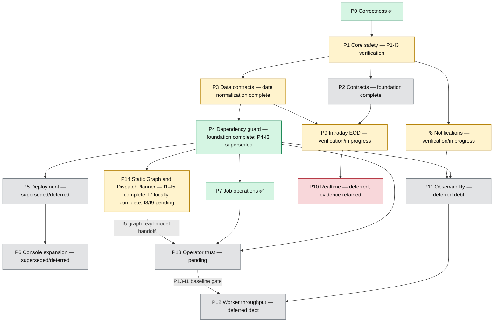

# Omni Roadmap Diagram

Current P14 status (2026-10-30): **I8 verification_pending; I9 in_progress**.
I9.a adds read-only graph/atomic planning; it does not acquire or dispatch work.
Common preparation now persists atomic dated work and sends the additive
`jobType`/`businessDate`/`parameters`/`atomicWorkId` envelope. V16 protects accepted
snapshots; matching Java/Python rollout is required even on the legacy scheduler.
Consumers preserve other dates and retain lookback; catalog/metadata are current
snapshots only. Writer and shared ancestors remain deferred. EOD-to-indicator
execution binding is implemented; broader version/concurrency guarantees remain
deferred.
The original I8 delivery ran no checks; later verification and repair evidence
is recorded in Plan 030. This supersedes earlier design-only I8/I9 statements.
See [contract, impact matrix and local handoff](../030-static-graph-dispatch-planner.md#i8-source-delivery-and-local-verification-handoff--2026-10-29).

The current P14 continuation is I7 completed -> I8 unified expansion pending ->
I9 graph composition/shared ancestors/definition consolidation pending. I9.a/b/c
are internal gates. This adds no dependency to P13/P12 and changes no runtime flag.
See [registry](implementation-increments.md#increment-registry) and
[handoff](../030-static-graph-dispatch-planner.md#current-i8i9-handoff--2026-10-29).

Current I7 checkpoint — 2026-10-28: isolated local verification against c20d9cb
completed under `P14-I7-reverify-20261028`. V15 and strict-work identity changes
are separate from future expansion plans and worker/readiness follow-ups. The verified commit keeps I5/I6
separate; later consolidation remains outside that commit. Preparation and cron behavior are unchanged. Retained deployment
requires the [V15 cutover procedure](../../deployment/004-job-run-admission-rollout.md#v15-legacy-outbox-identity-cutover-p14-i7).

This diagram is a navigational view of roadmap phases and selected cross-phase dependencies. Canonical story status, dependencies, ownership, and execution eligibility remain in the [increment registry](implementation-increments.md). The [roadmap index](README.md) owns milestone and epic navigation.

Color describes evidence state, not urgency. P14-I7 legacy outbox cleanup depends on I4/I5; I6 is not its prerequisite and no operator-trust dependency is added.

## Reading the Diagram

- P14 is the active [Static Graph & DispatchPlanner epic](../030-static-graph-dispatch-planner.md); I1–I3 are completed after [the 2026-10-24 acceptance reconciliation](../030-static-graph-dispatch-planner.md#i2i3-completion-and-remaining-p14-work--2026-10-24). I4 is completed on its integrated local gate; I5 is locally completed; I7 is locally completed; former I6 is merged into I5 with recorded scope/rollout boundaries. Preparation remains false and all 32 cron identities remain; the planner is integrated but no new JobRun preparation or retained rollout is activated.
- The P14 → P13 edge includes the P13-I1 dependency on completed I4/P7-I3. Basic operations do not wait for I5; graph-specific JobRun presentation consumes their evidence and handoff.
- P10, P11, and P12 retain historical status/evidence but remain owner-gated deferred work.
- Diagram edges summarize planning relationships and never replace exact `depends_on` metadata in the increment registry.
